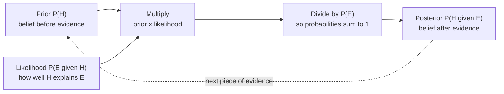

A test for a rare disease is 95% accurate. You test positive. How likely is it that you have the disease? Most people, including many doctors in published surveys, answer "about 95%". The real answer, for a disease affecting 1 in 100 people, is about 16%. Bayes' theorem is the rule that gets this right. It tells you how to update a belief when new evidence arrives, and it sits underneath spam filters, medical AI, fraud detection, and the way every classifier's output depends on how common each class is. This lesson builds on [conditional probability](/learn/probability-and-statistics/conditional-probability); if $P(A \mid B)$ is unfamiliar, read that first.

## From one conditional to the other

In the previous lesson you saw that $P(A \mid B)$ and $P(B \mid A)$ are different numbers. Often you know one and need the other. A test manufacturer can measure $P(\text{positive} \mid \text{disease})$ by testing people known to be ill, but a patient wants $P(\text{disease} \mid \text{positive})$. A spam filter can count how often "free" appears in known spam, but it needs the probability an email is spam given that it contains "free".

The multiplication rule gives the bridge. Both of these are equal to $P(A \cap B)$:

$$
P(A \mid B)\, P(B) = P(B \mid A)\, P(A)
$$

Divide both sides by $P(B)$ and you have **Bayes' theorem**:

$$
P(H \mid E) = \frac{P(E \mid H)\, P(H)}{P(E)}
$$

The events are renamed $H$ for **hypothesis** (what you want to know, such as "has the disease" or "is spam") and $E$ for **evidence** (what you observed, such as "tested positive" or "contains the word free"). Each piece has a name:

| Term | Symbol | Meaning |
| --- | --- | --- |
| Prior | $P(H)$ | How probable the hypothesis was before seeing the evidence |
| Likelihood | $P(E \mid H)$ | How probable the evidence is if the hypothesis is true |
| Evidence | $P(E)$ | How probable the evidence is overall |
| Posterior | $P(H \mid E)$ | How probable the hypothesis is after seeing the evidence |

The evidence term is usually computed with the [law of total probability](/learn/probability-and-statistics/conditional-probability), splitting into "hypothesis true" and "hypothesis false" (written $\neg H$):

$$
P(E) = P(E \mid H)\, P(H) + P(E \mid \neg H)\, P(\neg H)
$$



## Worked example: a medical test

Take a disease that affects 1% of the population. A test for it has:

- **Sensitivity** 95%: $P(\text{positive} \mid \text{disease}) = 0.95$
- **False positive rate** 5%: $P(\text{positive} \mid \text{healthy}) = 0.05$ (so its specificity, $P(\text{negative} \mid \text{healthy})$, is 95%)

Plug the numbers into Bayes' theorem:

$$
P(\text{disease} \mid +) = \frac{0.95 \times 0.01}{0.95 \times 0.01 + 0.05 \times 0.99} = \frac{0.0095}{0.0095 + 0.0495} = \frac{0.0095}{0.059} \approx 0.161
$$

A positive result raises the probability from 1% to about 16%. That is a big increase, but most people who test positive are still healthy.

### Natural frequencies make it obvious

The same calculation is much easier to see with counts. Imagine 10,000 people:

| | Test positive | Test negative | Total |
| --- | --- | --- | --- |
| Have the disease | 95 | 5 | 100 |
| Healthy | 495 | 9,405 | 9,900 |
| Total | 590 | 9,410 | 10,000 |

Of the 590 positive results, only 95 are real cases: $95 / 590 \approx 0.161$. The healthy group is 99 times larger than the sick group, so even a small false positive rate applied to it produces five times more false alarms than true detections.

> [!KEY]
> The posterior depends heavily on the **prior**, the base rate. Ignoring it is the **base rate fallacy**. A good test for a rare condition still produces mostly false positives, and the rarer the condition, the worse it gets.

### Checking by simulation

```python
import random

random.seed(0)
people = 1_000_000
positives = 0
sick_and_positive = 0
for _ in range(people):
    sick = random.random() < 0.01
    p_positive = 0.95 if sick else 0.05
    if random.random() < p_positive:
        positives += 1
        sick_and_positive += sick
print(positives, sick_and_positive, round(sick_and_positive / positives, 3))
```

```output
58843 9502 0.161
```

The simulation simply generates people, tests them, and counts. It agrees with the formula. (`sick_and_positive += sick` adds 1 when `sick` is `True`, because `True` counts as 1.)

## Updating repeatedly

Bayes' theorem chains naturally: today's posterior becomes tomorrow's prior. If the patient takes a second, independent test and it is also positive, start from 16.1% instead of 1%.

```trace
{
  "title": "updating belief after each positive test",
  "code": [
    "def posterior(prior, sensitivity, fpr):",
    "    p_pos_and_sick = sensitivity * prior",
    "    p_pos_and_healthy = fpr * (1 - prior)",
    "    return p_pos_and_sick / (p_pos_and_sick + p_pos_and_healthy)",
    "",
    "belief = 0.01",
    "for test in range(1, 4):",
    "    belief = posterior(belief, 0.95, 0.05)",
    "    print(test, round(belief, 3))"
  ],
  "steps": [
    { "line": 6, "vars": { "belief": "0.01" }, "note": "Before any test, the belief is the base rate: 1%." },
    { "line": 8, "vars": { "belief": "0.161", "test": "1" }, "note": "0.95 x 0.01 = 0.0095 against 0.05 x 0.99 = 0.0495. Posterior = 0.0095 / 0.059." },
    { "line": 9, "vars": { "belief": "0.161", "test": "1" }, "out": ["1 0.161"], "note": "After one positive test the belief is about 16%." },
    { "line": 8, "vars": { "belief": "0.785", "test": "2" }, "note": "The old posterior is the new prior. 0.95 x 0.161 = 0.153 against 0.05 x 0.839 = 0.042." },
    { "line": 9, "vars": { "belief": "0.785", "test": "2" }, "out": ["1 0.161", "2 0.785"], "note": "A second positive result makes the disease more likely than not." },
    { "line": 9, "vars": { "belief": "0.986", "test": "3" }, "out": ["1 0.161", "2 0.785", "3 0.986"], "note": "A third positive result makes it nearly certain. Each update multiplies the odds by the same factor, 0.95 / 0.05 = 19." }
  ]
}
```

This assumes the tests' errors are independent given the patient's true state. Repeating the same flawed test on the same sample would not give independent evidence.

## Bayes in a spam filter

Now the same reasoning for email. Suppose, from a labelled training set:

- 20% of emails are spam: $P(\text{spam}) = 0.2$
- "free" appears in 30% of spam: $P(\text{free} \mid \text{spam}) = 0.30$
- "free" appears in 2% of ham: $P(\text{free} \mid \text{ham}) = 0.02$

Then

$$
P(\text{spam} \mid \text{free}) = \frac{0.30 \times 0.2}{0.30 \times 0.2 + 0.02 \times 0.8} = \frac{0.06}{0.076} \approx 0.789
$$

The **class prior**, $P(\text{spam})$, matters as much here as in the medical test:

```python
def p_spam_given_word(prior_spam, p_word_given_spam, p_word_given_ham):
    numerator = p_word_given_spam * prior_spam
    evidence = numerator + p_word_given_ham * (1 - prior_spam)
    return numerator / evidence

for prior in [0.5, 0.2, 0.01]:
    print(prior, round(p_spam_given_word(prior, 0.30, 0.02), 3))
```

```output
0.5 0.938
0.2 0.789
0.01 0.132
```

The same word is strong evidence in an inbox where half the mail is spam, and weak evidence in one where spam is rare.

> [!WARNING]
> Every trained classifier absorbs the class priors of its training data, whether or not it uses Bayes' theorem explicitly. If you train on a balanced dataset (50% fraud, 50% legitimate) and deploy where fraud is 0.1%, the model's probabilities will be far too high. Either retrain on realistic proportions or adjust the outputs for the new prior.

### A tiny Naive Bayes classifier

With many words, the likelihood is $P(w_1, w_2, \dots, w_n \mid \text{spam})$, which you could never estimate directly. **Naive Bayes** makes the simplifying assumption that words are conditionally independent given the class, so the likelihood becomes a product of per-word probabilities $P(w_i \mid \text{class})$:

$$
P(\text{class} \mid w_1, \dots, w_n) \propto P(\text{class}) \prod_{i=1}^{n} P(w_i \mid \text{class})
$$

$\propto$ means "proportional to": we skip dividing by $P(E)$ and instead normalise the scores at the end so they sum to 1. $\prod$ means "multiply the terms". In code we add logarithms instead of multiplying, because the product of many small probabilities underflows to zero.

```python
import math
from collections import Counter

train = [
    ("win free money now", "spam"),
    ("free prize claim now", "spam"),
    ("cheap meds free shipping", "spam"),
    ("meeting moved to friday", "ham"),
    ("lunch on friday", "ham"),
    ("project notes and meeting agenda", "ham"),
    ("can you review my notes", "ham"),
]

labels = Counter(label for _, label in train)
word_counts = {"spam": Counter(), "ham": Counter()}
for text, label in train:
    word_counts[label].update(text.split())
vocab = {w for c in word_counts.values() for w in c}

def log_score(text, label):
    score = math.log(labels[label] / len(train))            # log prior
    total = sum(word_counts[label].values())
    for word in text.split():
        count = word_counts[label][word] + 1                # Laplace smoothing
        score += math.log(count / (total + len(vocab)))     # log likelihood
    return score

def classify(text):
    scores = {label: log_score(text, label) for label in labels}
    biggest = max(scores.values())
    exp = {k: math.exp(v - biggest) for k, v in scores.items()}
    z = sum(exp.values())
    return {k: round(v / z, 3) for k, v in exp.items()}

print(classify("free money"))
print(classify("notes for the meeting"))
```

```output
{'spam': 0.887, 'ham': 0.113}
{'spam': 0.124, 'ham': 0.876}
```

**Laplace smoothing** adds 1 to every word count, so a word never seen with a class gets a small probability instead of zero; otherwise a single unseen word would make the whole product zero. Despite its "naive" assumption, this kind of classifier was the basis of early practical spam filters and remains a fast, strong baseline for text. scikit-learn provides it as `MultinomialNB`.

## Exercises

**1.** Repeat the medical calculation for a disease with prevalence 10% and the same test. How does the posterior change?

<details>
<summary>Show solution</summary>

$$
\frac{0.95 \times 0.10}{0.95 \times 0.10 + 0.05 \times 0.90} = \frac{0.095}{0.140} \approx 0.679
$$

With a higher base rate, a positive result is far more convincing: about 68% instead of 16%.

</details>

**2.** A fraud model flags 2% of legitimate transactions and catches 90% of fraud. Fraud makes up 0.2% of transactions. Using natural frequencies for 100,000 transactions, what fraction of flagged transactions are fraud?

<details>
<summary>Show solution</summary>

Fraud: 200 transactions, of which 180 are flagged. Legitimate: 99,800, of which 1,996 are flagged. Precision is $180 / (180 + 1996) \approx 0.083$. Only about 8% of flags are real fraud, which is why such systems usually send flags to human review rather than blocking automatically.

</details>

**3.** In the Naive Bayes code, what happens if you remove the `+ 1` smoothing and classify `"free meeting"`?

<details>
<summary>Show solution</summary>

"free" never appears in ham and "meeting" never appears in spam, so both classes get a zero count for one of the words. `math.log(0)` raises `ValueError: math domain error`. Without smoothing, one unseen word vetoes a class entirely, however strong the other evidence.

</details>

```quiz
[
  {
    "q": "In Bayes' theorem, what is the prior?",
    "options": ["The probability of the evidence given the hypothesis", "The probability of the hypothesis before seeing the evidence", "The probability of the hypothesis after seeing the evidence", "The probability of the evidence overall"],
    "answer": 1,
    "why": "The prior P(H) is the belief before the evidence. P(E | H) is the likelihood and P(H | E) is the posterior."
  },
  {
    "q": "A test has 99% sensitivity and a 1% false positive rate. The condition affects 1 in 10,000 people. A random person tests positive. Roughly how likely are they to have it?",
    "options": ["About 99%", "About 50%", "About 1%", "About 0.01%"],
    "answer": 2,
    "why": "Per million people: 100 are ill and 99 test positive; 999,900 are healthy and about 9,999 test positive. 99 / (99 + 9,999) is about 1%."
  },
  {
    "q": "Why does Naive Bayes add log probabilities rather than multiplying probabilities?",
    "options": ["Logs make the classifier more accurate", "Multiplying many small probabilities underflows to zero in floating point", "Bayes' theorem requires logarithms", "Logs remove the need for a prior"],
    "answer": 1,
    "why": "The product of hundreds of probabilities below 1 quickly becomes too small to represent. The log of a product is a sum of logs, which is numerically stable and ranks classes identically."
  },
  {
    "q": "A fraud classifier was trained on a dataset balanced 50/50 but deployed where fraud is 0.5% of traffic. What should you expect?",
    "options": ["Its fraud probabilities will be too high", "Its fraud probabilities will be too low", "Nothing changes because the likelihoods are the same", "It will refuse to predict"],
    "answer": 0,
    "why": "The model has learned a prior of 50% fraud. With the real prior of 0.5%, the true posterior for any input is much lower than the model reports."
  }
]
```
