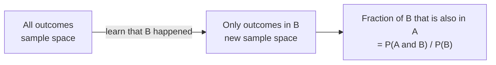
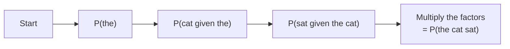

Probabilities change when you learn something. The chance that a random email is spam might be 20%, but the chance that an email is spam *given that it contains the phrase "claim your prize"* is far higher. Almost everything a machine learning model outputs is a probability of this kind: the probability of a label given the input features, the probability of the next token given the text so far. This idea, **conditional probability**, is what turns raw probability into something you can learn from data, and it is the foundation for [Bayes' theorem](/learn/probability-and-statistics/bayes-theorem) in the next lesson.

## Narrowing the world

The conditional probability of $A$ given $B$, written $P(A \mid B)$, is the probability that $A$ happens once you know $B$ has happened. The vertical bar is read "given".

The intuition: knowing $B$ happened shrinks the world. Every outcome outside $B$ is ruled out, so $B$ becomes the new sample space. Within that smaller world, you ask what fraction of it also belongs to $A$.

$$
P(A \mid B) = \frac{P(A \cap B)}{P(B)}, \quad \text{provided } P(B) > 0
$$

Here $P(A \cap B)$ is the probability that both $A$ and $B$ happen, and $P(B)$ is the probability of the condition. Dividing by $P(B)$ rescales the shrunken world so its probabilities again sum to 1.



A dice example makes this concrete. The probability that two dice sum to 8 is 5/36, about 0.139. But if you already know the first die shows 3, only a second die of 5 works, so the probability becomes 1/6. A simulation shows conditioning as nothing more than filtering:

```python
import random

random.seed(3)
rolls = [(random.randint(1, 6), random.randint(1, 6)) for _ in range(200_000)]

sum_is_8 = [r for r in rolls if r[0] + r[1] == 8]
first_is_3 = [r for r in rolls if r[0] == 3]
both = [r for r in first_is_3 if r[0] + r[1] == 8]

print(round(len(sum_is_8) / len(rolls), 4))      # P(sum = 8)
print(round(len(both) / len(first_is_3), 4))     # P(sum = 8 | first = 3)
```

```output
0.1374
0.166
```

> [!KEY]
> Conditioning is filtering. To estimate $P(A \mid B)$ from data, keep only the rows where $B$ is true, then measure how often $A$ is true among them. This is exactly what a pandas filter followed by a mean does, and it is how many simple models are trained.

## Order matters: P(A | B) is not P(B | A)

The two conditional probabilities $P(A \mid B)$ and $P(B \mid A)$ usually differ, sometimes enormously. Most people know that $P(\text{wet ground} \mid \text{rain})$ is close to 1, while $P(\text{rain} \mid \text{wet ground})$ is lower, because sprinklers exist. Confusing the two is so common it has a name, the **confusion of the inverse**, and it is behind many misread medical tests and court cases.

Here it is with a spam filter. You run it on 1,000 emails and tally the results:

| | Flagged | Not flagged | Total |
| --- | --- | --- | --- |
| Spam | 180 | 20 | 200 |
| Ham (not spam) | 40 | 760 | 800 |
| Total | 220 | 780 | 1,000 |

A table like this, counting two variables against each other, is a **contingency table**. In machine learning, when one variable is the true label and the other is the prediction, it is called a **confusion matrix**.

```python
# 1,000 emails, tallied by true label and by whether the filter flagged them
counts = {
    ("spam", "flagged"): 180,
    ("spam", "not flagged"): 20,
    ("ham", "flagged"): 40,
    ("ham", "not flagged"): 760,
}
total = sum(counts.values())

spam = counts[("spam", "flagged")] + counts[("spam", "not flagged")]
flagged = counts[("spam", "flagged")] + counts[("ham", "flagged")]
both = counts[("spam", "flagged")]

print("P(spam)            =", spam / total)
print("P(flagged)         =", flagged / total)
print("P(spam | flagged)  =", round(both / flagged, 3))
print("P(flagged | spam)  =", both / spam)
```

```output
P(spam)            = 0.2
P(flagged)         = 0.22
P(spam | flagged)  = 0.818
P(flagged | spam)  = 0.9
```

These two numbers have names you will use constantly in model evaluation:

| Quantity | Name | Question it answers |
| --- | --- | --- |
| $P(\text{flagged} \mid \text{spam})$ | **Recall** (sensitivity) | Of the real spam, how much did we catch? |
| $P(\text{spam} \mid \text{flagged})$ | **Precision** | Of what we flagged, how much was really spam? |

The filter catches 90% of spam, but only 81.8% of flagged emails are actually spam. Both are conditional probabilities of the same two events, conditioned in opposite directions.

## The multiplication rule

Rearranging the definition gives a way to compute the probability of both events:

$$
P(A \cap B) = P(A \mid B)\, P(B) = P(B \mid A)\, P(A)
$$

This generalises to a chain of events, the **chain rule of probability**:

$$
P(A_1 \cap A_2 \cap A_3) = P(A_1)\, P(A_2 \mid A_1)\, P(A_3 \mid A_1 \cap A_2)
$$

Each factor is the probability of the next event given everything before it.

This is precisely how a language model scores a sentence. If $w_1, w_2, w_3$ are the tokens of "the cat sat", the model's probability for the whole sequence is

$$
P(w_1, w_2, w_3) = P(w_1)\, P(w_2 \mid w_1)\, P(w_3 \mid w_1, w_2)
$$

A model such as GPT is trained to output exactly these conditional probabilities: given the tokens so far, a probability for every possible next token. Generation is repeated sampling from $P(\text{next token} \mid \text{context})$.



## The law of total probability

Sometimes $P(A)$ is hard to find directly but easy to find within each of several separate cases. If $B_1, B_2, \dots, B_k$ split the sample space into non-overlapping pieces that cover everything (a **partition**), then

$$
P(A) = \sum_{j=1}^{k} P(A \mid B_j)\, P(B_j)
$$

Each term is "the chance of being in case $j$" times "the chance of $A$ within case $j$".

Suppose a scraped training corpus comes from three sources in known proportions, each with a different rate of toxic text:

```python
p_source = {"forum": 0.5, "news": 0.3, "spam_farm": 0.2}
p_toxic_given_source = {"forum": 0.08, "news": 0.01, "spam_farm": 0.30}

p_toxic = sum(p_source[s] * p_toxic_given_source[s] for s in p_source)
print(round(p_toxic, 3))
```

```output
0.103
```

About 10.3% of the corpus is toxic overall, and the breakdown shows that the spam-farm source, only a fifth of the data, contributes more than half of it (0.06 out of 0.103). That kind of reasoning tells you where data cleaning effort pays off.

## Independence, precisely

Two events are **independent** when learning one does not change the probability of the other:

$$
P(A \mid B) = P(A), \quad \text{equivalently} \quad P(A \cap B) = P(A)\, P(B)
$$

In the spam table, $P(\text{spam}) = 0.2$ but $P(\text{spam} \mid \text{flagged}) = 0.818$. Learning the email was flagged changes the probability a lot, so the events are strongly dependent, which is exactly what you want from a filter. A filter whose flags were independent of the true label would be useless.

> [!NOTE]
> Events can also be **conditionally independent**: independent once you know some third event. Two words in an email may be correlated overall, but roughly independent once you know whether the email is spam. The Naive Bayes classifier assumes exactly this, as you will see in the next lesson.

## Pitfalls

- **Swapping the condition.** Always ask which event is behind the bar. "90% of spam gets flagged" and "90% of flagged mail is spam" are different claims.
- **Conditioning on a tiny group.** $P(A \mid B)$ estimated from five rows where $B$ is true is very noisy. Check how many examples your conditional estimate rests on.
- **Ignoring the base rate.** A large $P(\text{flagged} \mid \text{spam})$ says nothing about $P(\text{spam} \mid \text{flagged})$ until you know how common spam is. Bayes' theorem makes that connection exact.

## Exercises

**1.** Using the spam table, compute $P(\text{flagged} \mid \text{ham})$, the false positive rate. What fraction of legitimate emails end up in the spam folder?

<details>
<summary>Show solution</summary>

Filter to the 800 ham emails: 40 were flagged. $P(\text{flagged} \mid \text{ham}) = 40 / 800 = 0.05$, so 5% of legitimate mail is wrongly sent to spam.

</details>

**2.** Using the multiplication rule and the spam table, check whether "spam" and "flagged" would be independent: compare $P(\text{spam}) \times P(\text{flagged})$ with $P(\text{spam} \cap \text{flagged})$.

<details>
<summary>Show solution</summary>

```python
p_spam = 200 / 1000
p_flagged = 220 / 1000
p_both = 180 / 1000
print(round(p_spam * p_flagged, 3), p_both)
```

```output
0.044 0.18
```

If the events were independent, both numbers would be equal. The joint probability, 0.18, is about four times the product, so the events are strongly dependent.

</details>

**3.** A model is deployed to two regions. Region A sends 70% of traffic and the model's error rate there is 2%. Region B sends 30% with an error rate of 10%. What is the overall error rate?

<details>
<summary>Show solution</summary>

By the law of total probability: $0.7 \times 0.02 + 0.3 \times 0.10 = 0.014 + 0.030 = 0.044$, an overall error rate of 4.4%. Region B produces over two thirds of the errors despite sending under a third of the traffic.

</details>

```quiz
[
  {
    "q": "P(A and B) = 0.12 and P(B) = 0.4. What is P(A | B)?",
    "options": ["0.048", "0.3", "0.52", "0.12"],
    "answer": 1,
    "why": "P(A | B) = P(A and B) / P(B) = 0.12 / 0.4 = 0.3."
  },
  {
    "q": "In classification terms, what is P(predicted positive | actually positive)?",
    "options": ["Precision", "Accuracy", "Recall", "Prevalence"],
    "answer": 2,
    "why": "Recall conditions on the true label: of all real positives, what fraction did the model predict as positive. Precision conditions the other way."
  },
  {
    "q": "How does a language model assign a probability to a whole sentence?",
    "options": ["It adds the probability of each token", "It multiplies the conditional probability of each token given the tokens before it", "It takes the probability of the most likely token", "It averages the token probabilities"],
    "answer": 1,
    "why": "By the chain rule, P(w1, ..., wn) = P(w1) P(w2 | w1) ... P(wn | w1, ..., wn-1)."
  },
  {
    "q": "Events A and B are independent. Which statement must be true?",
    "options": ["P(A | B) = P(A)", "P(A | B) = P(B | A)", "P(A and B) = 0", "P(A) + P(B) = 1"],
    "answer": 0,
    "why": "Independence means learning B does not change the probability of A. Mutually exclusive events (P(A and B) = 0) are in fact strongly dependent."
  }
]
```
