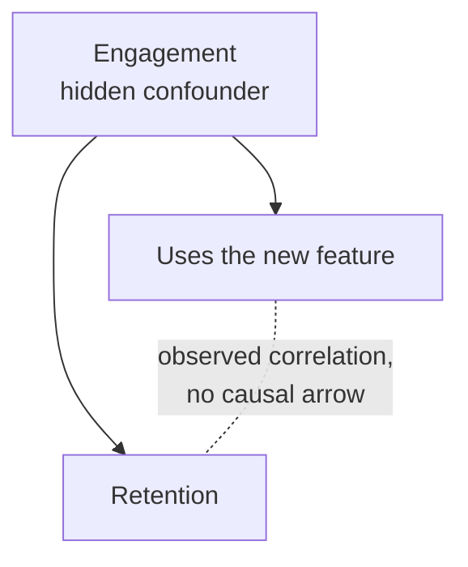

When you explore a dataset before building a model, one of the first questions is which variables move together. Do larger houses sell for more? Does prompt length relate to response latency? Are two of your features so similar that one is redundant? **Covariance** and **correlation** measure how two variables vary together. They are the workhorses of feature analysis, the basis of principal component analysis, and the source of one of the most expensive mistakes in data work: treating "these move together" as "this causes that".

## Moving together

Picture a scatter plot of two variables. If points in the upper right and lower left dominate, the variables tend to be high together and low together: a **positive** relationship. If points in the upper left and lower right dominate, one rises as the other falls: a **negative** relationship. A shapeless cloud suggests no linear relationship.

Covariance turns that picture into a number. For each point, measure how far $x$ is from its mean and how far $y$ is from its mean, and multiply. If both are above average or both below, the product is positive; if one is above and the other below, it is negative. Average the products:

$$
\text{cov}(x, y) = \frac{1}{n - 1} \sum_{i=1}^{n} (x_i - \bar{x})(y_i - \bar{y})
$$

Here $n$ is the number of paired observations $(x_i, y_i)$, and $\bar{x}$ and $\bar{y}$ are the two sample means. The divisor $n - 1$ is the sample version, for the same reason as in [variance](/learn/probability-and-statistics/variance-and-standard-deviation). In fact, the covariance of a variable with itself is its variance.

```trace
{
  "title": "covariance step by step",
  "code": [
    "x = [1, 2, 3]",
    "y = [2, 4, 9]",
    "mx = sum(x) / len(x)",
    "my = sum(y) / len(y)",
    "total = 0",
    "for xi, yi in zip(x, y):",
    "    total += (xi - mx) * (yi - my)",
    "print(total / (len(x) - 1))"
  ],
  "steps": [
    { "line": 4, "vars": { "mx": "2.0", "my": "5.0" }, "note": "First find both means." },
    { "line": 7, "vars": { "mx": "2.0", "my": "5.0", "xi": "1", "yi": "2", "total": "3.0" }, "note": "Both below their means: (-1) x (-3) = 3. Positive, as both are low together." },
    { "line": 7, "vars": { "mx": "2.0", "my": "5.0", "xi": "2", "yi": "4", "total": "3.0" }, "note": "x sits exactly on its mean, so this point adds 0 x (-1) = 0." },
    { "line": 7, "vars": { "mx": "2.0", "my": "5.0", "xi": "3", "yi": "9", "total": "7.0" }, "note": "Both above their means: 1 x 4 = 4. Positive again." },
    { "line": 8, "vars": { "mx": "2.0", "my": "5.0", "total": "7.0" }, "out": ["3.5"], "note": "Divide by n - 1 = 2. A positive covariance: x and y rise together." }
  ]
}
```

### The problem with covariance

Covariance has units (here, "x units times y units"), and its size depends on the scale of the data:

```python
import statistics

hours_studied = [2, 4, 6, 8, 10]
exam_score = [55, 62, 70, 75, 88]

print(statistics.covariance(hours_studied, exam_score))
print(round(statistics.correlation(hours_studied, exam_score), 4))

minutes_studied = [h * 60 for h in hours_studied]
print(statistics.covariance(minutes_studied, exam_score))
print(round(statistics.correlation(minutes_studied, exam_score), 4))
```

```output
39.5
0.989
2370.0
0.989
```

Measuring study time in minutes instead of hours multiplied the covariance by 60, though nothing about the relationship changed. The sign of the covariance is meaningful; its size on its own is not.

## Correlation: covariance on a common scale

The **Pearson correlation coefficient** fixes this by dividing by both standard deviations:

$$
r = \frac{\text{cov}(x, y)}{s_x \, s_y}
$$

where $s_x$ and $s_y$ are the sample standard deviations of $x$ and $y$. Equivalently, $r$ is the covariance of the two variables after each has been standardised to z-scores. The result is unit-free and always between -1 and 1, so it was unchanged at 0.989 when hours became minutes.

| $r$ | Interpretation |
| --- | --- |
| 1 | Perfect positive straight-line relationship |
| around 0.7 | Strong positive linear trend with scatter |
| around 0 | No **linear** relationship |
| around -0.7 | Strong negative linear trend |
| -1 | Perfect negative straight-line relationship |

$r^2$, the square of the correlation, is the fraction of the variance in $y$ that a straight line through $x$ can explain. You will meet it again as the $R^2$ score of linear regression.

## Correlation only sees straight lines

Pearson correlation measures *linear* association. A perfect but curved relationship can score zero:

```python
import statistics

x = [-3, -2, -1, 0, 1, 2, 3]
y = [v ** 2 for v in x]
print(y)
print(round(statistics.correlation(x, y), 4))
```

```output
[9, 4, 1, 0, 1, 4, 9]
0.0
```

$y$ is completely determined by $x$, yet $r = 0$, because the left half slopes down and the right half slopes up and the two cancel. Zero correlation does not mean independence.

It is also sensitive to outliers, because it is built from squared-scale deviations. A single extreme point can manufacture a correlation from nothing. **Spearman's rank correlation** computes Pearson's $r$ on the ranks of the values instead of the values themselves, which makes it robust to outliers and able to detect any monotonic (consistently increasing or decreasing) relationship. In `statistics.correlation` it is `method="ranked"` (Python 3.12 and later); in SciPy, `stats.spearmanr`.

```python
import statistics

x = [1, 2, 3, 4, 5, 6, 7, 8, 9]
y = [5, 3, 8, 1, 7, 2, 9, 4, 6]          # no real relationship
print(round(statistics.correlation(x, y), 3))

x_out, y_out = x + [60], y + [60]         # add one extreme point
print(round(statistics.correlation(x_out, y_out), 3))
print(round(statistics.correlation(x_out, y_out, method="ranked"), 3))
```

```output
0.167
0.982
0.394
```

One point pushed Pearson's $r$ from 0.17 to 0.98. Spearman's is far less impressed. Always plot the data; a single number can hide almost anything.

## Correlation matrices in feature analysis

With many features, you compute every pairwise correlation at once. NumPy's `np.corrcoef` returns a **correlation matrix**, where entry $(i, j)$ is the correlation between feature $i$ and feature $j$ ([Module 7](/learn/numpy/arrays-and-dimensions) covers NumPy itself):

```python
import numpy as np

rng = np.random.default_rng(0)
size_m2 = rng.uniform(40, 200, 300)
rooms = np.round(size_m2 / 25 + rng.normal(0, 0.7, 300))
age_years = rng.uniform(0, 80, 300)
price = 3000 * size_m2 - 400 * age_years + rng.normal(0, 40_000, 300)

X = np.column_stack([size_m2, rooms, age_years, price])
print(np.corrcoef(X, rowvar=False).round(2))
```

```output
[[ 1.    0.93  0.03  0.96]
 [ 0.93  1.    0.02  0.9 ]
 [ 0.03  0.02  1.   -0.03]
 [ 0.96  0.9  -0.03  1.  ]]
```

`rowvar=False` says each column is a variable. Reading the matrix:

- The diagonal is always 1: every variable correlates perfectly with itself, and the matrix is symmetric.
- Size and rooms correlate at 0.93. Features this strongly correlated are **multicollinear**: they carry largely the same information, which can make the coefficients of linear models unstable and hard to interpret.
- Age shows almost no correlation with price, even though the simulation built a real effect into price. Its effect is small next to the noise and the influence of size. A weak correlation on its own does not prove a feature is useless.

The **covariance matrix**, from `np.cov`, holds covariances instead. It describes the shape of a cloud of data points in many dimensions, and its [eigenvectors](/learn/linear-algebra/eigenvalues-and-eigenvectors) point along the directions of greatest spread. That is exactly what principal component analysis computes, as you will see in the Unsupervised Learning module.

## Correlation is not causation

This is the most important idea in the lesson. Suppose product analytics finds that users who tried a new AI feature stay subscribed much longer. Should every user be pushed towards it? The simulation below builds in a hidden **confounder**, how engaged each user is, which drives both feature use and retention. The feature itself has no effect at all.



```python
import random
import statistics

random.seed(2)
engagement, used_feature, retained_days = [], [], []
for _ in range(5000):
    e = random.random()                                  # hidden: how engaged the user is
    engagement.append(e)
    used_feature.append(1 if random.random() < e else 0) # engaged users try more features
    retained_days.append(30 * e + random.gauss(0, 3))    # engaged users stay longer
    # note: the feature itself has no effect on retention

print(round(statistics.correlation(used_feature, retained_days), 3))

# compare like with like: only users with similar engagement
band = [i for i, e in enumerate(engagement) if 0.45 < e < 0.55]
print(len(band), round(statistics.correlation(
    [used_feature[i] for i in band], [retained_days[i] for i in band]), 3))
```

```output
0.55
527 0.031
```

Overall, feature use and retention correlate at 0.55. Among users with similar engagement, the correlation all but vanishes. Pushing the feature on everyone would change nothing.

> [!WARNING]
> A correlation between $X$ and $Y$ can arise because $X$ causes $Y$, $Y$ causes $X$, a third factor causes both, the data was selected in a biased way, or by pure chance. Only a **randomised experiment**, such as an A/B test where the feature is assigned at random, reliably separates these. When experiments are impossible, the field of causal inference offers careful methods, but never assume causation from a correlation table.

The same trap matters for models. A model learns correlations, not causes. An image classifier that learns "snow in the background means wolf" because most training wolves were photographed in snow will fail on a wolf on grass. Such **spurious correlations** are a major source of models that score well in testing and fail in the real world.

> [!KEY]
> Covariance tells you the direction of a linear relationship; correlation tells you its direction and strength on a fixed -1 to 1 scale. Neither tells you about curved relationships, and neither tells you about cause.

## Exercises

**1.** Without code: if $r = 0.8$ between ad spend and sales, what fraction of the variance in sales is explained by a straight-line relationship with ad spend? Does ad spend cause sales?

<details>
<summary>Show solution</summary>

$r^2 = 0.64$, so about 64%. The correlation alone cannot establish causation: perhaps the company spends more on ads in seasons when sales would be high anyway. A randomised experiment would be needed.

</details>

**2.** Compute the Pearson and Spearman correlations of `x = [1, 2, 3, 4, 5]` and `y = [1, 8, 27, 64, 125]` (cubes). Explain why Spearman gives exactly 1.

<details>
<summary>Show solution</summary>

```python
import statistics

x = [1, 2, 3, 4, 5]
y = [v ** 3 for v in x]
print(round(statistics.correlation(x, y), 4))
print(statistics.correlation(x, y, method="ranked"))
```

```output
0.9431
1.0
```

The relationship is perfectly monotonic but curved. Pearson measures how close it is to a straight line (close, but not exact). Spearman works on ranks, which are 1 to 5 for both, so it is exactly 1.

</details>

```quiz
[
  {
    "q": "You convert a feature from metres to centimetres. What happens to its covariance and its correlation with another feature?",
    "options": ["Both stay the same", "Covariance is multiplied by 100; correlation is unchanged", "Covariance is unchanged; correlation is multiplied by 100", "Both are multiplied by 100"],
    "answer": 1,
    "why": "Covariance carries the units of both variables. Correlation divides by both standard deviations, which cancels any rescaling."
  },
  {
    "q": "Two variables have Pearson correlation 0. Which statement is justified?",
    "options": ["They are independent", "One cannot be predicted from the other", "There is no linear relationship between them", "Their covariance is undefined"],
    "answer": 2,
    "why": "Pearson's r only measures linear association. A strong curved relationship, such as y = x squared on symmetric data, can give r = 0."
  },
  {
    "q": "Users who enable notifications have higher retention. What is the most careful conclusion?",
    "options": ["Notifications cause retention, so enable them for everyone", "Retention causes users to enable notifications", "The two are associated; a confounder such as engagement may explain it, so test with a randomised experiment", "The data must be wrong"],
    "answer": 2,
    "why": "Correlation alone cannot separate causation from confounding or reverse causation. Randomly assigning notifications would reveal their actual effect."
  },
  {
    "q": "What is on the diagonal of a correlation matrix?",
    "options": ["The variances", "All ones", "All zeros", "The means"],
    "answer": 1,
    "why": "Every variable has a perfect correlation of 1 with itself. The diagonal of a covariance matrix, by contrast, holds the variances."
  }
]
```
