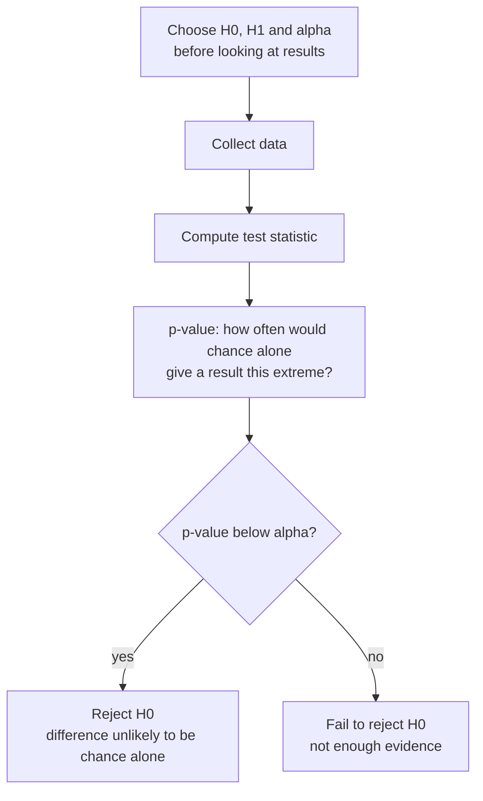

You change a prompt, swap in a new model version, or tweak a retrieval setting, and the success rate goes from 82.4% to 86.6%. Did you make things better, or did you get lucky with which users happened to arrive? As the [sampling](/learn/probability-and-statistics/sampling) lesson showed, every measured rate wobbles from sample to sample. **Hypothesis testing** is the standard procedure for deciding whether an observed difference is larger than that wobble can plausibly explain. It is how A/B tests of model versions are judged, and it is the backbone of every "the improvement is statistically significant" claim you will read in papers.

## The logic: assume nothing happened

A hypothesis test is a proof by contradiction with probabilities. You start by assuming the boring explanation, then check whether your data would be surprising under it.

| Term | Meaning | A/B test example |
| --- | --- | --- |
| Null hypothesis $H_0$ | The "nothing interesting" claim | Model B has the same success rate as model A |
| Alternative $H_1$ | What you suspect instead | The success rates differ |
| Test statistic | One number summarising the evidence against $H_0$ | The difference in success rates, or a z-score |
| p-value | Probability of a result at least this extreme **if $H_0$ were true** | 0.067 |
| Significance level $\alpha$ | The threshold you set in advance | 0.05 |

The decision rule: if the p-value is below $\alpha$, the data would be quite surprising under $H_0$, so you **reject** $H_0$. Otherwise you **fail to reject** it, which is not the same as proving it true; it means the data is not strong enough to rule it out.



## An A/B test of two model versions

Your product randomly routes each user to model A (the current version) or model B (the candidate). After 500 users each, you record whether each user's task succeeded: 412 successes for A (82.4%) and 433 for B (86.6%).

### A permutation test from scratch

The cleanest way to see what a p-value means is to simulate the null hypothesis directly. If the model made no difference, then the labels "A" and "B" are arbitrary: any user's outcome could equally have been recorded under either label. So shuffle all 1,000 outcomes, split them into two fake groups of 500, and see how often chance alone produces a gap as large as the one observed.

```python
import random

random.seed(0)
# per-user outcomes (1 = task succeeded), 500 users per model
model_a = [1] * 412 + [0] * 88      # 82.4% success
model_b = [1] * 433 + [0] * 67      # 86.6% success

observed = sum(model_b) - sum(model_a)          # 21 more successes
pooled = model_a + model_b

trials = 10_000
as_extreme = 0
for _ in range(trials):
    random.shuffle(pooled)                      # pretend labels A/B are arbitrary
    diff = sum(pooled[500:]) - sum(pooled[:500])
    if abs(diff) >= abs(observed):
        as_extreme += 1

print("observed difference:", observed / 500)
print("p-value:", as_extreme / trials)
```

```output
observed difference: 0.042
p-value: 0.0795
```

In about 8% of random relabellings, chance alone produced a gap of 4.2 points or more (in either direction, because of `abs`). At $\alpha = 0.05$ that is not convincing enough: you fail to reject $H_0$. Model B may well be better, but this experiment cannot tell.

### The same test with a formula

For comparing two proportions with large samples, the [central limit theorem](/learn/probability-and-statistics/normal-distribution) says each observed rate is approximately normal, which gives the **two-proportion z-test**. Under $H_0$ both groups share one success rate, estimated by pooling:

$$
\hat{p} = \frac{x_A + x_B}{n_A + n_B}, \qquad z = \frac{\hat{p}_B - \hat{p}_A}{\sqrt{\hat{p}(1 - \hat{p})\left(\frac{1}{n_A} + \frac{1}{n_B}\right)}}
$$

Here $x_A$ and $x_B$ are the success counts, $n_A$ and $n_B$ the group sizes, $\hat{p}_A$ and $\hat{p}_B$ the observed rates, and $\hat{p}$ the pooled rate. The denominator is the standard error of the difference. The p-value is the probability that a standard normal variable lands at least $|z|$ from zero.

```python
import math
from statistics import NormalDist

def two_proportion_test(correct_a, n_a, correct_b, n_b):
    p_a, p_b = correct_a / n_a, correct_b / n_b
    p_pool = (correct_a + correct_b) / (n_a + n_b)
    se = math.sqrt(p_pool * (1 - p_pool) * (1 / n_a + 1 / n_b))
    z = (p_b - p_a) / se
    p_value = 2 * (1 - NormalDist().cdf(abs(z)))
    return f"z={z:.2f}  p={p_value:.2g}"

print(two_proportion_test(412, 500, 433, 500))
print(two_proportion_test(4120, 5000, 4330, 5000))
```

```output
z=1.83  p=0.067
z=5.80  p=6.5e-09
```

The formula gives 0.067, close to the permutation result (the small gap comes from the normal approximation of a count that can only take whole values). The second line shows the same rates with ten times the users: now the evidence is overwhelming. The size of the difference did not change; only the amount of evidence did.

> [!KEY]
> A p-value is **not** the probability that the null hypothesis is true, and $1 - p$ is not the probability that B is better. It is the probability of seeing data at least this extreme *assuming* $H_0$ is true. Turning it into "the probability my model is better" needs a prior and [Bayes' theorem](/learn/probability-and-statistics/bayes-theorem).

## Comparing means: the t-test

When the outcome is a measurement rather than a yes/no, such as latency or a quality score, the usual tool is the **t-test**, which compares two sample means relative to their standard errors. SciPy implements it:

```python
from scipy import stats

# seconds per response for two prompt templates (illustrative measurements)
template_a = [2.1, 2.4, 1.9, 2.6, 2.2, 2.8, 2.0, 2.5, 2.3, 2.7]
template_b = [1.8, 2.0, 1.7, 2.2, 1.9, 2.1, 1.6, 2.3, 1.9, 2.0]

result = stats.ttest_ind(template_a, template_b, equal_var=False)
print(round(result.statistic, 3), round(result.pvalue, 4))
```

```output
3.394 0.0036
```

`equal_var=False` selects Welch's t-test, which does not assume the two groups have the same variance and is the safer default. A p-value of 0.0036 means a difference this large would rarely arise by chance if the templates were equally fast.

| Situation | Common test | In SciPy |
| --- | --- | --- |
| Two independent groups, yes/no outcome | Two-proportion z-test or chi-squared test | `stats.chi2_contingency` |
| Two independent groups, numeric outcome | Welch's t-test | `stats.ttest_ind(a, b, equal_var=False)` |
| Same items measured twice (paired), numeric | Paired t-test | `stats.ttest_rel(a, b)` |
| One success count against a fixed rate | Binomial test | `stats.binomtest(k, n, p)` |
| Any statistic, few assumptions | Permutation test | `stats.permutation_test`, or write your own |

> [!NOTE]
> Comparing two models on the **same** test set is paired data: each example is scored by both models, and those scores are correlated. Use a paired test, such as a paired t-test on per-example losses or McNemar's test on per-example correctness, rather than treating the two accuracies as independent samples.

## Two ways to be wrong

Because the decision rests on probabilities, it can be wrong in two directions:

| | $H_0$ actually true | $H_0$ actually false |
| --- | --- | --- |
| Reject $H_0$ | **Type I error** (false positive), probability $\alpha$ | Correct: a real effect detected |
| Fail to reject | Correct | **Type II error** (false negative), probability $\beta$ |

Setting $\alpha = 0.05$ means that when there is no real difference, you will still declare one 5% of the time. The **power** of a test, $1 - \beta$, is the probability of detecting a real effect of a given size. Power rises with sample size and with the size of the effect. The 500-user experiment above was underpowered for a 4-point difference; that is why it could not reach a conclusion.

## Doing it properly

1. **Decide before you look.** Fix $H_0$, the metric, $\alpha$ and the sample size in advance. Choosing them after seeing the data invalidates the p-value.
2. **Randomise assignment.** Route users to A or B at random so the groups differ only in the model. Otherwise, a difference in who used each model could explain the result.
3. **Do not peek and stop early.** Checking the p-value every hour and stopping the moment it dips below 0.05 inflates the false positive rate well above 5%.
4. **Report the effect size and an interval**, not just "p < 0.05". The [statistical significance](/learn/probability-and-statistics/statistical-significance) lesson explains why.

## Exercises

**1.** A model answers 9 of 10 yes/no questions correctly. Use `scipy.stats.binomtest` to test whether it is better than random guessing ($p = 0.5$).

<details>
<summary>Show solution</summary>

```python
from scipy import stats
print(round(stats.binomtest(9, n=10, p=0.5).pvalue, 4))
```

```output
0.0215
```

Under random guessing, a result at least as extreme as 9 out of 10 (in either direction) happens about 2% of the time, so at $\alpha = 0.05$ you reject the hypothesis that the model is guessing.

</details>

**2.** In the permutation test, why do we compare `abs(diff)` rather than `diff`?

<details>
<summary>Show solution</summary>

The alternative hypothesis was "the rates differ", in either direction, so a large gap favouring A counts as evidence against $H_0$ just as much as one favouring B. This is a **two-sided** test. A one-sided test (only "B is better") would compare `diff >= observed` and give roughly half the p-value, but you must choose it before seeing the data.

</details>

**3.** A colleague's A/B test gives p = 0.30 and they conclude "the two models perform the same". What is wrong with that conclusion?

<details>
<summary>Show solution</summary>

Failing to reject $H_0$ is not evidence that $H_0$ is true. The test may simply lack power: with too few users, a real difference can easily produce a large p-value. The correct statement is that the experiment found no convincing evidence of a difference, and an interval for the difference would show how large an effect is still plausible.

</details>

```quiz
[
  {
    "q": "What does a p-value of 0.03 mean?",
    "options": ["There is a 3% chance the null hypothesis is true", "If the null hypothesis were true, data at least this extreme would occur about 3% of the time", "There is a 97% chance the new model is better", "The effect size is 3%"],
    "answer": 1,
    "why": "A p-value is computed assuming H0 is true. It is not the probability of H0 itself."
  },
  {
    "q": "In a permutation test, why are the group labels shuffled?",
    "options": ["To remove outliers", "To simulate what differences arise when the labels carry no information, as the null hypothesis claims", "To increase the sample size", "To make the data normally distributed"],
    "answer": 1,
    "why": "Under H0 the labels are arbitrary, so shuffling them generates the distribution of differences that chance alone produces."
  },
  {
    "q": "You run a test at alpha = 0.05 and there is truly no difference between the models. How often will you wrongly declare a difference?",
    "options": ["Never", "About 50% of the time", "About 95% of the time", "About 5% of the time"],
    "answer": 3,
    "why": "Alpha is the Type I error rate: the probability of rejecting H0 when it is actually true."
  },
  {
    "q": "Which test suits comparing two models' per-example losses on the same 1,000 test examples?",
    "options": ["A paired test, such as `stats.ttest_rel`", "An independent two-sample test, `stats.ttest_ind`", "A binomial test against 0.5", "No test is needed"],
    "answer": 0,
    "why": "Each example is scored by both models, so the measurements are paired. A paired test uses this structure and is usually much more powerful."
  }
]
```
