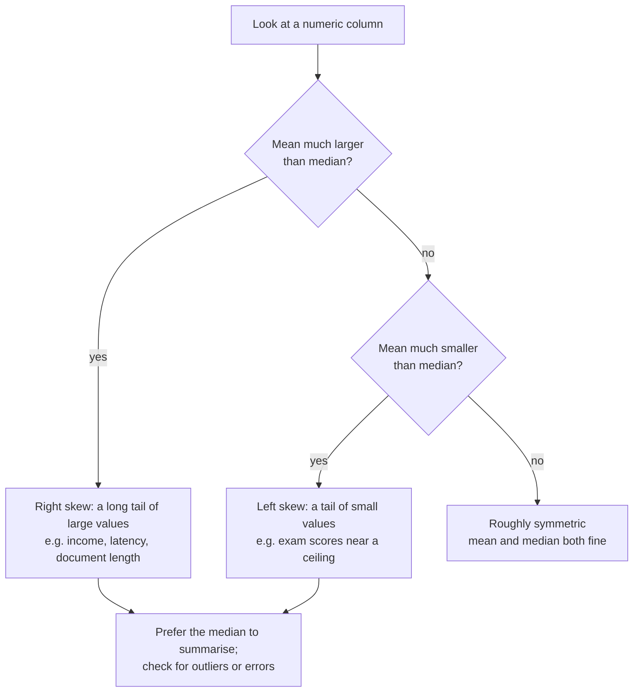

Before you train a model, you look at your data, and the first thing you want to know about any column of numbers is where its values sit. Is a typical response time 130 milliseconds or 450? Is the usual house price in the dataset near the middle or dragged up by a few mansions? The mean, median and mode are three answers to the question "what is a typical value?", and they often disagree. Knowing which one to trust, and why they differ, is the first step in statistics and a daily skill in AI work: you will use them to summarise datasets, fill in missing values, report model latency and build baselines that any real model must beat.

## Three ways to say "typical"

| Measure | Definition | Sensitive to outliers? | Works on categories? |
| --- | --- | --- | --- |
| Mean | Sum of values divided by how many there are | Very | No |
| Median | The middle value once the data is sorted | Barely | No (needs an order) |
| Mode | The most frequent value | No | Yes |

These are called **measures of central tendency**. Each compresses a whole list of numbers into one, and each throws away different information.

## The mean

The **arithmetic mean** is what most people call the average. For $n$ values $x_1, x_2, \dots, x_n$:

$$
\bar{x} = \frac{1}{n} \sum_{i=1}^{n} x_i
$$

Here $\bar{x}$ (read "x bar") is the mean, $n$ is the number of values, $x_i$ is the $i$-th value, and $\sum_{i=1}^{n}$ means "add up the terms for $i = 1$ to $n$".

You can think of the mean as the balance point: if each value were a weight on a ruler, the ruler would balance at $\bar{x}$. That is also its weakness. One heavy weight far out on the ruler shifts the balance point a long way.

Here are seven response times from a model API, one of which hit a cold start:

```python
import statistics

latencies_ms = [120, 135, 128, 142, 131, 125, 2400]

print(statistics.mean(latencies_ms))
print(statistics.median(latencies_ms))
```

```output
454.42857142857144
131
```

Six of the seven requests took around 130 ms, yet the mean says 454 ms, a value no request was anywhere near. The median, 131 ms, describes the typical request far better.

### The weighted mean

Sometimes values should not count equally. Suppose a model scores 92% accuracy on a test set of 10,000 examples, 80% on one of 500, and 75% on one of 200. The plain mean of the three accuracies treats the tiny sets as equally important as the large one. The **weighted mean** gives each value $x_i$ a weight $w_i$:

$$
\bar{x}_w = \frac{\sum_{i=1}^{n} w_i x_i}{\sum_{i=1}^{n} w_i}
$$

```python
import statistics

accuracies = [0.92, 0.80, 0.75]
sizes = [10_000, 500, 200]

print(round(statistics.mean(accuracies), 4))
print(round(statistics.fmean(accuracies, weights=sizes), 4))
```

```output
0.8233
0.9112
```

The weighted figure, 91.1%, is the accuracy over all 10,700 examples pooled together. The unweighted 82.3% answers a different question: the average accuracy per test set. Neither is wrong, but you must know which one you are reporting. (`fmean` accepts `weights` from Python 3.11.)

## The median

The **median** is the middle value of the sorted data. With an odd number of values there is exactly one middle value. With an even number, the median is the mean of the two middle values.

```trace
{
  "title": "computing a median by hand",
  "code": [
    "def median(values):",
    "    ordered = sorted(values)",
    "    n = len(ordered)",
    "    mid = n // 2",
    "    if n % 2 == 1:",
    "        return ordered[mid]",
    "    return (ordered[mid - 1] + ordered[mid]) / 2",
    "",
    "print(median([7, 1, 9, 3]))"
  ],
  "steps": [
    { "line": 9, "vars": {}, "note": "Four values, so there is no single middle one. Expect the mean of the two central values." },
    { "line": 2, "vars": { "values": "[7, 1, 9, 3]", "ordered": "[1, 3, 7, 9]" }, "note": "The median is defined on sorted data, so sort first." },
    { "line": 3, "vars": { "values": "[7, 1, 9, 3]", "ordered": "[1, 3, 7, 9]", "n": "4" }, "note": "n is even." },
    { "line": 4, "vars": { "values": "[7, 1, 9, 3]", "ordered": "[1, 3, 7, 9]", "n": "4", "mid": "2" }, "note": "Integer division gives index 2, the upper of the two middle positions." },
    { "line": 5, "vars": { "values": "[7, 1, 9, 3]", "ordered": "[1, 3, 7, 9]", "n": "4", "mid": "2" }, "note": "4 % 2 is 0, so the odd branch is skipped." },
    { "line": 7, "vars": { "values": "[7, 1, 9, 3]", "ordered": "[1, 3, 7, 9]", "n": "4", "mid": "2" }, "out": ["5.0"], "note": "Average ordered[1] = 3 and ordered[2] = 7 to get 5.0. Changing 9 to 9000 would not change this result." }
  ]
}
```

That last note is the key property: the median depends only on the order of the values, not how far the extremes are from the centre. Statisticians call it **robust**. Half the data could be wildly wrong on one side and the median would still be a value from the other half.

### Percentiles generalise the median

The median is the **50th percentile**: half the values lie below it. The 90th percentile is the value below which 90% of the data lies. When engineers report model serving latency as p50, p95 and p99, they are quoting percentiles. A p50 of 130 ms with a p99 of 2,400 ms tells you most users are fine but one request in a hundred is painfully slow, which a single mean would hide.

## The mode

The **mode** is the most common value. It is the only one of the three that works on categories, where adding or sorting makes no sense.

```python
import statistics

predictions = ["cat", "dog", "cat", "bird", "cat", "dog"]
print(statistics.mode(predictions))
print(statistics.multimode([1, 1, 2, 2, 3]))
print(statistics.median([4, 1, 3, 2]))
```

```output
cat
[1, 2]
2.5
```

`multimode` returns every value tied for most frequent; data with two peaks is called **bimodal**. For continuous measurements such as heights, where no two values may be exactly equal, the mode of the raw numbers is meaningless; you would group values into bins first.

> [!KEY]
> In classification, predicting the mode of the training labels for every input is the **majority-class baseline**. If 95% of emails are not spam, a "model" that always says "not spam" scores 95% accuracy. Any real classifier has to beat that number, which is why you compute the mode of your labels before you celebrate an accuracy figure.

## How skew pulls them apart

On symmetric data the mean and median are close. When a distribution has a long tail on one side, called **skew**, the mean is pulled towards the tail while the median stays with the bulk of the data.



Comparing the mean and median is a quick, free diagnostic. A large gap tells you to plot the data before trusting any single summary.

## The same tools in NumPy and SciPy

You will meet NumPy properly in [Module 7](/learn/numpy/arrays-and-dimensions); for now it is enough to know that the same summaries exist for arrays. SciPy adds the **trimmed mean**, which discards a fixed fraction of the smallest and largest values before averaging, a compromise between the mean and median.

```python
import numpy as np
from scipy import stats

latencies_ms = np.array([120, 135, 128, 142, 131, 125, 2400])
print(np.mean(latencies_ms), np.median(latencies_ms))
print(stats.trim_mean(latencies_ms, proportiontocut=0.15))
```

```output
454.42857142857144 131.0
132.2
```

With 15% cut from each end of seven values, one value goes from each side (the 120 and the 2400), and the remaining five average to 132.2.

## Filling missing values

Real datasets have gaps, and many models cannot accept missing values. A common first fix is **imputation**: replacing each gap with a typical value from the column.

```python
import statistics

ages = [34, 29, None, 41, 38, None, 120]
known = [a for a in ages if a is not None]
fill = statistics.median(known)
print(known, fill)
print([fill if a is None else a for a in ages])
```

```output
[34, 29, 41, 38, 120] 38
[34, 29, 38, 41, 38, 38, 120]
```

The age of 120 is almost certainly a data entry error. The mean of the known ages would be 52.4, pulled up by that error; the median, 38, is unaffected. Use the median for skewed numeric columns and the mode for categorical ones.

> [!WARNING]
> Compute imputation values from the **training data only**, then apply the same values to validation and test data. Computing them on the full dataset leaks information from the test set into training, a mistake you will meet again in the Pandas module's [feature preparation](/learn/pandas/feature-preparation) lesson.

## Exercises

**1.** A dataset of document lengths, in tokens, is `[310, 280, 295, 305, 290, 8000, 300]`. Compute the mean and median. Which better describes a typical document, and what might the 8000 be?

<details>
<summary>Show solution</summary>

```python
import statistics

lengths = [310, 280, 295, 305, 290, 8000, 300]
print(statistics.mean(lengths), statistics.median(lengths))
```

```output
1397.142857142857 300
```

The median, 300 tokens, describes a typical document. The 8000-token document is an outlier: perhaps a whole book scraped by mistake or several documents concatenated. It is worth inspecting before training, because it could also exceed a model's context window.

</details>

**2.** Write a function `majority_baseline(labels)` that returns the most common label and the accuracy you would get by always predicting it. Test it on `["ham"] * 90 + ["spam"] * 10`.

<details>
<summary>Show solution</summary>

```python
import statistics

def majority_baseline(labels):
    top = statistics.mode(labels)
    accuracy = labels.count(top) / len(labels)
    return top, accuracy

print(majority_baseline(["ham"] * 90 + ["spam"] * 10))
```

```output
('ham', 0.9)
```

</details>

**3.** Without running code: for the values `[2, 2, 3, 4, 100]`, which is largest, the mean, median or mode, and which is smallest?

<details>
<summary>Show solution</summary>

The mode is 2, the median is 3 and the mean is 111 / 5 = 22.2. The mean is largest because the outlier 100 pulls it towards the right tail; the mode is smallest. This ordering (mode, then median, then mean) is typical of right-skewed data.

</details>

```quiz
[
  {
    "q": "Which measure of central tendency is least affected by a single extreme outlier?",
    "options": ["Mean", "Weighted mean", "Median", "Sum"],
    "answer": 2,
    "why": "The median depends only on the order of the values, so moving an extreme value further out does not change it."
  },
  {
    "q": "A column of user incomes has a mean far above its median. What does this suggest?",
    "options": ["The data is left-skewed", "The data is right-skewed with a tail of large values", "The data is perfectly symmetric", "The data must contain missing values"],
    "answer": 1,
    "why": "A long tail of large values pulls the mean upwards while the median stays with the bulk of the data."
  },
  {
    "q": "What is the median of `[8, 2, 6, 4]`?",
    "options": ["5.0", "6", "4", "2.5"],
    "answer": 0,
    "why": "Sorted, the values are 2, 4, 6, 8. With an even count, the median is the mean of the two middle values, (4 + 6) / 2 = 5.0."
  },
  {
    "q": "In a dataset where 97% of transactions are legitimate, a fraud model reports 97% accuracy. Why is this unimpressive?",
    "options": ["Accuracy cannot be computed for fraud", "Always predicting the mode, \"legitimate\", already scores 97%", "The median accuracy would be higher", "97% is below the weighted mean"],
    "answer": 1,
    "why": "The majority-class baseline, predicting the mode of the labels every time, achieves the same accuracy without learning anything."
  }
]
```
