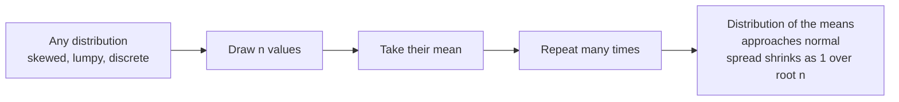

Measure the heights of a thousand adults, the errors of a well-calibrated sensor, or the average accuracy of a model over many random test sets, and plot them. Again and again the same shape appears: a symmetric bell, dense in the middle and thinning quickly at both sides. This is the **normal distribution**, also called the **Gaussian**. It is the default assumption behind feature standardisation, anomaly detection, weight initialisation, noise in diffusion models, and most of the statistical tests in this module. This lesson explains what it is, why it turns up so often, and how to compute with it.

## The bell curve

A normal distribution is fully described by two numbers: its mean $\mu$, which sets the centre, and its standard deviation $\sigma$, which sets the width. You write $X \sim \mathcal{N}(\mu, \sigma^2)$, read "$X$ is normally distributed with mean $\mu$ and variance $\sigma^2$". Its [probability density function](/learn/probability-and-statistics/probability-distributions) is

$$
f(x) = \frac{1}{\sigma \sqrt{2\pi}} \exp\!\left( -\frac{(x - \mu)^2}{2 \sigma^2} \right)
$$

where $x$ is any real number, $\exp(u)$ means $e^u$, and $\pi \approx 3.14159$. You will rarely evaluate this by hand, but it is worth reading:

- $(x - \mu)^2$ is the squared distance from the centre, so the curve is symmetric and highest at $x = \mu$.
- Dividing by $2\sigma^2$ measures that distance relative to the spread: a wide distribution falls off slowly.
- The negative exponent makes the density shrink extremely fast with distance; values far from the mean are rare.
- The constant in front makes the total area under the curve exactly 1.

Because the mean is at the peak and the curve is symmetric, the mean, median and mode of a normal distribution are all equal.

## The 68-95-99.7 rule

Every normal distribution has the same proportions when measured in standard deviations:

| Range | Fraction of values inside |
| --- | --- |
| $\mu \pm 1\sigma$ | about 68.3% |
| $\mu \pm 2\sigma$ | about 95.4% |
| $\mu \pm 3\sigma$ | about 99.7% |

Python's standard library includes `statistics.NormalDist`, which can confirm these numbers through its cumulative distribution function `cdf`:

```python
from statistics import NormalDist

z = NormalDist()   # standard normal: mu = 0, sigma = 1
for k in [1, 2, 3]:
    print(k, round(z.cdf(k) - z.cdf(-k), 4))
```

```output
1 0.6827
2 0.9545
3 0.9973
```

`z.cdf(k)` is $P(Z \le k)$, so `z.cdf(k) - z.cdf(-k)` is the probability of landing between $-k$ and $k$. Only about 3 values in 1,000 fall more than three standard deviations from the mean, which is why "beyond 3 sigma" is a common threshold for calling something unusual.

## The standard normal and z-scores

The normal distribution with $\mu = 0$ and $\sigma = 1$ is the **standard normal**, usually written $Z$. Any normal variable can be converted to it with the z-score from [variance and standard deviation](/learn/probability-and-statistics/variance-and-standard-deviation):

$$
z = \frac{x - \mu}{\sigma}
$$

This means one table, or one function, answers questions about every normal distribution. `NormalDist` does the conversion for you:

```python
from statistics import NormalDist

heights = NormalDist(mu=170, sigma=8)    # adult heights in cm (illustrative)

print(round(heights.cdf(178), 4))                       # P(height <= 178)
print(round(heights.cdf(186) - heights.cdf(154), 4))    # within 2 sigma
print(round(heights.inv_cdf(0.95), 2))                  # 95th percentile
print(round(heights.zscore(190), 2))
```

```output
0.8413
0.9545
183.16
2.5
```

| Method | Answers |
| --- | --- |
| `cdf(x)` | What fraction of values are at most `x`? |
| `inv_cdf(p)` | Which value has a fraction `p` below it? (a percentile) |
| `pdf(x)` | The density at `x` (not a probability) |
| `zscore(x)` | How many standard deviations `x` is from the mean |
| `samples(n, seed=...)` | A list of `n` random draws |

SciPy offers the same through `scipy.stats.norm`, with `norm.cdf`, `norm.ppf` (the inverse CDF) and `norm.pdf`, and NumPy draws normal samples in bulk, as you will see below.

## Why it is everywhere: the central limit theorem

Many things in nature and in data are not normal at all. Response times have a long right tail; incomes are heavily skewed. So why does the bell keep appearing?

The answer is the **central limit theorem** (CLT). Informally: take the mean of $n$ independent draws from almost any distribution with a finite variance. As $n$ grows, the distribution of that mean gets closer and closer to normal, with mean $\mu$ and standard deviation $\sigma / \sqrt{n}$, whatever the shape of the original distribution.



You can watch it happen. The exponential distribution is strongly skewed, so it makes a good test:

```python
import random
import statistics

random.seed(0)

def sample_mean(n):
    # mean of n draws from a skewed distribution (exponential, mean 1)
    return statistics.fmean(random.expovariate(1.0) for _ in range(n))

for n in [1, 5, 30]:
    means = [sample_mean(n) for _ in range(20_000)]
    mu = statistics.fmean(means)
    sd = statistics.pstdev(means)
    within_1sd = sum(abs(m - mu) <= sd for m in means) / len(means)
    skew_gap = mu - statistics.median(means)
    print(f"n={n:>2}  mean={mu:.3f}  sd={sd:.3f}  within 1 sd={within_1sd:.3f}  mean-median={skew_gap:.3f}")
```

```output
n= 1  mean=1.001  sd=1.001  within 1 sd=0.866  mean-median=0.300
n= 5  mean=0.999  sd=0.447  within 1 sd=0.700  mean-median=0.064
n=30  mean=0.999  sd=0.182  within 1 sd=0.685  mean-median=0.011
```

Three things to read from this:

- With $n = 1$ (raw draws), the gap between mean and median shows the skew, and 86.6% of values lie within one standard deviation, far from the normal 68.3%.
- By $n = 30$ the gap has almost vanished and the within-one-sd fraction, 68.5%, is close to the normal value.
- The spread shrinks like $1/\sqrt{n}$: $1/\sqrt{5} \approx 0.447$ and $1/\sqrt{30} \approx 0.183$.

> [!KEY]
> The CLT is why so much of statistics works. A model's accuracy on a test set is a mean of per-example 0/1 scores, so across different test sets it is approximately normal. That lets you put error bars on it and test whether two models really differ, as the [hypothesis testing](/learn/probability-and-statistics/hypothesis-testing) lesson shows.

## The normal distribution in AI

### Anomaly detection with z-scores

If a metric is roughly normal, values with a large $|z|$ are suspicious. A simple monitor for model latency:

```python
import random
import statistics

random.seed(1)
normal_latency = [random.gauss(200, 15) for _ in range(500)]
mu = statistics.fmean(normal_latency)
sigma = statistics.stdev(normal_latency)

for new in [212, 241, 290]:
    z = (new - mu) / sigma
    flag = "ANOMALY" if abs(z) > 3 else "ok"
    print(new, round(z, 2), flag)
```

```output
212 0.75 ok
241 2.73 ok
290 6.08 ANOMALY
```

`random.gauss(mu, sigma)` draws one value from $\mathcal{N}(\mu, \sigma^2)$.

### Weight initialisation

Neural network weights are commonly initialised by drawing from a normal distribution whose standard deviation depends on the layer size. One widely used scheme, He initialisation, uses $\sigma = \sqrt{2 / n_{\text{in}}}$, where $n_{\text{in}}$ (the **fan-in**) is the number of inputs to each neuron. This keeps the scale of activations roughly stable from layer to layer. NumPy, covered fully in [Module 7](/learn/numpy/random-number-generation), draws a whole matrix at once:

```python
import numpy as np

rng = np.random.default_rng(seed=0)
fan_in = 512                                  # inputs feeding each neuron
target_std = np.sqrt(2 / fan_in)
weights = rng.normal(loc=0.0, scale=target_std, size=(fan_in, 256))

print(weights.shape)
print(round(float(target_std), 4), round(float(weights.std()), 4))
```

```output
(512, 256)
0.0625 0.0626
```

### Other places you will meet it

- **Gaussian noise** is added to inputs for data augmentation, and diffusion models generate images by learning to reverse a process that gradually adds Gaussian noise.
- **Mean squared error** is what you get when you assume a regression model's errors are normal and fit by [maximum likelihood](/learn/essential-mathematics-for-machine-learning/maximum-likelihood-estimation).
- **Embedding and latent spaces** in variational autoencoders are pushed towards a standard normal distribution.

> [!WARNING]
> Do not assume normality without looking. Latencies, word frequencies, incomes and many financial quantities have heavy tails, where extreme values are far more common than a normal model predicts. A 3-sigma threshold on heavy-tailed data raises alarms far more often than the 0.3% you expect. Plot a histogram first, and consider transforming skewed data, for example with a logarithm.

## Exercises

**1.** IQ-style scores are designed to follow $\mathcal{N}(100, 15^2)$. Using `NormalDist`, what fraction of people score above 130? What score marks the top 1%?

<details>
<summary>Show solution</summary>

```python
from statistics import NormalDist

iq = NormalDist(100, 15)
print(round(1 - iq.cdf(130), 4))
print(round(iq.inv_cdf(0.99), 1))
```

```output
0.0228
134.9
```

About 2.3% score above 130 (two standard deviations up), and the top 1% starts at about 135.

</details>

**2.** A model's accuracy over random test sets of 1,000 examples has mean 0.85 and standard deviation 0.011. Roughly what range would you expect 95% of test-set accuracies to fall in?

<details>
<summary>Show solution</summary>

By the CLT the accuracy is approximately normal, so 95% of values fall within about 2 standard deviations: $0.85 \pm 0.022$, roughly 0.828 to 0.872. A reported improvement of 1 percentage point is well inside this noise.

</details>

**3.** Repeat the CLT simulation with `random.uniform(0, 1)` instead of the exponential distribution. Why does the mean-median gap start near zero?

<details>
<summary>Show solution</summary>

The uniform distribution is already symmetric, so its mean and median are equal from the start. The CLT still applies: the distribution of means becomes bell-shaped and its spread shrinks like $1/\sqrt{n}$, but there is no skew to remove.

</details>

```quiz
[
  {
    "q": "About what fraction of a normal distribution lies within two standard deviations of the mean?",
    "options": ["68%", "95%", "99.7%", "50%"],
    "answer": 1,
    "why": "The 68-95-99.7 rule: about 68% within one sigma, 95% within two, 99.7% within three."
  },
  {
    "q": "What does the central limit theorem state?",
    "options": ["All real data is normally distributed", "The mean of many independent draws is approximately normal, whatever the original distribution (with finite variance)", "Large samples always have zero variance", "The median equals the mean for any distribution"],
    "answer": 1,
    "why": "The CLT is about the distribution of sample means, not the raw data. The raw data can be heavily skewed."
  },
  {
    "q": "Response time is normal with mean 200 ms and standard deviation 20 ms. What is the z-score of 260 ms?",
    "options": ["3", "60", "1.3", "-3"],
    "answer": 0,
    "why": "z = (260 - 200) / 20 = 3, three standard deviations above the mean."
  },
  {
    "q": "If the standard deviation of single measurements is sigma, what is the standard deviation of the mean of 100 independent measurements?",
    "options": ["sigma", "sigma / 100", "100 x sigma", "sigma / 10"],
    "answer": 3,
    "why": "The spread of a sample mean is sigma divided by the square root of n, and the square root of 100 is 10."
  }
]
```
