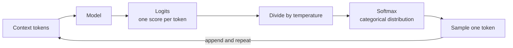

When a language model predicts the next word, it does not output one word. It outputs a probability for every word in its vocabulary: perhaps 0.64 for "cat", 0.23 for "dog", and tiny amounts for tens of thousands of others. That complete list of outcomes and their probabilities is a **probability distribution**, and it is the central object in machine learning. Models output distributions, loss functions compare distributions, data is assumed to come from distributions, and generation is sampling from them. This lesson introduces the language of distributions and the handful you will meet again and again.

## Random variables

A **random variable** is a number whose value depends on the outcome of a random experiment. It is conventionally written with a capital letter, such as $X$, while a particular value it takes is lower case, $x$.

| Experiment | Random variable $X$ | Possible values |
| --- | --- | --- |
| Roll a die | The face shown | 1, 2, 3, 4, 5, 6 |
| Classify 20 test examples | Number classified correctly | 0, 1, ..., 20 |
| Measure an API call | Response time in seconds | Any positive real number |
| Predict the next token | Index of the chosen token | 0 to vocabulary size minus 1 |

Random variables come in two kinds. **Discrete** ones take separate, countable values (counts, categories). **Continuous** ones take any value in a range (time, temperature, a pixel intensity scaled to 0-1). The two kinds are described slightly differently.

## Discrete distributions: the PMF

A discrete random variable is described by its **probability mass function** (PMF), which gives the probability of each value:

$$
p(x) = P(X = x)
$$

A valid PMF satisfies the axioms from [probability fundamentals](/learn/probability-and-statistics/probability-fundamentals): every $p(x) \ge 0$, and $\sum_x p(x) = 1$, where the sum runs over every possible value $x$.

For a fair die, $p(x) = 1/6$ for each face. Simulating many rolls recovers it:

```python
import random
from collections import Counter

random.seed(0)
rolls = [random.randint(1, 6) for _ in range(60_000)]
counts = Counter(rolls)
print({face: round(counts[face] / len(rolls), 3) for face in sorted(counts)})
```

```output
{1: 0.166, 2: 0.169, 3: 0.167, 4: 0.164, 5: 0.168, 6: 0.166}
```

The **cumulative distribution function** (CDF) gives the probability of a value at most $x$: $F(x) = P(X \le x)$. For the die, $F(3) = 3/6 = 0.5$. The CDF answers "what fraction falls below this threshold?" questions, and it works the same way for discrete and continuous variables.

## Expected value and variance

The **expected value** (or mean) of a random variable is the probability-weighted average of its values:

$$
\mathbb{E}[X] = \sum_x x \, p(x)
$$

$\mathbb{E}$ stands for expectation. For a die, $\mathbb{E}[X] = (1 + 2 + 3 + 4 + 5 + 6)/6 = 3.5$. You can never roll 3.5; the expected value is the long-run average over many rolls, the population version of the [mean](/learn/probability-and-statistics/mean-median-and-mode).

The **variance** of a random variable is the expected squared distance from its mean, exactly as in [variance and standard deviation](/learn/probability-and-statistics/variance-and-standard-deviation):

$$
\text{Var}(X) = \mathbb{E}\big[(X - \mathbb{E}[X])^2\big]
$$

Expectations appear throughout AI. A training loss is an expected value of the per-example loss over the data distribution, and the average loss over a batch is an estimate of it. In reinforcement learning, an agent maximises expected reward.

## Common discrete distributions

| Distribution | Models | Parameters | Mean | AI example |
| --- | --- | --- | --- | --- |
| Bernoulli | One yes/no trial | $p$, probability of 1 | $p$ | Is this email spam? Did the user click? |
| Binomial | Number of successes in $n$ independent trials | $n$, $p$ | $np$ | Correct answers out of $n$ test questions |
| Categorical | One choice among $K$ categories | $p_1, \dots, p_K$ summing to 1 | n/a | Next token, image class |
| Poisson | Count of events in a fixed interval | $\lambda$, average rate | $\lambda$ | Requests per second hitting an API |

### Bernoulli and binomial

A **Bernoulli** variable is 1 with probability $p$ and 0 with probability $1 - p$. Add up $n$ independent Bernoulli trials and you get a **binomial** variable, the number of successes. Its PMF is

$$
P(X = k) = \binom{n}{k} p^k (1 - p)^{n - k}
$$

where $k$ is the number of successes, and $\binom{n}{k}$ ("$n$ choose $k$") counts the ways to choose which $k$ of the $n$ trials succeed. Its mean is $np$ and its variance is $np(1-p)$.

Suppose a model answers each question correctly with probability 0.8, independently, and you test it on 20 questions. SciPy's `stats` module has every common distribution:

```python
from scipy import stats

# 20 test questions, each answered correctly with probability 0.8
n, p = 20, 0.8
print(round(stats.binom.pmf(16, n, p), 4))       # exactly 16 correct
print(round(stats.binom.cdf(14, n, p), 4))       # 14 or fewer correct
print(stats.binom.mean(n, p), round(stats.binom.std(n, p), 3))
```

```output
0.2182
0.1958
16.0 1.789
```

Even though the model's true accuracy is 80%, it scores exactly 16 out of 20 only about 22% of the time, and scores 14 or fewer (70% or less) about 20% of the time. A tiny benchmark gives a very noisy picture of true ability, a point the [sampling](/learn/probability-and-statistics/sampling) lesson develops.

### Poisson

The **Poisson** distribution counts events that happen independently at a constant average rate $\lambda$ (lambda). If an API receives on average 4 requests per second, `stats.poisson.pmf(0, 4)` gives about 0.018, the chance of a completely idle second, and `stats.poisson.sf(8, 4)` gives about 0.021, the chance of more than 8 requests (`sf`, the survival function, is $1 - F(x)$). Capacity planning for model serving starts from estimates like these.

## Softmax outputs are categorical distributions

A classifier or language model produces raw scores called **logits**, one per class, which can be any real numbers. The **softmax** function turns them into a categorical distribution:

$$
\text{softmax}(z)_i = \frac{e^{z_i}}{\sum_{j=1}^{K} e^{z_j}}
$$

Here $z_i$ is the logit for class $i$, $K$ is the number of classes, and $e$ is Euler's number (about 2.718). Exponentiating makes every value positive; dividing by the sum makes them add to 1.

```python
import math

def softmax(logits):
    biggest = max(logits)
    exps = [math.exp(z - biggest) for z in logits]
    total = sum(exps)
    return [e / total for e in exps]

vocab = ["cat", "dog", "car", "the"]
logits = [2.0, 1.0, 0.1, -1.0]
probs = softmax(logits)
print([round(p, 3) for p in probs], round(sum(probs), 6))
```

```output
[0.638, 0.235, 0.095, 0.032] 1.0
```

Subtracting the largest logit first does not change the result (it cancels in the fraction) but stops `math.exp` overflowing on large logits.

### Sampling and temperature

Text generation draws a token from this distribution. Dividing the logits by a **temperature** $T$ before the softmax reshapes the distribution: $T < 1$ sharpens it towards the top choice, $T > 1$ flattens it.

```python
import math
import random
from collections import Counter

def softmax(logits, temperature=1.0):
    scaled = [z / temperature for z in logits]
    biggest = max(scaled)
    exps = [math.exp(z - biggest) for z in scaled]
    total = sum(exps)
    return [e / total for e in exps]

vocab = ["cat", "dog", "car", "the"]
logits = [2.0, 1.0, 0.1, -1.0]

random.seed(0)
for t in [0.5, 1.0, 2.0]:
    probs = softmax(logits, t)
    samples = random.choices(vocab, weights=probs, k=1000)
    print(t, [round(p, 2) for p in probs], Counter(samples).most_common())
```

```output
0.5 [0.86, 0.12, 0.02, 0.0] [('cat', 862), ('dog', 120), ('car', 16), ('the', 2)]
1.0 [0.64, 0.23, 0.1, 0.03] [('cat', 630), ('dog', 233), ('car', 103), ('the', 34)]
2.0 [0.45, 0.27, 0.17, 0.1] [('cat', 440), ('dog', 284), ('car', 168), ('the', 108)]
```

`random.choices` draws `k` items with the given weights. This is the "temperature" setting you will find on LLM APIs: low values give focused, repeatable text; high values give more varied and more error-prone text.



> [!KEY]
> A model's output is not an answer but a distribution over answers. Picking the most probable class, sampling with a temperature, or thresholding a probability are separate decisions you make on top of that distribution.

## Continuous distributions: the PDF

For a continuous variable, the probability of any exact value, such as a latency of exactly 0.2500000 seconds, is zero. Instead, a **probability density function** (PDF) $f(x)$ describes how probability is spread, and probabilities are areas under it:

$$
P(a \le X \le b) = \int_a^b f(x)\, dx
$$

The integral sign $\int_a^b$ means the area under $f$ between $a$ and $b$, a cumulative sum of the kind you met in [calculus](/learn/calculus/functions-and-graphs). The total area under a PDF is 1.

The simplest example is the **uniform** distribution on $[a, b]$, flat at height $1/(b - a)$: every value in the range is equally likely. `random.random()` samples from the uniform distribution on $[0, 1)$. The most important continuous distribution, the [normal distribution](/learn/probability-and-statistics/normal-distribution), has the next lesson to itself.

> [!WARNING]
> A density is not a probability and can be greater than 1. A uniform distribution on $[0, 0.5]$ has density 2 everywhere in its range. Only areas under the curve are probabilities.

## Exercises

**1.** Compute the expected value of a loaded die with PMF $p(6) = 0.5$ and $p(x) = 0.1$ for $x = 1, \dots, 5$.

<details>
<summary>Show solution</summary>

$\mathbb{E}[X] = 0.1 \times (1 + 2 + 3 + 4 + 5) + 0.5 \times 6 = 1.5 + 3 = 4.5$.

```python
pmf = {1: 0.1, 2: 0.1, 3: 0.1, 4: 0.1, 5: 0.1, 6: 0.5}
print(sum(x * p for x, p in pmf.items()))
```

```output
4.5
```

</details>

**2.** Using `scipy.stats.binom`, find the probability that a model with true accuracy 0.9 gets all 10 questions of a tiny benchmark right.

<details>
<summary>Show solution</summary>

```python
from scipy import stats
print(round(stats.binom.pmf(10, 10, 0.9), 4))
```

```output
0.3487
```

This equals $0.9^{10}$. About a third of the time, a 90%-accurate model looks perfect on this benchmark.

</details>

**3.** What happens to softmax probabilities as the temperature approaches zero? As it grows very large?

<details>
<summary>Show solution</summary>

As $T \to 0$, dividing by $T$ magnifies the gaps between logits, and nearly all probability goes to the largest logit: sampling becomes picking the top token (greedy decoding). As $T$ grows very large, all scaled logits approach zero, and the distribution approaches uniform: every token becomes equally likely.

</details>

```quiz
[
  {
    "q": "Which distribution best models the number of correct answers a model gives on 50 independent test questions?",
    "options": ["Categorical", "Poisson", "Uniform", "Binomial"],
    "answer": 3,
    "why": "A fixed number of independent yes/no trials, each with the same success probability, gives a binomial count."
  },
  {
    "q": "Softmax is applied to logits `[1.0, 1.0, 1.0]`. What are the probabilities?",
    "options": ["`[1.0, 1.0, 1.0]`", "`[1/3, 1/3, 1/3]`", "`[0.5, 0.25, 0.25]`", "`[e, e, e]`"],
    "answer": 1,
    "why": "Equal logits give equal exponentials, and normalising them gives a uniform distribution."
  },
  {
    "q": "What does lowering the sampling temperature below 1 do?",
    "options": ["Makes the distribution sharper, concentrating probability on the top tokens", "Makes the distribution flatter", "Removes the need for softmax", "Has no effect on the probabilities"],
    "answer": 0,
    "why": "Dividing logits by T < 1 enlarges the gaps between them, so after softmax the highest-scoring tokens get even more of the probability."
  },
  {
    "q": "A continuous random variable has density 1.6 at x = 0.3. What can you conclude?",
    "options": ["The data is invalid because probabilities cannot exceed 1", "P(X = 0.3) = 1.6", "Values near 0.3 are relatively likely; densities can exceed 1", "The distribution must be uniform"],
    "answer": 2,
    "why": "A density is probability per unit length, not a probability. Only areas under the density curve are probabilities, and those never exceed 1."
  }
]
```
