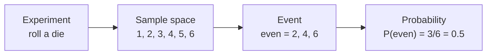
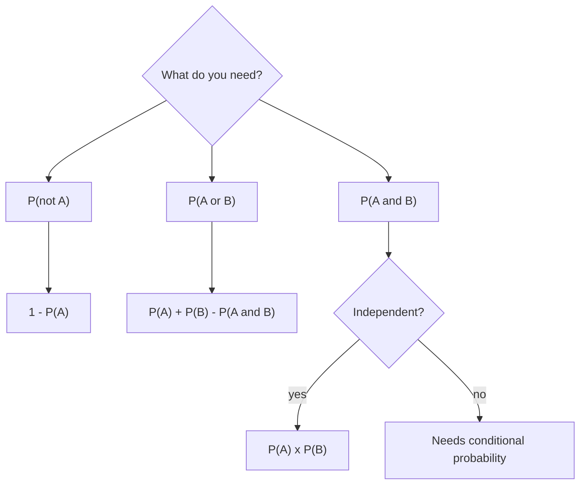

Machine learning is, at heart, reasoning under uncertainty. A spam filter cannot be certain an email is spam; it estimates a probability. A language model does not "know" the next word; it assigns a probability to every word in its vocabulary and picks one. An agent that calls a tool ten times in a row has some chance of failing at each step. To build, evaluate and debug these systems you need a precise language for uncertainty, and that language is probability. This lesson sets out the vocabulary and the handful of rules everything else in this module is built on.

## Experiments, outcomes and events

Probability starts with a random **experiment**: any process whose result you cannot predict with certainty, such as rolling a die, drawing an email from an inbox, or asking a model a question.

| Term | Meaning | Die example |
| --- | --- | --- |
| Outcome | One possible result | Rolling a 4 |
| Sample space $\Omega$ | The set of all possible outcomes | $\{1, 2, 3, 4, 5, 6\}$ |
| Event | A set of outcomes you care about | "Even number" $= \{2, 4, 6\}$ |
| Probability $P(A)$ | A number from 0 to 1 measuring how likely event $A$ is | $P(\text{even}) = 0.5$ |

$\Omega$ (capital omega) is the standard symbol for the sample space. An event happens if the outcome of the experiment is one of its members. You met sets in [Python's collections](/learn/python-programming/lists-tuples-sets-dictionaries), and the same operations apply here: "A or B" is the union $A \cup B$, "A and B" is the intersection $A \cap B$, and "not A" is the complement $A^c$.



## The rules every probability obeys

All of probability theory follows from three basic rules, called the **axioms of probability**:

1. Every probability is between 0 and 1: $0 \le P(A) \le 1$. Zero means impossible, one means certain.
2. Something in the sample space must happen: $P(\Omega) = 1$.
3. If two events cannot both happen (they are **mutually exclusive**), the probability that one or the other happens is the sum: $P(A \cup B) = P(A) + P(B)$.

The second rule is why a classifier's output probabilities across all classes must add up to 1. When you see the output of a softmax layer, which you will meet in [probability distributions](/learn/probability-and-statistics/probability-distributions), it has been constructed precisely to satisfy these rules.

## Two ways to find a probability

### Counting equally likely outcomes

When every outcome is equally likely, the probability of an event is the fraction of outcomes it contains:

$$
P(A) = \frac{|A|}{|\Omega|}
$$

where $|A|$ is the number of outcomes in event $A$ and $|\Omega|$ is the total number of outcomes. For example, what is the probability that two dice sum to 7?

```python
from itertools import product

outcomes = list(product(range(1, 7), repeat=2))
sevens = [o for o in outcomes if sum(o) == 7]
print(len(outcomes), len(sevens), len(sevens) / len(outcomes))
```

```output
36 6 0.16666666666666666
```

`product` lists every ordered pair, (1, 1) through (6, 6). Six of the 36 pairs sum to 7, so the probability is 1/6.

### Long-run frequency

Most real-world probabilities cannot be counted this way. What is the probability that a user clicks a recommended video? You estimate it from data: the fraction of times it happened. The **law of large numbers** says that as the number of trials grows, the observed frequency gets closer and closer to the true probability.

```python
import random

random.seed(42)
for n in [10, 100, 1_000, 10_000, 100_000]:
    heads = sum(random.random() < 0.5 for _ in range(n))
    print(f"{n:>7} flips: proportion of heads = {heads / n:.4f}")
```

```output
     10 flips: proportion of heads = 0.6000
    100 flips: proportion of heads = 0.4900
   1000 flips: proportion of heads = 0.4820
  10000 flips: proportion of heads = 0.5017
 100000 flips: proportion of heads = 0.5001
```

`random.random()` returns a float uniformly between 0 and 1, so `random.random() < 0.5` is `True` with probability 0.5: a simulated fair coin. With 10 flips the estimate is off by 10 percentage points; with 100,000 it is within a hundredth of one. This is also why a model evaluated on 50 test examples gives a much noisier accuracy than one evaluated on 5,000.

Simulation is a powerful habit. When you are unsure of a calculation, simulate it:

```python
import random

random.seed(1)
trials = 100_000
sevens = 0
for _ in range(trials):
    if random.randint(1, 6) + random.randint(1, 6) == 7:
        sevens += 1
print(sevens / trials)
```

```output
0.16621
```

Close to 1/6 ≈ 0.1667, as counting predicted.

## Combining events



**Complement rule.** Either $A$ happens or it does not, so

$$
P(A^c) = 1 - P(A)
$$

**Addition rule.** For any two events, add their probabilities and subtract the overlap, which would otherwise be counted twice:

$$
P(A \cup B) = P(A) + P(B) - P(A \cap B)
$$

For one die, $P(\text{even or greater than 4})$: even is $\{2, 4, 6\}$, greater than 4 is $\{5, 6\}$, the overlap is $\{6\}$. So $3/6 + 2/6 - 1/6 = 4/6$. When the events are mutually exclusive, the overlap is zero and you get axiom 3.

**Multiplication rule for independent events.** Two events are **independent** if knowing one happened tells you nothing about the other, such as two separate coin flips. Then

$$
P(A \cap B) = P(A) \times P(B)
$$

When events are not independent, you need the [conditional probability](/learn/probability-and-statistics/conditional-probability) of one given the other, which is the next lesson.

## Reliability of multi-step AI systems

These rules have a sharp practical consequence. Suppose each step of an AI agent (a tool call, a parsing step, an LLM decision) succeeds with probability 0.95, and steps fail independently. The whole task succeeds only if every step does, so you multiply. The probability of at least one failure is the complement.

```python
p_step_ok = 0.95
for steps in [1, 5, 10, 20, 50]:
    p_all_ok = p_step_ok ** steps
    print(f"{steps:>2} steps: P(all succeed) = {p_all_ok:.3f}, P(at least one failure) = {1 - p_all_ok:.3f}")
```

```output
 1 steps: P(all succeed) = 0.950, P(at least one failure) = 0.050
 5 steps: P(all succeed) = 0.774, P(at least one failure) = 0.226
10 steps: P(all succeed) = 0.599, P(at least one failure) = 0.401
20 steps: P(all succeed) = 0.358, P(at least one failure) = 0.642
50 steps: P(all succeed) = 0.077, P(at least one failure) = 0.923
```

A step that works 95% of the time sounds reliable. Chain ten of them and the task fails four times in ten. This is why agent designers add retries, validation and fallbacks, and why shortening a chain often helps more than improving any one step.

> [!KEY]
> "At least one" questions are almost always easiest through the complement: $P(\text{at least one}) = 1 - P(\text{none})$. Counting all the ways to get one, two, three or more failures directly is much harder.

## Common mistakes

> [!WARNING]
> The multiplication rule only applies to independent events. Errors in real systems are often correlated: if the API is down, every call fails together; if a model misunderstands a document, it may get every question about it wrong. Assuming independence when events are linked can badly underestimate the chance of joint failure.

- **The gambler's fallacy.** After five heads in a row, a fair coin is still 50/50 on the next flip. Independent trials have no memory.
- **Adding probabilities that overlap.** $P(A) + P(B)$ can exceed 1, a sure sign you forgot to subtract $P(A \cap B)$.
- **Treating a model's score as a calibrated probability.** A classifier that outputs 0.9 is not necessarily right 90% of the time. Whether its scores behave like real probabilities is a property called **calibration**, which you will check in the Model Evaluation module.

## Exercises

**1.** A card is drawn from a standard 52-card deck. What is the probability it is a heart or a king? Use the addition rule.

<details>
<summary>Show solution</summary>

There are 13 hearts and 4 kings, and one card (the king of hearts) is both. $P = 13/52 + 4/52 - 1/52 = 16/52 \approx 0.308$.

</details>

**2.** Simulate the agent from this lesson: 10 steps, each succeeding independently with probability 0.95. Estimate the probability that all steps succeed using 100,000 trials and `random.seed(7)`. Compare with $0.95^{10}$.

<details>
<summary>Show solution</summary>

```python
import random

random.seed(7)
trials = 100_000
count = 0
for _ in range(trials):
    steps_ok = all(random.random() < 0.95 for _ in range(10))
    count += steps_ok
print(count / trials)
```

```output
0.59767
```

This matches the exact value 0.599 to within simulation noise.

</details>

**3.** A content filter catches a harmful prompt with probability 0.9. You chain three independent filters. What is the probability a harmful prompt gets past all three? Why might the real figure be higher?

<details>
<summary>Show solution</summary>

Each filter misses with probability 0.1. If the misses are independent, all three miss with probability $0.1^3 = 0.001$. In practice, filters trained on similar data tend to miss the same cleverly disguised prompts, so their failures are correlated and the true probability is higher than 0.001.

</details>

```quiz
[
  {
    "q": "A classifier outputs probabilities for three classes: 0.5, 0.3 and 0.3. What is wrong?",
    "options": ["Nothing, each value is between 0 and 1", "The probabilities over the whole sample space sum to 1.1, not 1", "Probabilities cannot be 0.5", "There must be an even number of classes"],
    "answer": 1,
    "why": "The classes are mutually exclusive and together cover every outcome, so their probabilities must sum to exactly 1."
  },
  {
    "q": "P(A) = 0.6, P(B) = 0.5 and P(A and B) = 0.3. What is P(A or B)?",
    "options": ["1.1", "0.3", "0.8", "0.9"],
    "answer": 2,
    "why": "By the addition rule, 0.6 + 0.5 - 0.3 = 0.8."
  },
  {
    "q": "Each of 4 independent API calls succeeds with probability 0.9. What is the probability at least one fails?",
    "options": ["1 - 0.9^4, about 0.344", "4 x 0.1 = 0.4", "0.1^4 = 0.0001", "0.9^4, about 0.656"],
    "answer": 0,
    "why": "All succeed with probability 0.9^4 ≈ 0.656, so at least one fails with probability 1 - 0.656 ≈ 0.344. Adding 0.1 four times double-counts the cases with several failures."
  },
  {
    "q": "What does the law of large numbers say?",
    "options": ["Rare events become common in large datasets", "Observed frequencies get closer to the true probability as the number of trials grows", "After a run of heads, tails becomes more likely", "Large numbers are more probable than small ones"],
    "answer": 1,
    "why": "With more trials, the proportion of times an event occurs converges towards its probability. It says nothing about any single upcoming trial."
  }
]
```
