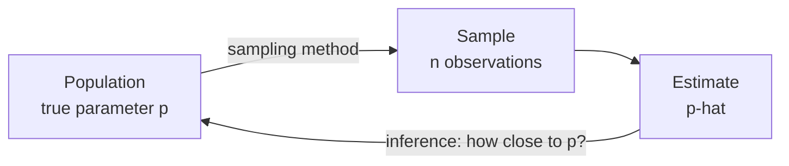
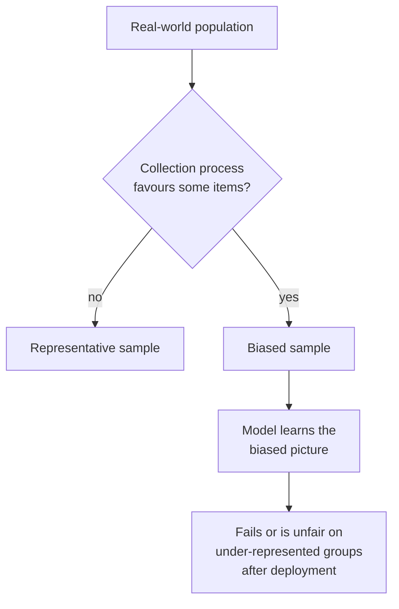

You almost never get to see everything. You cannot evaluate a chatbot on every question users will ever ask, or train a vision model on every photo ever taken. You work with a **sample** and hope it represents the **population** you care about. Every dataset is a sample, every test set is a sample, and every accuracy number is an estimate with some uncertainty attached. This lesson covers how samples are drawn, how much they can be trusted, and the ways they quietly go wrong, which is one of the most common reasons AI systems fail after deployment.

## Populations, samples and estimates

| Term | Meaning | Example |
| --- | --- | --- |
| Population | Everything you want to draw conclusions about | All emails your filter will ever see |
| Sample | The part you actually observe | 10,000 labelled emails |
| Parameter | A true property of the population, usually unknown | The filter's true accuracy, $p$ |
| Statistic / estimate | The same property computed on the sample | Accuracy on the test set, $\hat{p}$ |

A hat on a symbol, as in $\hat{p}$, conventionally marks an estimate of the unhatted quantity. The whole of statistics is about the gap between $\hat{p}$ and $p$: how big it is likely to be, and whether it is random noise or systematic error.



Two different things can make $\hat{p}$ differ from $p$:

- **Sampling error**: random variation from which items happened to be drawn. It shrinks as the sample grows.
- **Sampling bias**: a systematic difference between the sample and the population. It does **not** shrink with more data.

## Ways to draw a sample

### Simple random sampling

Every item has the same chance of being chosen. Python's `random` module offers two forms:

```python
import random

random.seed(0)
population = list(range(1, 101))            # IDs of 100 users
print(random.sample(population, 5))         # without replacement
print(random.choices(population, k=5))      # with replacement
```

```output
[50, 98, 54, 6, 34]
[97, 49, 92, 83, 97]
```

`random.sample` never picks the same item twice; `random.choices` can, as user 97 shows. Shuffling a dataset and splitting it into training and test sets is simple random sampling without replacement.

### Stratified sampling

Split the population into groups (**strata**), such as classes or regions, and sample from each in proportion. This guarantees that small groups are represented. It matters most for imbalanced data, where a random split can leave a rare class out of the test set entirely:

```python
from collections import Counter
from sklearn.model_selection import train_test_split

labels = ["fraud"] * 20 + ["ok"] * 980
ids = list(range(len(labels)))

for strat in [None, labels]:
    _, test_ids = train_test_split(ids, test_size=0.05, random_state=3, stratify=strat)
    print(Counter(labels[i] for i in test_ids))
```

```output
Counter({'ok': 50})
Counter({'ok': 49, 'fraud': 1})
```

With 2% fraud, a 50-example test set should hold one fraud case. The plain random split happened to include none, so the test set could not measure fraud detection at all. Passing `stratify=labels` preserves the class proportions in both parts.

### Other schemes

| Method | How | Watch out for |
| --- | --- | --- |
| Systematic | Take every $k$-th item | Hidden periodic patterns, such as every 7th day being a Sunday |
| Cluster | Pick whole groups at random, such as entire hospitals | Items within a cluster are similar, so you learn less per item |
| Time-based split | Train on the past, test on the most recent period | Required whenever you will predict the future, otherwise you leak it |
| Group split | Keep all data from one user or patient on one side | Without it, the model can memorise individuals and look better than it is |

## How big should a sample be? The standard error

Each test set gives a slightly different accuracy. The **standard error** (SE) is the standard deviation of an estimate across all the samples you might have drawn. For a sample mean of $n$ independent values from a population with standard deviation $\sigma$:

$$
\text{SE}(\bar{x}) = \frac{\sigma}{\sqrt{n}}
$$

For a proportion such as accuracy, each value is 0 or 1 with standard deviation $\sqrt{p(1-p)}$, so

$$
\text{SE}(\hat{p}) = \sqrt{\frac{p(1 - p)}{n}}
$$

where $p$ is the true accuracy and $n$ is the number of test examples. A simulation confirms it:

```python
import math
import random
import statistics

random.seed(0)
true_accuracy = 0.85

for n in [50, 500, 5000]:
    estimates = []
    for _ in range(2000):
        correct = sum(random.random() < true_accuracy for _ in range(n))
        estimates.append(correct / n)
    observed_se = statistics.stdev(estimates)
    formula_se = math.sqrt(true_accuracy * (1 - true_accuracy) / n)
    print(f"n={n:>4}  spread of estimates={observed_se:.4f}  formula={formula_se:.4f}")
```

```output
n=  50  spread of estimates=0.0509  formula=0.0505
n= 500  spread of estimates=0.0157  formula=0.0160
n=5000  spread of estimates=0.0050  formula=0.0050
```

On 50 examples, a model with true accuracy 85% typically scores anywhere from about 75% to 95% (two standard errors either side). On 5,000 it is pinned to within about one percentage point.

> [!KEY]
> Precision improves with the **square root** of the sample size. To halve the standard error you need four times as much data. This is why small evaluation sets cannot distinguish models that differ by a point or two.

## The bootstrap: uncertainty without formulas

Not every statistic has a neat SE formula: think of the median latency or an F1 score. The **bootstrap** estimates uncertainty by treating your sample as a stand-in for the population. Draw many new samples of the same size *with replacement* from your data, compute the statistic on each, and look at how much it varies.

```python
import random
import statistics

random.seed(0)
# per-example results of a model on a 200-example test set: 1 = correct
results = [1] * 172 + [0] * 28
print("accuracy:", statistics.fmean(results))

boot = []
for _ in range(10_000):
    resample = random.choices(results, k=len(results))
    boot.append(statistics.fmean(resample))

boot.sort()
low, high = boot[249], boot[9749]       # 2.5th and 97.5th percentiles
print("95% bootstrap interval:", round(low, 3), "to", round(high, 3))
```

```output
accuracy: 0.86
95% bootstrap interval: 0.81 to 0.905
```

Reporting "86% (95% interval 81% to 90.5%)" is far more honest than "86%". The middle 95% of bootstrap results is a **confidence interval**, which the [statistical significance](/learn/probability-and-statistics/statistical-significance) lesson discusses further.

## Sampling bias: when more data does not help

Bias comes from *how* the sample was collected. Here an AI assistant has 100,000 users, and the team estimates satisfaction from a voluntary feedback form. Happier users are more likely to fill it in:

```python
import random
import statistics

random.seed(4)
# satisfaction scores (1-10) for 100,000 users of an AI assistant
users = [min(10, max(1, round(random.gauss(6, 2)))) for _ in range(100_000)]

# who answers a voluntary feedback survey? happier users are far more likely to
responders = [s for s in users if random.random() < s / 20]

# a simple random sample of the same size
fair_sample = random.sample(users, len(responders))

print(round(statistics.fmean(users), 2))
print(len(responders), round(statistics.fmean(responders), 2))
print(round(statistics.fmean(fair_sample), 2))
```

```output
6.0
30064 6.65
6.0
```

Thirty thousand responses and the estimate is still wrong, by 0.65 points. A random sample of the same size is right. A huge biased sample gives you a very precise wrong answer.

Forms of bias that regularly damage AI datasets:

| Bias | What happens | AI example |
| --- | --- | --- |
| Selection bias | Some items are more likely to be included | Training a skin-condition classifier mostly on images of lighter skin |
| Self-selection / non-response | Participants choose whether to take part | Thumbs-up and thumbs-down feedback comes mostly from enthusiastic or angry users |
| Survivorship bias | Only items that "survived" a filter are seen | A loan model trained only on approved loans never sees how rejected applicants would have behaved |
| Temporal shift | The population changes after sampling | A model trained on last year's queries meets new products, slang and events |
| Convenience sampling | Using whatever is easiest to collect | Web-scraped text over-represents some languages, regions and viewpoints |



> [!WARNING]
> No statistical method applied after the fact can fully fix a biased sample, because the missing information was never collected. Ask "who or what could not have ended up in this dataset?" before training, and evaluate performance separately on important subgroups rather than only overall.

## Exercises

**1.** A model is about 90% accurate. Roughly how many test examples do you need for a standard error of 1 percentage point (0.01)?

<details>
<summary>Show solution</summary>

Solve $\sqrt{0.9 \times 0.1 / n} = 0.01$: $0.09 / n = 0.0001$, so $n = 900$. For a standard error of 0.5 points you would need four times as many, 3,600.

</details>

**2.** Modify the bootstrap code to compute a 95% interval for a model with 18 correct out of 20. Why is the interval so wide?

<details>
<summary>Show solution</summary>

```python
import random
import statistics

random.seed(0)
results = [1] * 18 + [0] * 2
boot = sorted(statistics.fmean(random.choices(results, k=20)) for _ in range(10_000))
print(boot[249], boot[9749])
```

```output
0.75 1.0
```

With only 20 examples, the true accuracy could plausibly be anywhere from about 75% to 100%. Small samples carry little information.

</details>

**3.** A team builds a dataset of customer support questions by collecting tickets that were successfully resolved by their old system. What bias does this introduce?

<details>
<summary>Show solution</summary>

Survivorship (selection) bias: the hardest questions, the ones the old system failed on, are missing. A model trained and evaluated on this data will look better than it is and will be weakest exactly where help is most needed.

</details>

```quiz
[
  {
    "q": "You collect ten times more data using the same biased process. What happens to the bias in your estimate?",
    "options": ["It shrinks by a factor of about 3", "It stays roughly the same", "It disappears", "It shrinks by a factor of 10"],
    "answer": 1,
    "why": "More data reduces random sampling error, not systematic bias. You get a more precise estimate of the wrong quantity."
  },
  {
    "q": "What does `train_test_split(..., stratify=labels)` guarantee?",
    "options": ["That the split is identical on every run", "That the test set is larger than the training set", "That the class proportions are preserved in both parts", "That no duplicate rows exist"],
    "answer": 2,
    "why": "Stratification samples each class separately, so rare classes appear in both training and test sets in roughly their overall proportion."
  },
  {
    "q": "The standard error of an accuracy estimate on 400 examples is 0.02. Roughly what will it be on 1,600 examples?",
    "options": ["0.005", "0.01", "0.02", "0.04"],
    "answer": 1,
    "why": "The standard error scales with 1 over the square root of n. Four times the data halves it."
  },
  {
    "q": "How does the bootstrap estimate uncertainty?",
    "options": ["By collecting new data from the population", "By resampling the observed data with replacement many times and measuring how the statistic varies", "By assuming the data is normal", "By removing outliers"],
    "answer": 1,
    "why": "Resampling with replacement mimics drawing fresh samples, using the observed data as a stand-in for the population."
  }
]
```
