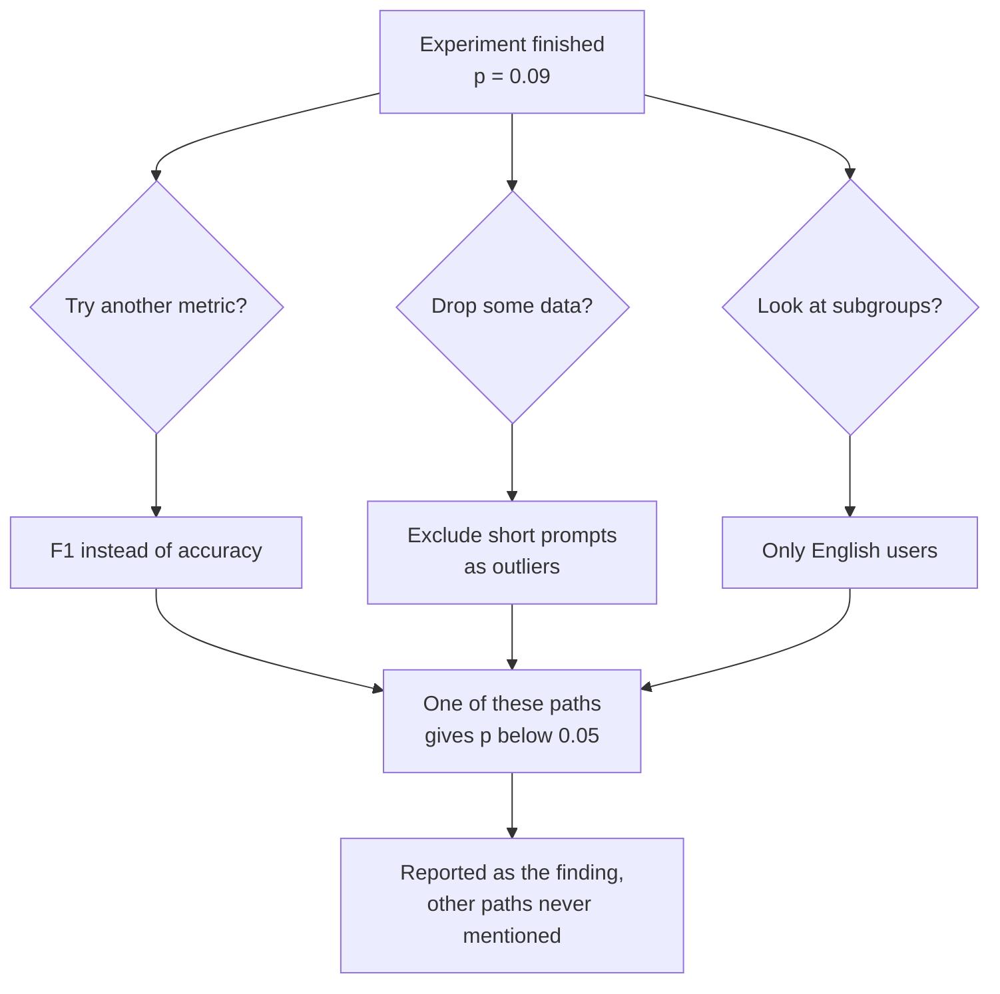

"Our new model is a statistically significant improvement" is one of the most quoted and most misunderstood sentences in AI. It does not mean the improvement is large, or important, or even likely to be real if the team tried dozens of things before finding it. The [hypothesis testing](/learn/probability-and-statistics/hypothesis-testing) lesson gave you the mechanics of p-values. This lesson is about using them well: telling a significant result from an important one, putting honest error bars on results, deciding how much data you need, and avoiding the trap that catches most teams comparing many models, multiple comparisons.

## What "statistically significant" means

A result is **statistically significant** at level $\alpha$ when its p-value is below $\alpha$, conventionally 0.05. That is all. It says the observed difference would be unusual if there were truly no difference. It says nothing about:

| Significance does not tell you | What does |
| --- | --- |
| How big the effect is | The **effect size**, such as the difference in accuracy |
| Whether the effect matters in practice | Domain judgement: cost, latency, user impact |
| How precisely the effect is known | A **confidence interval** |
| Whether the result will replicate | Pre-registration, fresh data, honest counting of every test run |

The 0.05 threshold is a convention, not a law of nature. A p-value of 0.049 is not meaningfully different from 0.051, and treating them as opposite verdicts is a common mistake.

## Significant is not the same as important

The p-value depends on two things: the size of the effect and the amount of data. With enough data, any non-zero difference becomes significant, however tiny. A **confidence interval** for the difference shows both the size and the uncertainty at once. For two success rates, a 95% interval is approximately

$$
(\hat{p}_B - \hat{p}_A) \pm 1.96 \sqrt{\frac{\hat{p}_A(1 - \hat{p}_A)}{n_A} + \frac{\hat{p}_B(1 - \hat{p}_B)}{n_B}}
$$

where $\hat{p}_A, \hat{p}_B$ are the observed rates, $n_A, n_B$ the sample sizes, and 1.96 is the value that leaves 2.5% in each tail of a standard normal (so 95% in the middle).

```python
import math
from statistics import NormalDist

def diff_ci(correct_a, n_a, correct_b, n_b, level=0.95):
    p_a, p_b = correct_a / n_a, correct_b / n_b
    se = math.sqrt(p_a * (1 - p_a) / n_a + p_b * (1 - p_b) / n_b)
    z = NormalDist().inv_cdf(0.5 + level / 2)       # 1.96 for 95%
    diff = p_b - p_a
    return round(diff, 4), round(diff - z * se, 4), round(diff + z * se, 4)

print(diff_ci(412, 500, 433, 500))                  # small test
print(diff_ci(500_000, 1_000_000, 501_500, 1_000_000))   # huge test, tiny effect
```

```output
(0.042, -0.0028, 0.0868)
(0.0015, 0.0001, 0.0029)
```

Read them:

- **Small test.** The observed gain is 4.2 points, but the interval runs from slightly negative to almost 9 points. It includes zero, matching the non-significant p-value from the previous lesson, and it also shows that a large real improvement is entirely plausible. The honest conclusion is "we need more data", not "no effect".
- **Huge test.** With a million users per arm, a 0.15-point improvement is significant: the interval excludes zero. But is 0.15 points worth a model that costs more to serve? Statistics cannot answer that; you must.

> [!KEY]
> Always report the effect size with a confidence interval, such as "accuracy +4.2 points (95% CI -0.3 to +8.7)". It carries everything the p-value does and much more. A p-value alone hides whether an effect is big, small or simply uncertain.

## How much data do you need?

Running an experiment that is too small to detect the effect you care about wastes time and tends to produce misleading "no difference" results. A **power analysis**, done before the experiment, estimates the sample size needed. For comparing two proportions, a standard approximation for the users needed in each group is

$$
n \approx \frac{(z_{1-\alpha/2} + z_{1-\beta})^2 \,\big[p_A(1-p_A) + p_B(1-p_B)\big]}{(p_B - p_A)^2}
$$

where $p_A$ is the baseline rate, $p_B$ the rate you hope to detect, $\alpha$ the significance level, $1 - \beta$ the desired power, and $z_q$ is the value below which a fraction $q$ of the standard normal lies (so $z_{0.975} \approx 1.96$ and $z_{0.8} \approx 0.84$).

```python
import math
from statistics import NormalDist

def users_per_group(p_base, p_new, alpha=0.05, power=0.8):
    z_alpha = NormalDist().inv_cdf(1 - alpha / 2)
    z_power = NormalDist().inv_cdf(power)
    variance = p_base * (1 - p_base) + p_new * (1 - p_new)
    return math.ceil((z_alpha + z_power) ** 2 * variance / (p_new - p_base) ** 2)

print(users_per_group(0.824, 0.866))
print(users_per_group(0.80, 0.81))
```

```output
1162
24638
```

To have an 80% chance of detecting a 4.2-point gain you need about 1,160 users per model, more than double the 500 used before. Detecting a 1-point gain needs about 25,000 per model. The squared difference in the denominator is why small effects are so expensive to confirm.

## Multiple comparisons

Here is the trap. At $\alpha = 0.05$, each test on a useless change has a 5% chance of a false positive. Run $k$ independent tests on useless changes and the chance that **at least one** looks significant is, using the complement rule from [probability fundamentals](/learn/probability-and-statistics/probability-fundamentals),

$$
1 - (1 - \alpha)^k
$$

| Tests run, $k$ | Chance of at least one false "win" |
| --- | --- |
| 1 | 5% |
| 5 | 23% |
| 20 | 64% |
| 100 | 99.4% |

This is exactly what happens when a team tries twenty prompt variants, twenty hyperparameter settings, or twenty architectures, and reports the one that "significantly" beat the baseline. A simulation in which **no** change has any real effect:

```python
import random
from statistics import NormalDist

def ab_p_value(n=1000, rate=0.80):
    # one A/B test where both versions have the SAME true success rate
    a = sum(random.random() < rate for _ in range(n))
    b = sum(random.random() < rate for _ in range(n))
    pooled = (a + b) / (2 * n)
    se = (pooled * (1 - pooled) * 2 / n) ** 0.5
    z = (b - a) / n / se
    return 2 * (1 - NormalDist().cdf(abs(z)))

random.seed(0)
p_values = [ab_p_value() for _ in range(20)]
print("smallest p-value:", round(min(p_values), 4))
print("significant at 0.05:", sum(p < 0.05 for p in p_values))
print("significant after Bonferroni:", sum(p < 0.05 / 20 for p in p_values))

batches = [[ab_p_value() for _ in range(20)] for _ in range(500)]
print("batches with a false winner:", sum(min(b) < 0.05 for b in batches) / 500)
print("same, with Bonferroni:", sum(min(b) < 0.05 / 20 for b in batches) / 500)
```

```output
smallest p-value: 0.0215
significant at 0.05: 1
significant after Bonferroni: 0
batches with a false winner: 0.622
same, with Bonferroni: 0.036
```

In the first batch of 20 useless experiments, one produced p = 0.02, which would make a convincing slide. Across 500 such batches, 62% contained at least one false winner, close to the 64% the formula predicts.

### Corrections

The simplest fix is the **Bonferroni correction**: with $k$ tests, require $p < \alpha / k$ for each. This keeps the chance of any false positive across the whole family at or below $\alpha$, as the 3.6% above shows. It is conservative: with many tests it makes real effects hard to detect too. Less strict alternatives, such as the Holm method or procedures controlling the **false discovery rate** (Benjamini-Hochberg), are standard in fields that run thousands of tests.

## p-hacking and the garden of forking paths

Multiple comparisons do not need to be deliberate. Every choice made after seeing the data is a hidden extra test:



Trying analyses until one crosses 0.05 is called **p-hacking**. The reported p-value is then meaningless, because it ignores all the paths not reported.

In machine learning this takes some familiar forms:

- **Overfitting the test set.** Every time you check test performance and adjust the model, the test set becomes a little more like training data. After hundreds of rounds, the "best" configuration is partly fitted to the noise of that specific test set. This is why you tune on a **validation** set and touch the test set rarely, ideally once.
- **Benchmark leaderboards.** When a whole community evaluates thousands of models on one public benchmark, small differences at the top can partly reflect benchmark-specific luck rather than general ability.
- **Cherry-picked seeds.** Training with ten seeds and reporting the best run turns noise into an apparent improvement. Report the mean and spread over all runs.

> [!WARNING]
> If you ran many comparisons, either correct for them or say how many you ran. The most reliable safeguard is to confirm a promising result on **fresh data** that played no part in choosing it, such as a held-out test set or a new A/B test.

## A checklist for claiming an improvement

1. Fix the metric, the comparison and the sample size (from a power analysis) before collecting results.
2. Use a held-out test set or a randomised experiment, and a paired test when both models see the same examples.
3. Report the effect size with a confidence interval, plus the p-value if you like.
4. Count every variant you tried, and correct for multiple comparisons.
5. Ask whether the effect is large enough to matter, given the costs.
6. Confirm surprising results on new data before acting on them.

## Exercises

**1.** A team tests 10 independent prompt tweaks at $\alpha = 0.05$, none of which has any real effect. What is the probability that at least one appears significant? What per-test threshold would Bonferroni require?

<details>
<summary>Show solution</summary>

$1 - 0.95^{10} \approx 0.401$, about a 40% chance of at least one false winner. Bonferroni requires $p < 0.05 / 10 = 0.005$ for each test.

</details>

**2.** Use `users_per_group` to find how many users per arm you need to detect an improvement from 0.50 to 0.55 with 80% power. What happens if you want 90% power?

<details>
<summary>Show solution</summary>

```python
print(users_per_group(0.50, 0.55))
print(users_per_group(0.50, 0.55, power=0.9))
```

```output
1562
2091
```

About 1,560 users per arm for 80% power, rising to about 2,090 for 90%. More certainty of detecting the effect costs more data.

</details>

**3.** A paper reports that model X beats model Y by 0.3 points on a benchmark, "p < 0.05", from a single training run of each. List two things you would want to know before believing that X is better.

<details>
<summary>Show solution</summary>

Any two of: the variation across training seeds (a single run may differ by more than 0.3 points by chance); a confidence interval for the difference; how many models, settings or benchmarks were tried before this comparison was chosen; whether the test set was used for tuning; whether the gain holds on other datasets; and whether 0.3 points matters in practice.

</details>

```quiz
[
  {
    "q": "A huge A/B test finds a 0.1-point improvement with p = 0.001. What is the best conclusion?",
    "options": ["The improvement is large and important", "The improvement is very likely real but tiny; whether it matters depends on costs and context", "The result must be a false positive", "The p-value proves a 99.9% chance the new model is better"],
    "answer": 1,
    "why": "With enough data, even tiny effects become significant. Significance speaks to whether an effect is distinguishable from zero, not whether it is large enough to matter."
  },
  {
    "q": "You compare 20 models with the baseline at alpha = 0.05 and none is truly better. Roughly how likely is at least one significant result?",
    "options": ["5%", "20%", "64%", "100%"],
    "answer": 2,
    "why": "1 - 0.95^20 is about 0.64. Running many tests makes at least one false positive very likely."
  },
  {
    "q": "With 25 comparisons and a family-wide alpha of 0.05, what threshold does the Bonferroni correction use for each test?",
    "options": ["0.05", "0.002", "0.0125", "1.25"],
    "answer": 1,
    "why": "Bonferroni divides alpha by the number of tests: 0.05 / 25 = 0.002."
  },
  {
    "q": "Why should you avoid repeatedly checking test-set performance while tuning a model?",
    "options": ["It is computationally expensive", "The test set gradually influences your choices, so its score becomes an over-optimistic estimate of real performance", "Test sets can only be loaded once", "It changes the training data"],
    "answer": 1,
    "why": "Each decision informed by the test score is another comparison. The selected model ends up partly fitted to that test set's noise. Tune on validation data instead."
  }
]
```
