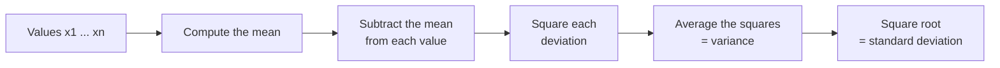

Two models both average 81% accuracy across five training runs. One scores between 80% and 82% every time; the other swings between 70% and 90% depending on the random seed. They have the same mean, but you would only want to ship one of them. The [mean, median and mode](/learn/probability-and-statistics/mean-median-and-mode) tell you where data is centred; **variance** and **standard deviation** tell you how spread out it is. In AI work, spread appears everywhere: in how stable a training run is, in how features are scaled before training, in how weights are initialised, and in every error bar you put on a result.

## Same mean, different story

```python
import statistics

model_a = [0.81, 0.82, 0.80, 0.81, 0.81]   # accuracy over five random seeds
model_b = [0.90, 0.72, 0.85, 0.70, 0.88]

for name, runs in [("A", model_a), ("B", model_b)]:
    print(name, round(statistics.mean(runs), 3), round(statistics.stdev(runs), 3))
```

```output
A 0.81 0.007
B 0.81 0.093
```

The standard deviation exposes what the mean hides. Model A's runs typically sit within about 0.7 percentage points of the mean; model B's within about 9. If you only ran model B once, you might report 90% or 70% by pure luck of the seed.

## Measuring spread from the mean

The simplest spread measure is the **range**, maximum minus minimum, but it depends entirely on the two most extreme values. A better idea is to ask how far, on average, each value lies from the mean.

The distances $x_i - \bar{x}$ themselves always sum to zero (positives cancel negatives), so we square them first. The **variance** is the mean of the squared deviations:

$$
\sigma^2 = \frac{1}{N} \sum_{i=1}^{N} (x_i - \mu)^2
$$

Here $N$ is the number of values in the whole population, $x_i$ is the $i$-th value, $\mu$ (mu) is the population mean, and $\sigma^2$ (sigma squared) is the population variance.

Squaring has two effects. It makes every deviation positive, and it punishes large deviations much more than small ones: a value 10 units away contributes 100, while one 1 unit away contributes 1. This is the same reason mean squared error, which you will meet in [loss functions](/learn/essential-mathematics-for-machine-learning/loss-functions), punishes big mistakes heavily.

The variance has awkward units. If the data is in milliseconds, the variance is in milliseconds squared. Taking the square root returns to the original units and gives the **standard deviation**:

$$
\sigma = \sqrt{\sigma^2}
$$



### A worked example

Take the eight values 2, 4, 4, 4, 5, 5, 7, 9. Their mean is 40 / 8 = 5.

| $x_i$ | $x_i - \mu$ | $(x_i - \mu)^2$ |
| --- | --- | --- |
| 2 | -3 | 9 |
| 4 | -1 | 1 |
| 4 | -1 | 1 |
| 4 | -1 | 1 |
| 5 | 0 | 0 |
| 5 | 0 | 0 |
| 7 | 2 | 4 |
| 9 | 4 | 16 |
| | **Sum** | **32** |

The variance is 32 / 8 = 4, and the standard deviation is $\sqrt{4} = 2$.

## Population or sample: n or n - 1

There is a subtlety. The formula above assumes you have the **entire population**. Usually you have a **sample** drawn from a larger population, and you want to estimate the population's spread. In that case the conventional estimate divides by $n - 1$ instead of $n$:

$$
s^2 = \frac{1}{n - 1} \sum_{i=1}^{n} (x_i - \bar{x})^2
$$

Here $n$ is the sample size, $\bar{x}$ is the sample mean, and $s^2$ is the **sample variance**; its square root $s$ is the sample standard deviation.

Why $n - 1$? The deviations are measured from $\bar{x}$, which was computed from the same sample, and the sample mean is always as close as possible to its own data. So deviations from $\bar{x}$ are systematically a little smaller than deviations from the true mean $\mu$ would be. Dividing by $n - 1$ instead of $n$ (known as **Bessel's correction**) exactly compensates on average. You do not need to take this on trust; a simulation shows it:

```python
import random
import statistics

random.seed(0)
population = [random.gauss(50, 10) for _ in range(100_000)]
true_var = statistics.pvariance(population)

divide_by_n, divide_by_n_minus_1 = [], []
for _ in range(20_000):
    sample = random.sample(population, 5)
    divide_by_n.append(statistics.pvariance(sample))
    divide_by_n_minus_1.append(statistics.variance(sample))

print(round(true_var, 1))
print(round(statistics.mean(divide_by_n), 1))
print(round(statistics.mean(divide_by_n_minus_1), 1))
```

```output
99.7
79.6
99.5
```

With samples of five, dividing by $n$ underestimates the true variance by about 20% (a factor of $(n-1)/n = 4/5$). Dividing by $n - 1$ is right on average. An estimator that is right on average is called **unbiased**. With thousands of data points the difference between $n$ and $n - 1$ is negligible.

## In Python

| Function | Divides by | Use when |
| --- | --- | --- |
| `statistics.pvariance`, `statistics.pstdev` | $n$ | The data is the whole population |
| `statistics.variance`, `statistics.stdev` | $n - 1$ | The data is a sample |
| `np.var(x)`, `np.std(x)` | $n$ by default | Pass `ddof=1` for the sample version |
| pandas `Series.var()`, `Series.std()` | $n - 1$ by default | Pass `ddof=0` for the population version |

```python
import statistics

x = [2, 4, 4, 4, 5, 5, 7, 9]
print(statistics.pvariance(x), statistics.pstdev(x))
print(round(statistics.variance(x), 4), round(statistics.stdev(x), 4))
```

```output
4 2.0
4.5714 2.1381
```

```python
import numpy as np

x = np.array([2, 4, 4, 4, 5, 5, 7, 9])
print(np.std(x), np.std(x, ddof=1))
```

```output
2.0 2.138089935299395
```

`ddof` stands for "delta degrees of freedom": the divisor is $n - \text{ddof}$.

> [!WARNING]
> NumPy and pandas use different defaults, so the "same" standard deviation can differ between two pieces of your code. On small datasets that matters. Pass `ddof` explicitly when the result will be compared or reported.

## Standard deviation in feature scaling

Many models, including linear models, neural networks and anything using distances such as k-nearest neighbours, behave badly when features are on wildly different scales. Income measured in tens of thousands would swamp age measured in tens. **Standardisation** rescales each feature to have mean 0 and standard deviation 1 by computing a **z-score**:

$$
z = \frac{x - \mu}{\sigma}
$$

Here $x$ is the original value, $\mu$ and $\sigma$ are the mean and standard deviation of that feature, and $z$ says how many standard deviations $x$ lies above (positive) or below (negative) the mean.

```python
import statistics

income = [28_000, 35_000, 52_000, 41_000, 120_000]
age = [23, 31, 45, 38, 52]

def standardise(values):
    mu = statistics.mean(values)
    sigma = statistics.pstdev(values)
    return [round((v - mu) / sigma, 2) for v in values]

print(standardise(income))
print(standardise(age))
```

```output
[-0.82, -0.61, -0.1, -0.43, 1.94]
[-1.45, -0.67, 0.71, 0.02, 1.39]
```

Both features now live on the same scale. scikit-learn's `StandardScaler` does exactly this, using the population standard deviation:

```python
import numpy as np
from sklearn.preprocessing import StandardScaler

# columns: income, age
X_train = np.array([[28_000, 23], [35_000, 31], [52_000, 45], [41_000, 38], [120_000, 52]])
scaler = StandardScaler().fit(X_train)

print(scaler.mean_.tolist())
print(scaler.scale_.round(2).tolist())
print(scaler.transform([[60_000, 30]]).round(2).tolist())
```

```output
[55200.0, 37.8]
[33343.07, 10.19]
[[0.14, -0.77]]
```

> [!KEY]
> Fit the scaler (compute $\mu$ and $\sigma$) on the training data only, then use those same numbers to transform validation, test and production inputs. The model learned in "training-data units", so every later input must be measured in the same units.

## Where else spread matters in AI

- **Reporting results.** Report the mean and standard deviation over several seeds, such as "81.0 ± 0.7", rather than a single run.
- **Weight initialisation.** Neural network weights are drawn at random with a carefully chosen standard deviation. Too large and activations explode; too small and they vanish. You will see this in the neural networks phase.
- **Outlier detection.** A value more than about three standard deviations from the mean is rare for many kinds of data and worth investigating.
- **Robust alternatives.** Because squaring amplifies outliers, the standard deviation is itself sensitive to them. The **interquartile range** (75th percentile minus 25th) is a robust alternative, just as the median is to the mean.

## Exercises

**1.** Compute, by hand and then with Python, the population variance and standard deviation of `[1, 3, 5, 7]`.

<details>
<summary>Show solution</summary>

The mean is 4. Deviations are -3, -1, 1, 3; squared, 9, 1, 1, 9, summing to 20. The variance is 20 / 4 = 5 and the standard deviation is $\sqrt{5} \approx 2.236$.

```python
import statistics
print(statistics.pvariance([1, 3, 5, 7]), statistics.pstdev([1, 3, 5, 7]))
```

```output
5 2.23606797749979
```

</details>

**2.** What happens to the standard deviation if you add 100 to every value? If you multiply every value by 3?

<details>
<summary>Show solution</summary>

Adding a constant shifts the mean by the same amount, so every deviation is unchanged and the standard deviation stays the same. Multiplying by 3 multiplies every deviation by 3, so the standard deviation is multiplied by 3 and the variance by 9.

</details>

**3.** A colleague standardises the test set using the test set's own mean and standard deviation. Explain the problem.

<details>
<summary>Show solution</summary>

The model expects inputs scaled with the training statistics. Rescaling the test set with its own statistics changes what a given raw value maps to, so the same input could get a different z-score depending on which batch it arrives in. In production you often score one example at a time, where a standard deviation cannot even be computed. Always reuse the training mean and standard deviation.

</details>

```quiz
[
  {
    "q": "Why are deviations squared when computing the variance?",
    "options": ["To make the result an integer", "Because raw deviations from the mean always sum to zero, and squaring makes them all positive", "To make the variance robust to outliers", "To convert the units back to the original scale"],
    "answer": 1,
    "why": "Positive and negative deviations cancel exactly. Squaring makes every term non-negative; a side effect is that large deviations are weighted heavily, which makes variance sensitive to outliers."
  },
  {
    "q": "You compute the spread of 10 accuracy scores sampled from many possible training runs. Which divisor gives an unbiased variance estimate?",
    "options": ["10", "11", "9", "100"],
    "answer": 2,
    "why": "For a sample of size n, dividing by n - 1 (here 9) corrects for measuring deviations from the sample mean rather than the true mean."
  },
  {
    "q": "What does `np.std(x)` compute by default?",
    "options": ["The population standard deviation, dividing by n", "The sample standard deviation, dividing by n - 1", "The variance", "The interquartile range"],
    "answer": 0,
    "why": "NumPy defaults to `ddof=0`. Pass `ddof=1` for the sample version, which is pandas' default."
  },
  {
    "q": "A feature has mean 50 and standard deviation 5. What is the z-score of the value 40?",
    "options": ["2", "-10", "0.8", "-2"],
    "answer": 3,
    "why": "z = (40 - 50) / 5 = -2: the value is two standard deviations below the mean."
  }
]
```
