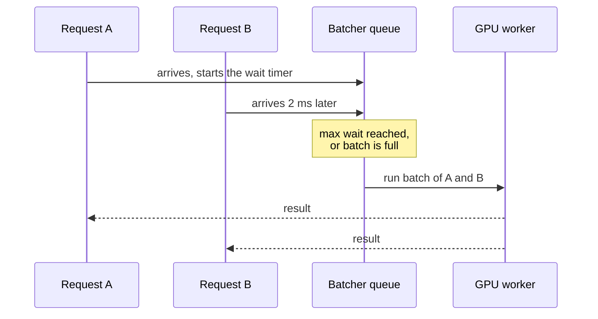
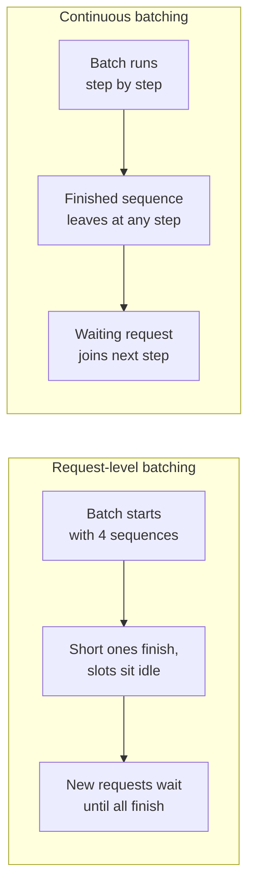

A GPU running a model on one input at a time is like a bus driving with a single passenger. Most of the cost of a forward pass, launching kernels and reading the weights from memory, is the same whether the batch holds one input or sixteen. **Batching** groups several requests into one forward pass so that fixed cost is shared. It is the single most important lever for throughput in model serving, and it comes with a price paid in latency: a request may have to wait for others to join it. This lesson makes that trade-off concrete with a simulation that gives real numbers.

## Why batches are nearly free

Suppose one forward pass costs a fixed overhead plus a small amount per item:

$$
T(n) = t_0 + t_1 n
$$

where $T(n)$ is the time to process a batch of $n$ inputs, $t_0$ is the fixed cost (weight reads, kernel launches, Python overhead) and $t_1$ is the extra cost per input. On GPUs $t_0$ is often much larger than $t_1$ until the batch is big enough to saturate the hardware. The maximum throughput of a single worker is then

$$
\text{throughput}(n) = \frac{n}{t_0 + t_1 n}
$$

With illustrative values $t_0 = 20$ ms and $t_1 = 2$ ms, batch size 1 gives about 45 requests per second, and batch size 16 gives $16 / 52\text{ ms} \approx 307$ requests per second: almost seven times more from the same hardware. The [GPU utilisation](/learn/production-ai-systems/gpu-utilization) lesson explains where the fixed cost comes from.

## Static versus dynamic batching

| Strategy | How a batch forms | Strength | Weakness |
| --- | --- | --- | --- |
| **No batching** | Each request runs alone | Lowest latency at very low load | Poor throughput, collapses under load |
| **Static batching** | Wait until exactly $B$ requests have arrived | Maximum batch efficiency | At low traffic, requests wait a long time for the batch to fill |
| **Dynamic batching** | Run when $B$ requests are waiting **or** the oldest has waited $W$ ms, whichever comes first | Adapts to load: small batches when quiet, large when busy | Two knobs to tune |
| **Continuous batching** (LLMs) | Sequences join and leave the running batch at every generation step | Keeps the GPU full despite outputs of different lengths | Needs a specialised engine |

Static batching suits offline jobs, where you already hold the whole dataset and latency does not matter. Online services use **dynamic batching**, which model servers such as Triton provide as a configuration option: you set a maximum batch size and a maximum queue delay.



## A queueing simulation

The following simulation models one GPU worker using the cost model above. Requests arrive at random (a Poisson process, meaning exponentially distributed gaps between arrivals) at a chosen average rate. For each policy it reports the median and 99th-percentile latency (wait plus processing), the mean batch size actually formed, and the achieved throughput. A request's latency is everything from arrival to result.

```python
import numpy as np

def arrivals(rate_per_s, n=20_000, seed=0):
    rng = np.random.default_rng(seed)
    return np.cumsum(rng.exponential(1000 / rate_per_s, n))   # arrival times in ms

def service_ms(batch_size, overhead=20.0, per_item=2.0):
    return overhead + per_item * batch_size

def simulate(arr, max_batch, max_wait_ms):
    n, i, free_at = len(arr), 0, 0.0
    latency, sizes = np.empty(n), []
    while i < n:
        # the batch starts when the worker is free AND (the batch is full OR the oldest has waited enough)
        full_at = arr[i + max_batch - 1] if i + max_batch - 1 < n else np.inf
        start = max(free_at, min(full_at, arr[i] + max_wait_ms))
        j = min(np.searchsorted(arr, start, side="right"), i + max_batch)
        end = start + service_ms(j - i)
        latency[i:j] = end - arr[i:j]
        sizes.append(j - i)
        i, free_at = j, end
    return latency, np.mean(sizes), n / free_at * 1000

policies = {"no batching": (1, 0), "dynamic 16/5ms": (16, 5),
            "dynamic 16/20ms": (16, 20), "static 16": (16, np.inf)}
print(f"{'load':>5} {'policy':<16}{'p50':>8}{'p99':>9}{'batch':>7}{'thru/s':>8}")
for rate in [10, 40, 200]:
    arr = arrivals(rate)
    for name, (b, w) in policies.items():
        lat, mean_b, thr = simulate(arr, b, w)
        p50, p99 = np.percentile(lat, [50, 99])
        print(f"{rate:>5} {name:<16}{p50:>8.1f}{p99:>9.1f}{mean_b:>7.1f}{thr:>8.1f}")
```

```output
 load policy               p50      p99  batch  thru/s
   10 no batching         22.0     55.6    1.0    10.1
   10 dynamic 16/5ms      27.0     43.4    1.1    10.1
   10 dynamic 16/20ms     42.0     46.0    1.2    10.1
   10 static 16          755.0   2169.7   16.0    10.1
   40 no batching         76.1    376.6    1.0    40.3
   40 dynamic 16/5ms      29.5     48.6    1.4    40.3
   40 dynamic 16/20ms     42.0     50.0    1.8    40.3
   40 static 16          227.7    581.4   16.0    40.3
  200 no batching     170361.8 337231.4    1.0    45.5
  200 dynamic 16/5ms      52.2     86.1    6.8   201.3
  200 dynamic 16/20ms     52.5     85.6    6.9   201.3
  200 static 16           88.0    157.9   16.0   201.3
```

Read the table one load level at a time. Latencies are in milliseconds, loads in requests per second.

- **Light load (10/s).** No batching is best at the median: requests rarely overlap, so waiting only adds delay. Dynamic batching costs a few milliseconds at the median but nothing dramatic. Static batching is a disaster: each request waits for fifteen others, taking most of a second at the median and over two seconds at p99.
- **Moderate load (40/s).** Without batching, the worker is busy about 88% of the time, close to its capacity of about 45/s, and queues build: p99 is 377 ms. Dynamic batching, by grouping just one or two requests at a time, keeps p99 at about 50 ms. Batching improved **latency** here, not just throughput, because it stopped the queue growing.
- **Heavy load (200/s).** Without batching, arrivals exceed capacity, so the queue grows without limit; the latencies of minutes simply reflect how long the simulation ran. Dynamic batching forms batches of about seven and comfortably serves all 200/s with p99 under 90 ms.

> [!KEY]
> Batching trades a small, bounded wait for a large increase in capacity. Below capacity, the wait dominates and batching costs a little latency. Near or above capacity, the queue dominates and batching is what keeps latency finite. The maximum wait $W$ bounds the cost at low load; the maximum batch size $B$ bounds the latency of each batch at high load.

## Tuning the two knobs

- **Maximum batch size $B$.** Increase it until throughput stops improving (the hardware is saturated) or memory runs out. For LLMs the limit is often KV-cache memory rather than compute.
- **Maximum wait $W$.** Choose it from your latency budget. If your p99 target is 200 ms and the model takes 60 ms, you can afford a few milliseconds of batching delay but not 100.

Measure with realistic, bursty traffic. Real traffic is rarely a smooth Poisson stream: bursts form queues that a smooth simulation underestimates.

> [!WARNING]
> Batching inputs of very different sizes wastes work. A batch must be padded to its longest member, so one 2,000-token input in a batch of 50-token inputs makes every row cost 2,000 tokens. Servers mitigate this by **bucketing** requests of similar length together, and LLM engines avoid padding altogether with the techniques below.

## Batching LLM generation

Text generation breaks the simple model. Each request runs for a different number of steps, one per output token. With ordinary dynamic batching, a batch of eight sequences runs until the **longest** finishes; slots freed by short answers sit idle, and new requests wait outside.



**Continuous batching** (also called in-flight or iteration-level batching) schedules at the granularity of a single decoding step: after every step, finished sequences leave and waiting ones join. Combined with paged KV-cache memory management, it is the main reason engines such as vLLM achieve much higher throughput than a naive loop over a transformers model. The details are in [continuous batching](/learn/advanced-llm-engineering/continuous-batching) and [vLLM](/learn/advanced-llm-engineering/vllm).

Hosted LLM APIs offer yet another kind: **batch APIs**, where you submit a file of requests and collect results within hours at a discount. That is offline batching sold as a product, covered in [cost optimisation](/learn/production-ai-systems/cost-optimization).

## Exercises

**1.** Using the formula $n / (t_0 + t_1 n)$ with $t_0 = 20$ and $t_1 = 2$, compute the maximum throughput per second for batch sizes 1, 4, 16 and 64. What value does throughput approach as $n$ grows?

<details>
<summary>Show solution</summary>

```python
for n in [1, 4, 16, 64]:
    print(n, round(n / (20 + 2 * n) * 1000, 1))
```

About 45.5, 142.9, 307.7 and 432.4 per second. As $n$ grows, $n / (t_0 + t_1 n)$ approaches $1 / t_1$, here 500 per second: once the fixed cost is shared, the per-item cost sets the ceiling.

</details>

**2.** Run the simulation at a load of 40 per second with `max_wait_ms` set to 1, 5, 20 and 50 (keeping `max_batch=16`). How do p50 and p99 change, and why?

<details>
<summary>Show solution</summary>

```python
arr = arrivals(40)
for w in [1, 5, 20, 50]:
    lat, mean_b, thr = simulate(arr, 16, w)
    print(w, np.percentile(lat, [50, 99]).round(1), round(mean_b, 2))
```

As the wait grows, the median rises because most requests now wait the full timer before running, while batches grow only modestly at this load (from about 1.3 to 3 requests). At 50 ms even p99 gets worse. A long wait only pays off when traffic is heavy enough to fill batches during it.

</details>

**3.** Explain why static batching with $B = 16$ has a lower p99 at 200 requests per second than at 10 requests per second.

<details>
<summary>Show solution</summary>

At 200 per second, sixteen requests arrive in about 80 ms on average, so the batch fills quickly. At 10 per second it takes about 1.6 seconds to collect sixteen, and the earliest request waits for all of them. Static batching only performs well when traffic is heavy and steady, which is why online services use dynamic batching with a timeout.

</details>

```quiz
[
  {
    "q": "Why does batching increase throughput on a GPU?",
    "options": [
      "It makes each individual input compute faster",
      "It shares the large fixed cost of a forward pass across many inputs",
      "It reduces the model's parameter count",
      "It removes network latency"
    ],
    "answer": 1,
    "why": "Weight reads and kernel launches are paid once per batch, so the cost per input falls as batches grow."
  },
  {
    "q": "In dynamic batching, what does the maximum wait time bound?",
    "options": [
      "The extra delay a request can suffer while waiting for a batch to fill",
      "The total number of requests per second",
      "The GPU memory used",
      "The number of replicas"
    ],
    "answer": 0,
    "why": "A batch runs when it is full or when the oldest request has waited W, so no request waits longer than W for batching."
  },
  {
    "q": "In the simulation at 40 requests per second, why did dynamic batching beat no batching on p99 latency?",
    "options": [
      "Dynamic batching uses a faster model",
      "Without batching the worker ran near capacity, so queues built up; batching added capacity and kept queues short",
      "Batching skips some requests",
      "p99 is always lower with batching at any load"
    ],
    "answer": 1,
    "why": "Near capacity, queueing delay dominates; the extra throughput from batching removes it."
  },
  {
    "q": "What problem does continuous batching solve for LLM serving?",
    "options": [
      "Tokenisation is too slow",
      "Sequences finish at different times, so request-level batches leave slots idle until the longest one ends",
      "Prompts are too long to fit in memory",
      "Models cannot run on more than one GPU"
    ],
    "answer": 1,
    "why": "By scheduling every decoding step, finished sequences leave and new ones join immediately."
  }
]
```
