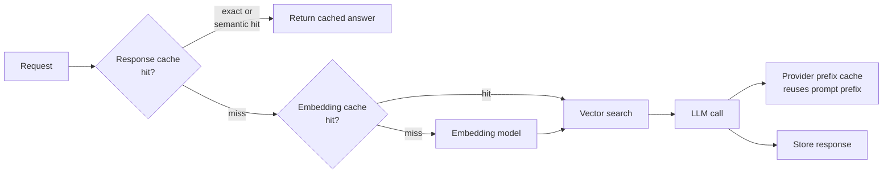

In many AI products a surprising share of requests repeat: the same FAQ asked in slightly different words, the same documents embedded again after every re-index, the same long system prompt sent at the start of every call. A **cache** stores the result of an expensive computation so the next identical (or similar enough) request can reuse it. For AI services, where a single call can take seconds and cost real money, caching is often the largest and cheapest optimisation available. It is also a source of subtle bugs: stale answers, answers meant for someone else, and similar-looking questions that deserve different answers. This lesson covers the cache layers of an AI system and how to use each safely.

## The layers of caching



| Layer | What is stored | Key | Saves |
| --- | --- | --- | --- |
| **Exact-match response cache** | Final answers | Hash of the full normalised request | The whole pipeline |
| **Semantic response cache** | Final answers | Embedding of the question, matched by similarity | The whole pipeline, for paraphrases |
| **Embedding cache** | Vectors | Hash of the text plus embedding model name | Embedding calls during ingestion and querying |
| **Prompt or prefix cache** | Model's internal state (KV cache) for a prompt prefix | Exact token prefix | Prefill compute and input-token cost |

The first three you build yourself. The last happens inside the model server or provider, and your job is to structure prompts so it can work.

## Building a cache key

An exact-match cache is only correct if the key captures **everything that affects the answer**. Two requests with the same user text but a different model, system prompt or temperature are different requests.

```python
import hashlib
import json

def cache_key(model, system_prompt_version, messages, temperature, tenant_id):
    payload = {
        "model": model,
        "system": system_prompt_version,
        "messages": [{"role": m["role"], "content": " ".join(m["content"].lower().split())}
                     for m in messages],
        "temperature": temperature,
        "tenant": tenant_id,
    }
    blob = json.dumps(payload, sort_keys=True)
    return hashlib.sha256(blob.encode()).hexdigest()[:16]

msgs_a = [{"role": "user", "content": "What is your  refund policy?"}]
msgs_b = [{"role": "user", "content": "what is your refund policy?"}]
print(cache_key("small-model", "v7", msgs_a, 0.0, "acme"))
print(cache_key("small-model", "v7", msgs_b, 0.0, "acme"))
print(cache_key("small-model", "v8", msgs_b, 0.0, "acme"))
```

```output
59c5f9157c10bd08
59c5f9157c10bd08
9a48ba5dc8a2779b
```

Normalising whitespace and case makes the first two requests share a key; bumping the system prompt version to `v8` correctly produces a new one, so a prompt change automatically invalidates old answers. Including the **tenant** prevents one customer's cached answer, possibly containing their data, being served to another.

> [!WARNING]
> Only cache responses that are safe to reuse. Answers that depend on the user's private data, the current time, or live tools (account balances, stock levels) must either be excluded or keyed by everything they depend on. Responses sampled at high temperature are also a judgement call: caching them makes a "creative" feature return the same text every time.

## An LRU cache with expiry

Production systems usually use Redis or a similar store for a shared cache, but the logic is worth implementing once. Two policies keep the cache bounded and fresh:

- **LRU (least recently used) eviction**: when the cache is full, drop the entry that has gone unused longest.
- **TTL (time to live)**: every entry expires after a fixed time, so answers cannot go stale forever.

The clock is passed in as a function so the behaviour can be tested deterministically.

```python
from collections import OrderedDict

class LRUTTLCache:
    def __init__(self, capacity, ttl_s, clock):
        self.capacity, self.ttl_s, self.clock = capacity, ttl_s, clock
        self.data = OrderedDict()          # key -> (value, expires_at); order = recency
        self.hits = self.misses = 0

    def get(self, key):
        item = self.data.get(key)
        if item is None or item[1] <= self.clock():
            self.data.pop(key, None)       # drop expired entries lazily
            self.misses += 1
            return None
        self.data.move_to_end(key)         # mark as most recently used
        self.hits += 1
        return item[0]

    def put(self, key, value):
        self.data[key] = (value, self.clock() + self.ttl_s)
        self.data.move_to_end(key)
        if len(self.data) > self.capacity:
            evicted, _ = self.data.popitem(last=False)   # least recently used
            print(f"  evicted {evicted}")

now = [0.0]
cache = LRUTTLCache(capacity=2, ttl_s=60, clock=lambda: now[0])

cache.put("q1", "answer 1")
cache.put("q2", "answer 2")
print("q1 ->", cache.get("q1"))        # q1 becomes most recent
cache.put("q3", "answer 3")             # evicts q2, the least recent
print("q2 ->", cache.get("q2"))
now[0] = 61.0                           # a minute passes
print("q1 ->", cache.get("q1"))        # expired
print(f"hits={cache.hits} misses={cache.misses} size={len(cache.data)}")
```

```output
q1 -> answer 1
  evicted q2
q2 -> None
q1 -> None
hits=1 misses=2 size=1
```

Track the **hit rate**, `hits / (hits + misses)`, as a metric. It tells you whether the cache is earning its keep, and a sudden drop usually means the key changed shape, for example a timestamp crept into the prompt.

## Semantic caching and its threshold problem

Users rarely type exactly the same question twice. A **semantic cache** embeds each question and returns a stored answer if a previous question is similar enough, measured by [cosine similarity](/learn/vector-databases/similarity-search) against a threshold.

The danger is that similarity in embedding space is not the same as "deserves the same answer". The example below uses character n-gram TF-IDF vectors as a stand-in for an embedding model, so it runs anywhere; real embedding models show the same failure, especially with negations, numbers and names.

```python
from sklearn.feature_extraction.text import TfidfVectorizer
from sklearn.metrics.pairwise import cosine_similarity

cached = ["how do i cancel my subscription",
          "what is your refund policy",
          "how do i reset my password"]
queries = ["how can i cancel my subscription",
           "how do i not cancel my subscription",
           "how do i reset my username",
           "what's the refund policy for annual plans"]
vec = TfidfVectorizer(analyzer="char_wb", ngram_range=(2, 4)).fit(cached + queries)
sims = cosine_similarity(vec.transform(queries), vec.transform(cached))
for q, row in zip(queries, sims):
    best = row.argmax()
    print(f"{row[best]:.2f}  {q!r} -> {cached[best]!r}")
```

```output
0.91  'how can i cancel my subscription' -> 'how do i cancel my subscription'
0.90  'how do i not cancel my subscription' -> 'how do i cancel my subscription'
0.43  'how do i reset my username' -> 'how do i reset my password'
0.49  "what's the refund policy for annual plans" -> 'what is your refund policy'
```

The genuine paraphrase scores 0.91 and the question with the opposite meaning scores 0.90. **No threshold separates them.** Set it at 0.85 and the user who wants to keep their subscription gets cancellation instructions; set it at 0.95 and the cache rarely hits at all.

Ways to use semantic caching responsibly:

- Restrict it to **low-risk, high-repetition** content such as public FAQs, never to personalised or high-stakes answers.
- Choose the threshold from a **labelled set of query pairs** (same answer or not) drawn from real traffic, measuring the false-hit rate, not by intuition.
- Add a cheap **verification step**: a small model or reranker confirms that the cached question and the new one really ask the same thing.
- Log semantic hits with both questions so you can audit them.

## Embedding caches

Embedding the same text twice with the same model always gives the same vector, so an embedding cache is safe and simple: key by a hash of the exact text plus the **embedding model name and version**. It pays off when re-indexing documents where most chunks are unchanged, and for repeated queries. Never mix vectors from different embedding models in one index; including the model in the key prevents that by construction.

## Prompt and prefix caching

When many requests start with the same long prefix (a system prompt, tool definitions, a shared document), the model recomputes the same internal state for that prefix every time. **Prefix caching** stores the KV cache of the prefix and reuses it, skipping most of the prefill work. Self-hosted engines such as vLLM offer automatic prefix caching; hosted providers offer **prompt caching**, typically billing cached input tokens at a reduced rate and reducing time to first token. The mechanics and pricing rules differ by provider (some cache automatically, some need explicit markers, all have minimum lengths and expiry times), so check your provider's documentation. The cost side was introduced in [token usage and cost optimisation](/learn/working-with-llms/token-usage-and-cost-optimization), and the underlying KV cache is covered in [KV caching](/learn/advanced-llm-engineering/kv-caching).

> [!TIP]
> Prefix caches match on an exact prefix of tokens. Put stable content first (system prompt, tool schemas, reference documents) and variable content last (the user's question, timestamps, request IDs). A single changing value near the start of the prompt, such as today's date in the first line, defeats the cache for everything after it.

## Exercises

**1.** A team keys its response cache on the user's message text only. List three situations where this returns a wrong answer.

<details>
<summary>Show solution</summary>

Examples: the model or system prompt was updated, so old answers no longer reflect current behaviour; two tenants or users ask the same question but the answer depends on their own data; the answer depends on time or live data (for example "what is my order status?"); generation parameters such as temperature or maximum length differ between callers. The key must include everything that affects the answer.

</details>

**2.** Add a `hit_rate` method to `LRUTTLCache` and show it after the demo above.

<details>
<summary>Show solution</summary>

```python
def hit_rate(self):
    total = self.hits + self.misses
    return self.hits / total if total else 0.0

LRUTTLCache.hit_rate = hit_rate
print(round(cache.hit_rate(), 3))
```

The demo had one hit and two misses, so the hit rate is about 0.333.

</details>

**3.** A prompt begins with `Current time: 2026-11-12T09:31:07Z`, followed by a 3,000-token system prompt and then the user's question. Why is the provider's prompt cache hit rate near zero, and how do you fix it?

<details>
<summary>Show solution</summary>

Prefix caching only reuses an exact token prefix. The timestamp changes every second and sits at the very start, so no two requests share a prefix. Move the timestamp (rounded if possible) to the end of the prompt, after the stable system prompt, so the 3,000 stable tokens form a shared prefix.

</details>

```quiz
[
  {
    "q": "Why should a response cache key include the system prompt version?",
    "options": [
      "To make keys longer and harder to guess",
      "So that changing the prompt automatically stops old answers being served",
      "Because providers require it",
      "To improve the semantic similarity score"
    ],
    "answer": 1,
    "why": "Answers depend on the prompt; versioning it in the key invalidates stale entries when the prompt changes."
  },
  {
    "q": "In an LRU cache at full capacity, which entry is evicted when a new one is added?",
    "options": [
      "The newest entry",
      "The entry used least recently",
      "The largest entry",
      "A random entry"
    ],
    "answer": 1,
    "why": "Least recently used eviction drops the entry that has gone unused for the longest time."
  },
  {
    "q": "What is the main risk of a semantic cache with a low similarity threshold?",
    "options": [
      "It uses too much memory",
      "Questions with different meanings, such as negations, receive a cached answer meant for another question",
      "It never returns a hit",
      "It makes embeddings slower"
    ],
    "answer": 1,
    "why": "Embedding similarity does not guarantee the same intended answer, so false hits return wrong answers."
  },
  {
    "q": "To benefit from prefix or prompt caching, where should a per-request timestamp go?",
    "options": [
      "At the very start of the prompt",
      "Inside the system prompt",
      "Near the end, after the stable content",
      "In the cache key only"
    ],
    "answer": 2,
    "why": "Prefix caches match exact leading tokens, so variable content must come after the shared prefix."
  }
]
```
