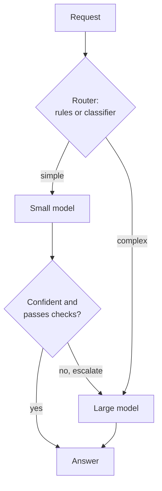

AI features have an unusual cost profile. A traditional web request costs a tiny fraction of a cent and nobody counts them individually; an LLM request can cost a thousand times more, and the cost scales with how much text goes in and comes out. A feature that is cheap in a demo can become the largest line in the company's cloud bill once it has real users. **Cost optimisation** is the discipline of knowing what each request costs, where the money goes, and which levers reduce it without hurting quality. This lesson builds the arithmetic first, then works through the levers: routing, caching, right-sizing, spot capacity and batch processing. It extends the per-call view from [token usage and cost optimisation](/learn/working-with-llms/token-usage-and-cost-optimization) to a whole production system.

> [!NOTE]
> All prices in this lesson are **illustrative round numbers** stored in variables, not real quotes. Provider and cloud prices change often and differ by model, region and contract. Substitute current prices from your provider's pricing page.

## Cost per request

For a hosted LLM API, you pay per token, usually with output tokens priced higher than input tokens:

$$
C_{\text{req}} = \frac{T_{\text{in}} \, p_{\text{in}} + T_{\text{out}} \, p_{\text{out}}}{10^6}
$$

where $T_{\text{in}}$ and $T_{\text{out}}$ are the input and output tokens of the request, and $p_{\text{in}}$ and $p_{\text{out}}$ are the prices per million tokens. In a RAG or agent system, a single user action may involve several model calls, so sum over all of them.

```python
PRICE_IN_PER_M = 3.00     # illustrative, USD per million input tokens
PRICE_OUT_PER_M = 15.00   # illustrative, USD per million output tokens

def request_cost(tokens_in, tokens_out, p_in=PRICE_IN_PER_M, p_out=PRICE_OUT_PER_M):
    return (tokens_in * p_in + tokens_out * p_out) / 1e6

# a RAG answer: system prompt + retrieved chunks + question, then an answer
cost = request_cost(tokens_in=1_200 + 3_000 + 50, tokens_out=350)
requests_per_day = 50_000
print(f"per request: USD {cost:.4f}")
print(f"per day:     USD {cost * requests_per_day:,.0f}")
print(f"per month:   USD {cost * requests_per_day * 30:,.0f}")

share_in = 4_250 * PRICE_IN_PER_M / 1e6 / cost
print(f"input tokens are {share_in:.0%} of the cost")
```

```output
per request: USD 0.0180
per day:     USD 900
per month:   USD 27,000
input tokens are 71% of the cost
```

The breakdown is the useful part. Here input tokens are about 70% of the cost, mostly the retrieved context. Cutting the retrieved chunks from 3,000 to 1,500 tokens saves more than shortening answers would. Always break cost down by component before optimising, exactly as you profile latency before tuning it.

## Self-hosted cost per token

When you run models on your own GPUs, you pay for **time**, not tokens. The cost per token depends on how many tokens you actually push through each GPU-hour:

$$
C_{\text{per M tokens}} = \frac{\text{price per GPU-hour}}{\text{tokens per second} \times 3600 \times u} \times 10^6
$$

where $u$ is the average utilisation, the fraction of paid time spent doing useful work.

```python
GPU_PER_HOUR = 4.00          # illustrative on-demand price, USD
TOKENS_PER_SECOND = 2_500    # measured throughput of your model on this GPU at a good batch size

for utilisation in [1.0, 0.5, 0.2, 0.05]:
    per_m = GPU_PER_HOUR / (TOKENS_PER_SECOND * 3600 * utilisation) * 1e6
    print(f"utilisation {utilisation:>4.0%}: USD {per_m:6.2f} per million tokens")
```

```output
utilisation 100%: USD   0.44 per million tokens
utilisation  50%: USD   0.89 per million tokens
utilisation  20%: USD   2.22 per million tokens
utilisation   5%: USD   8.89 per million tokens
```

The same GPU is twenty times more expensive per token at 5% utilisation than fully loaded. Self-hosting is cheap when traffic is high and steady enough to keep GPUs busy; for spiky or low traffic, a pay-per-token API is often cheaper, even at a higher list price per token. The **throughput** figure must come from your own benchmark at realistic prompt lengths and batch sizes, not a vendor's headline number.

> [!KEY]
> Idle capacity is the hidden cost of self-hosting. A GPU you pay for but do not use is pure waste, so utilisation, driven by [batching](/learn/production-ai-systems/batching) and [autoscaling](/learn/production-ai-systems/scaling), is the main determinant of self-hosted cost per request.

## Routing and cascades

Not every request needs your most capable model. **Model routing** sends each request to the cheapest model likely to handle it well. Two common patterns:



- **Routing**: a rule or a small classifier decides up front (short factual question, small model; multi-step reasoning, large model).
- **Cascade**: always try the small model first and escalate to the large one only when a check fails, such as low confidence, invalid JSON or a failed validation rule.

A cascade's expected cost is the small model's cost on every request plus the large model's cost on the escalated fraction $e$:

$$
\mathbb{E}[C] = C_{\text{small}} + e \, C_{\text{large}}
$$

```python
c_small = request_cost(1_500, 300, p_in=0.20, p_out=0.80)   # illustrative small-model prices
c_large = request_cost(1_500, 300)                           # large model at the prices above

print(f"large only: USD {c_large * 1000:.2f} per 1,000 requests")
for e in [0.1, 0.3, 0.6, 0.9]:
    cascade = c_small + e * c_large
    print(f"cascade, {e:.0%} escalated: USD {cascade * 1000:.2f} per 1,000 ({cascade / c_large:.0%} of large-only)")
```

```output
large only: USD 9.00 per 1,000 requests
cascade, 10% escalated: USD 1.44 per 1,000 (16% of large-only)
cascade, 30% escalated: USD 3.24 per 1,000 (36% of large-only)
cascade, 60% escalated: USD 5.94 per 1,000 (66% of large-only)
cascade, 90% escalated: USD 8.64 per 1,000 (96% of large-only)
```

A cascade is a large saving when the small model handles most traffic. The saving shrinks as escalation rises, because escalated requests pay for both models; with these prices the cascade costs more than the large model alone once over 96% of requests escalate. It also adds latency to escalated requests, which wait for two models. Measure the escalation rate and the quality of answers the small model kept on a labelled evaluation set before switching; a router that saves money by quietly giving worse answers is not a saving.

## The other levers

| Lever | How it saves | Watch out for |
| --- | --- | --- |
| **Response and prefix caching** | Repeated requests and shared prompt prefixes cost less or nothing ([caching](/learn/production-ai-systems/caching)) | Stale or wrongly shared answers |
| **Shorter prompts** | Fewer input tokens: trim system prompts, retrieve fewer and better chunks, summarise long histories | Dropping context the model needs |
| **Output limits** | Fewer output tokens, usually the most expensive kind | Truncated answers |
| **Batch APIs** | Providers offer a discount for asynchronous jobs completed within a window of hours | Only for work that can wait |
| **Right-sizing** | Choose the smallest GPU or instance that meets the latency target; quantise to fit a cheaper GPU | Benchmark at real load, not idle |
| **Spot or preemptible instances** | Spare cloud capacity at a deep discount that can be reclaimed at short notice | Must tolerate interruption |
| **Autoscaling and scale to zero** | Pay only for capacity you use | Cold starts, covered in [scaling](/learn/production-ai-systems/scaling) |
| **Committed use or reserved capacity** | Discount for committing to steady baseline usage | Paying for capacity you stop needing |

**Spot instances** deserve care. They suit batch inference, embedding back-fills and evaluation runs, where a job can checkpoint progress and resume elsewhere. For online serving, they work only as extra capacity on top of an on-demand baseline, with the load balancer draining a replica when the cloud announces it will be reclaimed. See [virtual machines](/learn/cloud-computing/virtual-machines) for the cloud mechanics.

**Batch APIs** are the easiest win for offline work. Classifying a million support tickets, generating evaluation data or embedding an archive rarely needs an answer within seconds. Submitting the work as a batch job, where the provider supports it, usually costs substantially less than the same calls made interactively.

## Making cost visible

You cannot optimise what you do not measure. Record the model, input tokens, output tokens, cached tokens and computed cost for **every** model call, tagged with the feature, the customer or tenant, and the prompt version. Then:

- Build a dashboard of cost per feature and per tenant, and cost per successful outcome rather than per call.
- Set budget alerts and per-tenant quotas so a runaway agent loop or a single abusive customer cannot spend a month's budget overnight.
- Review the most expensive requests regularly; they are often bugs, such as a retry loop or an entire document pasted into the prompt.

> [!WARNING]
> Agents multiply cost. An agent that loops ten times, each time resending a growing conversation history, can cost far more than ten single calls, because input tokens grow with every step. Cap iterations and total tokens per task.

## Exercises

**1.** Using `request_cost`, compare the monthly cost of the RAG example at 50,000 requests per day if (a) retrieved context is cut from 3,000 to 1,500 tokens, or (b) answers are cut from 350 to 200 tokens. Which saves more?

<details>
<summary>Show solution</summary>

```python
base = request_cost(4_250, 350)
a = request_cost(2_750, 350)
b = request_cost(4_250, 200)
for name, c in [("base", base), ("shorter context", a), ("shorter answers", b)]:
    print(name, round(c * 50_000 * 30))
```

Cutting context saves 1,500 input tokens at the input price (about USD 6,750 a month at these illustrative prices); cutting answers saves 150 output tokens at the output price (about USD 3,375). Here context is the bigger lever, even though output tokens are dearer per token.

</details>

**2.** At what utilisation does the self-hosted GPU above match an API that charges USD 2.00 per million tokens for the same model?

<details>
<summary>Show solution</summary>

Solve $4 / (2500 \times 3600 \times u) \times 10^6 = 2$, which gives $u = 4 \times 10^6 / (2 \times 9 \times 10^6) \approx 0.22$. Below about 22% average utilisation, the API is cheaper (before counting engineering and operational effort, which favours the API further).

</details>

**3.** A cascade escalates 35% of requests. Product managers propose lowering the confidence threshold so only 15% escalate. What must you measure before agreeing?

<details>
<summary>Show solution</summary>

The quality of the extra 20% of requests that would now be answered by the small model. Compare their answers with the large model's on a labelled sample. The cost saving is easy to compute; the quality loss is what decides whether the change is acceptable. Also check latency and user-facing signals after rollout.

</details>

```quiz
[
  {
    "q": "A request uses 2,000 input tokens and 500 output tokens. Input costs 1 and output 5 currency units per million tokens. What does it cost?",
    "options": ["0.0045", "0.0025", "0.0070", "0.0450"],
    "answer": 0,
    "why": "(2,000 x 1 + 500 x 5) / 1,000,000 = 4,500 / 1,000,000 = 0.0045."
  },
  {
    "q": "Why can self-hosting be more expensive per token than a pricier API?",
    "options": [
      "Open-weight models are always slower",
      "You pay for GPU time whether or not it is used, so low utilisation raises the cost per token",
      "Self-hosted models need more tokens per answer",
      "Cloud GPUs charge per token"
    ],
    "answer": 1,
    "why": "Cost per token is price per hour divided by tokens processed; idle time processes none."
  },
  {
    "q": "When does a cascade cost more than always using the large model?",
    "options": [
      "When nearly all requests are escalated, so you pay for both models",
      "When the small model is very cheap",
      "When responses are cached",
      "Never"
    ],
    "answer": 0,
    "why": "Expected cost is small cost plus escalation rate times large cost, which exceeds large-only as escalation approaches 100%."
  },
  {
    "q": "Which workload is the best fit for spot instances?",
    "options": [
      "A latency-critical chat service with no other capacity",
      "A nightly batch embedding job that checkpoints its progress",
      "A database primary",
      "A single-replica payment service"
    ],
    "answer": 1,
    "why": "Spot capacity can be reclaimed at short notice, so it suits interruptible, resumable work."
  }
]
```
