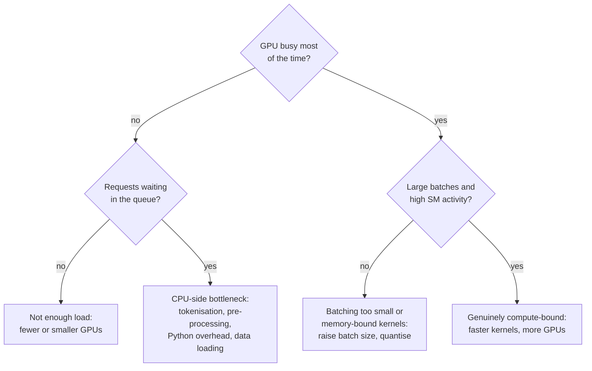

GPUs are usually the most expensive line on an AI service's bill, and they are very easy to waste. A GPU can show "100% utilisation" while doing a small fraction of the work it is capable of, or sit idle waiting for a Python process to tokenise text. This lesson explains what actually limits a GPU during inference, how to tell which limit you are hitting, what the monitoring numbers really mean, and how batch size and model placement change the picture. You saw how to move work onto a GPU in [GPU acceleration](/learn/pytorch/gpu-acceleration) and how to rent one in [GPU instances](/learn/cloud-computing/gpu-instances); this is about using it well.

## Two ceilings: compute and memory bandwidth

Every GPU kernel needs to do arithmetic and move data between the GPU's main memory (HBM) and its compute units. Each has a maximum rate:

- **Peak compute**, in floating-point operations per second (FLOP/s), which depends on the number format (16-bit, 8-bit and so on).
- **Memory bandwidth**, in bytes per second, how fast data can be read from GPU memory.

Which ceiling you hit depends on the **arithmetic intensity** of the work: how many operations you perform per byte moved.

$$
I = \frac{\text{FLOPs performed}}{\text{bytes moved}}
$$

The **roofline model** says the best achievable performance is

$$
P = \min\left(P_{\text{peak}},\ I \times B_{\text{mem}}\right)
$$

where $P_{\text{peak}}$ is the peak compute rate and $B_{\text{mem}}$ is the memory bandwidth. Work with intensity below the **ridge point** $P_{\text{peak}} / B_{\text{mem}}$ is **memory-bound**: the compute units wait for data. Above it, work is **compute-bound**. Modern accelerators can do hundreds of operations in the time it takes to fetch one byte, so the ridge point is high, and a lot of inference falls below it.

## Batch size changes the intensity

A linear layer multiplies a batch of inputs $X$ (size $b \times d$) by a weight matrix $W$ (size $d \times d$). The weights must be read once no matter how many inputs are in the batch, so a larger batch does more arithmetic per weight byte read. For small batches the intensity is roughly equal to the batch size.

The following calculation uses round, **illustrative** hardware figures, not any specific product. Look up your own GPU's data sheet for real values.

```python
PEAK_TFLOPS = 400       # illustrative 16-bit matrix throughput
BANDWIDTH_TBS = 2.0     # illustrative memory bandwidth, TB/s
ridge = PEAK_TFLOPS / BANDWIDTH_TBS   # FLOPs per byte where the two limits meet

d, bytes_per = 4096, 2  # a d x d weight matrix in 16-bit
print(f"ridge point: {ridge:.0f} FLOPs/byte")
print(f"{'batch':>6}{'intensity':>11}{'attainable':>12}{'of peak':>9}{'bound':>9}")
for b in [1, 8, 32, 128, 512, 2048]:
    flops = 2 * b * d * d                              # multiply-adds for X @ W
    bytes_moved = bytes_per * (d * d + 2 * b * d)      # read W and X, write the output
    intensity = flops / bytes_moved
    attainable = min(PEAK_TFLOPS, intensity * BANDWIDTH_TBS)
    bound = "memory" if intensity < ridge else "compute"
    print(f"{b:>6}{intensity:>11.1f}{attainable:>10.0f} T{attainable / PEAK_TFLOPS:>9.1%}{bound:>9}")
```

```output
ridge point: 200 FLOPs/byte
 batch  intensity  attainable  of peak    bound
     1        1.0         2 T     0.5%   memory
     8        8.0        16 T     4.0%   memory
    32       31.5        63 T    15.8%   memory
   128      120.5       241 T    60.2%   memory
   512      409.6       400 T   100.0%  compute
  2048     1024.0       400 T   100.0%  compute
```

At batch size 1 this layer can use about half a percent of the GPU's arithmetic capability. That is exactly the situation of LLM decoding for a single user: every new token requires reading all the weights to do one row of arithmetic. It also explains the batching lesson's cost model: until the batch is large enough to become compute-bound, extra inputs ride along almost for free.

A useful consequence for LLMs is a quick upper bound on single-stream decoding speed. If every token must read all the weights, then

$$
\text{tokens per second} \le \frac{B_{\text{mem}}}{\text{model size in bytes}}
$$

```python
model_bytes = 8e9 * 2                      # 8 billion parameters at 16-bit
print(f"{BANDWIDTH_TBS * 1e12 / model_bytes:.0f} tokens/s upper bound at batch size 1")
print(f"{BANDWIDTH_TBS * 1e12 / (model_bytes / 4):.0f} tokens/s with 4-bit weights")
```

```output
125 tokens/s upper bound at batch size 1
500 tokens/s with 4-bit weights
```

This is why [weight quantisation](/learn/production-ai-systems/quantization) speeds up decoding and why batching many users together is essential for LLM economics.

> [!KEY]
> Small-batch inference, and LLM decoding in particular, is limited by memory bandwidth, not arithmetic. Raising the batch size, reducing bytes per weight and avoiding repeated memory traffic (fused kernels, KV caching) are the levers that move it. Buying a GPU with more FLOP/s does little for a memory-bound workload.

## What the monitoring numbers mean

The first tool everyone reaches for is `nvidia-smi`, which ships with the NVIDIA driver.

```bash
nvidia-smi                                   # snapshot: processes, memory, utilisation
nvidia-smi --query-gpu=utilization.gpu,memory.used,memory.total,power.draw --format=csv -l 5
```

The second command prints a CSV row every five seconds, which is handy during a load test. Interpret its numbers carefully:

| Metric | What it actually measures | Trap |
| --- | --- | --- |
| **GPU utilisation** (`utilization.gpu`) | The fraction of time **at least one kernel** was running | A tiny kernel running constantly shows 100% while most of the chip is idle |
| **Memory used** | GPU memory allocated | LLM servers such as vLLM pre-allocate most memory for the KV cache at start-up, so "90% used" is normal and says nothing about load |
| **Power draw** | Electrical power | A rough but honest proxy for how hard the chip is working |
| **SM activity / occupancy** (DCGM profiling metrics) | How many of the streaming multiprocessors are busy, and how fully | The better measure of real compute use |
| **Tensor core activity** (DCGM) | How busy the matrix units are | Low values on a matrix-heavy model suggest poor batching or wrong precision |

For production, NVIDIA's **Data Center GPU Manager (DCGM)** collects these metrics continuously, and its exporter publishes them to Prometheus so they can sit on the same dashboards as your latency and throughput (see [observability](/learn/production-ai-systems/observability)). The most useful view combines GPU metrics with service metrics: requests per second, batch size and queue depth together tell you *why* the GPU looks the way it does.

## Finding the bottleneck

Low GPU activity during a load test usually means the GPU is starved, not that it is slow.



Common CPU-side culprits are tokenising in a single Python thread, decoding images on the request path, synchronous logging, and copying tensors back and forth between CPU and GPU for each request.

## Sharing a GPU between models

A small model on a large GPU wastes most of it. Options for packing several workloads onto one device:

| Approach | Isolation | Notes |
| --- | --- | --- |
| **Several models in one server process** (for example Triton serving multiple models) | Low: shared memory and failure domain | Simple and efficient; one misbehaving model can affect others |
| **Time-slicing** (several processes take turns) | Low | Easy to configure in Kubernetes; no memory isolation, and context switching adds overhead |
| **CUDA MPS** (Multi-Process Service) | Partial | Lets kernels from several processes run concurrently on the GPU |
| **MIG** (Multi-Instance GPU) | High: dedicated memory and compute slices | Available on some data-centre NVIDIA GPUs; splits one GPU into several smaller isolated GPUs, each with guaranteed resources |

MIG is the right choice when you need predictable latency for several small services, because each instance has its own memory and compute. The cost is rigidity: partitions come in fixed sizes and changing them requires reconfiguration.

> [!WARNING]
> Running two models on one GPU without memory isolation means both compete for memory. An LLM server that pre-allocates most of the GPU for its KV cache leaves nothing for a second model. Configure the memory fraction each process may use, or use MIG.

## Exercises

**1.** Using the illustrative figures above, find the smallest batch size (to the nearest power of two) at which the 4096 by 4096 layer becomes compute-bound. Then repeat with a bandwidth of 4 TB/s. What changes and why?

<details>
<summary>Show solution</summary>

```python
def first_compute_bound(peak, bw, d=4096):
    b = 1
    while (2 * b * d * d) / (2 * (d * d + 2 * b * d)) < peak / bw:
        b *= 2
    return b

print(first_compute_bound(400, 2.0), first_compute_bound(400, 4.0))
```

With 2 TB/s the ridge point is 200 FLOPs per byte and the layer becomes compute-bound at batch size 256. Doubling bandwidth halves the ridge point to 100, so it becomes compute-bound at 128. More bandwidth makes memory-bound work faster and lowers the batch size needed to saturate compute.

</details>

**2.** `nvidia-smi` reports 100% GPU utilisation, yet throughput is a fraction of what the vendor's benchmarks suggest. Give two possible explanations.

<details>
<summary>Show solution</summary>

`utilization.gpu` only says that some kernel was running at every sample, not that the chip was fully used. Possible causes: batch size 1 (memory-bound kernels that occupy few streaming multiprocessors), running in 32-bit instead of 16-bit so tensor cores are unused, or many small unfused kernels. Check DCGM's SM activity and tensor core activity, and the batch sizes actually formed.

</details>

**3.** Estimate the single-stream decoding upper bound in tokens per second for a 70-billion-parameter model in 8-bit on a GPU with 3 TB/s of bandwidth, ignoring the KV cache.

<details>
<summary>Show solution</summary>

The weights are $70 \times 10^9$ bytes. $3 \times 10^{12} / 7 \times 10^{10} \approx 43$ tokens per second at most, before any overheads. Real speeds will be lower; batching many users raises total throughput but not this single-stream ceiling.

</details>

```quiz
[
  {
    "q": "What is arithmetic intensity?",
    "options": [
      "The GPU's clock speed",
      "Floating-point operations performed per byte of memory moved",
      "The percentage of time a kernel is running",
      "The number of parameters per layer"
    ],
    "answer": 1,
    "why": "Intensity compares arithmetic to memory traffic; it decides whether work is memory-bound or compute-bound."
  },
  {
    "q": "Why does increasing batch size raise the arithmetic intensity of a linear layer?",
    "options": [
      "The weights are read once but used for every input in the batch",
      "Larger batches use lower precision",
      "Larger batches skip the activation function",
      "The GPU clock speeds up"
    ],
    "answer": 0,
    "why": "Weight bytes are fixed per pass, while arithmetic grows with the number of inputs."
  },
  {
    "q": "What does `utilization.gpu` in `nvidia-smi` measure?",
    "options": [
      "The fraction of streaming multiprocessors in use",
      "The fraction of time at least one kernel was executing",
      "Memory bandwidth used",
      "Tensor core activity"
    ],
    "answer": 1,
    "why": "It is a time-based measure, so it can read 100% while most of the chip is idle."
  },
  {
    "q": "Which option gives several small services on one GPU dedicated, isolated memory and compute?",
    "options": ["Time-slicing", "Multi-Instance GPU (MIG)", "Running them in one Python process", "Increasing the batch size"],
    "answer": 1,
    "why": "MIG partitions a supported GPU into isolated instances with guaranteed resources."
  }
]
```
