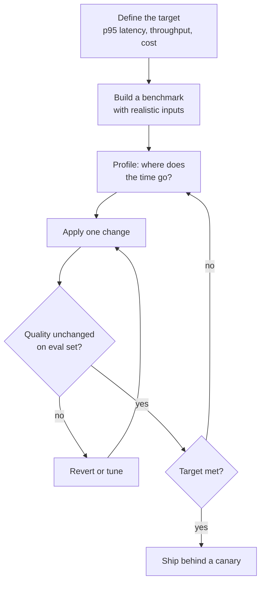

Training happens once; inference happens every time a user sends a request, potentially millions of times a day. A model that is twice as fast to run needs half the hardware, answers sooner and costs half as much. **Inference optimisation** is the toolkit for getting there: making each forward pass cheaper, running fewer of them, and keeping the hardware busy. This lesson is a map of that toolkit. The following lessons go deeper into the most important pieces: quantisation, batching, caching and GPU utilisation.

## Measure before you optimise

The first rule is to find where the time actually goes. A request to an AI service is rarely just a model call; it includes network hops, input parsing, tokenisation, retrieval, the model itself, and post-processing. Optimising the wrong stage gives no visible benefit.


**Amdahl's law** makes the point precise. If a fraction $p$ of the total time is spent in the part you speed up, and you make that part $s$ times faster, the overall speed-up is

$$
S = \frac{1}{(1 - p) + \dfrac{p}{s}}
$$

where $S$ is the end-to-end speed-up. The untouched fraction $1 - p$ sets a ceiling: even an infinitely fast model cannot make the request faster than $1/(1-p)$.

```python
def amdahl(p, s):
    return 1 / ((1 - p) + p / s)

stages_ms = {"network": 40, "retrieval": 120, "tokenise": 5, "model": 300, "postprocess": 15}
total = sum(stages_ms.values())
p_model = stages_ms["model"] / total
print(f"total {total} ms, model share {p_model:.1%}")

for s in [2, 4, 10]:
    print(f"model {s}x faster -> request {amdahl(p_model, s):.2f}x faster")
print(f"ceiling, infinitely fast model -> {1 / (1 - p_model):.2f}x")

p_retrieval = stages_ms["retrieval"] / total
print(f"retrieval 4x faster -> request {amdahl(p_retrieval, 4):.2f}x faster")
```

```output
total 480 ms, model share 62.5%
model 2x faster -> request 1.45x faster
model 4x faster -> request 1.88x faster
model 10x faster -> request 2.29x faster
ceiling, infinitely fast model -> 2.67x
retrieval 4x faster -> request 1.23x faster
```

A heroic 10-times model speed-up gives only about 2.3 times end to end, and the retrieval step, ignored in most discussions, is worth a visible 1.23 times. Profile with traces (see [observability](/learn/production-ai-systems/observability)) before choosing what to optimise.

## The four families of techniques

Almost every inference optimisation falls into one of four families.

| Family | Idea | Examples | Main cost |
| --- | --- | --- | --- |
| **Make the model smaller** | Fewer or cheaper numbers per prediction | Quantisation, distillation, pruning, choosing a smaller model | Possible quality loss; needs evaluation |
| **Make each pass faster** | Same maths, executed more efficiently | Compilation (`torch.compile`, TensorRT), operator fusion, fused attention kernels such as FlashAttention, mixed precision | Build complexity, hardware lock-in |
| **Do fewer passes** | Avoid repeated or wasted work | Response caching, KV caching, prefix caching, speculative decoding, early exit | Memory, staleness, complexity |
| **Use hardware better** | Keep the accelerator busy | Batching, continuous batching, concurrency, right-sized instances | Latency for individual requests |

The families combine: a typical self-hosted LLM deployment uses a quantised model (smaller), fused attention kernels (faster passes), KV and prefix caching (fewer passes) and continuous batching (better hardware use) all at once.

## Free wins: inference mode and evaluation mode

Some optimisations are simply correct practice. In PyTorch, [as covered earlier](/learn/pytorch/model-saving-and-loading), you should call `model.eval()` and run inference inside `torch.inference_mode()`. The first switches layers such as dropout and batch normalisation to their inference behaviour; the second stops PyTorch recording operations for autograd, saving memory and time.

Forgetting `eval()` is not just slow, it is wrong: dropout keeps randomly zeroing activations, so the same input gives different outputs.

```python
import torch
from torch import nn

torch.manual_seed(0)
model = nn.Sequential(nn.Linear(4, 16), nn.ReLU(), nn.Dropout(0.5), nn.Linear(16, 2))
x = torch.ones(1, 4)

def distinct_outputs(model, n=5):
    """Run the same input n times and count how many different outputs appear."""
    return len({tuple(model(x).flatten().tolist()) for _ in range(n)})

with torch.inference_mode():
    print("train mode, distinct outputs for one input:", distinct_outputs(model))
    model.eval()
    print("eval mode, distinct outputs for one input:", distinct_outputs(model))
    print("requires grad:", model(x).requires_grad)
```

```output
train mode, distinct outputs for one input: 4
eval mode, distinct outputs for one input: 1
requires grad: False
```

## Compilation and graph optimisation

Eager PyTorch runs one Python-dispatched operation at a time. **Compilers** look at the whole computation and rewrite it: fusing a matrix multiply, bias add and activation into a single GPU kernel avoids writing the intermediate results to memory and reading them back, which is often the dominant cost.

```python
import torch

model = torch.nn.Sequential(torch.nn.Linear(512, 512), torch.nn.GELU()).eval()
compiled = torch.compile(model)   # first call compiles; later calls reuse the result

with torch.inference_mode():
    out = compiled(torch.randn(8, 512))
```

The same idea, taken further and tied to specific hardware, is what ONNX Runtime and TensorRT do (see [model serving](/learn/production-ai-systems/model-serving)). Two operational consequences follow:

- **Compilation takes time**, so warm the model up with representative inputs at start-up, before the replica reports itself ready. Otherwise the first real users pay the compile cost.
- **Shapes matter.** Compilers often specialise for the input shapes they have seen. A service that receives wildly varying sequence lengths may trigger recompilation; padding inputs to a few fixed "buckets" of length keeps shapes stable.

## Optimisations specific to LLM inference

LLM generation has two phases with very different profiles, which explains why so many LLM-specific techniques exist:

1. **Prefill** processes the whole prompt in one parallel forward pass. It is compute-heavy and determines the **time to first token**.
2. **Decode** produces output tokens one at a time, each requiring a full forward pass that reads all the model's weights from memory to produce a single token per sequence. It is limited by memory bandwidth rather than arithmetic, as the [GPU utilisation](/learn/production-ai-systems/gpu-utilization) lesson explains.

| Technique | What it saves |
| --- | --- |
| **KV cache** | Stores each layer's attention keys and values for tokens already processed, so each decode step only computes the new token. Standard in every serving engine. |
| **Prefix caching** | Reuses the KV cache of a shared prompt prefix (such as a long system prompt) across requests, skipping repeated prefill. |
| **Continuous batching** | Adds and removes sequences from the running batch at every decode step, keeping the GPU full. |
| **Speculative decoding** | A small draft model proposes several tokens; the large model verifies them in one pass, accepting the ones it agrees with. Same output distribution, fewer large-model passes. |
| **Weight quantisation** | Fewer bytes of weights to read per decode step, directly speeding up the memory-bound phase. |

These are introduced across this module and treated in depth in [efficient inference](/learn/advanced-llm-engineering/efficient-inference), [KV caching](/learn/advanced-llm-engineering/kv-caching) and [continuous batching](/learn/advanced-llm-engineering/continuous-batching).

> [!KEY]
> The cheapest inference is the one you never run. Before tuning kernels, ask whether a smaller model, a cached answer, a shorter prompt or fewer output tokens would do. These "do less work" options usually give larger and safer wins than low-level tuning.

## An optimisation workflow



Change one thing at a time, so you know which change helped. Benchmark with **realistic inputs**: a model benchmarked on ten-token prompts will look far better than it performs on the two-thousand-token prompts your users actually send.

> [!WARNING]
> Every optimisation that changes numbers (quantisation, reduced precision, compilation with fast-maths options, a distilled model) must be re-evaluated on a quality benchmark, not just a speed benchmark. Speed regressions are loud; quality regressions are silent.

## Exercises

**1.** Using the `amdahl` function, a request spends 70% of its time in the model. What is the best possible end-to-end speed-up from optimising only the model, and what speed-up do you get from a 3-times faster model?

<details>
<summary>Show solution</summary>

```python
print(1 / (1 - 0.7))        # ceiling: about 3.33x
print(amdahl(0.7, 3))       # about 1.88x
```

The ceiling is $1/(1-0.7) \approx 3.33$. A 3-times faster model gives $1/(0.3 + 0.7/3) \approx 1.88$ times end to end.

</details>

**2.** Classify each technique into one of the four families: (a) serving answers to repeated questions from a cache, (b) replacing a 13-billion-parameter model with a distilled 3-billion-parameter one, (c) increasing the batch size, (d) fusing layer normalisation into the preceding kernel.

<details>
<summary>Show solution</summary>

(a) Do fewer passes. (b) Make the model smaller. (c) Use hardware better. (d) Make each pass faster.

</details>

**3.** Your compiled model is fast in benchmarks, but the first few requests after every deployment are very slow. What is happening, and how do you fix it?

<details>
<summary>Show solution</summary>

The first calls trigger compilation (and possibly other lazy initialisation such as CUDA context creation and memory allocation). Run warm-up requests with representative shapes during start-up and only mark the replica ready once they complete, so users never hit a cold model.

</details>

```quiz
[
  {
    "q": "A request spends 50% of its time in the model. Roughly what end-to-end speed-up does a 10-times faster model give?",
    "options": ["10x", "5x", "About 1.8x", "About 1.1x"],
    "answer": 2,
    "why": "By Amdahl's law, 1 / (0.5 + 0.5/10) = 1 / 0.55, about 1.82."
  },
  {
    "q": "What does operator fusion mainly save?",
    "options": [
      "Model accuracy",
      "Writing intermediate results to memory and reading them back between operations",
      "Disk space for the weights",
      "Network latency"
    ],
    "answer": 1,
    "why": "Fused kernels keep intermediates on-chip instead of round-tripping through GPU memory."
  },
  {
    "q": "Why is the decode phase of LLM generation usually memory-bandwidth bound?",
    "options": [
      "Each step reads all the weights to produce only one token per sequence",
      "Decoding uses more arithmetic than prefill",
      "The tokeniser runs on the GPU",
      "Decode steps cannot use the KV cache"
    ],
    "answer": 0,
    "why": "Little arithmetic is done per byte of weights read, so memory bandwidth limits speed."
  },
  {
    "q": "What happens if you forget `model.eval()` on a model with dropout?",
    "options": [
      "Nothing, `inference_mode` already handles it",
      "The model raises an error",
      "Dropout stays active, so outputs are random and degraded",
      "Gradients are computed but outputs are correct"
    ],
    "answer": 2,
    "why": "`inference_mode` disables gradient tracking, but only `eval()` switches dropout and batch norm to inference behaviour."
  }
]
```
