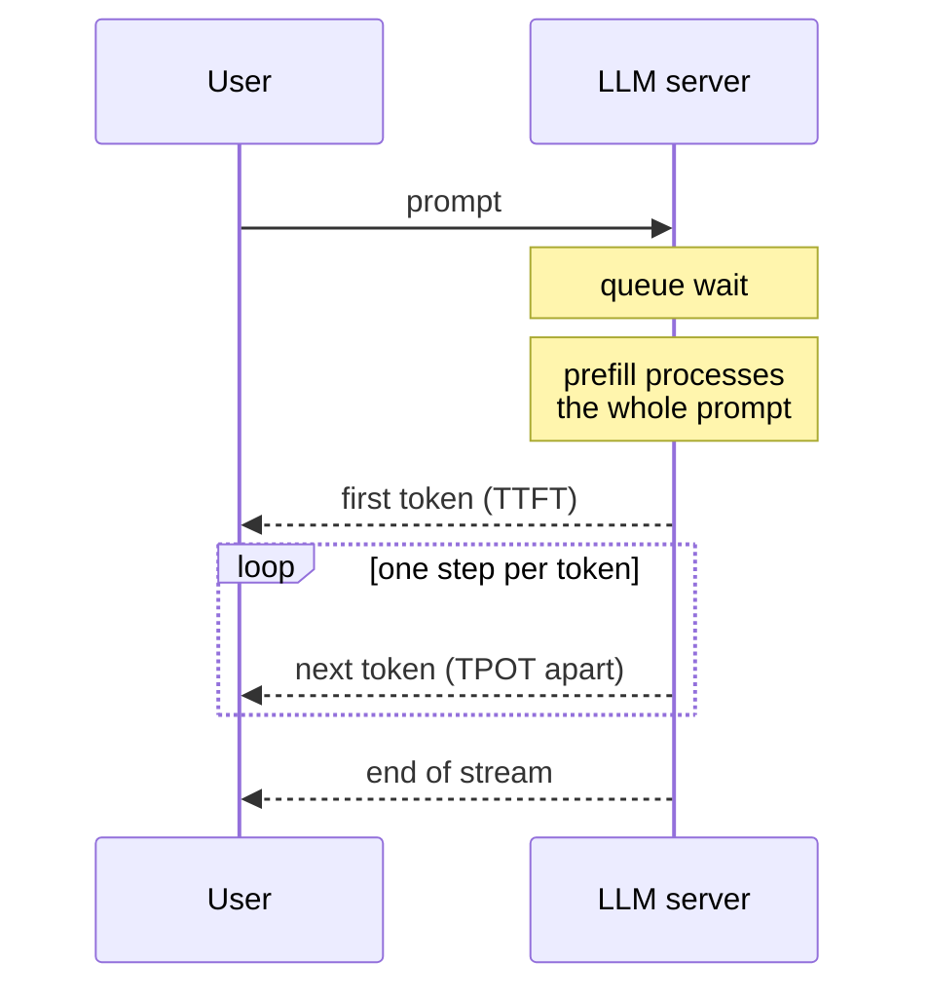

Latency is how long a user waits. It is the property of an AI service users notice first, and the one an average hides best. A service whose average response is a quarter of a second can still leave one user in a hundred waiting two seconds, and for a busy product that is thousands of frustrated people a day. This lesson shows how to measure latency properly with percentiles, why the slow tail matters more than the average, how LLM latency splits into time to first token and generation speed, and which techniques reduce each part.

## Why averages lie

Latency distributions are skewed: most requests are fast, and a small fraction are very slow because of cache misses, retries, garbage-collection pauses, cold replicas or long prompts. The mean mixes these together and describes nobody's experience. **Percentiles** describe the distribution directly: the p95 latency is the value that 95% of requests are faster than.

The following synthetic distribution has 97% of requests on a fast path and 3% on a slow path, a realistic shape for a service with a cache in front of a model.

```python
import numpy as np

rng = np.random.default_rng(42)
n = 100_000
fast = rng.lognormal(mean=np.log(180), sigma=0.3, size=n)        # typical requests
slow = rng.lognormal(mean=np.log(1500), sigma=0.5, size=n)       # cache misses, retries, GC pauses
latency_ms = np.where(rng.random(n) < 0.03, slow, fast)          # 3% take the slow path

print(f"mean   {latency_ms.mean():7.0f} ms")
for p in [50, 90, 95, 99, 99.9]:
    print(f"p{p:<5} {np.percentile(latency_ms, p):7.0f} ms")
print(f"max    {latency_ms.max():7.0f} ms")
```

```output
mean       232 ms
p50        181 ms
p90        279 ms
p95        331 ms
p99       1814 ms
p99.9     3780 ms
max       7354 ms
```

The mean of 232 ms suggests a healthy service. The median user waits 181 ms. But p99 is about **ten times** the median: one request in a hundred takes nearly two seconds. Nothing in the mean warns you of that.

| Percentile | Question it answers | Typical use |
| --- | --- | --- |
| **p50** (median) | What does a typical request experience? | Everyday performance tracking |
| **p95** | What do the unlucky 1 in 20 experience? | Common SLO target for interactive services |
| **p99** | What does the tail look like? | Detecting systemic slow paths |
| **p99.9** and max | What are the worst cases? | Debugging; too noisy for alerting on small volumes |

> [!WARNING]
> Never average percentiles. The p99 of a whole fleet is not the mean of each replica's p99. Compute percentiles from the combined raw data or from mergeable histograms, which is what monitoring systems such as Prometheus do with histogram metrics.

## Computing a percentile by hand

There are several percentile definitions. The **nearest-rank** method is the simplest: sort the values and take the one at position $\lceil p \cdot n / 100 \rceil$, counting from one. NumPy's default interpolates between neighbouring values instead, so its answers can differ slightly on small samples.

```trace
{
  "title": "nearest-rank p90 of ten latencies",
  "code": [
    "import math",
    "latencies = [120, 95, 300, 110, 105, 2100, 98, 130, 101, 115]",
    "ordered = sorted(latencies)",
    "rank = math.ceil(90 / 100 * len(ordered))",
    "p90 = ordered[rank - 1]",
    "print(p90)"
  ],
  "steps": [
    { "line": 2, "vars": { "latencies": "[120, 95, 300, 110, 105, 2100, 98, 130, 101, 115]" }, "note": "Ten request latencies in ms. One is a 2.1 second outlier; the mean is 327.4 ms, higher than nine of the ten values." },
    { "line": 3, "vars": { "ordered": "[95, 98, 101, 105, 110, 115, 120, 130, 300, 2100]" }, "note": "Percentiles work on sorted data." },
    { "line": 4, "vars": { "ordered": "[95, 98, 101, 105, 110, 115, 120, 130, 300, 2100]", "rank": "9" }, "note": "90% of 10 values is 9, so the p90 is the 9th value in sorted order." },
    { "line": 5, "vars": { "rank": "9", "p90": "300" }, "note": "Index rank - 1 = 8 because Python counts from zero." },
    { "line": 6, "vars": { "p90": "300" }, "out": ["300"], "note": "Nine of ten requests took 300 ms or less. With only ten samples, the p99 would simply be the maximum: tail percentiles need many samples to mean anything." }
  ]
}
```

## Tail latency at scale

The tail matters more as systems grow, because one user action often depends on several backend calls: retrieval, a reranker, an LLM call, a moderation check. If the action must wait for all of them, it is slow whenever **any** of them is slow. If each call independently has a 1% chance of hitting its p99, the chance that a request touching $n$ such calls hits at least one is

$$
P(\text{at least one slow}) = 1 - 0.99^{\,n}
$$

```python
for n in [1, 5, 10, 50, 100]:
    print(f"{n:>3} calls: {1 - 0.99 ** n:.1%} of requests hit at least one p99")
```

```output
  1 calls: 1.0% of requests hit at least one p99
  5 calls: 4.9% of requests hit at least one p99
 10 calls: 9.6% of requests hit at least one p99
 50 calls: 39.5% of requests hit at least one p99
100 calls: 63.4% of requests hit at least one p99
```

With 100 parallel calls, nearly two-thirds of requests see a backend's tail latency. This is why agentic and multi-step pipelines feel slow even when each component looks fast in isolation: the tail of each step becomes the typical experience of the whole.

## Latency of LLM responses

For a generative model, one latency number is not enough. A response streams out token by token, so two numbers matter:

- **Time to first token (TTFT)**: queueing plus processing the whole prompt (prefill). It dominates how responsive the product feels.
- **Time per output token (TPOT)**, also called inter-token latency; its inverse is the **tokens per second** of generation.

$$
T_{\text{total}} \approx \text{TTFT} + (N_{\text{out}} - 1) \times \text{TPOT}
$$

where $N_{\text{out}}$ is the number of output tokens.



```python
def total_ms(ttft_ms, tpot_ms, n_out):
    return ttft_ms + (n_out - 1) * tpot_ms

for label, ttft, tpot, n_out in [("chat answer", 400, 25, 300),
                                 ("short classification", 400, 25, 5),
                                 ("same answer, half the tokens", 400, 25, 150)]:
    print(f"{label:<30} {total_ms(ttft, tpot, n_out) / 1000:5.2f} s")
```

```output
chat answer                     7.88 s
short classification            0.50 s
same answer, half the tokens    4.12 s
```

Output length dominates long answers: halving the output tokens nearly halves the total time, which is why "be concise" instructions and sensible `max_tokens` limits are latency optimisations. For short outputs such as classification, TTFT dominates, so prompt length and queueing are what matter.

**Streaming** does not reduce total time, but it changes perceived latency enormously: the user starts reading after the TTFT instead of after the full eight seconds. For any user-facing text generation, stream (see [streaming responses](/learn/working-with-llms/streaming-responses)). Measure TTFT and TPOT as separate metrics; they are improved by different means.

## Techniques by component

| Component | Techniques |
| --- | --- |
| **Queueing** | Enough capacity and good [load balancing](/learn/production-ai-systems/load-balancing); autoscale before saturation; separate interactive and bulk traffic so batch jobs do not queue ahead of users |
| **TTFT (prefill)** | Shorter prompts; [prefix caching](/learn/production-ai-systems/caching) of shared system prompts; smaller retrieved context; a smaller model |
| **TPOT (decode)** | Smaller or [quantised](/learn/production-ai-systems/quantization) model; speculative decoding; avoid batches so large they slow every stream |
| **Output length** | Ask for concise answers; structured outputs instead of prose; set maximum tokens |
| **Pipeline** | Run independent steps in parallel with `asyncio`; cache retrieval and embeddings; skip steps that are not needed for simple queries |
| **Network** | Reuse HTTP connections; deploy in the region of your users and your model provider |
| **Tail** | Timeouts; **hedged requests** (if a request has not returned by its p95, send a duplicate to another replica and take whichever answers first) |

> [!TIP]
> Hedged requests attack the tail cheaply: waiting until the p95 before hedging means only about 5% of requests are duplicated. They suit idempotent, read-only calls such as retrieval. Do not hedge expensive LLM generations blindly, since every duplicate costs tokens.

There is a direct tension between latency and throughput, seen in the [batching](/learn/production-ai-systems/batching) lesson: larger batches give more tokens per second per GPU but slower tokens for each user. Decide which one your product needs. A chat interface cares about TTFT and per-user speed; an overnight summarisation job cares only about throughput.

## Exercises

**1.** Using `latency_ms` from the first example, compute the p99 of only the fast path and only the slow path, using a boolean mask. What does this tell you about where to focus?

<details>
<summary>Show solution</summary>

Regenerate with the mask kept, then compare:

```python
rng = np.random.default_rng(42)
fast = rng.lognormal(np.log(180), 0.3, n)
slow = rng.lognormal(np.log(1500), 0.5, n)
is_slow = rng.random(n) < 0.03
latency_ms = np.where(is_slow, slow, fast)
print(np.percentile(latency_ms[~is_slow], 99), np.percentile(latency_ms[is_slow], 50))
```

The fast path's own p99 is only around 360 ms, while even the median slow-path request takes about 1.5 seconds. The overall p99 is entirely caused by the 3% slow path, so reducing how often requests take it (better cache hit rate, fewer retries) helps far more than speeding up the model.

</details>

**2.** An LLM feature has TTFT 600 ms, TPOT 30 ms and typical outputs of 400 tokens. Users complain it is slow. Estimate the total time, then estimate it after (a) halving the output length and (b) halving TTFT. Which change helps more?

<details>
<summary>Show solution</summary>

```python
print(total_ms(600, 30, 400), total_ms(600, 30, 200), total_ms(300, 30, 400))
```

The total is about 12.6 s. Halving output gives about 6.6 s; halving TTFT gives about 12.3 s. For long outputs, output length matters far more. Streaming would also help the perceived wait, since users start reading after 600 ms.

</details>

**3.** A request fans out to 20 independent retrieval shards and waits for all of them. Each shard has p99 of 200 ms and median of 40 ms. Roughly what fraction of requests will take at least 200 ms?

<details>
<summary>Show solution</summary>

$1 - 0.99^{20} \approx 0.18$, so about 18% of requests wait for at least one shard's tail. Hedging the slowest shards or returning partial results after a deadline are standard fixes.

</details>

```quiz
[
  {
    "q": "Why is mean latency a poor service-level indicator?",
    "options": [
      "It is hard to compute",
      "It is dominated by the fastest requests",
      "It hides the skewed tail that many users actually experience",
      "It is always higher than p99"
    ],
    "answer": 2,
    "why": "Latency is skewed; the mean describes no real user and masks a slow tail."
  },
  {
    "q": "An LLM response has TTFT 500 ms, TPOT 20 ms and 101 output tokens. Roughly how long is the full response?",
    "options": ["0.5 s", "2.0 s", "2.5 s", "20 s"],
    "answer": 2,
    "why": "500 + 100 x 20 = 2,500 ms."
  },
  {
    "q": "What does streaming improve?",
    "options": [
      "Total generation time",
      "Perceived latency, because the user sees output after the time to first token",
      "Tokens per second on the GPU",
      "The cost per request"
    ],
    "answer": 1,
    "why": "The work is the same, but the user starts reading as soon as the first tokens arrive."
  },
  {
    "q": "Each of 50 parallel backend calls has a 1% chance of being slow. What fraction of requests that wait for all of them are slowed?",
    "options": ["About 1%", "About 5%", "About 40%", "About 99%"],
    "answer": 2,
    "why": "1 - 0.99^50 is about 0.39."
  }
]
```
