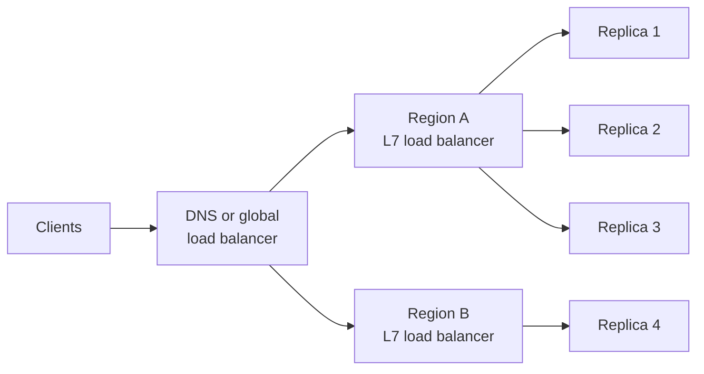
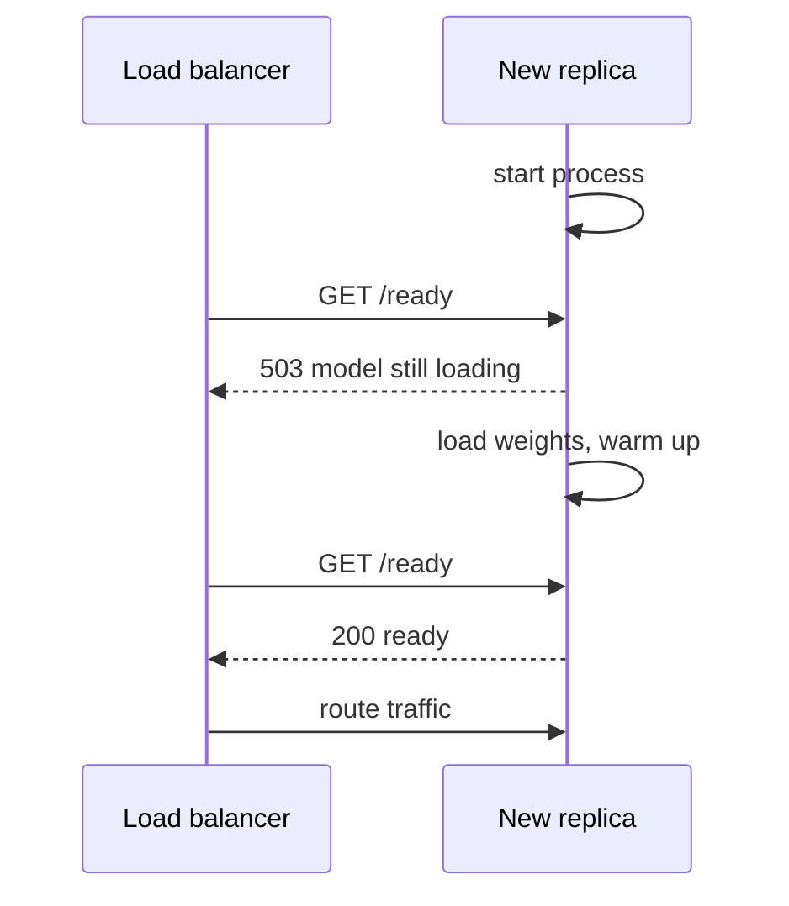

Once a service runs on several replicas, something has to decide which replica handles each request. That is the **load balancer**. For ordinary web traffic, where every request costs about the same, almost any strategy works. AI traffic is different: one LLM request may finish in 200 milliseconds and the next may generate for thirty seconds, replicas hold caches that make some requests much cheaper on one replica than another, and a replica that has crashed or is still loading its model must receive nothing. This lesson covers the balancing algorithms, why "least outstanding requests" suits LLMs, how to route for cache affinity without overloading replicas, and how health checks keep broken replicas out of rotation.

## Where load balancing happens



Global balancing sends users to a nearby healthy region. Within a region, a **layer 7** (HTTP-aware) load balancer such as a cloud application load balancer, Envoy, NGINX or a Kubernetes ingress or gateway picks a replica per request. Layer 7 matters for AI services because it can read request paths and headers, and therefore route by model, tenant or session. The networking basics are in [container networking](/learn/docker-and-containers/container-networking).

## Balancing algorithms

| Algorithm | How it picks | Strength | Weakness |
| --- | --- | --- | --- |
| **Round robin** | Each replica in turn | Simple, even request counts | Ignores how busy each replica is |
| **Weighted round robin** | In turn, proportional to weights | Mixes replica sizes (for example two GPU types) | Weights are static |
| **Random** | Uniformly at random | No shared state | Uneven by chance |
| **Least connections / least outstanding requests** | The replica with the fewest requests in progress | Adapts to requests of different cost | Needs up-to-date counts |
| **Power of two choices** | Sample two replicas at random, send to the less loaded | Nearly as good as least outstanding, cheap with many balancers | Slightly worse than full information |
| **Consistent hashing** | Hash a key (session, user, prompt prefix) to a replica | Affinity: the same key goes to the same replica | Can create hot spots |

Least outstanding requests is supported by major load balancers; for example, AWS Application Load Balancers offer it as a routing algorithm, and Envoy's least-request balancer uses power-of-two choices by default.

## Why request counts are not enough for LLMs

Round robin sends the same number of requests to each replica. With LLMs, request **cost** varies enormously, so equal counts produce unequal load: one replica can end up with three long generations while another sits idle.

The simulation below models four replicas, each processing one request at a time from its own queue. Requests arrive at random; 80% are short (mean 0.2 s) and 20% are long generations (mean 3 s), giving about 57% average utilisation. It compares four policies.

```python
import numpy as np

rng = np.random.default_rng(7)
n, servers, rate = 50_000, 4, 3.0                       # 3 requests per second over 4 replicas
arrive = np.cumsum(rng.exponential(1 / rate, n))
long_req = rng.random(n) < 0.2                          # 20% are long generations
service = np.where(long_req, rng.exponential(3.0, n), rng.exponential(0.2, n))

def run(policy):
    free_at = np.zeros(servers)                         # when each replica finishes its queue
    finishes = [[] for _ in range(servers)]             # finish times of requests sent to each
    latency = np.empty(n)
    pick_rng = np.random.default_rng(1)
    for i in range(n):
        t = arrive[i]
        outstanding = [sum(f > t for f in finishes[s][-50:]) for s in range(servers)]
        if policy == "round robin":
            s = i % servers
        elif policy == "random":
            s = pick_rng.integers(servers)
        elif policy == "power of two":
            a, b = pick_rng.choice(servers, 2, replace=False)
            s = a if outstanding[a] <= outstanding[b] else b
        else:                                           # least outstanding requests
            s = int(np.argmin(outstanding))
        start = max(t, free_at[s])
        free_at[s] = start + service[i]
        finishes[s].append(free_at[s])
        latency[i] = free_at[s] - t
    return latency

print(f"{'policy':<20}{'mean wait':>10}{'p50':>7}{'p99':>7}")
for policy in ["random", "round robin", "power of two", "least outstanding"]:
    lat = run(policy)
    wait = (lat - service).mean()                       # time spent queued behind others
    p50, p99 = np.percentile(lat, [50, 99])
    print(f"{policy:<20}{wait:>9.2f}s{p50:>6.2f}s{p99:>6.1f}s")
```

```output
policy               mean wait    p50    p99
random                   3.32s  1.35s  26.3s
round robin              2.72s  0.92s  25.0s
power of two             1.09s  0.38s  15.0s
least outstanding        0.60s  0.27s  13.1s
```

Same hardware, same traffic, very different results. Round robin is only modestly better than random, because counting requests says nothing about their cost. Least outstanding requests cuts the average queueing wait by more than four times and the median latency by more than three, because it notices that a replica is stuck on a long generation and sends new work elsewhere. Power of two choices gets most of that benefit while only checking two replicas. The p99 roughly halves but stays high for every policy, because the long requests themselves take many seconds: balancing removes waiting, not work.

> [!KEY]
> For LLM serving, balance on **work in progress**, not on request counts. Least outstanding requests, or a server-reported load signal such as running and waiting sequences, adapts to the huge variation in request cost.

## Sticky sessions and prefix-cache affinity

Sometimes you **want** related requests to land on the same replica. LLM servers with prefix caching keep the KV cache of recent prompts in GPU memory. A multi-turn conversation resends the whole history each turn; if turn five reaches the replica that served turn four, the history is already cached and only the new message needs prefill. Sent elsewhere, the whole history is recomputed.

Two ways to get affinity:

- **Sticky sessions**: the load balancer pins a client to a replica, usually with a cookie. Simple, but blind to load.
- **Consistent hashing**: hash a key, such as a conversation ID or a hash of the system prompt, to choose the replica. Good hashing schemes move only a small fraction of keys when replicas are added or removed, so most caches survive scaling events.

The difference between naive and consistent hashing is easy to demonstrate. Rendezvous hashing, one consistent scheme, scores every replica for each key and picks the highest.

```python
import hashlib

def h(text):
    return int(hashlib.sha256(text.encode()).hexdigest(), 16)

def modulo_pick(key, replicas):
    return replicas[h(key) % len(replicas)]

def rendezvous_pick(key, replicas):
    return max(replicas, key=lambda r: h(f"{key}|{r}"))   # highest score wins

keys = [f"session-{i}" for i in range(10_000)]
before = ["r1", "r2", "r3", "r4", "r5"]
after = ["r1", "r2", "r3", "r4"]                           # r5 removed

for name, pick in [("modulo", modulo_pick), ("rendezvous", rendezvous_pick)]:
    moved = sum(pick(k, before) != pick(k, after) for k in keys)
    print(f"{name:<11} {moved / len(keys):.0%} of sessions moved replica")
```

```output
modulo      81% of sessions moved replica
rendezvous  20% of sessions moved replica
```

With `hash % n`, removing one of five replicas reshuffles about four in five sessions and destroys most caches. With rendezvous hashing, only the sessions that lived on the removed replica (one in five) move.

Affinity fights with balance: a popular system prompt or a very active tenant can make one replica a hot spot. Production LLM routers therefore combine the two, preferring the replica that holds the cached prefix **unless** it is much busier than the others, in which case they fall back to the least-loaded replica. Treat affinity as an optimisation, never a correctness requirement: any replica must be able to serve any request.

## Health checks

A load balancer must stop sending traffic to replicas that cannot serve it. Distinguish two kinds of check, as Kubernetes does:

| Check | Question | On failure |
| --- | --- | --- |
| **Liveness** | Is the process alive, or hung? | Restart the container |
| **Readiness** | Can it serve requests right now? | Remove from the load balancer, but do not restart |



For model servers, readiness must mean **the model is loaded and warmed up**, which can take minutes. A liveness check that fails during that load will restart the container in a loop, so give liveness a generous start-up allowance (Kubernetes has a separate startup probe for this). Keep checks cheap: running a full LLM generation every few seconds wastes capacity.

> [!WARNING]
> Health checks catch dead replicas, not sick ones. A replica whose GPU has entered an error state may still answer HTTP checks while every inference fails. Use **passive health checking** (outlier detection) as well: eject replicas whose real requests return errors or time out far more often than their peers.

Finally, when a replica is removed during a deployment or scale-down, **drain** it: stop sending new requests and let in-flight generations finish, within a timeout, before stopping the process. Otherwise every scale-down cuts off users mid-answer.

## Exercises

**1.** Add a `"weighted"` policy to `run` where replica 0 is twice as fast as the others (divide its service times by two) and receives twice as many requests in a weighted round-robin. Compare it with least outstanding requests on the same heterogeneous replicas.

<details>
<summary>Show solution</summary>

One approach: build a fixed rotation `[0, 0, 1, 2, 3]`, pick `s = rotation[i % 5]`, and when computing the service time use `service[i] / 2 if s == 0 else service[i]`. Apply the same speed-up inside the least-outstanding branch. Weighted round robin handles the speed difference on average but still ignores request cost, so you should find least outstanding requests still gives much lower waits; it adapts to both replica speed and request length automatically.

</details>

**2.** Why should a model server's readiness check fail while the model is loading, but its liveness check succeed?

<details>
<summary>Show solution</summary>

During loading the process is healthy (so it should not be restarted, which would only restart the load) but it cannot serve requests (so the load balancer must not send any). Readiness controls traffic; liveness controls restarts.

</details>

**3.** A chatbot routes by consistent hashing on the conversation ID to exploit prefix caching. One enterprise customer runs an automated agent that generates thousands of turns in one conversation. What goes wrong, and how do you fix it?

<details>
<summary>Show solution</summary>

All of that conversation's traffic lands on one replica, creating a hot spot with long queues while other replicas idle. Use bounded-load affinity: prefer the hashed replica only while its outstanding work is within some factor of the average, otherwise route to the least-loaded replica. Per-tenant rate limits also help.

</details>

```quiz
[
  {
    "q": "Why does round robin perform poorly for LLM traffic?",
    "options": [
      "It cannot handle HTTPS",
      "It balances request counts, but LLM request costs vary enormously",
      "It always sends traffic to one replica",
      "It requires sticky sessions"
    ],
    "answer": 1,
    "why": "Equal counts of very unequal requests give unequal load; some replicas queue while others idle."
  },
  {
    "q": "What does the power of two choices algorithm do?",
    "options": [
      "Uses two load balancers",
      "Sends each request to two replicas",
      "Samples two replicas at random and picks the less loaded one",
      "Doubles capacity when load is high"
    ],
    "answer": 2,
    "why": "It gets most of the benefit of least-loaded routing while only checking two replicas."
  },
  {
    "q": "What is the benefit of consistent hashing over `hash(key) % n` for cache affinity?",
    "options": [
      "It is faster to compute",
      "When replicas are added or removed, only a small fraction of keys move",
      "It guarantees perfectly even load",
      "It encrypts the key"
    ],
    "answer": 1,
    "why": "Modulo hashing reshuffles most keys when n changes, destroying caches; consistent schemes move only the affected keys."
  },
  {
    "q": "A model server is still loading its weights. What should its probes report?",
    "options": [
      "Liveness fail, readiness fail",
      "Liveness pass, readiness pass",
      "Liveness pass, readiness fail",
      "Liveness fail, readiness pass"
    ],
    "answer": 2,
    "why": "The process is healthy and should not be restarted, but it must not receive traffic until the model is ready."
  }
]
```
