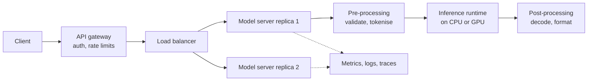
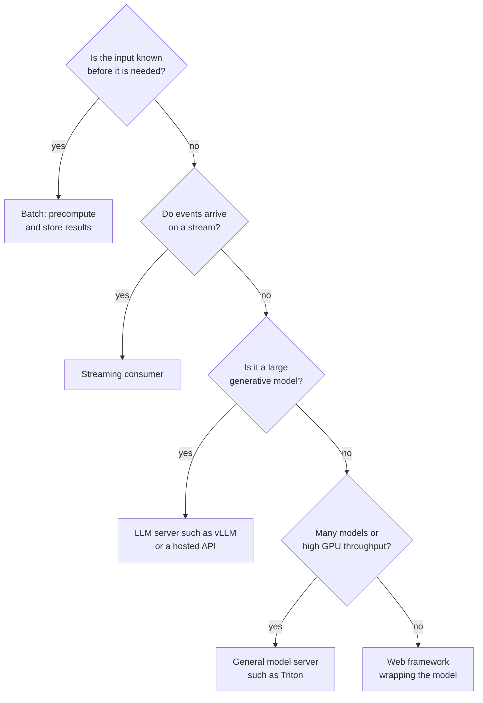

A trained model sitting in a file is worth nothing until something can send it inputs and get predictions back. **Model serving** is everything between that file and a user: loading the weights once, accepting requests, validating them, running inference on the right hardware, returning results, and doing it reliably under load. The previous modules showed you how to [host a model in the cloud](/learn/cloud-computing/model-hosting) and how to [build an API with FastAPI](/learn/fastapi/fastapi-fundamentals). This module takes the operational view: how production AI services are shaped, why they are fast or slow, what they cost, and how they stay up. This first lesson sets out the vocabulary and the architectures the rest of the module builds on.

## Three ways to serve a model

Before choosing any tool, decide **when** predictions are needed. That single decision shapes the whole system.

| Pattern | When predictions are made | Latency target | Typical examples |
| --- | --- | --- | --- |
| **Online (real-time)** | On demand, one request at a time | Milliseconds to a few seconds | Chat assistants, fraud checks at checkout, search ranking |
| **Batch (offline)** | On a schedule, over a whole dataset | Minutes to hours for the job | Nightly churn scores, embedding a document archive, weekly recommendations |
| **Streaming** | Continuously, as events arrive on a stream | Seconds | Scoring every transaction from a Kafka topic, live anomaly detection on sensor data |

Batch serving is the cheapest and simplest: no servers waiting idle, no latency budget, and failures can be retried by re-running the job. Use it whenever predictions can be computed ahead of time and looked up later. Online serving is needed when the input only exists at request time, such as a user's question to a chatbot. Streaming sits in between: inputs arrive continuously, and the system processes them as they come rather than on demand or on a schedule.

> [!TIP]
> A common and effective hybrid is to **precompute in batch, serve online**. Recommendations or embeddings for every known item are computed nightly and stored in a database or vector store; the online path only does a cheap lookup plus a small amount of fresh computation.

Note that "streaming" also has a second meaning for LLMs: sending generated tokens to the client as they are produced, covered in [streaming responses](/learn/working-with-llms/streaming-responses). That is a property of an online response, not a separate architecture.

## Anatomy of an online serving stack

Whatever tools you pick, an online inference service has the same layers.



- The **gateway** handles authentication, quotas and routing to the right model or version.
- The **load balancer** spreads requests over **replicas**, identical copies of the server, so the service can scale and survive one copy failing. See [load balancing](/learn/production-ai-systems/load-balancing) and [scaling](/learn/production-ai-systems/scaling).
- The **model server** owns the process that keeps the model in memory, queues requests, often batches them together, and exposes health and metrics endpoints.
- The **runtime** is the engine that actually executes the model's maths: PyTorch, ONNX Runtime, TensorRT, llama.cpp and so on.

Separating the server from the runtime is a useful mental model: the server decides *which* requests run *when*; the runtime decides *how fast* each batch of them runs.

## Model servers by role

You can serve a model with a plain FastAPI app, and for small models with modest traffic that is often the right choice. Dedicated model servers exist because they solve problems you would otherwise rebuild yourself: request batching, multiple models per process, GPU memory management, metrics and, for LLMs, efficient token generation.

| Server | Role | Good fit |
| --- | --- | --- |
| **FastAPI (or similar) + your code** | General web framework wrapping a model you load yourself | Small or classical models, custom logic, low to moderate traffic |
| **NVIDIA Triton Inference Server** | Multi-framework server (TensorRT, ONNX, PyTorch, Python backends) with dynamic batching and model ensembles | Many models of different types on shared GPUs, high-throughput non-LLM inference |
| **TorchServe** | Server for PyTorch models packaged with handler code | Teams standardised on PyTorch; check the project's current maintenance status before adopting |
| **vLLM** | High-throughput LLM inference engine and OpenAI-compatible server | Self-hosted open-weight LLMs on GPUs where throughput matters |
| **Text Generation Inference (TGI)** | Hugging Face's LLM serving server | LLMs from the Hugging Face Hub; check the project's current status and recommendations |
| **Ollama** | Simple local runner for quantised LLMs, built on llama.cpp | Local development, laptops, single-user or small internal tools |

LLM servers such as vLLM are a special case because text generation is a loop of many forward passes, one per output token. Their key techniques, **continuous batching** and **paged KV caching**, are introduced in the [batching](/learn/production-ai-systems/batching) lesson and covered in depth in [vLLM](/learn/advanced-llm-engineering/vllm), [continuous batching](/learn/advanced-llm-engineering/continuous-batching) and [KV caching](/learn/advanced-llm-engineering/kv-caching).

> [!NOTE]
> Many LLM servers expose an **OpenAI-compatible HTTP API**. That is valuable operationally: client code written against a hosted API can be pointed at a self-hosted model by changing the base URL, which makes fallbacks and migrations much easier.

## Runtimes: ONNX Runtime and TensorRT

Training frameworks are designed for flexibility; inference runtimes are designed for speed on a fixed graph.

- **ONNX** is an open file format describing a model as a graph of standard operators. You export a PyTorch or scikit-learn model to ONNX once, and **ONNX Runtime** executes it on CPUs or GPUs through pluggable *execution providers*. It applies graph optimisations such as fusing several operators into one, and removes the Python and autograd overhead of the training framework.
- **TensorRT** is NVIDIA's compiler and runtime for NVIDIA GPUs. It takes a model (often via ONNX), chooses fast kernels for the specific GPU, fuses layers and can run in reduced precision. The resulting *engine* is tied to the GPU type and TensorRT version it was built for, so you rebuild it when either changes. TensorRT-LLM applies the same idea to large language models.

The trade-off is always the same: more speed in exchange for an extra build step, less flexibility, and a new place for numerical differences to creep in. Always compare the optimised model's outputs with the original before shipping, as the [quantization](/learn/production-ai-systems/quantization) lesson shows.

## A minimal online server

Here is the smallest sensible online server for a scikit-learn model. The essential details are that the model is loaded **once** at start-up rather than per request, inputs are validated before they reach the model, and there is a health endpoint.

```python
from contextlib import asynccontextmanager
import joblib
from fastapi import FastAPI
from pydantic import BaseModel, Field

state = {}

@asynccontextmanager
async def lifespan(app: FastAPI):
    state["model"] = joblib.load("model.joblib")   # load once, at start-up
    yield
    state.clear()

app = FastAPI(lifespan=lifespan)

class Features(BaseModel):
    values: list[float] = Field(min_length=4, max_length=4)

@app.get("/health")
def health():
    return {"ready": "model" in state}

@app.post("/predict")
def predict(features: Features):
    proba = state["model"].predict_proba([features.values])[0]
    return {"probabilities": proba.tolist(), "model_version": "iris-v3"}
```

Two habits worth copying: return the **model version** with every prediction, so any output can be traced back to the model that produced it, and keep the health endpoint honest, reporting ready only once the model is loaded.

## Batch serving in practice

Batch serving is usually a scheduled job that reads a table, scores it in chunks and writes the predictions back with metadata. Chunking keeps memory bounded however large the table grows.

```python
import numpy as np
import pandas as pd
from sklearn.datasets import load_iris
from sklearn.linear_model import LogisticRegression

X, y = load_iris(return_X_y=True)
model = LogisticRegression(max_iter=500).fit(X, y)

table = pd.DataFrame(X, columns=["f1", "f2", "f3", "f4"])
table.insert(0, "customer_id", np.arange(1000, 1000 + len(table)))

def score_in_chunks(df, model, chunk_size=64, version="iris-v3"):
    parts = []
    for start in range(0, len(df), chunk_size):
        chunk = df.iloc[start:start + chunk_size]
        preds = model.predict(chunk[["f1", "f2", "f3", "f4"]].to_numpy())
        parts.append(pd.DataFrame({"customer_id": chunk["customer_id"],
                                   "prediction": preds,
                                   "model_version": version}))
    return pd.concat(parts, ignore_index=True)

scores = score_in_chunks(table, model)
print(scores.shape)
print(scores.head(3).to_string(index=False))
print(scores["prediction"].value_counts().sort_index().to_dict())
```

```output
(150, 3)
 customer_id  prediction model_version
        1000           0       iris-v3
        1001           0       iris-v3
        1002           0       iris-v3
{0: 50, 1: 48, 2: 52}
```

The same function could run nightly from a scheduler such as [Airflow](/learn/data-engineering-fundamentals/basic-apache-airflow), and the online application would then simply look up `customer_id` in the results table.

## Choosing an architecture



> [!WARNING]
> **Training-serving skew** is the most common silent failure in model serving: the pre-processing at serving time differs slightly from the pre-processing used in training (a different tokeniser version, a feature scaled differently, a missing default). The model still returns predictions, just worse ones. Package pre-processing with the model, version them together, and test them together.

## Exercises

**1.** For each of these, choose online, batch or streaming serving and justify it in one sentence: (a) a weekly email of recommended articles; (b) a support chatbot; (c) flagging suspicious logins from an authentication event stream within seconds.

<details>
<summary>Show solution</summary>

(a) Batch: the recommendations can be computed before the email is sent, so there is no need for a live server. (b) Online: the user's question exists only at request time and they are waiting for the answer. (c) Streaming: events arrive continuously and must be scored within seconds, without anyone making an explicit request.

</details>

**2.** Modify `score_in_chunks` so it also writes the predicted probability of the predicted class in a column called `confidence`.

<details>
<summary>Show solution</summary>

```python
def score_in_chunks(df, model, chunk_size=64, version="iris-v3"):
    parts = []
    cols = ["f1", "f2", "f3", "f4"]
    for start in range(0, len(df), chunk_size):
        chunk = df.iloc[start:start + chunk_size]
        proba = model.predict_proba(chunk[cols].to_numpy())
        parts.append(pd.DataFrame({"customer_id": chunk["customer_id"],
                                   "prediction": proba.argmax(axis=1),
                                   "confidence": proba.max(axis=1).round(3),
                                   "model_version": version}))
    return pd.concat(parts, ignore_index=True)
```

Iris labels are 0, 1 and 2, so `argmax` over the probability columns gives the same labels as `predict`. For arbitrary labels, use `model.classes_[proba.argmax(axis=1)]`.

</details>

**3.** A colleague's FastAPI endpoint calls `joblib.load` inside the `predict` function. Explain two problems this causes.

<details>
<summary>Show solution</summary>

Every request pays the full cost of reading and deserialising the model from disk, which adds latency and wastes CPU. It can also make memory use spike under concurrent requests, since each one holds its own copy of the model. Load the model once at start-up and share it.

</details>

```quiz
[
  {
    "q": "Which serving pattern fits nightly churn scores that a dashboard reads the next morning?",
    "options": ["Online serving", "Streaming serving", "Batch serving", "Edge serving"],
    "answer": 2,
    "why": "The inputs are known in advance and nobody waits for individual predictions, so a scheduled batch job is cheapest and simplest."
  },
  {
    "q": "In the server versus runtime split, what is the runtime responsible for?",
    "options": [
      "Authenticating users",
      "Executing the model's computations efficiently on the hardware",
      "Spreading requests over replicas",
      "Storing logs"
    ],
    "answer": 1,
    "why": "The server decides which requests run when; the runtime (PyTorch, ONNX Runtime, TensorRT) executes the maths."
  },
  {
    "q": "Why must a TensorRT engine often be rebuilt?",
    "options": [
      "It expires after 30 days",
      "It is specific to the GPU type and TensorRT version it was built for",
      "It only stores the model's architecture, not its weights",
      "It cannot be loaded more than once"
    ],
    "answer": 1,
    "why": "TensorRT selects kernels for the exact GPU and version, so a change of either requires a rebuild."
  },
  {
    "q": "What is training-serving skew?",
    "options": [
      "Serving traffic that is larger than training data",
      "A difference between the pre-processing used in training and at serving time",
      "Training on GPUs but serving on CPUs",
      "Latency that grows over time"
    ],
    "answer": 1,
    "why": "If features are prepared differently at serving time, the model silently produces worse predictions."
  }
]
```
