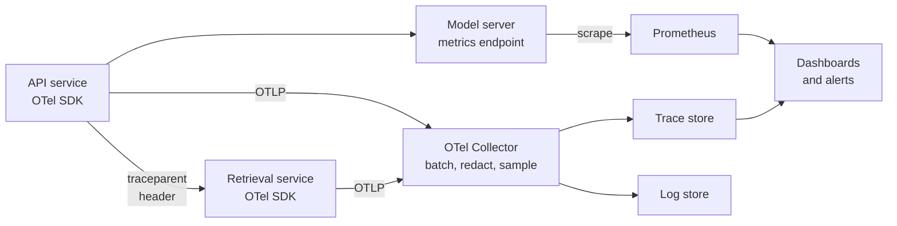

When a user reports that "the assistant was slow and gave a weird answer", you need to be able to find that request and see exactly what happened: which model version answered, what context was retrieved, how many tokens were used, which step was slow and what it cost. **Observability** is the property of a system that lets you answer such questions from the outside, using the data it emits, without shipping new code to investigate. Earlier modules covered [logging](/learn/software-engineering/logging), [error monitoring](/learn/software-engineering/error-monitoring), cloud [monitoring and logging](/learn/cloud-computing/monitoring-and-logging) and [model monitoring](/learn/mlops/model-monitoring) for drift. This lesson brings them together for AI services and adds what is specific to LLMs: tracing prompts, tokens, cost and latency per step, while protecting the private data that prompts contain.

## Metrics, logs and traces

| Signal | What it is | Answers | Cost profile |
| --- | --- | --- | --- |
| **Metrics** | Numeric time series, aggregated (counters, gauges, histograms) | Is something wrong right now? How much, how fast, how often? | Cheap; fixed size regardless of traffic |
| **Logs** | Timestamped records of discrete events, ideally structured JSON | What exactly happened in this event? | Grows with traffic; costly at volume |
| **Traces** | The path of one request through every component, as a tree of timed **spans** | Where did the time go for this request, and what did each step do? | Grows with traffic; usually sampled |

The three work together. A metric alert says p95 latency has doubled; traces of slow requests show the time is in the reranker; logs from the reranker show it is timing out against a dependency. Link them by putting the **trace ID** in every log line.

## What to measure

For every service, start with the **RED** method: **R**ate (requests per second), **E**rrors (failed requests per second), **D**uration (latency histogram). For resources such as GPUs and queues, use **USE**: **U**tilisation, **S**aturation (queued work) and **E**rrors. AI services need more on top:

| Category | Metrics |
| --- | --- |
| **LLM latency** | Time to first token, time per output token, total generation time |
| **Usage and cost** | Input, output and cached tokens per request; cost per request, per feature, per tenant |
| **Serving engine** | Requests running and waiting, batch size, KV-cache usage, GPU memory and SM activity |
| **Caching** | Hit rate for each cache layer |
| **Behaviour** | Finish reasons (completed, hit the length limit, filtered), tool-call counts, retries, fallbacks taken |
| **Quality** | User feedback, guardrail triggers, rate of invalid structured outputs, scores from sampled automatic evaluation |

Quality is the one metric that does not come for free. A model can be fast, cheap and error-free while giving worse answers after a prompt change. Sample production traffic for offline evaluation, as in [prompt testing and evaluation](/learn/prompt-engineering/prompt-testing-and-evaluation), and track the scores alongside the operational metrics.

## Tracing an AI request

A **trace** is a tree of **spans**. Each span has a name, a start time, a duration, a parent, and **attributes** (key-value pairs such as the model name or token count). To see the idea without any library, here is a tiny tracer that records nested spans, driven by a simulated clock so the output is deterministic.

```python
import itertools
from contextlib import contextmanager

class Tracer:
    def __init__(self, clock):
        self.clock, self.spans, self.stack = clock, [], []
        self.ids = itertools.count(1)

    @contextmanager
    def span(self, name, **attributes):
        record = {"id": next(self.ids), "name": name, "attrs": attributes,
                  "parent": self.stack[-1]["id"] if self.stack else None,
                  "depth": len(self.stack), "start": self.clock()}
        self.stack.append(record)
        try:
            yield record
        finally:
            self.stack.pop()
            record["ms"] = self.clock() - record["start"]
            self.spans.append(record)

    def report(self):
        for s in sorted(self.spans, key=lambda s: (s["start"], s["depth"])):
            attrs = " ".join(f"{k}={v}" for k, v in s["attrs"].items())
            print(f"{'  ' * s['depth']}{s['name']:<{24 - 2 * s['depth']}}{s['ms']:>6} ms  {attrs}")

now = [0]
def work(ms): now[0] += ms                   # simulated passage of time
tracer = Tracer(clock=lambda: now[0])

PRICE_IN, PRICE_OUT = 3.00, 15.00            # illustrative, per million tokens
with tracer.span("POST /ask", user="u_7f3a"):
    with tracer.span("embed_query", model="embed-small"):
        work(35)
    with tracer.span("vector_search", top_k=8):
        work(60)
    with tracer.span("llm.generate", model="large-model") as llm:
        work(420); llm["attrs"]["ttft_ms"] = 420
        work(1900)
        tin, tout = 3400, 260
        llm["attrs"].update(tokens_in=tin, tokens_out=tout,
                            cost_usd=round((tin * PRICE_IN + tout * PRICE_OUT) / 1e6, 5))
    work(5)
tracer.report()
```

```output
POST /ask                 2420 ms  user=u_7f3a
  embed_query               35 ms  model=embed-small
  vector_search             60 ms  top_k=8
  llm.generate            2320 ms  model=large-model ttft_ms=420 tokens_in=3400 tokens_out=260 cost_usd=0.0141
```

At a glance: the request took 2.4 seconds, 96% of it in generation; retrieval is not the problem; this request cost about 1.4 cents at the illustrative prices; and the 3,400 input tokens suggest the retrieved context is large. That one view answers questions that metrics alone cannot.

## OpenTelemetry

You should not write your own tracer for production. **OpenTelemetry** (OTel) is the vendor-neutral standard for generating and exporting metrics, logs and traces. Its key concepts:

- **API and SDK**: you instrument code with the API; the SDK, configured at start-up, decides sampling and where data goes.
- **Instrumentation libraries** automatically create spans for common frameworks (web servers, HTTP clients, database drivers), so most of the tree appears without manual work.
- **Context propagation**: the trace ID travels between services in HTTP headers (the W3C `traceparent` header), so spans from the API, the retrieval service and the model server join one trace.
- **Exporters and the Collector**: data is sent using the OTLP protocol, usually to an OpenTelemetry Collector, which batches, filters, redacts and forwards it to back ends.



Creating a span manually with the Python API looks like this; the provider and exporter setup is done once at start-up and is omitted here.

```python
from opentelemetry import trace

tracer = trace.get_tracer(__name__)

def generate(prompt, client):
    with tracer.start_as_current_span("llm.generate") as span:
        span.set_attribute("gen_ai.request.model", "large-model")
        response = client.complete(prompt)          # your model client
        span.set_attribute("gen_ai.usage.input_tokens", response.input_tokens)
        span.set_attribute("gen_ai.usage.output_tokens", response.output_tokens)
        return response
```

OpenTelemetry has **semantic conventions** for generative AI, attribute names such as `gen_ai.request.model` and `gen_ai.usage.input_tokens`, so different tools interpret your data the same way. They are still evolving, so check the current specification. Several dedicated LLM observability tools (some open source) build on these ideas and add prompt-level views, evaluation and cost tracking; the [LangChain](/learn/agent-frameworks/langchain) ecosystem's tracing tool is one you have already met.

## Dashboards and alerts

A good service dashboard answers "is it healthy?" in five seconds. A typical layout for an LLM service:

1. **Traffic and errors**: requests per second and error rate, split by endpoint and model.
2. **Latency**: p50, p95, p99 of total time and of TTFT, against the SLO line.
3. **Saturation**: requests waiting, running sequences, KV-cache usage, GPU activity, replica count.
4. **Cost**: tokens and cost per minute, by feature and tenant.
5. **Quality**: feedback rate, guardrail triggers, invalid outputs, fallback rate.

Alert on **symptoms users feel** (error rate, latency SLO burn, as defined in [reliability](/learn/production-ai-systems/reliability)) rather than on every internal cause. A page at 3 am for high GPU utilisation that hurts nobody teaches people to ignore alerts.

## Privacy of logged prompts

Prompts and responses are the most useful debugging data an AI service has, and often the most sensitive: users paste emails, contracts, health details and credentials into chat boxes. Logging them carelessly creates a second, poorly protected copy of your users' most private data.

> [!WARNING]
> Treat prompt and response logs as personal data. Decide deliberately what to keep, redact before storage, restrict who can read it, and delete it on a schedule. Your privacy policy and regulations such as the GDPR apply to logs as much as to your database.

Practical measures:

- **Log metadata by default** (model, token counts, latency, cost, finish reason, prompt template version) and full text only where needed, for a sample, with a short retention period.
- **Redact** obvious identifiers before logs leave the process or in the Collector.
- **Pseudonymise** user IDs with a keyed hash so traces can be grouped by user without exposing who the user is.
- **Control access** to prompt logs separately from ordinary operational logs, and audit that access.

```python
import re

PATTERNS = [
    (re.compile(r"[\w.+-]+@[\w-]+\.[\w.-]+"), "[EMAIL]"),
    (re.compile(r"\b(?:\d[ -]?){13,16}\b"), "[CARD]"),
    (re.compile(r"\+?\d[\d ()-]{8,}\d"), "[PHONE]"),
]

def redact(text):
    for pattern, label in PATTERNS:
        text = pattern.sub(label, text)
    return text

prompt = "Refund order 5521 for jane.doe@example.com, card 4111 1111 1111 1111, call +44 20 7946 0958"
print(redact(prompt))
```

```output
Refund order 5521 for [EMAIL], card [CARD], call [PHONE]
```

Regular expressions catch only well-formed patterns; names, addresses and free-text health details pass straight through. For stronger guarantees, use a dedicated PII-detection tool and, above all, keep less. Data you never stored cannot leak. The [privacy](/learn/ai-security-and-responsible-ai/privacy) lesson covers this in depth.

## Exercises

**1.** Extend the `Tracer` demo with a `rerank` span of 80 ms between `vector_search` and `llm.generate`, and add a `cache_hit=False` attribute to `embed_query`. Run it and check the root span's duration.

<details>
<summary>Show solution</summary>

Inside the root span, add `with tracer.span("rerank", model="reranker-small"): work(80)` after the search, and pass `cache_hit=False` to the `embed_query` span. Recreate `now` and `tracer` first so the clock starts from zero. The root span becomes 2,500 ms because it contains every child plus the 5 ms of final work.

</details>

**2.** List five fields you would record for every LLM call in a structured log, without storing the prompt text.

<details>
<summary>Show solution</summary>

For example: trace ID, model name and version, prompt template version, input tokens, output tokens, cached tokens, TTFT, total latency, computed cost, finish reason, tenant (pseudonymised), feature name and whether a fallback was used. Any five of these give useful, low-risk observability.

</details>

**3.** A developer proposes alerting whenever GPU utilisation exceeds 90%. Why is this a weak alert, and what would you alert on instead?

<details>
<summary>Show solution</summary>

High GPU utilisation is a cause-level signal and often perfectly healthy (a well-batched server should be busy). It would page people when nothing is wrong. Alert on user-facing symptoms such as error rate or latency SLO burn rate, and use GPU metrics on dashboards to diagnose the cause.

</details>

```quiz
[
  {
    "q": "What does a trace show that metrics usually cannot?",
    "options": [
      "The total number of requests per day",
      "The path and timing of one specific request through every component",
      "The average CPU usage",
      "The size of the container image"
    ],
    "answer": 1,
    "why": "Traces are per request: a tree of timed spans with attributes for each step."
  },
  {
    "q": "How do spans from different services end up in the same trace?",
    "options": [
      "They share a database",
      "The trace context is propagated in request headers such as `traceparent`",
      "They are matched by timestamp",
      "Each service sends its logs to the same file"
    ],
    "answer": 1,
    "why": "Context propagation passes the trace ID between services so their spans join one tree."
  },
  {
    "q": "What does the RED method monitor?",
    "options": [
      "Rate, errors and duration of requests",
      "Redundancy, encryption and deployment",
      "Retries, evictions and drift",
      "RAM, energy and disk"
    ],
    "answer": 0,
    "why": "RED covers request rate, error rate and latency (duration) for request-driven services."
  },
  {
    "q": "Which is the best default for logging LLM prompts in production?",
    "options": [
      "Log every prompt and response in full forever",
      "Never log anything about LLM calls",
      "Log metadata for every call, and full text only for a redacted sample with short retention and restricted access",
      "Log prompts only in the browser"
    ],
    "answer": 2,
    "why": "Metadata gives operational visibility; full text is sensitive and should be minimised, redacted and protected."
  }
]
```
