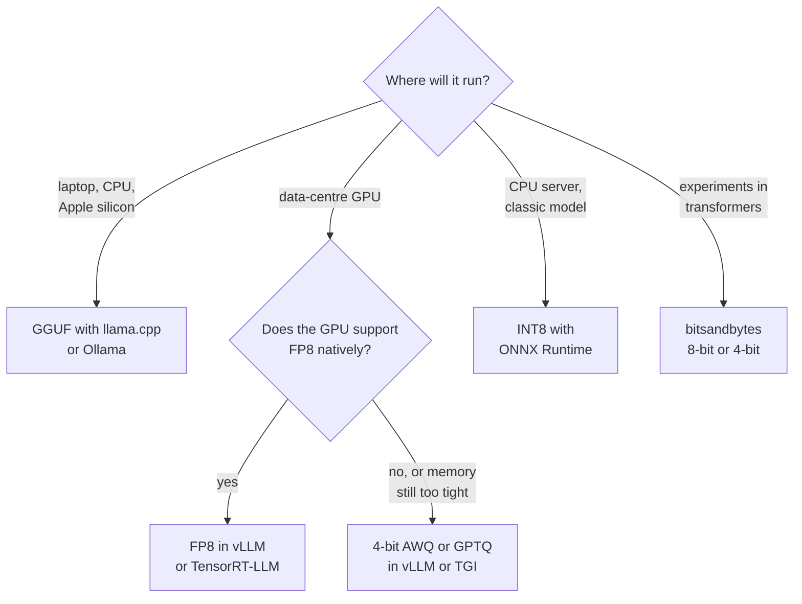

Quantisation stores a model's numbers with fewer bits, for example 8-bit or 4-bit integers instead of 16-bit floats. You met the mechanics in [quantisation in the Hugging Face ecosystem](/learn/hugging-face-ecosystem/quantization): scales, zero points, per-channel granularity and formats such as GPTQ, AWQ and GGUF. This lesson takes the operator's view. When you serve a model, quantisation is a deliberate trade: less memory and often more throughput, in exchange for some risk to quality. Your job is to know what you gain, measure what you lose, and pick a format your serving runtime actually executes efficiently.

## What quantisation buys you in serving

Three distinct benefits come from fewer bits per weight, and they matter in different situations.

| Benefit | Why it happens | When it matters most |
| --- | --- | --- |
| **Fits on less hardware** | Weights take fewer bytes | A model that needs two GPUs at 16-bit may fit on one at 4-bit |
| **More room for the KV cache and batches** | Memory freed from weights can hold more concurrent sequences | High-concurrency LLM serving |
| **Faster memory-bound steps** | Fewer bytes to read per forward pass | LLM decoding at small batch sizes |

The third point surprises people. Quantised arithmetic is not always faster; integer or low-precision maths needs hardware and kernel support. But LLM decoding mostly waits on reading weights from memory (see [GPU utilisation](/learn/production-ai-systems/gpu-utilization)), so halving the bytes read can nearly halve the time per token even when the arithmetic is done in 16-bit after unpacking. At large batch sizes the workload becomes compute-bound and weight-only quantisation helps less, unless the hardware also computes in the low-precision format.

## Memory arithmetic

The weight memory of a model is simply its parameter count times the bytes per parameter. A rough serving budget adds the KV cache and some overhead for activations and the runtime.

$$
\text{weights (bytes)} = N_{\text{params}} \times \frac{b}{8}
$$

where $N_{\text{params}}$ is the number of parameters and $b$ is the bits per weight. Real quantised formats add a little for the stored scales, so treat these as lower bounds.

```python
def weight_gb(params_billion, bits):
    return params_billion * 1e9 * bits / 8 / 1e9

print(f"{'model size':<12}{'16-bit':>9}{'8-bit':>9}{'4-bit':>9}")
for size in [1, 8, 70]:
    row = "".join(f"{weight_gb(size, b):>8.1f}G" for b in [16, 8, 4])
    print(f"{str(size) + 'B params':<12}{row}")
```

```output
model size     16-bit    8-bit    4-bit
1B params        2.0G     1.0G     0.5G
8B params       16.0G     8.0G     4.0G
70B params     140.0G    70.0G    35.0G
```

So a 70-billion-parameter model needs about 140 GB for weights alone at 16-bit, more than a single 80 GB accelerator holds, but about 35 GB at 4-bit, leaving room for the KV cache. That single fact drives much of the quantisation used in practice.

> [!NOTE]
> The KV cache can also be quantised (for example to 8-bit) in several LLM servers. It stores keys and values for every token of every active sequence, so for long contexts and many concurrent users it can rival the weights in size. Quantising it raises concurrency, at its own quality risk.

## Weight-only versus weight-and-activation

| Scheme | What is low precision | Typical use |
| --- | --- | --- |
| **Weight-only** (for example 4-bit GPTQ, AWQ, GGUF) | Weights stored compressed, unpacked to 16-bit for the maths | LLM serving where memory and decode speed dominate |
| **Weight and activation** (for example INT8, FP8) | Both inputs of the matrix multiply | Throughput-bound serving on hardware with fast low-precision units |
| **Dynamic quantisation** | Weights quantised ahead of time, activation scales computed at run time | CPU inference of smaller models, for example in ONNX Runtime or PyTorch |

FP8 deserves a mention: it is an 8-bit floating-point format supported natively by recent data-centre GPUs. Because it keeps an exponent, it handles outliers better than INT8, and serving engines increasingly offer it as a near-lossless way to roughly halve memory relative to 16-bit on hardware that supports it.

## Choosing a format for your runtime

A quantised model is only fast if the runtime has efficient kernels for that exact format on your hardware. A format your runtime merely tolerates may be slower than the original.



Treat this as a starting point, not a rule. Support changes quickly between runtime versions, so check your server's documentation for the formats and GPU generations it supports. Note in particular that bitsandbytes is excellent for fitting a model into memory during experimentation and [QLoRA fine-tuning](/learn/hugging-face-ecosystem/qlora), but dedicated serving formats are usually faster for production throughput.

## Testing for quality regressions

Quantisation errors are not uniform. Most inputs give the same answer; a minority flip. Aggregate accuracy can hide this, so measure two things on a fixed evaluation set:

- **Task quality**: accuracy, or for LLMs your task metric or LLM-judge score (see [model evaluation](/learn/working-with-llms/model-evaluation)).
- **Agreement with the reference model**: the fraction of inputs where the quantised model gives the same answer as the full-precision one. This catches changes that happen to cancel out in the accuracy number.

Here is that test applied to a small neural network, quantising its weight matrices symmetrically to different bit widths, per tensor and per output channel.

```python
import numpy as np
from sklearn.datasets import load_digits
from sklearn.model_selection import train_test_split
from sklearn.neural_network import MLPClassifier

X, y = load_digits(return_X_y=True)
X = X / 16.0
X_train, X_test, y_train, y_test = train_test_split(X, y, test_size=0.3, random_state=0)
mlp = MLPClassifier(hidden_layer_sizes=(64,), max_iter=500, random_state=0).fit(X_train, y_train)

def quantise(w, bits, per_channel):
    qmax = 2 ** (bits - 1) - 1
    axis = 0 if per_channel else None              # one scale per output column, or one overall
    scale = np.abs(w).max(axis=axis, keepdims=True) / qmax
    return np.clip(np.round(w / scale), -qmax, qmax) * scale   # quantise, then dequantise

def predict(weights, biases, X):
    h = np.maximum(0, X @ weights[0] + biases[0])
    return (h @ weights[1] + biases[1]).argmax(axis=1)

ref = predict(mlp.coefs_, mlp.intercepts_, X_test)
print(f"{'format':<22}{'accuracy':>9}{'agreement':>11}")
print(f"{'float (reference)':<22}{(ref == y_test).mean():>9.3f}{1.0:>11.3f}")
for bits in [8, 4, 3, 2]:
    for per_channel in [False, True]:
        qw = [quantise(w, bits, per_channel) for w in mlp.coefs_]
        pred = predict(qw, mlp.intercepts_, X_test)
        name = f"int{bits} " + ("per-channel" if per_channel else "per-tensor")
        print(f"{name:<22}{(pred == y_test).mean():>9.3f}{(pred == ref).mean():>11.3f}")
```

```output
format                 accuracy  agreement
float (reference)         0.980      1.000
int8 per-tensor           0.980      1.000
int8 per-channel          0.980      1.000
int4 per-tensor           0.961      0.981
int4 per-channel          0.972      0.993
int3 per-tensor           0.931      0.943
int3 per-channel          0.937      0.957
int2 per-tensor           0.109      0.106
int2 per-channel          0.467      0.474
```

The pattern is typical. 8-bit is indistinguishable from the original here; 4-bit loses a little, and finer per-channel scales recover much of it; below that, quality collapses. Notice that agreement is a more sensitive signal than accuracy: at 4-bit per-tensor, accuracy fell by about two points but almost one in fifty answers changed. For an LLM the same principle applies with a richer evaluation set: run your regression suite on both models and read the cases that changed, not only the averages.

> [!WARNING]
> Quantisation damage is often concentrated in specific capabilities: long-context reasoning, arithmetic, code, rare languages or strict output formats such as JSON. A general benchmark can look fine while your particular use case degrades. Always include examples of your real traffic in the regression set.

## A release checklist

1. Pick the format your serving runtime supports well on your hardware.
2. Benchmark memory, throughput and latency at your **realistic** batch sizes and prompt lengths.
3. Run the quality regression suite against the full-precision reference and inspect flipped cases.
4. Roll out gradually (a canary or shadow deployment, as in [continuous delivery](/learn/ci-cd/continuous-delivery)) and watch production quality signals.

The deeper theory of LLM quantisation algorithms comes later in [model quantization](/learn/advanced-llm-engineering/model-quantization).

## Exercises

**1.** A 13-billion-parameter model is served on a GPU with 24 GB of memory. Can it fit at 16-bit? At 8-bit? At 4-bit? Leave about 4 GB for the KV cache and runtime overhead.

<details>
<summary>Show solution</summary>

```python
for bits in [16, 8, 4]:
    need = weight_gb(13, bits) + 4
    print(bits, round(need, 1), need <= 24)
```

At 16-bit the weights alone are 26 GB, so no. At 8-bit they are 13 GB, about 17 GB with overhead: it fits. At 4-bit they are 6.5 GB, leaving plenty of room for a larger KV cache and more concurrent requests.

</details>

**2.** Extend the regression test to print the indices of test examples whose prediction changed under int4 per-tensor quantisation, and the true label of each. Why is this list more useful than the accuracy number?

<details>
<summary>Show solution</summary>

```python
qw = [quantise(w, 4, False) for w in mlp.coefs_]
pred = predict(qw, mlp.intercepts_, X_test)
changed = np.where(pred != ref)[0]
for i in changed:
    print(i, "true", y_test[i], "ref", ref[i], "quantised", pred[i])
```

The list shows exactly which inputs regressed, so you can look for a pattern (a class, an input type, a capability) and decide whether the regression is acceptable for your users. Accuracy alone can hide flips that happen to cancel out.

</details>

**3.** Your team quantises a model to 4-bit and finds throughput did not improve at batch size 64, although it improved a lot at batch size 1. Explain why.

<details>
<summary>Show solution</summary>

At batch size 1 decoding is memory-bound, so reading fewer bytes of weights speeds it up. At batch size 64 the same weights are reused for 64 sequences per read, so the workload becomes compute-bound. Weight-only quantisation does not reduce the arithmetic (weights are unpacked to 16-bit for the maths) and adds unpacking work, so it gives little or no gain there.

</details>

```quiz
[
  {
    "q": "Roughly how much memory do the weights of an 8-billion-parameter model take at 4-bit?",
    "options": ["About 2 GB", "About 4 GB", "About 16 GB", "About 32 GB"],
    "answer": 1,
    "why": "8e9 parameters times 0.5 bytes is 4e9 bytes, about 4 GB, before scales and overhead."
  },
  {
    "q": "Why can weight-only 4-bit quantisation speed up LLM decoding at small batch sizes?",
    "options": [
      "4-bit arithmetic is always faster than 16-bit",
      "Decoding is memory-bound, so reading fewer bytes per step saves time",
      "It shortens the prompt",
      "It removes the need for a KV cache"
    ],
    "answer": 1,
    "why": "At small batches each step is limited by how fast weights are read, so smaller weights mean faster steps."
  },
  {
    "q": "Why measure agreement with the full-precision model as well as task accuracy?",
    "options": [
      "Agreement is cheaper to compute",
      "Accuracy can stay similar while many individual answers change",
      "Agreement measures latency",
      "Accuracy cannot be computed for quantised models"
    ],
    "answer": 1,
    "why": "Some answers get better and others worse; agreement exposes the churn that an average hides."
  },
  {
    "q": "You need to run a quantised LLM on a developer laptop without a data-centre GPU. Which format is the natural fit?",
    "options": ["FP8", "GGUF with llama.cpp or Ollama", "TensorRT engine", "Unquantised 32-bit"],
    "answer": 1,
    "why": "GGUF is designed for llama.cpp-based runtimes, which run efficiently on CPUs and Apple silicon."
  }
]
```
