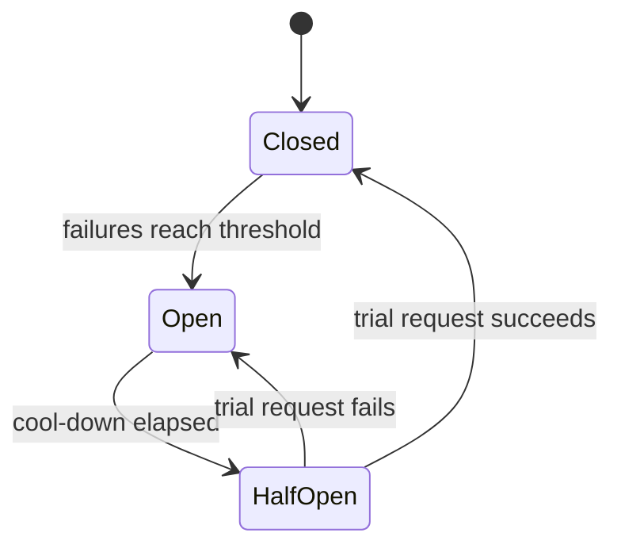
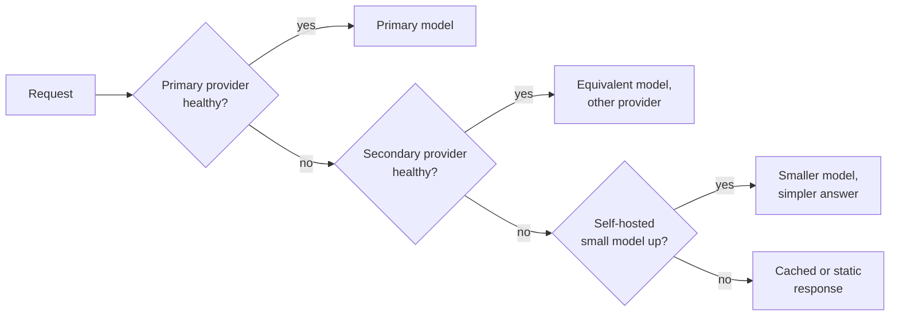

Every dependency of an AI service will fail at some point. Model providers have outages and return rate-limit errors at peak times; GPU nodes crash; a vector database slows down; a new model version starts timing out on long prompts. **Reliability engineering** is not about preventing every failure, which is impossible, but about deciding how reliable the service needs to be, measuring whether it is, and designing it so that failures in one part degrade the experience gracefully instead of taking everything down. This lesson covers service level objectives and error budgets, then the core resilience patterns: timeouts, retries with jitter, circuit breakers, fallbacks, graceful degradation and rate limiting. Error handling inside agents was covered in [agent error handling](/learn/advanced-agent-systems/error-handling); here the focus is the service as a whole.

## SLIs, SLOs and error budgets

Three terms from site reliability engineering give reliability a number:

- A **service level indicator (SLI)** is a measured quantity that reflects user experience, usually a ratio of good events to total events. Examples: the fraction of requests that succeed; the fraction of chat responses whose time to first token is under 1 second.
- A **service level objective (SLO)** is the target for an SLI over a window: "99.9% of requests succeed, measured over 30 days".
- The **error budget** is what the SLO allows to fail: $1 - \text{SLO}$. It turns reliability into a resource you can spend on deployments, experiments and risk.

$$
\text{error budget} = (1 - \text{SLO}) \times \text{total events in the window}
$$

```python
slo = 0.999
minutes_30d = 30 * 24 * 60
print(f"allowed downtime: {(1 - slo) * minutes_30d:.1f} minutes per 30 days")

requests_30d = 10_000_000
budget = (1 - slo) * requests_30d
print(f"error budget: {budget:,.0f} failed requests per 30 days")

current_error_rate = 0.005                 # 0.5% of requests failing right now
burn_rate = current_error_rate / (1 - slo)
print(f"burn rate: {burn_rate:.1f}x -> budget gone in {30 / burn_rate:.0f} days")
```

```output
allowed downtime: 43.2 minutes per 30 days
error budget: 10,000 failed requests per 30 days
burn rate: 5.0x -> budget gone in 6 days
```

The **burn rate** is how fast you are spending the budget relative to the rate that would exactly exhaust it at the end of the window. A burn rate of 1 is sustainable; a burn rate of 5 means the month's budget is gone in six days. Alerting on burn rate (fast burn: page someone now; slow burn: open a ticket) is far better than alerting on every error spike.

| SLO | Downtime allowed per 30 days |
| --- | --- |
| 99% | 7.2 hours |
| 99.9% | 43.2 minutes |
| 99.99% | 4.3 minutes |

Each extra nine costs much more engineering effort and money. Choose SLOs from what users need, not from what sounds impressive. And remember that your service cannot be more available than the dependencies it cannot work without: if you rely on a single model provider whose availability is lower than your target, you need a fallback.

> [!KEY]
> An SLO turns "is the service reliable enough?" into a measurable question. While budget remains, ship features; when it runs out, prioritise reliability work. This gives product and engineering teams a shared, objective rule.

## Timeouts

Every network call needs a timeout. Without one, a hung dependency holds a connection and a worker forever, and enough hung calls exhaust the service. For LLM calls, a single timeout is often not enough:

- A **connection or first-token timeout** catches a provider that is not responding at all; for a streaming chat, a few seconds is often reasonable.
- A **total timeout** caps the whole generation, sized from your expected output length and tokens per second.
- An overall **request deadline** across all steps, so that a slow retrieval leaves less time for generation rather than blowing the user's budget.

Set timeouts from measured latency percentiles (for example a little above p99), not by guesswork.

## Retries with backoff and jitter

Many failures are transient: a dropped connection, a `429 Too Many Requests`, a `503` from an overloaded server. Retrying can turn them into successes, but naive retries make outages worse. If a thousand clients all retry immediately, then all again after one second, they hit the recovering service in synchronised waves, a **thundering herd**.

The standard remedy is **exponential backoff with jitter**: wait longer after each failure (doubling up to a cap), and randomise each wait so clients spread out. With **full jitter**, each wait is drawn uniformly between zero and the current cap.

```python
import random

def backoff_delays(attempts, rng, base=0.5, cap=8.0):
    """Full jitter: sleep a random time between 0 and the exponential cap."""
    return [round(rng.uniform(0, min(cap, base * 2 ** a)), 2) for a in range(attempts)]

print("exponential caps:", [min(8.0, 0.5 * 2 ** a) for a in range(6)])
rng = random.Random(3)
for client in range(3):
    print(f"client {client} sleeps:", backoff_delays(6, rng))
```

```output
exponential caps: [0.5, 1.0, 2.0, 4.0, 8.0, 8.0]
client 0 sleeps: [0.12, 0.54, 0.74, 2.42, 5.01, 0.52]
client 1 sleeps: [0.01, 0.84, 0.52, 0.94, 7.97, 3.76]
client 2 sleeps: [0.42, 0.48, 1.28, 0.6, 5.08, 6.94]
```

The three clients' retries land at different moments instead of in lockstep. Rules for retrying safely:

| Rule | Why |
| --- | --- |
| Retry only **transient** errors: timeouts, 429, 502, 503, 504 | A 400 (bad request) or 401 (unauthorised) fails identically every time |
| Honour a `Retry-After` header when the server sends one | The server knows when it can take traffic again |
| Cap the number of attempts and the total time | Retries must fit inside the user's deadline |
| Retry at **one** layer only | If the client, the gateway and the service each retry three times, one failure becomes up to 27 calls |
| Make retried operations **idempotent** | Retrying a call that sends an email or charges a card can do it twice; use idempotency keys |

> [!WARNING]
> Retries multiply load exactly when a dependency is struggling. A service at its limit that receives three times the traffic from retries will not recover. Combine retries with a retry budget (for example, retries may add at most 10% extra traffic) and with circuit breakers.

## Circuit breakers

When a dependency is clearly down, continuing to call it wastes time (every call waits for a timeout) and adds load to something trying to recover. A **circuit breaker** wraps calls to a dependency and tracks failures. After enough consecutive failures it **opens** and fails immediately without calling the dependency. After a cool-down it goes **half-open** and lets a trial request through: success closes it, failure opens it again.



Here is a minimal implementation with an injectable clock, followed by a simulated outage and recovery.

```python
class CircuitBreaker:
    def __init__(self, failure_threshold, reset_after_s, clock):
        self.threshold, self.reset_after, self.clock = failure_threshold, reset_after_s, clock
        self.state, self.failures, self.opened_at = "closed", 0, 0.0

    def call(self, fn):
        if self.state == "open":
            if self.clock() - self.opened_at < self.reset_after:
                raise RuntimeError("circuit open: failing fast")
            self.state = "half-open"                 # let one trial request through
        try:
            result = fn()
        except Exception:
            self.failures += 1
            if self.state == "half-open" or self.failures >= self.threshold:
                self.state, self.opened_at = "open", self.clock()
            raise
        self.state, self.failures = "closed", 0      # success resets everything
        return result

now = [0.0]
breaker = CircuitBreaker(failure_threshold=3, reset_after_s=30, clock=lambda: now[0])
provider_up = [False]

def call_provider():
    if not provider_up[0]:
        raise TimeoutError("provider timed out")
    return "answer"

def attempt(t, label):
    now[0] = t
    try:
        result = breaker.call(call_provider)
    except Exception as e:
        result = f"error: {e}"
    print(f"t={t:>4}s {label:<22} -> {result:<32} state={breaker.state}")

for t in [0, 1, 2, 3, 10]:
    attempt(t, "provider down")
attempt(33, "trial, still down")
provider_up[0] = True
attempt(40, "provider back")
attempt(64, "trial request")
attempt(65, "normal traffic")
```

```output
t=   0s provider down          -> error: provider timed out        state=closed
t=   1s provider down          -> error: provider timed out        state=closed
t=   2s provider down          -> error: provider timed out        state=open
t=   3s provider down          -> error: circuit open: failing fast state=open
t=  10s provider down          -> error: circuit open: failing fast state=open
t=  33s trial, still down      -> error: provider timed out        state=open
t=  40s provider back          -> error: circuit open: failing fast state=open
t=  64s trial request          -> answer                           state=closed
t=  65s normal traffic         -> answer                           state=closed
```

Follow the timeline. Three timeouts open the circuit at 2 s; later calls fail instantly instead of waiting for timeouts. At 33 s the cool-down has passed, a trial goes through, fails, and the circuit reopens. At 40 s the provider has recovered, but the breaker is still cooling down, so it keeps failing fast: that is the cost of protection. At 64 s the next trial succeeds and normal traffic resumes. Production breakers usually count failures over a sliding time window or as a failure rate, and expose their state as a metric.

## Fallbacks and graceful degradation

A circuit breaker turns a slow failure into a fast one. A **fallback** turns a fast failure into a still-useful answer. For an LLM feature, a fallback chain might be:



```python
def with_fallbacks(prompt, chain):
    for name, breaker, fn in chain:
        try:
            return name, breaker.call(lambda: fn(prompt))
        except Exception as e:
            print(f"  {name} unavailable: {e}")
    return "static", "The assistant is temporarily unavailable. Please try again shortly."

def rate_limited(prompt):
    raise RuntimeError("429 rate limited")

def small_model(prompt):
    return f"(short answer to: {prompt})"

provider_up[0] = False
now[0] = 100.0
primary = CircuitBreaker(3, 30, clock=lambda: now[0])
primary.state, primary.opened_at = "open", 95.0          # already tripped by the outage
chain = [("primary", primary, lambda p: call_provider()),
         ("secondary", CircuitBreaker(3, 30, clock=lambda: now[0]), rate_limited),
         ("small-self-hosted", CircuitBreaker(3, 30, clock=lambda: now[0]), small_model)]
print(with_fallbacks("How do I reset my password?", chain))
```

```output
  primary unavailable: circuit open: failing fast
  secondary unavailable: 429 rate limited
('small-self-hosted', '(short answer to: How do I reset my password?)')
```

Fallbacks need care. Prompts tuned for one model may behave differently on another, so maintain and test a prompt per fallback model. Record which path served each request (see [observability](/learn/production-ai-systems/observability)), and **exercise fallbacks regularly**: a fallback path that has not run for months often fails exactly when it is needed. Using a provider-agnostic client or an OpenAI-compatible interface makes switching cheaper.

**Graceful degradation** is the broader idea: when under stress, turn off what is optional to protect what is essential. Examples: skip the reranker and use plain vector search; reduce retrieved context; cap output length; disable expensive features such as image generation; serve cached answers for popular questions; or accept requests into a queue and notify the user later instead of failing them.

## Rate limiting and load shedding

Protect your service from overload by refusing excess work early and cheaply. A **token bucket** is the usual mechanism: each client has a bucket that refills at a steady rate up to a maximum, each request takes a token, and requests that find the bucket empty receive `429 Too Many Requests`. For LLM services, limit **tokens per minute** as well as requests per minute, because one request with a huge prompt can cost as much as hundreds of small ones. Apply limits per tenant, so one customer's batch job cannot starve everyone else, and when the service itself is saturated, **shed load**: reject low-priority work quickly rather than letting every request time out slowly. Providers rate-limit you in the same way, so your own retries and queues must respect their limits.

> [!TIP]
> During a provider outage, your best tools are those prepared in advance: a tested fallback provider or self-hosted model, circuit breakers that fail fast, a status message the product can show, and a runbook describing who switches what. Write the runbook while things are calm.

## Exercises

**1.** A service has a 99.5% success SLO over 30 days and serves 2 million requests in that window. What is its error budget in requests? If 4,000 requests failed in the first 10 days, what is the burn rate so far?

<details>
<summary>Show solution</summary>

```python
budget = (1 - 0.995) * 2_000_000             # 10,000 failed requests allowed
expected_by_day_10 = budget * 10 / 30        # about 3,333 if spent evenly
print(budget, round(4_000 / expected_by_day_10, 2))
```

The budget is 10,000 failures. Spending evenly would use about 3,333 by day 10, so 4,000 is a burn rate of about 1.2: slightly too fast, and worth watching but not an emergency.

</details>

**2.** Why should a `400 Bad Request` not be retried, while a `503 Service Unavailable` usually should?

<details>
<summary>Show solution</summary>

A 400 means the request itself is invalid; sending it again produces the same error and wastes capacity. A 503 indicates a temporary condition on the server side, so a later attempt, after a jittered backoff, may succeed.

</details>

**3.** Rerun the circuit breaker demo with a breaker that opens after 2 failures and cools down for 10 seconds, using the same sequence of calls. Before running it, predict the state after the calls at `t=1`, `t=10`, `t=33` and `t=40`.

<details>
<summary>Show solution</summary>

Reset the simulation and create the new breaker:

```python
now[0] = 0.0
provider_up[0] = False
breaker = CircuitBreaker(failure_threshold=2, reset_after_s=10, clock=lambda: now[0])
```

Then repeat the `attempt` calls. The breaker opens at `t=1` after two failures. At `t=10` only 9 seconds have passed, so it still fails fast. At `t=33` the cool-down is over, the trial request fails and the breaker reopens. At `t=40` the provider is back, but only 7 seconds have passed since reopening, so it still fails fast; the trial at `t=64` succeeds and closes it. A shorter cool-down detects recovery sooner but sends more trial traffic to a struggling dependency.

</details>

```quiz
[
  {
    "q": "A service has a 99.9% availability SLO over 30 days. Roughly how much downtime does the error budget allow?",
    "options": ["4.3 minutes", "43 minutes", "7.2 hours", "3 days"],
    "answer": 1,
    "why": "0.001 x 30 x 24 x 60 = 43.2 minutes."
  },
  {
    "q": "Why add jitter to exponential backoff?",
    "options": [
      "To make retries faster",
      "To spread clients' retries out so they do not hit a recovering service in synchronised waves",
      "To reduce the number of retries",
      "To make retries idempotent"
    ],
    "answer": 1,
    "why": "Without jitter, clients that failed together retry together, creating a thundering herd."
  },
  {
    "q": "What does an open circuit breaker do with a new request?",
    "options": [
      "Sends it to the dependency with a longer timeout",
      "Queues it until the dependency recovers",
      "Fails it immediately without calling the dependency",
      "Retries it three times"
    ],
    "answer": 2,
    "why": "Failing fast saves time for the caller and load on the struggling dependency, until a half-open trial succeeds."
  },
  {
    "q": "Why should LLM services rate-limit tokens per minute and not only requests per minute?",
    "options": [
      "Tokens are easier to count than requests",
      "Request cost varies hugely with prompt and output length, so request counts alone do not bound load",
      "Providers ignore request counts",
      "Token limits remove the need for authentication"
    ],
    "answer": 1,
    "why": "One request with a very long prompt can consume as much capacity as hundreds of short ones."
  }
]
```
