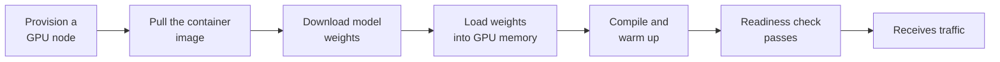

Traffic to an AI service is never constant. It follows the working day, spikes when a feature launches or a newsletter goes out, and drops to almost nothing at night. **Scaling** means matching capacity to that demand: enough replicas that requests do not queue, but not so many that you pay for idle GPUs. For ordinary web services this is largely solved; containers start in seconds and cost little. For AI services it is harder, because a GPU replica can take minutes to start, costs a lot per hour, and the right signal to scale on is not the CPU usage that default autoscalers watch. This lesson covers how to size capacity, which signals to scale on, and how to live with cold starts.

## Vertical and horizontal scaling

| | Vertical scaling (scale up) | Horizontal scaling (scale out) |
| --- | --- | --- |
| **What changes** | A bigger machine: more GPU memory, a faster GPU, more GPUs per node | More copies (replicas) of the same server |
| **When it is needed** | The model does not fit, or a single request is too slow | Too many requests for the current replicas |
| **Limits** | The largest machine available; one failure domain | Load balancing, state, cost of each replica |
| **Typical AI example** | Moving a model to a GPU with more memory, or splitting it across GPUs with tensor parallelism | Running six identical vLLM replicas behind a load balancer |

In practice you scale **vertically until the model fits and meets its per-request latency target**, then **horizontally for throughput**. Splitting one model across several GPUs or nodes is a form of vertical scaling for models too big for one device, discussed in [distributed inference](/learn/ai-system-design/distributed-inference).

Horizontal scaling assumes replicas are interchangeable, so keep them **stateless**: conversation history, user sessions and caches belong in an external store such as Redis or a database, not in a replica's memory. The one useful exception, prefix-cache locality, is handled by routing rather than by state, as the [load balancing](/learn/production-ai-systems/load-balancing) lesson explains.

## Sizing capacity with Little's law

**Little's law** connects three quantities for any stable system:

$$
L = \lambda W
$$

where $L$ is the average number of requests in the system at once, $\lambda$ is the arrival rate, and $W$ is the average time each request spends in the system. If an LLM service receives 40 requests per second and each takes 6 seconds to generate, about 240 requests are in flight at any moment. If each replica can run 32 sequences concurrently and you aim for 70% utilisation to leave headroom for bursts, you need

```python
import math

def replicas_needed(rps, latency_s, slots_per_replica, target_util=0.7):
    in_flight = rps * latency_s                       # Little's law: L = lambda * W
    return math.ceil(in_flight / (slots_per_replica * target_util))

print(replicas_needed(rps=40, latency_s=6.0, slots_per_replica=32))
print(replicas_needed(rps=40, latency_s=6.0, slots_per_replica=32, target_util=1.0))
```

```output
11
8
```

Eleven replicas with headroom, eight at the absolute minimum. Little's law also explains why LLM capacity planning is about **concurrency**, not request rate: long generations hold a slot for seconds, so a modest request rate can still need many concurrent slots. Doubling average output length doubles $W$ and therefore doubles the replicas needed.

## Choosing an autoscaling signal

An autoscaler periodically compares a metric with a target and adds or removes replicas. The choice of metric is the most important decision.

| Signal | Good for | Problem |
| --- | --- | --- |
| **CPU utilisation** | CPU-bound classical models | Meaningless for GPU inference: the CPU may be idle while the GPU is saturated |
| **GPU utilisation** | A rough indicator of GPU load | Can read high while there is spare capacity, as the [GPU utilisation](/learn/production-ai-systems/gpu-utilization) lesson showed; lags behind demand |
| **Queue depth** (requests waiting) | Most model servers | Directly measures unmet demand; the best leading indicator |
| **Concurrency** (requests in flight per replica) | LLM servers with a known number of slots | Needs the server to expose it; ties neatly to Little's law |
| **Latency** (for example p95 or TTFT) | Protecting a latency SLO | A lagging signal: by the time latency rises, users are already affected |

For LLM servers, the most effective signals are usually **requests waiting** and **requests running** per replica, which servers such as vLLM expose as Prometheus metrics. On Kubernetes, the Horizontal Pod Autoscaler can scale on such custom metrics once a metrics adapter (such as the Prometheus Adapter) makes them available; KEDA is a popular alternative that scales on queues and Prometheus queries, including down to zero.

```yaml
apiVersion: autoscaling/v2
kind: HorizontalPodAutoscaler
metadata:
  name: llm-server
spec:
  scaleTargetRef:
    apiVersion: apps/v1
    kind: Deployment
    name: llm-server
  minReplicas: 2
  maxReplicas: 10
  metrics:
    - type: Pods
      pods:
        metric:
          name: requests_waiting        # exposed by the server, served by a metrics adapter
        target:
          type: AverageValue
          averageValue: "5"
  behavior:
    scaleDown:
      stabilizationWindowSeconds: 300   # wait five calm minutes before removing replicas
```

The `behavior` section matters. Scaling **up** should be fast, because under-capacity hurts users; scaling **down** should be slow, because removing a replica you need again a minute later means paying a cold start twice. Without this asymmetry, autoscalers oscillate.

## Cold starts of large models

Starting a new GPU replica is slow, and every step adds up:



For a large model, each of these can take from seconds to many minutes: GPU nodes may not be immediately available, CUDA-based images are several gigabytes, and weights for a big model are tens or hundreds of gigabytes. The following simulation shows why this matters. Demand ramps from 20 to 120 requests per second; each replica handles 25 per second; the autoscaler targets 70% utilisation, scales up immediately, and scales down only after five calm minutes.

```python
def demand(minute):                     # requests per second during each minute
    if minute < 10: return 20
    if minute < 15: return 20 + (minute - 9) * 20      # ramps up to 120/s
    if minute < 40: return 120
    return 30

def simulate(cold_start_min, capacity=25, target=0.7, cooldown=5):
    ready, starting = 2, []             # starting: minute at which each new replica is ready
    calm, unserved, log = 0, 0, []
    for m in range(60):
        ready += starting.count(m)
        starting = [t for t in starting if t > m]
        load = demand(m)
        unserved += max(0, load - ready * capacity) * 60
        desired = math.ceil(load / (capacity * target))
        if desired > ready + len(starting):             # scale up at once
            starting += [m + cold_start_min] * (desired - ready - len(starting))
        calm = calm + 1 if desired < ready else 0
        if calm >= cooldown:                            # scale down only after a calm period
            ready, calm = desired, 0
        log.append((m, load, ready, len(starting)))
    return unserved, log

for cs in [1, 3, 8]:
    unserved, _ = simulate(cs)
    print(f"cold start {cs} min: {unserved:,} requests arrived beyond capacity")

_, log = simulate(3)
for m, load, ready, starting in log[9:19:2] + log[39:48:2]:
    print(f"minute {m:>2}  demand {load:>3}/s  ready {ready}  starting {starting}")
```

```output
cold start 1 min: 0 requests arrived beyond capacity
cold start 3 min: 5,100 requests arrived beyond capacity
cold start 8 min: 26,100 requests arrived beyond capacity
minute  9  demand  20/s  ready 2  starting 0
minute 11  demand  60/s  ready 2  starting 2
minute 13  demand 100/s  ready 3  starting 3
minute 15  demand 120/s  ready 5  starting 2
minute 17  demand 120/s  ready 7  starting 0
minute 39  demand 120/s  ready 7  starting 0
minute 41  demand  30/s  ready 7  starting 0
minute 43  demand  30/s  ready 7  starting 0
minute 45  demand  30/s  ready 2  starting 0
minute 47  demand  30/s  ready 2  starting 0
```

With a one-minute cold start, the 30% headroom absorbs the ramp completely. With three minutes, replicas arrive behind demand and thousands of requests queue or fail; with eight minutes, over 26,000 do. The log shows the shape: replicas are always "starting" while demand climbs, and after demand falls at minute 40 the autoscaler waits five calm minutes before releasing them.

> [!KEY]
> When replicas start slowly, the autoscaler must act **earlier**, not just faster. Scale on leading signals such as queue depth, keep headroom by targeting well under full utilisation, and shorten the cold start itself.

Ways to shorten or hide cold starts:

- **Keep a minimum number of warm replicas**; scale to zero only for services that can tolerate a long first response.
- **Pre-pull images** onto nodes and keep images lean.
- **Cache weights close to the GPU**: on a local disk or a fast shared volume, rather than downloading from a model hub at start-up (see [persistent storage](/learn/docker-and-containers/persistent-storage)).
- **Schedule known peaks**: scale up before the 9 am surge or a launch, rather than reacting to it.
- **Overflow to a hosted API** while new replicas warm up, using the fallback patterns from [reliability](/learn/production-ai-systems/reliability).

> [!WARNING]
> A replica must not receive traffic until the model is loaded and warmed up. If the readiness check passes as soon as the web server starts, the load balancer sends requests to a replica that cannot serve them. Make readiness depend on the model being ready.

## Exercises

**1.** A service gets 15 requests per second, each taking 8 seconds, and each replica runs 16 concurrent sequences. How many replicas do you need at 75% target utilisation? What if average output length (and so latency) doubles?

<details>
<summary>Show solution</summary>

```python
print(replicas_needed(15, 8, 16, 0.75), replicas_needed(15, 16, 16, 0.75))
```

$15 \times 8 = 120$ in flight, divided by $16 \times 0.75 = 12$ gives 10 replicas. Doubling latency doubles in-flight requests to 240, giving 20 replicas.

</details>

**2.** Run `simulate` with a cold start of 3 minutes and `target=0.5`. How does the number of requests beyond capacity change, and what does it cost?

<details>
<summary>Show solution</summary>

```python
unserved, log = simulate(3, target=0.5)
print(unserved, max(r for _, _, r, _ in log))
```

Requests beyond capacity fall from 5,100 to 2,400, because the autoscaler requests more replicas earlier in the ramp, while each replica still has spare capacity. The cost is a peak of 10 replicas instead of 7, and more replicas whenever traffic is steady: headroom is insurance against cold starts, paid for every hour.

</details>

**3.** Explain why CPU utilisation is a poor autoscaling signal for a GPU-based LLM server, and propose a better one.

<details>
<summary>Show solution</summary>

The heavy work runs on the GPU, so the CPU can sit at low utilisation while the GPU is saturated and requests queue; the autoscaler would never scale up. Better signals are the number of requests waiting in the server's queue or the number of running requests per replica, which directly reflect unmet demand.

</details>

```quiz
[
  {
    "q": "An LLM service receives 20 requests per second and each takes 5 seconds. On average, how many requests are in flight?",
    "options": ["4", "25", "100", "200"],
    "answer": 2,
    "why": "Little's law: L = lambda x W = 20 x 5 = 100."
  },
  {
    "q": "Why should autoscalers scale down more slowly than they scale up?",
    "options": [
      "Kubernetes requires it",
      "Removing replicas that are needed again soon means paying their cold start again, and under-capacity hurts users",
      "Scaling down is more expensive",
      "Replicas cannot be removed while idle"
    ],
    "answer": 1,
    "why": "The asymmetry prevents oscillation and protects users from capacity gaps."
  },
  {
    "q": "Which is usually the best autoscaling signal for a GPU model server?",
    "options": ["CPU utilisation", "Disk usage", "Queue depth or requests waiting", "Number of log lines"],
    "answer": 2,
    "why": "Queue depth directly measures demand the current replicas cannot serve, and it rises before latency does."
  },
  {
    "q": "Which change does not reduce the cold-start time of a large-model replica?",
    "options": [
      "Caching weights on a local disk",
      "Pre-pulling the container image",
      "Raising the maximum replica count",
      "Keeping images lean"
    ],
    "answer": 2,
    "why": "A higher maximum allows more replicas but does not make any of them start faster."
  }
]
```
