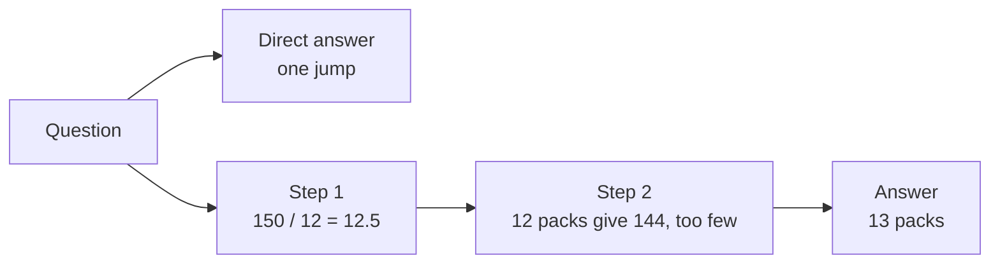
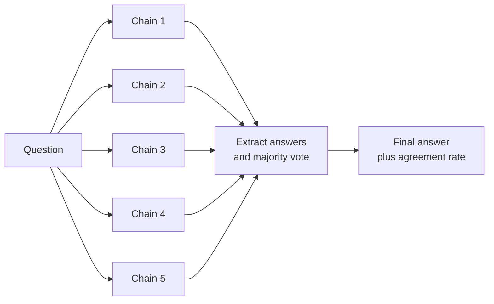

Ask a model "A shop sells pens in packs of 12. A school needs 150 pens. How many packs must it buy?" and some models will answer "12" straight away, which is wrong. Ask the same model to work through the problem first and it will often write "150 / 12 = 12.5, so 12 packs give only 144 pens; the school needs 13 packs", and get it right. **Chain-of-thought (CoT) prompting** is the family of techniques that get a model to produce intermediate reasoning before its final answer. This lesson explains why that helps, how to use it in code, how sampling several chains improves reliability, and why the arrival of dedicated reasoning models has changed when you should bother.

## Why writing out steps helps

Recall from [inference](/learn/generative-ai-fundamentals/inference) that a model generates one token at a time, and each token is produced by a fixed amount of computation: one forward pass through the network. A question whose answer needs several dependent steps cannot always be squeezed into the computation available for a single answer token.

Writing out intermediate steps changes that in two ways:

- **More computation.** Every reasoning token is another forward pass, and each one can attend to what came before. The model effectively gets a scratchpad.
- **Better conditioning.** Once "150 / 12 = 12.5" is written in the context, the next step is conditioned on that intermediate result rather than on the raw question. Each step is a smaller, easier prediction.



The benefit is largest on tasks with several dependent steps: arithmetic word problems, logic puzzles, multi-condition rules ("eligible if over 18 and resident and not already enrolled"), and planning. It is small or absent for tasks that are essentially one step, such as recalling a fact or classifying sentiment.

## Zero-shot and few-shot CoT

There are two classic ways to elicit reasoning.

**Zero-shot CoT** simply asks for it:

```text
Before: A shop sells pens in packs of 12. A school needs 150 pens.
        How many packs must it buy? Answer with a number.

After:  A shop sells pens in packs of 12. A school needs 150 pens.
        How many packs must it buy?
        Work through the problem step by step, then give the final
        answer on its own line in the form "Answer: <number>".
```

The "before" prompt actively discourages reasoning by demanding only a number. The "after" prompt invites reasoning and still fixes the format of the final line so code can extract it.

**Few-shot CoT** combines this with [few-shot examples](/learn/prompt-engineering/few-shot-prompting) whose answers include worked reasoning:

```text
Q: A box holds 8 eggs. How many boxes are needed for 30 eggs?
Reasoning: 30 / 8 = 3.75. Three boxes hold 24 eggs, which is not
enough, so a fourth box is needed.
Answer: 4

Q: A shop sells pens in packs of 12. A school needs 150 pens.
How many packs must it buy?
Reasoning:
```

Few-shot CoT lets you demonstrate the *kind* of reasoning you want, such as checking the rounding direction, which helps when the model's default reasoning style misses a step your domain cares about.

## Separating reasoning from the answer

Once a model reasons in its output, your code must find the answer inside a longer text. Fix the answer's position and format in the prompt, then parse it strictly. The reply below is illustrative, written to show the shape a model typically produces:

```python
import re

reply = """150 pens are needed and each pack has 12.
150 / 12 = 12.5, so 12 packs give 144 pens, which is too few.
Answer: 13"""

def extract_answer(text: str) -> str | None:
    match = re.search(r"^Answer:\s*(.+)$", text, flags=re.MULTILINE)
    return match.group(1).strip() if match else None

print(extract_answer(reply))
print(extract_answer("I think it is about 13 packs."))
```

```output
13
None
```

Returning `None` when the answer line is missing lets your code retry or flag the case rather than guessing. Some teams ask for the reasoning and answer inside separate tags (see [structured prompting](/learn/prompt-engineering/structured-prompting)), or use a [structured output](/learn/working-with-llms/structured-outputs) with a `reasoning` field followed by an `answer` field. Put the reasoning field first: the model generates fields in order, and an answer generated before its reasoning cannot benefit from it.

> [!WARNING]
> Written reasoning is not a faithful window into how the model reached its answer. Models sometimes produce plausible steps that do not match the answer, or reach the right answer with flawed steps. Treat the reasoning as a useful aid that often improves results and helps debugging, not as an audit trail or proof of correctness.

## Self-consistency: sample several chains and vote

A single chain of reasoning can go wrong at any step. **Self-consistency** exploits the fact that there are usually many valid routes to a correct answer but the wrong answers tend to scatter. The procedure:

1. Sample $n$ reasoning chains for the same question at a temperature above zero, so they differ.
2. Extract the final answer from each.
3. Return the most common answer.

Formally, if $a_1, \dots, a_n$ are the extracted answers, the chosen answer is

$$
\hat{a} = \arg\max_{a} \sum_{i=1}^{n} \mathbb{1}[a_i = a]
$$

where $\mathbb{1}[\cdot]$ is 1 when the condition holds and 0 otherwise. The fraction of chains agreeing with $\hat{a}$ is a useful rough confidence signal: unanimous agreement is more trustworthy than a narrow plurality.



Here is the voting logic, using five illustrative replies in place of real samples:

```python
from collections import Counter

samples = [
    "150 / 12 = 12.5, round up.\nAnswer: 13",
    "12 x 12 = 144 < 150, 13 x 12 = 156.\nAnswer: 13",
    "150 / 12 = 12.5.\nAnswer: 12",
    "Need 150, packs of 12, 12.5 packs, so round up.\nAnswer: 13",
    "I am not sure.",
]

answers = [a for a in (extract_answer(s) for s in samples) if a is not None]
votes = Counter(answers)
best, count = votes.most_common(1)[0]
print(votes)
print(f"chosen={best} agreement={count}/{len(samples)}")
```

```output
Counter({'13': 3, '12': 1})
chosen=13 agreement=3/5
```

Step through the vote to see how unparseable replies are dropped before counting:

```trace
{
  "title": "self-consistency voting",
  "code": [
    "answers = []",
    "for s in samples:",
    "    a = extract_answer(s)",
    "    if a is not None:",
    "        answers.append(a)",
    "votes = Counter(answers)",
    "print(votes.most_common(1))"
  ],
  "steps": [
    { "line": 1, "vars": { "answers": "[]" }, "note": "Start with an empty list of extracted answers." },
    { "line": 5, "vars": { "a": "'13'", "answers": "['13']" }, "note": "Sample 1 ends with 'Answer: 13', so 13 is kept." },
    { "line": 5, "vars": { "a": "'13'", "answers": "['13', '13']" }, "note": "Sample 2 reached 13 by a different route: multiplication instead of division." },
    { "line": 5, "vars": { "a": "'12'", "answers": "['13', '13', '12']" }, "note": "Sample 3 forgot to round up. Its wrong answer is kept for now; the vote will outweigh it." },
    { "line": 5, "vars": { "a": "'13'", "answers": "['13', '13', '12', '13']" }, "note": "Sample 4 agrees with the majority." },
    { "line": 4, "vars": { "a": "None", "answers": "['13', '13', '12', '13']" }, "note": "Sample 5 has no Answer line, so extract_answer returns None and it is skipped." },
    { "line": 7, "vars": { "votes": "{'13': 3, '12': 1}" }, "out": ["[('13', 3)]"], "note": "13 wins with 3 of 5 samples. The 3/5 agreement is a rough confidence signal." }
  ]
}
```

Self-consistency multiplies cost and latency by roughly $n$, so reserve it for questions where correctness matters and answers can be compared exactly (numbers, labels, short strings). It does not apply directly to open-ended writing, where no two outputs are identical.

## Reasoning models change the picture

Many current models are **reasoning models**: they have been trained, typically with reinforcement learning, to generate an extended internal reasoning process before their visible answer. Providers expose this in different ways; some show a summary of the reasoning, some hide it entirely, and many offer a setting that controls how much reasoning effort the model spends. Check your provider's documentation for the current options rather than relying on a specific parameter name.

For these models, the practical advice shifts:

| Situation | Classic chat model | Reasoning model |
| --- | --- | --- |
| "Think step by step" in the prompt | Often helps on multi-step tasks | Usually adds little; the model reasons anyway |
| Few-shot reasoning examples | Can teach a reasoning style | Often unnecessary; may constrain a better default approach |
| Visible reasoning in the output | The only way to get the benefit | Optional; the reasoning happens internally |
| What to put in the prompt | Steps and format | A clear goal, constraints and success criteria |

Reasoning is never free. Whether the tokens are visible or hidden, they are generated, usually billed, and add latency. Asking a reasoning model to *also* write out its steps in the answer doubles up the cost for little benefit. Asking a fast model to reason visibly on every call of a simple classification task slows down your application for nothing.

> [!KEY]
> Match reasoning to the task. For one-step tasks, ask for the answer directly. For multi-step tasks on a standard model, ask for reasoning before a clearly marked answer. For hard tasks, consider a reasoning model and spend your prompt on stating the goal and constraints precisely, not on telling it how to think.

## Exercises

**1.** Rewrite this prompt so that it invites reasoning but still yields an answer your code can extract reliably.

```text
Is a customer who joined on 3 March 2024, and whose plan renews
yearly, due for renewal in the week of 24 February 2025? Yes or no.
```

<details>
<summary>Show solution</summary>

```text
A customer joined on 3 March 2024. Their plan renews every year on
the anniversary of the join date.

Is the customer's renewal date within the week of 24 February to
2 March 2025 (inclusive)?

First, work out the renewal date and compare it with the week,
step by step. Then write the final answer on its own last line,
exactly "Answer: yes" or "Answer: no".
```

The renewal date (3 March 2025) falls just outside the week, which is exactly the kind of boundary a direct answer can miss. The fixed last line keeps parsing trivial, and making the week's end date explicit removes an ambiguity in the original question.

</details>

**2.** Extend the voting code so that it returns `None` instead of an answer when fewer than 60% of all samples agree on the winner.

<details>
<summary>Show solution</summary>

```python
def vote(samples: list[str], threshold: float = 0.6):
    answers = [a for a in (extract_answer(s) for s in samples) if a is not None]
    if not answers:
        return None
    best, count = Counter(answers).most_common(1)[0]
    return best if count / len(samples) >= threshold else None

print(vote(samples))
print(vote(samples, threshold=0.8))
```

```output
13
None
```

Dividing by `len(samples)` rather than `len(answers)` counts unparseable replies against the winner, which is the more cautious choice.

</details>

**3.** Your application classifies support tickets into five categories using a reasoning model. A colleague proposes adding "Think step by step and show all your reasoning before the label" to the prompt. What would you expect, and what would you do?

<details>
<summary>Show solution</summary>

Classification into a few categories is usually close to a one-step task, and a reasoning model already reasons internally where needed. Asking for visible reasoning would add output tokens and latency on every ticket, with little expected gain in accuracy, and would complicate parsing. Rather than argue, measure: run the evaluation set with and without the instruction and compare accuracy, cost and latency. Keep the instruction only if the gain justifies the cost.

</details>

```quiz
[
  {
    "q": "Why can generating intermediate reasoning tokens improve answers on multi-step problems?",
    "options": [
      "Reasoning tokens are processed by a larger model",
      "Each extra token adds a forward pass of computation, and later steps are conditioned on earlier written results",
      "Reasoning tokens bypass the context window limit",
      "They lower the temperature automatically"
    ],
    "answer": 1,
    "why": "Writing out steps gives the model more computation and lets each step build on explicit intermediate results."
  },
  {
    "q": "What does self-consistency do?",
    "options": [
      "Asks the model to check its own answer once",
      "Runs the same prompt at temperature 0 several times",
      "Samples several reasoning chains at non-zero temperature and takes the most common final answer",
      "Averages the token probabilities of several models"
    ],
    "answer": 2,
    "why": "Diverse chains that converge on the same answer are more reliable than a single chain. Temperature 0 would give near-identical chains, defeating the purpose."
  },
  {
    "q": "When using a structured output with `reasoning` and `answer` fields, which order is better?",
    "options": [
      "`reasoning` first, so the answer is generated after it",
      "`answer` first, so it is easy to find",
      "The order makes no difference",
      "Alphabetical order, as required by JSON"
    ],
    "answer": 0,
    "why": "Generation is sequential. An answer produced before its reasoning cannot be informed by that reasoning."
  },
  {
    "q": "What is the main trade-off of asking a reasoning model to also write visible step-by-step reasoning in its answer?",
    "options": [
      "It makes the model forget the system message",
      "It always makes answers less accurate",
      "It disables streaming",
      "It adds cost and latency, usually for little benefit, since the model already reasons internally"
    ],
    "answer": 3,
    "why": "Reasoning models already spend tokens thinking. Extra visible reasoning duplicates that work and slows responses."
  }
]
```
