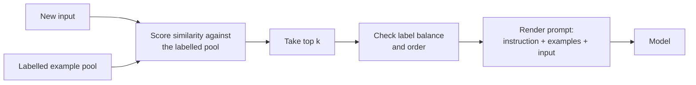

Some tasks are easier to show than to describe. You can spend a paragraph explaining what counts as a "feature request" rather than a "bug report", or you can show the model five labelled tickets and let it infer the boundary. **Few-shot prompting** puts a handful of input-output examples in the prompt before the real input. It is one of the most effective tools you have for controlling format, style and fuzzy category boundaries, and also one of the easiest to get subtly wrong, because the model copies patterns in your examples that you did not mean to teach.

## In-context learning

Few-shot prompting relies on **in-context learning**: a large language model can pick up a task from examples placed in its context window, without any change to its weights. Nothing is trained. The examples simply make certain continuations more likely, because the model has seen countless documents in which a pattern, once established, continues.

This has two practical consequences:

- **The effect lasts for one call only.** The next request starts from scratch, so the examples must be sent every time, and they cost tokens every time (see [token usage and cost](/learn/working-with-llms/token-usage-and-cost-optimization)).
- **The model learns whatever the examples have in common**, including accidents: their length, their tone, the position of the answer, even which label appears most often.

The terms "one-shot" and "k-shot" simply count the examples: one-shot uses one, k-shot uses $k$.

## Before and after: extracting product attributes

A zero-shot attempt at pulling structured attributes from messy product titles:

```text
Extract the brand, product type and size from this product title.

Title: ACME UltraSoft Bath Towel - 70x140cm - Grey
```

The model will extract something, but the format will drift between calls: sometimes a sentence, sometimes a list, sometimes "Size: 70 by 140 centimetres". The few-shot version:

```text
Extract the brand, product type and size from each product title.
If a field is missing, write "none".

Title: Nordlys LED Desk Lamp 40W
Brand: Nordlys | Type: desk lamp | Size: none

Title: pack of 6 GreenLeaf compostable bin bags 30L
Brand: GreenLeaf | Type: bin bags | Size: 30L

Title: Kettle 1.7L stainless steel by Brava
Brand: Brava | Type: kettle | Size: 1.7L

Title: ACME UltraSoft Bath Towel - 70x140cm - Grey
```

Why it helps:

- **Format is demonstrated, not described.** The exact separator, field order and casing are visible, so the output follows them closely.
- **Edge cases are covered by example.** The lamp shows what "missing" looks like; the bin bags show that a pack count is not a size; the kettle shows the brand can appear at the end.
- **Normalisation is implied.** Every type is lower case and singular or plural as written. You would struggle to describe all such conventions in words.
- **The instruction is still there.** Examples work best alongside a short task statement, not instead of it.

## Sending examples as messages

With a chat API you can place examples in one user message, as above, or as alternating user and assistant messages. The second form makes each example look like a previous turn the model itself produced, which tends to anchor the format strongly.

```python
EXAMPLES = [
    ("Nordlys LED Desk Lamp 40W", "Brand: Nordlys | Type: desk lamp | Size: none"),
    ("pack of 6 GreenLeaf compostable bin bags 30L", "Brand: GreenLeaf | Type: bin bags | Size: 30L"),
]

def build_messages(title: str) -> list[dict]:
    messages = [{
        "role": "system",
        "content": "Extract brand, product type and size from product titles. "
                   "Write 'none' for a missing field.",
    }]
    for example_input, example_output in EXAMPLES:
        messages.append({"role": "user", "content": f"Title: {example_input}"})
        messages.append({"role": "assistant", "content": example_output})
    messages.append({"role": "user", "content": f"Title: {title}"})
    return messages

for m in build_messages("ACME UltraSoft Bath Towel - 70x140cm - Grey"):
    print(f"{m['role']:>9}: {m['content']}")
```

```output
   system: Extract brand, product type and size from product titles. Write 'none' for a missing field.
     user: Title: Nordlys LED Desk Lamp 40W
assistant: Brand: Nordlys | Type: desk lamp | Size: none
     user: Title: pack of 6 GreenLeaf compostable bin bags 30L
assistant: Brand: GreenLeaf | Type: bin bags | Size: 30L
     user: Title: ACME UltraSoft Bath Towel - 70x140cm - Grey
```

Whichever layout you choose, keep it **consistent**: identical labels ("Title:", "Brand:"), identical separators, and an identical format for every example. Inconsistency in the examples becomes inconsistency in the output.

## Choosing good examples

The examples you pick matter more than how many you use.

| Principle | Why it matters |
| --- | --- |
| Representative | Examples should look like real inputs: same length, same messiness, same language. Clean toy examples teach the model to expect clean inputs. |
| Diverse | Cover different sub-types of input, so the model does not latch on to one surface pattern. |
| Cover the hard cases | Include the boundary cases that zero-shot got wrong: the missing field, the ambiguous category. |
| Correct | A wrong label in an example is a wrong instruction. Check every example as carefully as code. |
| Not in your test set | If an evaluation input also appears as an example, the score is meaningless. |

### Dynamic example selection

When you have a large pool of labelled examples, you do not have to use the same few for every input. You can retrieve the examples most **similar** to the current input, so the model sees demonstrations relevant to the case at hand. Production systems usually measure similarity with [embeddings](/learn/generative-ai-fundamentals/embeddings); TF-IDF from scikit-learn shows the idea with no model call:

```python
from sklearn.feature_extraction.text import TfidfVectorizer
from sklearn.metrics.pairwise import cosine_similarity

pool = [
    ("The app crashes when I open settings", "bug"),
    ("Please add a dark mode", "feature"),
    ("Export to PDF produces a blank page", "bug"),
    ("Could you support Apple Pay?", "feature"),
    ("Login button does nothing on Android", "bug"),
    ("It would be great to schedule reports weekly", "feature"),
]
texts = [text for text, _ in pool]
vectoriser = TfidfVectorizer().fit(texts)
pool_vectors = vectoriser.transform(texts)

def select_examples(query: str, k: int = 2):
    scores = cosine_similarity(vectoriser.transform([query]), pool_vectors)[0]
    best = scores.argsort()[::-1][:k]
    return [pool[i] for i in best]

for text, label in select_examples("Export to CSV crashes the app"):
    print(label, "|", text)
```

```output
bug | The app crashes when I open settings
bug | Export to PDF produces a blank page
```

The selector found two relevant demonstrations, but notice that both are `bug`. Similarity-based selection can quietly unbalance the labels, which leads to the next problem.



## Label balance and ordering

Few-shot prompts are known to be sensitive to properties of the example set that have nothing to do with the task.

**Majority-label bias.** If four of your five examples are labelled `positive`, the model leans towards `positive` on uncertain inputs. The examples act as a prior. Unless you deliberately want to encode the real class frequencies, keep labels roughly balanced and make sure every label appears at least once.

**Recency bias.** Labels that appear in the last example or two can have an outsized influence, because they are closest to where the model starts generating. If all `bug` examples come first and all `feature` examples last, you are nudging towards `feature`.

**Order sensitivity in general.** The same examples in a different order can produce different results on borderline inputs. You cannot reason your way to the best order; you can only measure.

A simple check catches the most common mistake:

```python
from collections import Counter

chosen = select_examples("Export to CSV crashes the app", k=4)
print(Counter(label for _, label in chosen))
```

```output
Counter({'bug': 3, 'feature': 1})
```

A practical recipe: select by similarity, then enforce a minimum count per label (for example, the most similar example from each class), and interleave labels rather than grouping them. Then evaluate a few different orderings on your test set and confirm that the results are stable. If accuracy swings widely between orderings, your examples are carrying too much of the decision and the instruction needs to be clearer.

> [!WARNING]
> Models copy surface features of examples. If every example output is exactly two sentences, outputs will be two sentences. If every example happens to mention a price, the model may invent one. Before adding an example, ask what else, besides the thing you want to teach, it demonstrates.

## How many examples?

There is no universal number. A few examples are often enough to fix format; subtle classification boundaries may need more. Each example costs input tokens on every call and pushes the real input further away. Start small, add examples that target specific failures in your tests, and stop when adding more no longer changes the results. If you find yourself needing hundreds, that is a signal to consider [fine-tuning](/learn/generative-ai-fundamentals/fine-tuning) instead.

> [!TIP]
> Keep your examples in a data file, not hard-coded in a string. Then you can version them, review changes, and swap example sets in an A/B test without editing the prompt code. The lesson on [prompt templates](/learn/prompt-engineering/prompt-templates) shows how.

## Exercises

**1.** A sentiment prompt uses these examples, in this order. Identify two problems and propose a fix.

```text
Review: Loved it, would buy again -> positive
Review: Fantastic quality -> positive
Review: Works as described -> positive
Review: Arrived broken -> negative
Review: Great value -> positive
```

<details>
<summary>Show solution</summary>

1. **Label imbalance**: four `positive` to one `negative`, and no `neutral` even if that label is allowed. The model will lean positive on unclear reviews.
2. **Recency**: the final example is `positive`, reinforcing the same bias. Also, "Works as described" is arguably neutral, so one example may be mislabelled.

Fix: use a balanced set (for example two of each label), include at least one neutral and one mixed review, interleave the labels, and check every label carefully.

</details>

**2.** Modify `select_examples` so that it always returns at least one example of each label in the pool, filling the remaining slots by similarity.

<details>
<summary>Show solution</summary>

```python
def select_balanced(query: str, k: int = 4):
    scores = cosine_similarity(vectoriser.transform([query]), pool_vectors)[0]
    ranked = list(scores.argsort()[::-1])
    chosen = []
    for label in sorted({lab for _, lab in pool}):
        best_for_label = next(i for i in ranked if pool[i][1] == label)
        chosen.append(best_for_label)
    for i in ranked:
        if len(chosen) >= k:
            break
        if i not in chosen:
            chosen.append(i)
    return [pool[i] for i in chosen]

print(select_balanced("Export to CSV crashes the app"))
```

```output
[('The app crashes when I open settings', 'bug'), ('It would be great to schedule reports weekly', 'feature'), ('Export to PDF produces a blank page', 'bug'), ('Login button does nothing on Android', 'bug')]
```

It guarantees one example per label first. The `feature` example it picked shares only the word "to" with the query, a reminder that word-overlap similarity is crude; embeddings capture meaning far better. The result still contains three bugs out of four, so for a strictly balanced set you would cap each label at `k // n_labels`.

</details>

**3.** Why is it a mistake to measure a few-shot prompt's accuracy on a test set that includes the prompt's own examples?

<details>
<summary>Show solution</summary>

The model can copy the answer straight from its context, so those test items measure recall of the prompt rather than generalisation. The score is inflated and hides failures on new inputs. Keep the example pool and the evaluation set strictly separate, just as you separate training and test data.

</details>

```quiz
[
  {
    "q": "What happens to a model's weights during few-shot prompting?",
    "options": [
      "They are updated slightly by each example",
      "They are updated once per session",
      "They do not change; the examples only influence the current call through the context",
      "Only the output layer is updated"
    ],
    "answer": 2,
    "why": "In-context learning works entirely through the context window. Nothing is trained, which is why examples must be sent with every call."
  },
  {
    "q": "Your few-shot classifier has eight examples: six labelled `spam`, two labelled `not_spam`. What effect should you expect?",
    "options": [
      "A tendency to over-predict `spam` on uncertain inputs",
      "No effect, because the model reads the instruction",
      "A tendency to over-predict `not_spam`",
      "The model will refuse to classify"
    ],
    "answer": 0,
    "why": "The label distribution of the examples acts like a prior. Imbalanced examples push borderline cases toward the majority label."
  },
  {
    "q": "Which is the best reason to retrieve examples similar to the current input?",
    "options": [
      "It guarantees balanced labels",
      "It makes the prompt shorter than zero-shot",
      "It removes the need for an instruction",
      "It shows the model demonstrations relevant to this particular case"
    ],
    "answer": 3,
    "why": "Similar examples demonstrate how to handle inputs like this one. They do not guarantee balance, which you must check separately."
  },
  {
    "q": "Every example output in your prompt is a single sentence ending with a price. What risk does this create?",
    "options": [
      "The model will ignore the examples",
      "The model may copy those surface features, producing one-sentence outputs and inventing prices",
      "The prompt will exceed the context window",
      "The API will reject the request"
    ],
    "answer": 1,
    "why": "Models imitate everything the examples share, not only the feature you meant to teach."
  }
]
```
