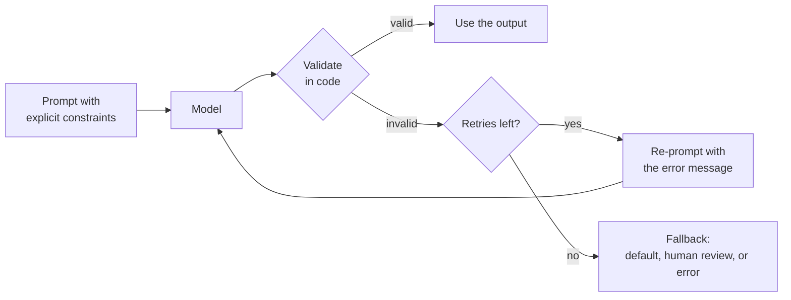

Most model output in a real application is read first by code, not by a person. A function expects a label from a fixed list, a database column expects a date, a user interface has room for two lines. **Output constraints** are the instructions that pin down the shape of the answer: its length, format, allowed values, and what to do when the model cannot or should not answer. Prompting for constraints raises the rate of usable outputs; validating them in code catches the rest. You need both, because no prompt makes a model's output guaranteed.

## The kinds of constraint

| Constraint | Example instruction | How code checks it |
| --- | --- | --- |
| Length | "At most 3 sentences", "under 80 words" | Count sentences or words |
| Format | "A Markdown table with columns Name, Price" | Parse the structure |
| Machine-readable | "Valid JSON matching this schema" | `json.loads` and field checks |
| Enumerated values | "One of: low, medium, high" | Membership test |
| Content rules | "Mention only products in the catalogue" | Compare against the catalogue |
| Escape path | "If the text has no date, reply `NONE`" | Check for the sentinel |



## Length

Models do not count characters reliably, because they see [tokens](/learn/generative-ai-fundamentals/tokenization), not letters. They are better with units that match how text is structured.

```text
Before: Describe the product briefly.

After:  Describe the product in exactly two sentences. The first
        sentence says what it is; the second says who it is for.
```

"Briefly" is relative. Sentence counts are concrete, and giving each sentence a job makes the instruction easier to follow and the output more useful. Word limits ("under 60 words") are followed approximately; character limits less reliably still. If a hard character limit matters, such as an SMS or a page title, check it in code and retry or truncate cleanly.

Do not confuse an instruction about length with the API's maximum output token setting. The token limit is a hard cut-off: when it is hit, the response simply stops, often mid-sentence or mid-JSON. Use it as a safety cap on cost, set comfortably above the length you ask for, never as the way to make answers short.

## Format and JSON

When code consumes the output, ask for a machine-readable format and describe it precisely. The strongest option is the provider's **structured output** feature, which constrains generation to a JSON schema; you used it in [structured outputs](/learn/working-with-llms/structured-outputs). Where that is not available, or for models served without it, describe the format in the prompt:

```text
Extract the meeting details from the email in <email> tags.

Reply with a single JSON object and nothing else, with these keys:
- "date": the date in YYYY-MM-DD format, or null if no date is given
- "attendees": a list of first names, possibly empty
- "priority": one of "low", "normal", "high"

<email>
...
</email>
```

Why this works: each key has a type and a stated format; missing information has an explicit representation (`null`, empty list) rather than leaving the model to invent something; and "nothing else" discourages a friendly preamble that would break `json.loads`. Even so, models sometimes wrap JSON in a Markdown code fence, so a tolerant parser strips that first.

## Enumerations and the "I don't know" path

Whenever an output must be one of a fixed set, list the set exactly, in the same spelling your code expects, and include a value for "none of these". Without that escape route, a model asked to choose between `bug` and `feature` for the message "What are your opening hours?" will still pick one, and your downstream code will treat it as genuine.

The same idea applies to questions the model cannot answer from the information given. A model asked for a fact it lacks is under pressure to produce *something*, and plausible invention is the result. Give it a sanctioned alternative:

```text
Answer the question using only the contract text provided.
If the contract does not state the answer, reply exactly:
NOT_IN_DOCUMENT
```

A fixed sentinel such as `NOT_IN_DOCUMENT` is better than "say you don't know", because your code can detect it reliably and handle it, for example by routing to a human. The same applies to refusals: if some requests are out of scope, define what the out-of-scope reply looks like, so it is distinguishable from an answer.

> [!KEY]
> An explicit escape path is one of the most effective constraints you can add. A model that is allowed to say "not in the document" has less reason to make something up.

## Validating in code

Here is a validator for the meeting extraction above. It strips code fences, parses, and checks every constraint, returning a list of human-readable problems:

```python
import json
import re
from datetime import date

PRIORITIES = {"low", "normal", "high"}

def parse_json_reply(text: str):
    text = text.strip()
    fenced = re.match(r"^```(?:json)?\s*(.*?)\s*```$", text, flags=re.DOTALL)
    if fenced:
        text = fenced.group(1)
    return json.loads(text)

def validate_meeting(text: str) -> tuple[dict | None, list[str]]:
    try:
        data = parse_json_reply(text)
    except json.JSONDecodeError as error:
        return None, [f"not valid JSON: {error.msg}"]
    if not isinstance(data, dict):
        return None, ["top level must be a JSON object"]
    problems = []
    if set(data) != {"date", "attendees", "priority"}:
        problems.append(f"keys must be date, attendees, priority; got {sorted(data)}")
    if data.get("date") is not None:
        try:
            date.fromisoformat(data["date"])
        except (TypeError, ValueError):
            problems.append(f"date {data['date']!r} is not YYYY-MM-DD")
    if not isinstance(data.get("attendees"), list):
        problems.append("attendees must be a list")
    if data.get("priority") not in PRIORITIES:
        problems.append(f"priority {data.get('priority')!r} not in {sorted(PRIORITIES)}")
    return (data if not problems else None), problems

replies = [
    '{"date": "2025-03-14", "attendees": ["Ana", "Raj"], "priority": "high"}',
    '```json\n{"date": null, "attendees": [], "priority": "normal"}\n```',
    'Sure! Here is the JSON: {"date": "14/03/2025"}',
    '{"date": "14/03/2025", "attendees": "Ana", "priority": "urgent"}',
]
for r in replies:
    data, problems = validate_meeting(r)
    print("OK " if data else "BAD", problems)
```

```output
OK  []
OK  []
BAD ['not valid JSON: Expecting value']
BAD ["date '14/03/2025' is not YYYY-MM-DD", 'attendees must be a list', "priority 'urgent' not in ['high', 'low', 'normal']"]
```

The second reply was wrapped in a code fence and still passed, thanks to the tolerant parser. The third had a chatty preamble. The fourth parsed but broke three rules, and the validator reports all of them, which is exactly what a retry needs. For larger schemas, a library such as [Pydantic](/learn/fastapi/pydantic) expresses the same checks as a typed model and produces similar error messages.

## Retrying with feedback

When validation fails, re-prompting with the specific problems usually works better than repeating the identical request, because the model can see what to fix. Cap the number of attempts so a persistently failing input cannot loop forever or run up cost. The model below is a stub that returns canned replies, so the loop's behaviour is real and repeatable:

```python
canned = iter([
    '{"date": "14/03/2025", "attendees": ["Ana"], "priority": "high"}',
    '{"date": "2025-03-14", "attendees": ["Ana"], "priority": "high"}',
])

def fake_model(prompt: str) -> str:
    return next(canned)

def extract_with_retry(prompt: str, max_attempts: int = 3):
    for attempt in range(1, max_attempts + 1):
        reply = fake_model(prompt)
        data, problems = validate_meeting(reply)
        if data is not None:
            return data, attempt
        prompt += "\n\nYour previous reply had these problems:\n- " + "\n- ".join(problems)
        prompt += "\nReply again with corrected JSON only."
    return None, max_attempts

print(extract_with_retry("Extract the meeting details..."))
```

```output
({'date': '2025-03-14', 'attendees': ['Ana'], 'priority': 'high'}, 2)
```

Step through the loop to see how the error message feeds the second attempt:

```trace
{
  "title": "validate and retry",
  "code": [
    "for attempt in range(1, max_attempts + 1):",
    "    reply = fake_model(prompt)",
    "    data, problems = validate_meeting(reply)",
    "    if data is not None:",
    "        return data, attempt",
    "    prompt += problems_message(problems)",
    "return None, max_attempts"
  ],
  "steps": [
    { "line": 1, "vars": { "attempt": "1" }, "note": "First attempt with the original prompt." },
    { "line": 2, "vars": { "attempt": "1", "reply": "'{\"date\": \"14/03/2025\", ...}'" }, "note": "The model returns a date in the wrong format." },
    { "line": 3, "vars": { "attempt": "1", "data": "None", "problems": "[\"date '14/03/2025' is not YYYY-MM-DD\"]" }, "note": "Validation fails with one specific, readable problem." },
    { "line": 6, "vars": { "attempt": "1", "prompt": "original + problems + 'Reply again...'" }, "note": "The problem is appended to the prompt so the model knows exactly what to fix." },
    { "line": 2, "vars": { "attempt": "2", "reply": "'{\"date\": \"2025-03-14\", ...}'" }, "note": "Second attempt: the date is now ISO format." },
    { "line": 3, "vars": { "attempt": "2", "data": "{'date': '2025-03-14', ...}", "problems": "[]" }, "note": "All checks pass." },
    { "line": 5, "vars": { "attempt": "2" }, "out": ["({'date': '2025-03-14', 'attendees': ['Ana'], 'priority': 'high'}, 2)"], "note": "Return the data and the attempt count. Logging the count shows how often your prompt needs a retry." }
  ]
}
```

> [!TIP]
> Track how often retries happen. A rising retry rate after a model or prompt change is an early warning that the constraints are no longer being followed well, long before users notice.

> [!WARNING]
> Validation checks the shape of the output, not its truth. A perfectly valid `{"date": "2025-03-14"}` can still be the wrong date. Checking correctness requires test data with known answers, which is the subject of [prompt testing and evaluation](/learn/prompt-engineering/prompt-testing-and-evaluation).

## Exercises

**1.** Rewrite this prompt with precise, checkable constraints, including an escape path.

```text
What is the warranty period in this document? Keep it short.
```

<details>
<summary>Show solution</summary>

```text
Find the warranty period stated in the document in <document> tags.

Reply with the period only, as a number followed by "months" or
"years", for example "24 months". If the document does not state a
warranty period, reply exactly: NOT_IN_DOCUMENT

<document>
...
</document>
```

The format is concrete and parseable, the unit choices are fixed, and the sentinel gives the model an honest answer when the information is absent, which your code can detect with an exact string comparison.

</details>

**2.** Write `validate_label(reply, allowed)` that returns the cleaned label if the reply (ignoring case, surrounding whitespace and a trailing full stop) is in `allowed`, and raises `ValueError` otherwise. Test it on `" High."` and `"very high"`.

<details>
<summary>Show solution</summary>

```python
def validate_label(reply: str, allowed: set[str]) -> str:
    cleaned = reply.strip().rstrip(".").strip().lower()
    if cleaned not in allowed:
        raise ValueError(f"{reply!r} is not one of {sorted(allowed)}")
    return cleaned

print(validate_label(" High.", {"low", "medium", "high"}))
try:
    validate_label("very high", {"low", "medium", "high"})
except ValueError as error:
    print(error)
```

```output
high
'very high' is not one of ['high', 'low', 'medium']
```

</details>

**3.** A developer sets the maximum output tokens to 50 to keep summaries short. Explain what will go wrong and propose a better approach.

<details>
<summary>Show solution</summary>

The token limit truncates generation wherever it falls, so many summaries will end mid-sentence, and any structured output such as JSON will be cut off and fail to parse. The model is not "aware" of the limit in the way it is aware of an instruction. A better approach is to ask for the length in the prompt ("at most two sentences"), set the token limit as a generous safety cap well above that, and check the length in code, retrying or flagging any that are too long.

</details>

```quiz
[
  {
    "q": "Why is \"in at most two sentences\" usually a better length constraint than \"in at most 140 characters\"?",
    "options": [
      "Characters are more expensive than sentences",
      "Models process tokens, not characters, so they follow structural units like sentences more reliably",
      "APIs reject character limits",
      "Sentences are always shorter than 140 characters"
    ],
    "answer": 1,
    "why": "Models do not see individual characters directly, so character counts are followed only approximately. Hard character limits must be checked in code."
  },
  {
    "q": "What does setting the API's maximum output tokens to a small value do?",
    "options": [
      "It makes the model plan a shorter answer",
      "It summarises the output",
      "It cuts generation off when the limit is reached, possibly mid-sentence or mid-JSON",
      "It lowers the temperature"
    ],
    "answer": 2,
    "why": "The token limit is a hard stop, not an instruction. Use it as a safety cap and ask for length in the prompt."
  },
  {
    "q": "Why define a sentinel reply such as `NOT_IN_DOCUMENT` for unanswerable questions?",
    "options": [
      "It gives the model a legitimate alternative to inventing an answer and lets code detect the case exactly",
      "It makes the model search the web",
      "It is required by JSON",
      "It reduces cost to zero"
    ],
    "answer": 0,
    "why": "Without an escape path the model is pushed to produce something plausible. A fixed sentinel is easy to detect and route."
  },
  {
    "q": "A reply passes all your schema validation checks. What can you conclude?",
    "options": [
      "The content is correct",
      "The model did not hallucinate",
      "No further testing is needed",
      "Only that its shape is right; its content may still be wrong"
    ],
    "answer": 3,
    "why": "Validation checks structure and allowed values. Correctness needs evaluation against known answers."
  }
]
```
