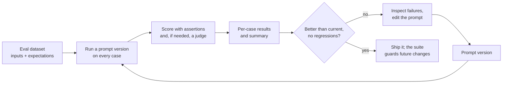

You have now seen many ways to change a prompt: add examples, add a role, ask for reasoning, restructure it, tighten its constraints. Each change is a hypothesis that the prompt got better. Without measurement you cannot tell whether it did, and a change that fixes the case you were looking at can quietly break another. **Prompt testing and evaluation** turns prompt engineering from trial and error into engineering: a fixed set of test cases, automatic checks, a way to compare versions case by case, and a regression suite that runs whenever anything changes. This lesson builds a small harness you can run right now, with a stub standing in for the model.

[Model evaluation](/learn/working-with-llms/model-evaluation) in the previous module compared models. Here the focus is on comparing prompts for one task.

## The evaluation loop



Prompts are tested much like other code ([unit testing](/learn/software-engineering/unit-testing) covers the general practice), with two differences. Outputs are often free text with many acceptable answers, so "equals the expected string" is too strict for many tasks. And outputs can vary between runs, so a single pass is weak evidence.

## Building an evaluation dataset

An evaluation dataset is a list of cases, each with an input and something to check the output against: an exact expected value, a set of acceptable values, or criteria for a judge. Good sources:

- **Real inputs**, sampled from logs or early users. These matter most, because they reflect what your application actually sees.
- **Known failures.** Every reported bad output becomes a test case, so it cannot return unnoticed.
- **Edge cases.** Empty input, very long input, other languages, off-topic requests, questions with no answer in the provided context.
- **Adversarial cases.** [Injection attempts](/learn/prompt-engineering/prompt-injection-awareness) and requests your application should decline.

Start small: a few dozen well-chosen cases are far better than none, and the set grows as you find failures. Keep it strictly separate from any [few-shot examples](/learn/prompt-engineering/few-shot-prompting) in the prompt, and keep it in version control next to the [prompt template](/learn/prompt-engineering/prompt-templates) it tests.

## Assertions: automatic checks

For many tasks a large part of quality can be checked with ordinary code.

| Assertion | Checks | Example |
| --- | --- | --- |
| Exact match | The output equals the expected value | Classification label |
| Membership | The output is in an allowed set | Enum values |
| Contains or excludes | A required phrase is present, a forbidden one absent | Must state the refund window; must not name competitors |
| Regex | The output matches a pattern | Dates, order IDs |
| Parse and validate | JSON parses and meets the schema | Structured extraction |
| Length | Word, sentence or character counts | Notification text |

Assertions are fast, free and perfectly consistent, so use them for everything they can check, and reserve slower methods for qualities code cannot judge.

## A runnable harness

The harness below compares three versions of a ticket classification prompt. The model is replaced by `stub_model`, a deterministic function that imitates two real behaviours: it can only choose labels the prompt mentions, and it adds chatty formatting unless told to reply with the label only. The keyword rules inside it are just a way to make a stand-in; in real use you would pass a function that calls your LLM API. Because the stub is deterministic, the output shown is real.

```python
import re

PROMPTS = {
    "v1": "Classify this support ticket as bug or feature.\n\nTicket: {ticket}",
    "v2": ("Classify the support ticket as one of: bug, feature, billing, other.\n"
           "Reply with the label only.\n\nTicket: {ticket}"),
    "v3": ("Classify the support ticket as one of: bug, feature, billing, other.\n"
           "If anything is broken or shows an error, choose bug first.\n"
           "Reply with the label only.\n\nTicket: {ticket}"),
}

KEYWORDS = {"billing": ["charged", "refund", "payment"],
            "bug": ["crash", "error", "broken", "fails"],
            "feature": ["add", "support for"]}

def stub_model(prompt: str) -> str:
    """Stands in for an LLM: deterministic, but sensitive to the prompt."""
    instructions, ticket = prompt.split("Ticket:")
    allowed = re.findall(r"\b(bug|feature|billing|other)\b", instructions)
    order = ["bug", "billing", "feature"] if "bug first" in instructions else list(KEYWORDS)
    label = next((lab for lab in order
                  if lab in allowed and any(w in ticket.lower() for w in KEYWORDS[lab])),
                 "other" if "other" in allowed else allowed[0])
    return label if "label only" in instructions else f"Label: {label.capitalize()}."

DATASET = [
    {"id": "t1", "ticket": "App crashes when I upload a photo", "expected": "bug"},
    {"id": "t2", "ticket": "Please add an export to Excel", "expected": "feature"},
    {"id": "t3", "ticket": "I was charged twice this month", "expected": "billing"},
    {"id": "t4", "ticket": "What are your opening hours?", "expected": "other"},
    {"id": "t5", "ticket": "Login fails with error 500", "expected": "bug"},
    {"id": "t6", "ticket": "Refund still missing for my broken kettle", "expected": "billing"},
    {"id": "t7", "ticket": "Payment page shows an error", "expected": "bug"},
]
ALLOWED = {"bug", "feature", "billing", "other"}

def normalise(output: str) -> str:
    return output.lower().removeprefix("label:").strip().rstrip(".")

def run_eval(version: str, model=stub_model) -> dict:
    results = {}
    for case in DATASET:
        output = model(PROMPTS[version].format(ticket=case["ticket"]))
        results[case["id"]] = {
            "output": output,
            "format_ok": output in ALLOWED,
            "correct": normalise(output) == case["expected"],
        }
    return results

runs = {version: run_eval(version) for version in PROMPTS}
for version, results in runs.items():
    n = len(results)
    correct = sum(r["correct"] for r in results.values())
    format_ok = sum(r["format_ok"] for r in results.values())
    print(f"{version}: correct {correct}/{n}  format {format_ok}/{n}")
```

```output
v1: correct 4/7  format 0/7
v2: correct 6/7  format 7/7
v3: correct 6/7  format 7/7
```

Two separate assertions tell two separate stories. v1 often picks the right category (4 of 7, after normalising) but never in the bare format downstream code expects, and it cannot produce `billing` or `other` at all because it never mentions them. v2 fixes both problems. v3 looks identical to v2 in the summary. Is it?

## A/B comparison: look at the cases, not just the totals

Equal totals can hide different failures. Comparing two versions case by case shows what a change actually did:

```python
def compare(a: str, b: str) -> None:
    print(f"{'case':<5}{a:<10}{b:<10}change")
    for case in DATASET:
        ra, rb = runs[a][case["id"]], runs[b][case["id"]]
        if ra["correct"] != rb["correct"]:
            change = "FIXED" if rb["correct"] else "REGRESSED"
            print(f"{case['id']:<5}{ra['output']:<10}{rb['output']:<10}{change}")

compare("v2", "v3")
```

```output
case v2        v3        change
t6   billing   bug       REGRESSED
t7   billing   bug       FIXED
```

The new rule in v3 fixed `t7` (a payment page error is a bug) but broke `t6` (a missing refund is a billing issue even though the kettle is broken). The summary score could not show this trade, and whether v3 is better depends on which kind of ticket matters more to your support team. That decision belongs to a person, informed by the per-case diff.

For free-text outputs where there is no exact expected answer, A/B comparison is often done **pairwise**: show a judge (human or model) the outputs of both versions for the same input and ask which is better against stated criteria. Pairwise judgements tend to be easier and more consistent than absolute scores.

## Noise: how much can you trust a score?

With a small dataset, a difference of one or two cases means little. If a prompt's true pass rate is $p$ and you test it on $n$ independent cases, the observed pass rate has a standard error of about

$$
\text{SE} = \sqrt{\frac{p(1 - p)}{n}}
$$

For $p = 0.8$ and $n = 50$, that is about $0.057$, so the observed rate could easily land anywhere from roughly 0.7 to 0.9 by chance alone. Two prompts scoring 0.80 and 0.84 on 50 cases are not reliably different. Grow the dataset for decisions that matter, and when outputs are sampled at non-zero [temperature](/learn/generative-ai-fundamentals/temperature), run each case several times and report the pass rate across runs.

> [!KEY]
> A summary score tells you whether to look; the per-case results tell you what happened. Always read the individual failures before deciding a prompt change is good.

## LLM-as-judge

Some qualities, such as whether a reply is polite, answers the question asked, or stays faithful to a source document, cannot be checked by regex. A common approach is to use a model as a **judge** with an explicit rubric:

```text
You are grading a customer support reply.

<question>{question}</question>
<policy>{policy}</policy>
<reply>{reply}</reply>

Assess the reply against each criterion. Answer PASS or FAIL for each:
1. accurate: every factual claim is supported by the policy
2. answers: it directly answers the customer's question
3. tone: it is polite and contains no blame

First give one sentence of reasoning per criterion, then finish with
a line of the form: VERDICT accurate=PASS answers=PASS tone=PASS
```

Why this rubric works better than "Rate this reply from 1 to 10": each criterion is narrow and binary, so the judge's decisions are easier to make and to check; reasoning comes before the verdict ([chain-of-thought](/learn/prompt-engineering/chain-of-thought-concepts)); and the final line is machine-parseable. Parsing it is ordinary code. The judge reply below is illustrative:

```python
judge_reply = """accurate: the 30-day window matches the policy.
answers: it says clearly that the item can be returned.
tone: polite, though slightly abrupt.
VERDICT accurate=PASS answers=PASS tone=FAIL"""

def parse_verdict(text: str) -> dict[str, bool] | None:
    match = re.search(r"^VERDICT (.+)$", text, flags=re.MULTILINE)
    if not match:
        return None
    pairs = dict(item.split("=") for item in match.group(1).split())
    return {name: value == "PASS" for name, value in pairs.items()}

print(parse_verdict(judge_reply))
```

```output
{'accurate': True, 'answers': True, 'tone': False}
```

Judges are models, so they have biases you must control:

| Bias | What happens | Mitigation |
| --- | --- | --- |
| Position | In pairwise comparisons, the first (or second) option is favoured | Judge each pair twice with the order swapped; count only consistent wins |
| Verbosity | Longer answers are rated higher regardless of quality | Make length an explicit criterion; prefer binary criteria |
| Self-preference | A model may favour text written in its own style | Use a different model as judge where practical |
| Drift | The judge's behaviour changes when its model is updated | Pin the judge model and version its prompt |

Most importantly, **validate the judge against people**. Have humans grade a sample of outputs, run the judge on the same sample, and measure how often they agree. Only trust the judge where agreement is high, and re-check whenever you change the judge prompt or model.

> [!WARNING]
> A judge prompt is itself a prompt that needs testing. An unvalidated judge can give you confident, consistent and wrong scores, which is worse than no score because it looks like evidence.

## Regression suites

Once a prompt ships, its evaluation set becomes a **regression suite**: a check that runs automatically before any change to the prompt, the model, the parameters or the code around them is deployed. A simple gate sets two kinds of requirement: an overall pass-rate threshold, and a list of critical cases that must always pass.

```python
CRITICAL = {"t3", "t6"}       # billing cases: must never be misrouted

def gate(results: dict, min_rate: float = 0.85) -> list[str]:
    failures = []
    rate = sum(r["correct"] for r in results.values()) / len(results)
    if rate < min_rate:
        failures.append(f"pass rate {rate:.2f} below {min_rate}")
    for case_id in sorted(CRITICAL):
        if not results[case_id]["correct"]:
            failures.append(f"critical case {case_id} failed")
    return failures

for version in ["v2", "v3"]:
    print(version, gate(runs[version]) or "PASS")
```

```output
v2 PASS
v3 ['critical case t6 failed']
```

The gate turns the A/B finding into an enforced rule: v3 cannot ship while it misroutes a billing ticket. Wrapped in a [pytest](/learn/software-engineering/pytest) test and run in [continuous integration](/learn/ci-cd/automated-testing), this check runs on every pull request that touches a prompt. Because real model calls cost money and time, teams often run a small, fast suite on every change and the full suite before release.

> [!TIP]
> Record every evaluation run with the prompt version, model name, parameters, date and per-case results. When quality drops in production, being able to rerun last month's suite against today's model is often the fastest way to find out why.

## Exercises

**1.** Add a case `t8` with the ticket "The refund button crashes the app" to `DATASET`. Decide its expected label, rerun all versions, and apply the gate to v2 and v3. What does the result tell you?

<details>
<summary>Show solution</summary>

A crashing button is a bug, even though the word "refund" appears, so the expected label is `bug`.

```python
DATASET.append({"id": "t8", "ticket": "The refund button crashes the app", "expected": "bug"})
runs = {version: run_eval(version) for version in PROMPTS}
compare("v2", "v3")
for version in ["v2", "v3"]:
    print(version, gate(runs[version]) or "PASS")
```

```output
case v2        v3        change
t6   billing   bug       REGRESSED
t7   billing   bug       FIXED
t8   billing   bug       FIXED
v2 ['pass rate 0.75 below 0.85']
v3 ['critical case t6 failed']
```

v2 now falls below the pass-rate threshold, and v3 still breaks a critical case, so neither version may ship. The new case has exposed a real conflict: keyword cues such as "refund" and "crashes" pull in opposite directions, and neither simple rule handles both `t6` and `t8`. The next step is a better prompt, perhaps a clearer definition of each category or few-shot examples of these boundary cases, and the suite will tell you whether it works.

</details>

**2.** Write a function `pass_rate_with_repeats(version, model, k)` that runs every case `k` times and returns the fraction of all runs that were correct. Test it with `stub_model` and `k=3`. Why is the result the same as a single run here?

<details>
<summary>Show solution</summary>

```python
def pass_rate_with_repeats(version: str, model, k: int) -> float:
    total = correct = 0
    for _ in range(k):
        for r in run_eval(version, model).values():
            total += 1
            correct += r["correct"]
    return correct / total

print(round(pass_rate_with_repeats("v2", stub_model, 3), 3))
```

```output
0.75
```

This is 6 of 8, the same as a single run of v2 on the extended dataset from exercise 1. The stub is deterministic, so every repeat gives identical results. With a real model sampled at non-zero temperature, repeats differ, and averaging over them gives a more stable estimate.

</details>

**3.** In a pairwise LLM-as-judge comparison of prompts A and B, the judge prefers A when A is shown first and B when B is shown first, on most inputs. What does this tell you, and what should you report?

<details>
<summary>Show solution</summary>

The judge is showing strong position bias: its preference follows the order, not the content. On those inputs the comparison is uninformative, so they should be counted as ties (or "inconsistent"), and only consistent wins across both orderings should count. If most inputs are inconsistent, the judge prompt or model is not fit for this comparison: refine the rubric to be more specific, or validate it against human judgements before relying on it.

</details>

```quiz
[
  {
    "q": "Two prompt versions both score 6/7 on your eval set. What should you do before choosing one?",
    "options": [
      "Pick the shorter prompt, since the scores are equal",
      "Compare them case by case to see which cases each one fixed and broke",
      "Average their outputs",
      "Increase the temperature and rerun"
    ],
    "answer": 1,
    "why": "Equal totals can hide different failures. A per-case diff shows what the change actually did."
  },
  {
    "q": "Why are binary criteria (PASS or FAIL per criterion) generally preferred over a 1 to 10 score in an LLM-as-judge rubric?",
    "options": [
      "They use fewer tokens than numbers",
      "Models cannot output numbers",
      "Narrow yes-or-no decisions are easier for the judge to make consistently and easier to validate",
      "They remove the need for human validation"
    ],
    "answer": 2,
    "why": "Fine-grained scales invite inconsistency. Narrow binary checks are more reliable and easier to compare with human labels."
  },
  {
    "q": "A prompt passes 40 of 50 eval cases; a revised prompt passes 42 of 50. What is the most reasonable conclusion?",
    "options": [
      "The difference is small relative to sampling noise at this size, so it is not strong evidence either way",
      "The revised prompt is clearly better",
      "The original prompt is better",
      "The eval set must be broken"
    ],
    "answer": 0,
    "why": "With 50 cases the standard error of a pass rate near 0.8 is about 0.06, so a difference of two cases is within noise."
  },
  {
    "q": "What does a regression suite's list of critical cases add beyond an overall pass-rate threshold?",
    "options": [
      "It makes the suite run faster",
      "It replaces the need for an overall threshold",
      "It allows the model to skip those cases",
      "It blocks any change that breaks specific high-stakes behaviours, even if the overall rate stays high"
    ],
    "answer": 3,
    "why": "Some failures matter far more than others. A change can keep the average high while breaking a case that must never fail."
  }
]
```
