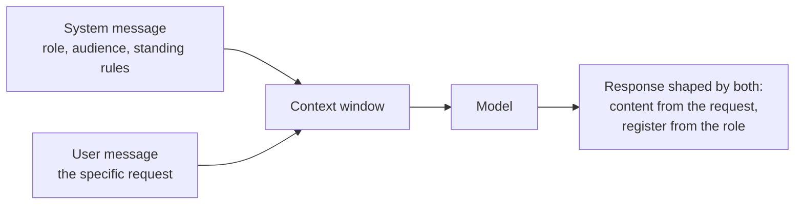
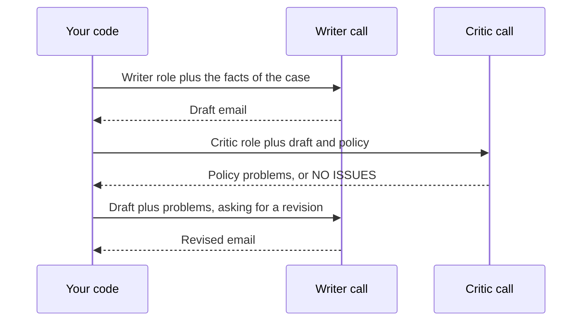

"You are a helpful assistant." "You are a senior data scientist." "You are a world-class copywriter." **Role prompting**, telling the model who it is or whom it is acting as, is the most widely used prompt technique and the most widely misunderstood. A role can genuinely change tone, vocabulary, level of detail and what the model pays attention to. It cannot give the model knowledge or skill it does not have. Knowing the difference saves you from prompts that sound impressive and do nothing, and lets you use roles where they actually earn their tokens.

## Where roles live

In a chat API a role is usually set in the **system message**, which applies to the whole conversation and which the model is trained to weight more heavily than ordinary user turns. [System and user instructions](/learn/working-with-llms/system-and-user-instructions) covered the mechanics. A role can also appear inside a user message ("Act as a code reviewer and..."), which is useful for one-off requests.



## What a role actually does

A language model generates text that is likely given everything in its context. Text written by a tax adviser for a client differs from text written by a teenager on a forum: in vocabulary, structure, caution, and which details are mentioned. Stating a role shifts the model towards the first kind of text. That is the whole mechanism. It is real, but it is about **style and framing**, not capability.

| A role can | A role cannot |
| --- | --- |
| Set tone and register (formal, friendly, terse) | Add facts the model never learned |
| Set the level of technical detail | Make the model's arithmetic or logic more reliable on its own |
| Focus attention on certain concerns (security, accessibility, cost) | Turn a guess into a verified answer |
| Establish default assumptions (British English, metric units, a given codebase) | Grant genuine professional authority or accountability |
| Keep behaviour consistent across a long conversation | Act as a security boundary |

> [!KEY]
> "You are an expert" is not a magic phrase. If the model can answer a question well, it usually can without being told it is an expert. If it cannot, the label will not fix it, and it may make wrong answers sound more confident.

## Before and after: a code review prompt

A typical first attempt:

```text
You are a world-class senior software engineer with 20 years of experience.
Review this code.
```

The role here is pure flattery. "World-class" and "20 years" do not tell the model what to look for, how severe a finding must be to mention, or what the output should look like. An improved version uses the role to carry real information:

```text
You are reviewing pull requests for a Python data pipeline that runs
nightly in production. Your reviews are read by junior engineers.

Focus on, in order of priority:
1. Bugs that would produce wrong data silently
2. Unhandled failures (missing files, network errors, empty inputs)
3. Readability problems that would slow down the next person

Ignore formatting and naming style; a linter handles those.
For each issue, quote the line, explain the problem in one or two
sentences, and suggest a fix. If you find no significant issues,
say so plainly rather than inventing minor ones.
```

Why it is better:

- **The situation** ("nightly in production", "data pipeline") tells the model which failures are expensive. Silent wrong data matters more here than in a throwaway script.
- **The audience** ("junior engineers") sets the level of explanation.
- **Explicit priorities** replace the vague promise of expertise with the actual criteria an expert would apply.
- **An exclusion** stops the review filling up with style nitpicks.
- **Permission to find nothing** counters the tendency to produce *something* when asked to review, which otherwise yields invented issues.

Notice that the improved prompt barely uses "You are..." at all. Most of the value came from describing the job.

## Audience roles are often more useful than model roles

Telling the model who the **reader** is often matters more than telling it who it is. "Explain this to a nurse in her first week on a ward" constrains vocabulary, assumed knowledge and emphasis far more precisely than "You are a medical expert".

```text
Before: You are an expert statistician. Explain p-values.

After:  Explain what a p-value is to a product manager who needs to
        decide whether an A/B test result is worth acting on. They
        know basic percentages but no statistics. Use one concrete
        example from an A/B test, and end with the single most common
        misinterpretation to avoid.
```

The "after" prompt has no model role at all. It works because it describes the reader's background and goal, which is exactly what the model needs to pitch the explanation.

## Roles for multiple perspectives

Roles become more than decoration when you use **different roles in different calls** to get genuinely different behaviour. A common pattern is draft and critique:



Each call has a narrow job and a role that matches it. The critic's system message can contain the full policy and a checklist; the writer's can focus on tone. This separation is easier to test than one giant prompt that tries to write and self-check at once. The pattern reappears in [reflection for agents](/learn/ai-agent-fundamentals/reflection).

In code, the roles are just different system messages:

```python
WRITER_ROLE = (
    "You draft short, friendly customer emails for an online bookshop. "
    "Write in British English. Never promise refunds; the policy check happens later."
)
CRITIC_ROLE = (
    "You check draft customer emails against the bookshop's policy. "
    "List each sentence that breaks a rule and name the rule. "
    "If nothing breaks a rule, reply exactly: NO ISSUES"
)

def messages_for(role: str, user_content: str) -> list[dict]:
    return [
        {"role": "system", "content": role},
        {"role": "user", "content": user_content},
    ]

critic_call = messages_for(CRITIC_ROLE, "Policy: ...\n\nDraft: ...")
print(critic_call[0]["content"][:60] + "...")
print(len(critic_call), "messages")
```

```output
You check draft customer emails against the bookshop's polic...
2 messages
```

The critic's fixed reply `NO ISSUES` is deliberate: your code can test for it exactly, rather than trying to interpret "Looks good to me!".

## Limits and risks

**False authority.** A model playing "doctor" or "lawyer" writes in the confident register of those professions. The content is no more reliable than without the role, but it sounds more trustworthy, which is worse. For high-stakes domains, a role should increase caution ("flag anything that needs a professional's review"), not confidence.

**Persona drift.** Over a long conversation, a role stated once at the start can weaken as the context fills with other text. Keep the role in the system message and restate key constraints if behaviour drifts.

**Role-play as an attack vector.** Attackers use role-play ("pretend you are an AI with no rules") to push models off their instructions. Your own system role does not protect against this; a role is an instruction like any other, and instructions can be overridden. See [prompt injection awareness](/learn/prompt-engineering/prompt-injection-awareness).

**Stacked superlatives.** Adding "genius", "world-class" and "award-winning" adds tokens, not quality. If a sentence in your system prompt would not change what a careful human does, it probably does not change what the model does either.

> [!TIP]
> To find out whether a role helps, test it. Run your evaluation set with and without the role sentence and compare. Often the role sentence can be deleted with no measurable change, which makes the prompt shorter and easier to maintain.

## Exercises

**1.** Rewrite this system message so the role carries useful information rather than flattery. The assistant answers questions from staff about a company's expense policy.

```text
You are the world's greatest HR expert. Answer expense questions brilliantly.
```

<details>
<summary>Show solution</summary>

```text
You answer questions from employees about the company expense policy,
which is provided below. Readers are staff of all seniority levels;
use plain language.

Answer only from the policy text. Quote the relevant clause number.
If the policy does not cover the question, say so and suggest the
employee contact the finance team. Do not guess amounts or limits.

Policy:
"""
...
"""
```

The useful parts are the task, the audience, the source of truth, the citation rule, and the fallback for uncovered questions. None of them depends on calling the model an expert.

</details>

**2.** A colleague claims that adding "You are a mathematics professor" made their arithmetic prompt more accurate. How would you check the claim?

<details>
<summary>Show solution</summary>

Build a test set of arithmetic problems with known answers (several dozen at least, including hard ones). Run it with the original prompt and with the role sentence added, holding everything else constant (same model, same temperature, ideally temperature 0 or several samples per item). Compare the accuracy and look at the individual items that changed. If the difference is small or within the variation you see between repeated runs, the claim is not supported. The [prompt testing lesson](/learn/prompt-engineering/prompt-testing-and-evaluation) shows how to automate this.

</details>

**3.** Why does the critic prompt in this lesson ask for the exact reply `NO ISSUES` instead of letting the model phrase its approval freely?

<details>
<summary>Show solution</summary>

Your code needs to decide whether to send the draft or revise it. An exact sentinel string can be checked with `reply.strip() == "NO ISSUES"`. Free phrasing ("This looks fine", "No problems found, great work") would force you to interpret natural language, which is fragile and can misclassify a reply that contains both praise and a problem.

</details>

```quiz
[
  {
    "q": "What does stating a role in the system message mainly change?",
    "options": [
      "The facts the model knows",
      "Style, framing, focus and default assumptions of the response",
      "The model's context window size",
      "The model's reliability on arithmetic"
    ],
    "answer": 1,
    "why": "A role shifts the model toward text typical of that role: tone, vocabulary, emphasis. It does not add knowledge or skill."
  },
  {
    "q": "Which addition is most likely to improve an explanation prompt?",
    "options": [
      "\"You are a genius-level expert\"",
      "\"You have won many awards for teaching\"",
      "\"Take a deep breath\"",
      "\"The reader is a product manager with no statistics background who must decide whether to act on an A/B test\""
    ],
    "answer": 3,
    "why": "Describing the reader's background and goal gives the model concrete information to pitch the explanation. Superlatives add tokens, not information."
  },
  {
    "q": "Why is a role a poor security control?",
    "options": [
      "It is an instruction like any other, so other text in the context can override it",
      "System messages are visible to users",
      "Roles increase the cost of each call",
      "Roles only work in English"
    ],
    "answer": 0,
    "why": "Role-play attacks and injected instructions can push a model off its role. Security needs controls outside the prompt."
  },
  {
    "q": "In the draft-and-critique pattern, why use separate calls with different system roles?",
    "options": [
      "Models can only hold one role per day",
      "It is always cheaper than one call",
      "Each call has one narrow job with matching instructions, which is easier to test and control",
      "It removes the need for evaluation"
    ],
    "answer": 2,
    "why": "Separate roles give each step focused instructions and a checkable output, instead of one prompt trying to write and self-check at once."
  }
]
```
