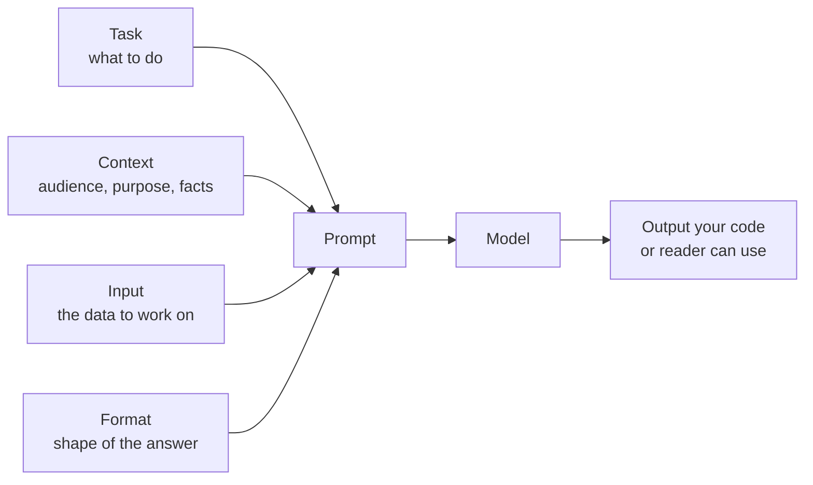
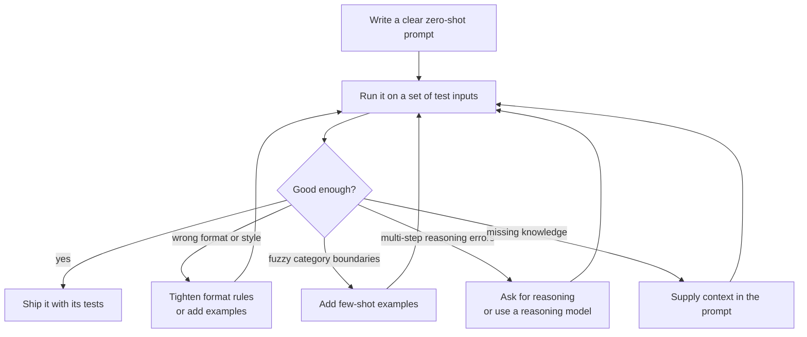

A **zero-shot prompt** asks a model to do a task without showing it a single worked example. You describe what you want, hand over the input, and rely on what the model learned during pretraining and instruction tuning to fill the gap. Most prompts you will ever write start life as zero-shot prompts, and many never need to become anything else. The difference between a zero-shot prompt that works and one that produces vague, inconsistent output is rarely clever wording. It is almost always whether the prompt states the task, the context, and the expected format clearly enough that a capable stranger could do the job without asking questions.

In [Working with LLMs](/learn/working-with-llms/prompt-construction) you learned how to send messages to a model. This module is about what to put in them.

## Why zero-shot works at all

A base model trained only to predict the next token is not a good instruction follower: give it "Translate to French: cheese" and it may continue with another line of a language worksheet. Modern chat models are [fine-tuned](/learn/generative-ai-fundamentals/fine-tuning) on large collections of instructions paired with good responses, and further tuned with human preference data. That training is what lets a model read "Classify the sentiment of this review" and do it, with no examples.

The consequence is important: the model is guessing what you mean from the words you give it. Anything you leave out, it fills in with the most typical interpretation it has seen. If you want the typical thing, a short prompt works. If you want something specific, you must say so.

## The four ingredients of a clear prompt

Almost every effective prompt contains some version of the same four parts.

| Ingredient | Question it answers | Example |
| --- | --- | --- |
| Task | What exactly should be produced? | "Write a two-sentence summary for the release notes" |
| Context | Who is it for, why, and what does the model need to know? | "Readers are non-technical customers; the product is a budgeting app" |
| Input | What material should the task be applied to? | The changelog text, clearly separated |
| Format | What shape should the answer take? | "Plain text, no bullet points, under 50 words" |



Examples, the fifth ingredient, are what turn a zero-shot prompt into a [few-shot prompt](/learn/prompt-engineering/few-shot-prompting). Try without them first: they cost tokens and can bias the output, and a clear description is often enough.

## Before and after: a summarisation prompt

Here is a prompt a developer might write on their first attempt:

```text
Summarise this:

We moved the export button to the top toolbar. CSV exports now include
the category column. Fixed a crash when importing files larger than
50 MB. Dropped support for the legacy v1 sync API.
```

It will produce *a* summary. Whether it is the right one is luck: the model has to guess the length, the audience, the tone, and whether the API change matters. Here is the improved version:

```text
You are writing release notes for a budgeting app. The readers are
everyday customers, not developers.

Summarise the changelog below in at most three short sentences.
Lead with the change customers are most likely to notice. Leave out
anything that only affects developers, such as API changes.
Use plain language and no bullet points.

Changelog:
"""
We moved the export button to the top toolbar. CSV exports now include
the category column. Fixed a crash when importing files larger than
50 MB. Dropped support for the legacy v1 sync API.
"""
```

Why each change helps:

- **Audience and purpose** ("everyday customers") tell the model which vocabulary to use and which facts matter. Without them, "Dropped support for the legacy v1 sync API" is as important as anything else.
- **A length limit** in sentences is something the model can count reliably and something you can check.
- **A priority rule** ("lead with the change customers are most likely to notice") encodes a judgement you would otherwise leave to chance.
- **An explicit exclusion** removes the one item that would confuse the target reader.
- **Delimiters** (the triple quotes) mark exactly where the input begins and ends. The lesson on [structured prompting](/learn/prompt-engineering/structured-prompting) develops this idea.

The second prompt is longer, but every added sentence removes a decision the model would otherwise make for you.

> [!KEY]
> The colleague test: if you handed the prompt to a capable new colleague with no other background, could they produce exactly what you want without asking a question? Every question they would ask is something missing from the prompt.

## Writing instructions the model can follow

A few habits make zero-shot prompts noticeably more reliable.

**Say what to do, not only what to avoid.** "Do not be verbose" leaves the target open. "Answer in one sentence" defines it. Negative instructions are fine as additions ("leave out API changes"), but pair them with a positive description of the goal.

**Be concrete about quantities and choices.** "Short" means different things in a tweet and a report. "Under 50 words", "exactly three bullet points" or "one of: positive, negative, neutral" are unambiguous.

**Explain the reason behind a rule when it is not obvious.** "Do not use abbreviations, because the text will be read aloud by a speech synthesiser" lets the model generalise the rule to cases you did not list, such as symbols like `&`.

**Put the task statement where it cannot be missed.** For a short input, the task usually comes first. For a very long input, restating the question after the document helps, because the instruction is then close to where the model starts generating.

**Do not ask for several unrelated things at once.** A prompt that classifies, summarises, translates and extracts entities in one go is hard to test and hard to fix. Split it into separate calls unless latency forces you to combine them.

## Zero-shot classification in code

Classification is a common zero-shot use: you want a label from a fixed set. The prompt-building part is ordinary Python and can be tested without calling a model.

```python
LABELS = ["billing", "technical", "account", "other"]

def build_ticket_prompt(ticket_text: str) -> str:
    label_list = ", ".join(LABELS)
    return (
        "Classify the customer support ticket below into exactly one category.\n"
        f"Allowed categories: {label_list}.\n"
        "Use 'other' if none of the categories clearly applies.\n"
        "Reply with the category name only, in lower case, with no punctuation.\n\n"
        f'Ticket:\n"""\n{ticket_text}\n"""'
    )

print(build_ticket_prompt("I was charged twice for my March subscription."))
```

```output
Classify the customer support ticket below into exactly one category.
Allowed categories: billing, technical, account, other.
Use 'other' if none of the categories clearly applies.
Reply with the category name only, in lower case, with no punctuation.

Ticket:
"""
I was charged twice for my March subscription.
"""
```

Three details matter. The label set is defined once in code and inserted into the prompt, so the prompt and the parser can never disagree. There is an explicit **fallback label**, so the model is not forced to pick a wrong category for an off-topic ticket. And the format rule ("category name only, in lower case") makes the answer easy to check.

Even with that rule, your code should normalise and verify the reply rather than trust it:

```python
def parse_label(reply: str) -> str:
    cleaned = reply.strip().strip(".").lower()
    return cleaned if cleaned in LABELS else "other"

for reply in ["billing", " Technical.", "Billing issue", "refund"]:
    print(repr(reply), "->", parse_label(reply))
```

```output
'billing' -> billing
' Technical.' -> technical
'Billing issue' -> other
'refund' -> other
```

The reply `"Billing issue"` falls back to `other`. Whether that is the right behaviour, or whether you should retry, is a product decision; the point is that the decision lives in code you control. The lesson on [output constraints](/learn/prompt-engineering/output-constraints) covers validation in depth.

The model call itself wraps the API you used in Module 25. It is shown here without output because it needs a network connection and an API key:

```python
from openai import OpenAI

client = OpenAI()

def classify_ticket(ticket_text: str, model: str) -> str:
    response = client.chat.completions.create(
        model=model,
        temperature=0,
        messages=[{"role": "user", "content": build_ticket_prompt(ticket_text)}],
    )
    return parse_label(response.choices[0].message.content)
```

A low [temperature](/learn/generative-ai-fundamentals/temperature) suits classification, where you want the most likely label rather than variety.

## When zero-shot is not enough

Zero-shot prompting is the baseline. Move beyond it only when tests show a specific failure, and choose the technique that targets that failure.



Note the last branch. No phrasing can make a model know your company's refund policy or yesterday's sales figures. When the failure is missing knowledge, the fix is to put the knowledge in the prompt, which is the idea behind [retrieval-augmented generation](/learn/rag-fundamentals/what-is-rag).

> [!WARNING]
> Do not judge a prompt by trying it on one or two inputs you made up. A prompt that looks perfect on your favourite example can fail on a quarter of real inputs. Collect a small, realistic test set early; the final lesson of this module, [prompt testing and evaluation](/learn/prompt-engineering/prompt-testing-and-evaluation), shows how.

## Exercises

**1.** Rewrite this zero-shot prompt so it passes the colleague test. The output will be shown in a mobile notification about a delayed parcel.

```text
Write a message about the delay.
```

<details>
<summary>Show solution</summary>

One good version:

```text
Write a push notification telling a customer their parcel is delayed.

Facts:
- New delivery date: Thursday
- Reason: severe weather at the regional depot

Requirements:
- At most 120 characters, so it fits a phone lock screen
- Friendly, apologetic tone; no exclamation marks
- Include the new delivery date
- Plain text only, no emojis or links
```

It adds the facts the model cannot know, the audience and channel, a length the model can aim for and you can check, and tone rules. Character limits are only approximately followed, so your code should still check the length.

</details>

**2.** Extend `build_ticket_prompt` so that it accepts the list of labels as a parameter instead of using the global `LABELS`, and make `parse_label` accept the same list. Why is it important that both functions use one shared list?

<details>
<summary>Show solution</summary>

```python
def build_ticket_prompt(ticket_text: str, labels: list[str]) -> str:
    return (
        "Classify the customer support ticket below into exactly one category.\n"
        f"Allowed categories: {', '.join(labels)}.\n"
        "Use 'other' if none of the categories clearly applies.\n"
        "Reply with the category name only, in lower case, with no punctuation.\n\n"
        f'Ticket:\n"""\n{ticket_text}\n"""'
    )

def parse_label(reply: str, labels: list[str]) -> str:
    cleaned = reply.strip().strip(".").lower()
    return cleaned if cleaned in labels else "other"
```

If the prompt and the parser kept separate copies of the labels, someone could add a category to one and forget the other. The model would then return a label the parser rejects, and every such ticket would silently become `other`. One source of truth prevents that drift. (A careful version would also check that `"other"` is in `labels`.)

</details>

**3.** A prompt says "Do not write long answers." List two ways to make it more precise, and explain why each helps.

<details>
<summary>Show solution</summary>

- State a measurable target, such as "Answer in at most two sentences". It gives the model a concrete goal and lets your code verify the result.
- Say what to prioritise when space is short, such as "Give the direct answer first; add a reason only if it fits". It tells the model what to cut, rather than leaving it to trim at random.

</details>

```quiz
[
  {
    "q": "What makes a prompt zero-shot?",
    "options": [
      "It is sent with temperature 0",
      "It contains no worked examples of the task",
      "It has no system message",
      "It is sent to a model that has not been fine-tuned"
    ],
    "answer": 1,
    "why": "Zero-shot means the model receives only a description of the task and the input, with no example input-output pairs."
  },
  {
    "q": "Why does adding the audience (\"readers are everyday customers\") improve a summarisation prompt?",
    "options": [
      "It makes the model use more tokens",
      "It unlocks a special customer-service mode in the model",
      "It tells the model which facts and vocabulary matter, removing a decision it would otherwise guess",
      "It guarantees the output will be shorter"
    ],
    "answer": 2,
    "why": "Context narrows the many valid summaries to the one that suits the reader. Without it the model falls back to a generic interpretation."
  },
  {
    "q": "A zero-shot prompt keeps giving wrong answers about your company's internal return policy. What is the most appropriate fix?",
    "options": [
      "Include the relevant policy text in the prompt",
      "Add \"think carefully\" to the prompt",
      "Raise the temperature",
      "Tell the model it is a returns expert"
    ],
    "answer": 0,
    "why": "The failure is missing knowledge. No wording can make the model know private facts; you must supply them as context."
  },
  {
    "q": "Why should a classification prompt include a fallback label such as `other`?",
    "options": [
      "Models refuse to answer without one",
      "It reduces the number of tokens in the reply",
      "It lets the model avoid forcing an off-topic input into a wrong category",
      "It makes the output valid JSON"
    ],
    "answer": 2,
    "why": "Without an escape route, the model must pick one of the real categories even when none fits, which produces confident wrong labels."
  }
]
```
