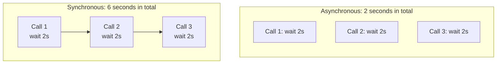
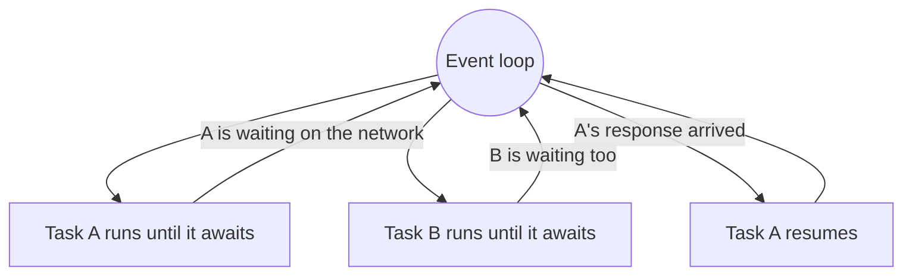

An LLM call can take several seconds, and nearly all of that time your program is doing nothing but waiting for a reply. If you need a hundred calls and make them one after another, you wait a hundred times. **Asynchronous programming** lets a single program start many waits at once and get on with other work in the meantime. It is essential for AI applications, which spend most of their life waiting on networks.

## Waiting is the bottleneck

Work falls into two kinds:

| Kind | The program is | Examples | Helped by async |
| --- | --- | --- | --- |
| **I/O-bound** | Waiting for something external | API calls, database queries, reading files, web requests | Yes |
| **CPU-bound** | Calculating | Training a model, resizing images, parsing huge files | No |

Async does not make anything compute faster. It removes idle time by overlapping the waits.



Six seconds becomes two.

## Coroutines, async and await

A function defined with `async def` is a **coroutine function**. Inside it, `await` marks the points where it may pause while waiting.

```python
import asyncio

async def fetch_answer(question):
    print(f"asking: {question}")
    await asyncio.sleep(2)              # stands in for a slow network call
    return f"answer to {question}"

async def main():
    result = await fetch_answer("What is RAG?")
    print(result)

asyncio.run(main())
```

```output
asking: What is RAG?
answer to What is RAG?
```

Three rules cover most of what you need:

1. `async def` defines a coroutine function.
2. `await` can only be used inside an `async def` function.
3. `asyncio.run(main())` starts everything, and is called once at the top of the program.

> [!WARNING]
> Calling a coroutine function does **not** run it. `fetch_answer("hi")` just creates a coroutine object. It runs only when awaited. Forgetting `await` gives the warning `RuntimeWarning: coroutine 'fetch_answer' was never awaited`, and the function silently never executes.

## The event loop

Async code runs on a single thread, managed by the **event loop**. The loop keeps a list of tasks. It runs one until that task hits an `await` on something not yet ready, then switches to another task that is ready to continue.



This is **cooperative** multitasking: a task gives up control only at an `await`. Two tasks never run at the exact same instant, which makes async code easier to reason about than threads.

## Running things concurrently

Awaiting coroutines one after another is still sequential:

```python
import asyncio
import time

async def fetch_answer(question):
    await asyncio.sleep(2)
    return f"answer to {question}"

async def main():
    start = time.perf_counter()
    a = await fetch_answer("q1")
    b = await fetch_answer("q2")
    c = await fetch_answer("q3")
    print(f"sequential: {time.perf_counter() - start:.1f}s")

asyncio.run(main())
```

```output
sequential: 6.0s
```

To overlap them, hand them all to `asyncio.gather`:

```python
async def main():
    start = time.perf_counter()
    results = await asyncio.gather(
        fetch_answer("q1"),
        fetch_answer("q2"),
        fetch_answer("q3"),
    )
    print(results)
    print(f"concurrent: {time.perf_counter() - start:.1f}s")

asyncio.run(main())
```

```output
['answer to q1', 'answer to q2', 'answer to q3']
concurrent: 2.0s
```

`gather` starts all three, waits until every one has finished, and returns the results in the order you passed them, regardless of which finished first.

For a list of inputs, combine it with a comprehension:

```python
questions = ["q1", "q2", "q3", "q4"]
results = await asyncio.gather(*(fetch_answer(q) for q in questions))
```

## Limiting concurrency

Launching a thousand requests at once will get you rate-limited or blocked. A **semaphore** caps how many run at the same time.

```python
import asyncio

async def fetch_limited(question, semaphore):
    async with semaphore:                 # at most 5 inside this block at once
        await asyncio.sleep(1)
        return f"answer to {question}"

async def main():
    semaphore = asyncio.Semaphore(5)
    questions = [f"q{i}" for i in range(20)]
    results = await asyncio.gather(*(fetch_limited(q, semaphore) for q in questions))
    print(len(results), "answers")

asyncio.run(main())
```

```output
20 answers
```

Twenty one-second calls, five at a time, finish in about four seconds. This is the standard pattern for batch-processing documents through an LLM API.

## Timeouts and errors

Any network call can hang. Give it a deadline:

```python
async def main():
    try:
        async with asyncio.timeout(1):
            await fetch_answer("slow question")
    except TimeoutError:
        print("gave up after 1 second")
```

By default, `gather` raises the first exception it meets. Pass `return_exceptions=True` to collect failures alongside successes, so one bad request does not discard the other ninety-nine results:

```python
results = await asyncio.gather(*tasks, return_exceptions=True)

for result in results:
    if isinstance(result, Exception):
        print("failed:", result)
```

## Do not block the event loop

Because everything shares one thread, a single slow synchronous call freezes every task.

```python
import time

async def bad():
    time.sleep(2)             # blocks the whole event loop for 2 seconds

async def good():
    await asyncio.sleep(2)    # pauses only this task
```

| Blocking (avoid in async code) | Async replacement |
| --- | --- |
| `time.sleep(n)` | `await asyncio.sleep(n)` |
| `requests.get(url)` | `await client.get(url)` with `httpx.AsyncClient` |
| A slow function you cannot change | `await asyncio.to_thread(func, args)` |
| Heavy computation | A separate process, or a job queue |

> [!KEY]
> Async libraries are needed all the way down. Putting `async` in front of a function that calls `requests.get` achieves nothing, because `requests` still blocks. Use an async-capable library such as `httpx`, or the async client that LLM providers ship.

## Async in AI applications

You will meet async in three places.

**Calling model APIs.** Providers offer async clients for exactly this purpose:

```python
from openai import AsyncOpenAI

client = AsyncOpenAI()

async def summarise(text):
    response = await client.chat.completions.create(
        model="gpt-4o-mini",
        messages=[{"role": "user", "content": f"Summarise: {text}"}],
    )
    return response.choices[0].message.content
```

**Serving requests.** A FastAPI endpoint defined with `async def` can serve other users while one request is waiting on a model.

**Streaming.** An `async for` loop consumes a response as it is generated, token by token:

```python
async def stream_tokens():
    for token in ["Async ", "generators ", "stream."]:
        await asyncio.sleep(0.1)
        yield token

async def main():
    async for token in stream_tokens():
        print(token, end="", flush=True)

asyncio.run(main())
```

```output
Async generators stream.
```

## When to use it

| Use async when | Stay synchronous when |
| --- | --- |
| Making many network or database calls | The script makes a few calls and speed is irrelevant |
| Building a web server or chatbot backend | The work is pure computation |
| Streaming responses to a user | The libraries you depend on are not async |

Async adds complexity. Use it where waiting dominates, and not otherwise.

## Exercises

**1.** Write a coroutine `brew(drink, seconds)` that prints when it starts and finishes. Brew tea (2 seconds) and coffee (3 seconds) concurrently and print the total time taken.

<details>
<summary>Show solution</summary>

```python
import asyncio
import time

async def brew(drink, seconds):
    print(f"start {drink}")
    await asyncio.sleep(seconds)
    print(f"{drink} ready")
    return drink

async def main():
    start = time.perf_counter()
    await asyncio.gather(brew("tea", 2), brew("coffee", 3))
    print(f"total: {time.perf_counter() - start:.1f}s")   # about 3.0s

asyncio.run(main())
```

The total equals the longest task, not the sum.

</details>

**2.** The code below takes 3 seconds instead of 1. Explain why and fix it.

```python
async def main():
    for i in range(3):
        await asyncio.sleep(1)
```

<details>
<summary>Show solution</summary>

Each `await` finishes before the loop moves on, so the sleeps run back to back. Create all the coroutines first and await them together:

```python
async def main():
    await asyncio.gather(*(asyncio.sleep(1) for _ in range(3)))
```

</details>

**3.** Write `process_all(items, limit)` that runs a coroutine `process(item)` over every item, with at most `limit` running at once, and returns the results in order.

<details>
<summary>Show solution</summary>

```python
import asyncio

async def process(item):
    await asyncio.sleep(0.5)
    return item * 2

async def process_all(items, limit):
    semaphore = asyncio.Semaphore(limit)

    async def guarded(item):
        async with semaphore:
            return await process(item)

    return await asyncio.gather(*(guarded(i) for i in items))

print(asyncio.run(process_all(range(10), limit=3)))
```

</details>

```quiz
[
  {
    "q": "Which kind of task benefits most from async programming?",
    "options": [
      "Multiplying large matrices",
      "Making hundreds of API calls",
      "Sorting a list of ten million numbers",
      "Training a neural network"
    ],
    "answer": 1,
    "why": "API calls are I/O-bound: the program mostly waits. Async overlaps those waits. The other options are CPU-bound."
  },
  {
    "q": "What happens if you call an `async def` function without `await`?",
    "options": [
      "It runs normally",
      "It runs in a background thread",
      "It returns a coroutine object and its body does not run",
      "Python raises a `SyntaxError`"
    ],
    "answer": 2,
    "why": "Calling a coroutine function only creates a coroutine object. It must be awaited or scheduled to execute."
  },
  {
    "q": "Three coroutines each sleep for 2 seconds. Roughly how long does `await asyncio.gather(a(), b(), c())` take?",
    "options": ["2 seconds", "4 seconds", "6 seconds", "It depends on the number of CPU cores"],
    "answer": 0,
    "why": "`gather` runs them concurrently, so the total is the longest individual wait, not the sum."
  },
  {
    "q": "Why is `time.sleep(5)` a problem inside an async function?",
    "options": [
      "It raises an exception",
      "It blocks the event loop, so no other task can run for 5 seconds",
      "It sleeps for less time than requested",
      "It is not: the two are interchangeable"
    ],
    "answer": 1,
    "why": "A blocking call never yields control back to the event loop. Use `await asyncio.sleep(5)` instead."
  }
]
```
