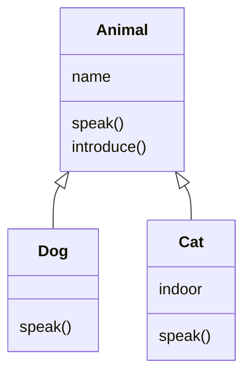

The previous lesson introduced the idea of objects. This one covers the machinery: how attributes are stored, the special methods that make objects behave like built-in types, and how inheritance and polymorphism let you build families of related classes.

## Instance and class attributes

An **instance attribute** belongs to one object. A **class attribute** is defined on the class and shared by every object.

```python
class Model:
    framework = "pytorch"           # class attribute: shared

    def __init__(self, name):
        self.name = name            # instance attribute: per object

a = Model("bert")
b = Model("gpt2")

print(a.name, b.name)
print(a.framework, b.framework, Model.framework)
```

```output
bert gpt2
pytorch pytorch pytorch
```

> [!WARNING]
> Do not use a mutable class attribute such as a list to hold per-object data. Every instance would share and modify the same list. Create it in `__init__` as `self.items = []` instead.

## Special methods

Methods with double underscores on both sides, often called **dunder methods**, let your objects work with Python's built-in syntax.

```python
class Vector:
    def __init__(self, x, y):
        self.x = x
        self.y = y

    def __repr__(self):
        return f"Vector({self.x}, {self.y})"

    def __add__(self, other):
        return Vector(self.x + other.x, self.y + other.y)

    def __eq__(self, other):
        return self.x == other.x and self.y == other.y

    def __len__(self):
        return 2

v = Vector(1, 2) + Vector(3, 4)
print(v)
print(v == Vector(4, 6), len(v))
```

```output
Vector(4, 6)
True 2
```

| Method | Triggered by |
| --- | --- |
| `__init__` | Creating an object: `Vector(1, 2)` |
| `__repr__` | `print(obj)` and the REPL |
| `__eq__` | `a == b` |
| `__add__`, `__mul__` | `a + b`, `a * b` |
| `__len__` | `len(obj)` |
| `__getitem__` | `obj[key]` |
| `__call__` | `obj(...)`, calling the object like a function |

This is how `tensor_a + tensor_b` works in PyTorch, and why you can call `model(inputs)`: the library defines `__add__` and `__call__`.

> [!TIP]
> Always write `__repr__`. Without it, printing an object shows something like `<__main__.Vector object at 0x10a3f>`, which tells you nothing while debugging.

## Properties

A **property** looks like an attribute from the outside but runs a method. It lets you add validation or computed values without changing how the class is used.

```python
class Temperature:
    def __init__(self, celsius):
        self.celsius = celsius

    @property
    def celsius(self):
        return self._celsius

    @celsius.setter
    def celsius(self, value):
        if value < -273.15:
            raise ValueError("below absolute zero")
        self._celsius = value

    @property
    def fahrenheit(self):
        return self._celsius * 9 / 5 + 32

t = Temperature(25)
print(t.fahrenheit)
t.celsius = -300
```

```output
77.0
ValueError: below absolute zero
```

## Inheritance

A class can **inherit** from another. The **child** class (subclass) gets all the attributes and methods of the **parent** (superclass) and can add to or change them.

```python
class Animal:
    def __init__(self, name):
        self.name = name

    def speak(self):
        return "..."

    def introduce(self):
        return f"{self.name} says {self.speak()}"


class Dog(Animal):
    def speak(self):                     # override
        return "Woof"


class Cat(Animal):
    def __init__(self, name, indoor=True):
        super().__init__(name)           # run the parent's constructor
        self.indoor = indoor             # then add something new

    def speak(self):
        return "Meow"


print(Dog("Rex").introduce())
print(Cat("Luna").introduce())
```

```output
Rex says Woof
Luna says Meow
```



Three things are happening:

- **Inheriting.** `Dog` never defines `introduce` or `__init__`, yet it has both.
- **Overriding.** `Dog` and `Cat` replace `speak` with their own version.
- **Extending with `super()`.** `Cat.__init__` calls the parent's constructor, then adds an attribute.

> [!WARNING]
> If a subclass defines its own `__init__`, the parent's does not run unless you call `super().__init__(...)`. Forgetting it is the cause of the classic PyTorch error `AttributeError: cannot assign module before Module.__init__() call`.

### Checking relationships

```python
rex = Dog("Rex")
print(isinstance(rex, Dog), isinstance(rex, Animal), isinstance(rex, Cat))
print(issubclass(Dog, Animal))
```

```output
True True False
True
```

Inheritance models an **is-a** relationship: a dog is an animal.

## Polymorphism

**Polymorphism** means the same call works on different types, each responding in its own way. The calling code does not need to know which type it has.

```python
animals = [Dog("Rex"), Cat("Luna"), Animal("Generic")]

for animal in animals:
    print(animal.speak())
```

```output
Woof
Meow
...
```

The loop never checks types. This is what lets you swap one model for another in a training script: as long as each has `fit` and `predict`, the rest of the code is unchanged.

### Duck typing

Python goes further: the objects need not share a parent at all. If an object has the method being called, it works. "If it walks like a duck and quacks like a duck, it is a duck."

```python
class Robot:
    def speak(self):
        return "Beep"

for thing in [Dog("Rex"), Robot()]:
    print(thing.speak())
```

```output
Woof
Beep
```

## Abstract base classes

Sometimes a parent class exists only to define what its children must implement. An **abstract base class** enforces that.

```python
from abc import ABC, abstractmethod

class Retriever(ABC):
    @abstractmethod
    def search(self, query, k=3):
        """Return the k most relevant documents for the query."""

class KeywordRetriever(Retriever):
    def __init__(self, documents):
        self.documents = documents

    def search(self, query, k=3):
        hits = [d for d in self.documents if query.lower() in d.lower()]
        return hits[:k]

docs = ["Python is popular", "Rust is fast", "Python powers AI"]
print(KeywordRetriever(docs).search("python"))
Retriever()
```

```output
['Python is popular', 'Python powers AI']
TypeError: Can't instantiate abstract class Retriever without an implementation for abstract method 'search'
```

You could later add a `VectorRetriever` with the same `search` method and use either interchangeably. Frameworks such as LangChain are built from interfaces like this.

## Composition over inheritance

Inheritance is not the only way to reuse code. **Composition** means an object holds other objects and delegates work to them. It models a **has-a** relationship.

```python
class Tokenizer:
    def tokenize(self, text):
        return text.lower().split()

class Pipeline:
    def __init__(self, tokenizer, retriever):
        self.tokenizer = tokenizer      # a pipeline has a tokenizer
        self.retriever = retriever      # and has a retriever

    def run(self, query):
        tokens = self.tokenizer.tokenize(query)
        return self.retriever.search(tokens[0])

pipeline = Pipeline(Tokenizer(), KeywordRetriever(docs))
print(pipeline.run("Rust or Python?"))
```

```output
['Rust is fast']
```

> [!KEY]
> Use inheritance when the child genuinely **is a** kind of the parent. Use composition when one object **has** or **uses** another. When in doubt, prefer composition: parts can be swapped without touching a class hierarchy.

## Dataclasses

For classes that mainly hold data, the `dataclass` decorator writes `__init__`, `__repr__` and `__eq__` for you.

```python
from dataclasses import dataclass

@dataclass
class TrainingConfig:
    model: str
    epochs: int = 3
    learning_rate: float = 2e-5

config = TrainingConfig("bert-base", epochs=5)
print(config)
print(config == TrainingConfig("bert-base", 5))
```

```output
TrainingConfig(model='bert-base', epochs=5, learning_rate=2e-05)
True
```

## Exercises

**1.** Create a `Shape` base class with an `area()` method, and subclasses `Circle` and `Square`. Print the area of each shape in a mixed list.

<details>
<summary>Show solution</summary>

```python
import math

class Shape:
    def area(self):
        raise NotImplementedError

class Circle(Shape):
    def __init__(self, radius):
        self.radius = radius

    def area(self):
        return math.pi * self.radius ** 2

class Square(Shape):
    def __init__(self, side):
        self.side = side

    def area(self):
        return self.side ** 2

for shape in [Circle(1), Square(2)]:
    print(type(shape).__name__, round(shape.area(), 2))
```

</details>

**2.** Give `Vector` from this lesson a `__mul__` method that multiplies by a number, and a `__getitem__` so that `v[0]` is `x` and `v[1]` is `y`.

<details>
<summary>Show solution</summary>

```python
class Vector:
    def __init__(self, x, y):
        self.x, self.y = x, y

    def __repr__(self):
        return f"Vector({self.x}, {self.y})"

    def __mul__(self, k):
        return Vector(self.x * k, self.y * k)

    def __getitem__(self, i):
        return (self.x, self.y)[i]

v = Vector(2, 3) * 4
print(v, v[0], v[1])   # Vector(8, 12) 8 12
```

</details>

**3.** Write an `Employee` class and a `Manager` subclass that also stores a list of reports. Override `__repr__` in both, using `super()` in `Manager`.

<details>
<summary>Show solution</summary>

```python
class Employee:
    def __init__(self, name, salary):
        self.name = name
        self.salary = salary

    def __repr__(self):
        return f"{self.name} ({self.salary:,})"

class Manager(Employee):
    def __init__(self, name, salary, reports=None):
        super().__init__(name, salary)
        self.reports = reports or []

    def __repr__(self):
        return f"{super().__repr__()} managing {len(self.reports)}"

print(Manager("Sara", 90000, [Employee("Ali", 50000)]))
```

</details>

```quiz
[
  {
    "q": "What does `super().__init__(name)` do inside a subclass constructor?",
    "options": [
      "Creates a second, separate object",
      "Runs the parent class's constructor on the current object",
      "Deletes the parent's attributes",
      "Makes the class abstract"
    ],
    "answer": 1,
    "why": "`super()` gives access to the parent class, so its `__init__` can set up the inherited attributes."
  },
  {
    "q": "Which special method makes `a + b` work for your own objects?",
    "options": ["`__plus__`", "`__sum__`", "`__add__`", "`__concat__`"],
    "answer": 2,
    "why": "Python translates `a + b` into `a.__add__(b)`."
  },
  {
    "q": "A loop calls `.predict()` on a list containing several different model classes, and it works for all of them. What is this called?",
    "options": ["Encapsulation", "Polymorphism", "Composition", "Overloading"],
    "answer": 1,
    "why": "Polymorphism lets different types respond to the same method call, so the calling code need not know the concrete type."
  },
  {
    "q": "A `Car` class stores an `Engine` object as an attribute and calls its methods. This is an example of:",
    "options": ["Inheritance", "Composition", "Duck typing", "Abstraction leakage"],
    "answer": 1,
    "why": "A car has an engine; it is not a kind of engine. Has-a relationships are modelled with composition."
  }
]
```
