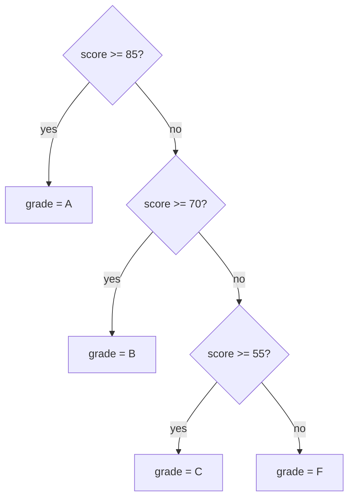

So far every program has run the same lines in the same order. Real programs make decisions: show an error if the input is invalid, stop training when the loss is low enough, route a question to the right tool. **Conditional statements** let your code choose which path to take.

## The if statement

```python
temperature = 31

if temperature > 30:
    print("It's hot.")
    print("Drink water.")

print("Done.")
```

```output
It's hot.
Drink water.
Done.
```

The anatomy is fixed: the keyword `if`, a condition, a colon, then an **indented block**. The block runs only when the condition is true. The line `print("Done.")` is not indented, so it is outside the block and always runs.

> [!WARNING]
> The colon and the indentation are both required. Forgetting the colon gives a `SyntaxError`; inconsistent indentation gives an `IndentationError`.

## if, elif, else

Add `else` for the path taken when the condition is false, and `elif` (else if) to test further conditions.

```python
score = 74

if score >= 85:
    grade = "A"
elif score >= 70:
    grade = "B"
elif score >= 55:
    grade = "C"
else:
    grade = "F"

print(grade)
```

```output
B
```

Python checks the conditions from top to bottom and runs the **first** block whose condition is true. All the others are skipped, even if they would also be true.



Because only the first match runs, **order matters**. Put the most specific condition first:

```python
score = 90

if score >= 55:       # wrong order: this catches everything above 55
    grade = "C"
elif score >= 85:
    grade = "A"

print(grade)
```

```output
C
```

Step through the correct version to watch Python pick a branch:

```trace
{
  "title": "choosing a branch",
  "code": [
    "score = 74",
    "if score >= 85:",
    "    grade = \"A\"",
    "elif score >= 70:",
    "    grade = \"B\"",
    "else:",
    "    grade = \"F\"",
    "print(grade)"
  ],
  "steps": [
    { "line": 1, "vars": { "score": "74" }, "note": "score is assigned." },
    { "line": 2, "vars": { "score": "74" }, "note": "74 >= 85 is False, so this block is skipped." },
    { "line": 4, "vars": { "score": "74" }, "note": "74 >= 70 is True. Python enters this block." },
    { "line": 5, "vars": { "score": "74", "grade": "\"B\"" }, "note": "grade is set. The else block will not run." },
    { "line": 8, "vars": { "score": "74", "grade": "\"B\"" }, "out": ["B"], "note": "Execution continues after the whole if statement." }
  ]
}
```

## Combining conditions

Use `and`, `or` and `not` to build richer conditions.

```python
age = 25
has_ticket = True

if age >= 18 and has_ticket:
    print("Welcome in.")
elif age >= 18:
    print("You need a ticket.")
else:
    print("Adults only.")
```

```output
Welcome in.
```

Conditions do not need to be comparisons. Any value works, using the truthiness rules from the previous lesson:

```python
results = []

if results:
    print("Found", len(results), "results")
else:
    print("No results.")
```

```output
No results.
```

Writing `if results:` is the idiomatic way to ask "is this collection non-empty?".

## Nested conditions and guard clauses

You can place an `if` inside another, but deep nesting is hard to read:

```python
if user is not None:
    if user_is_active:
        if has_permission:
            print("Access granted")
```

Handling the failure cases first, one at a time, keeps the code flat. These early checks are called **guard clauses**:

```python
if user is None:
    print("Not logged in")
elif not user_is_active:
    print("Account disabled")
elif not has_permission:
    print("Permission denied")
else:
    print("Access granted")
```

## The conditional expression

For a simple either/or assignment, Python has a one-line form:

```python
loss = 0.03
status = "converged" if loss < 0.05 else "training"
print(status)
```

```output
converged
```

Read it as "value if condition, else other value". Keep it for short cases. If you need `elif`, use a full statement.

## match statements

Python 3.10 added `match`, which compares one value against several patterns. It is clearer than a long `elif` chain when you are testing the same variable repeatedly.

```python
command = "stop"

match command:
    case "start":
        print("Starting")
    case "stop" | "quit":
        print("Stopping")
    case _:
        print("Unknown command")
```

```output
Stopping
```

The `_` case matches anything, like `else`.

## Common mistakes

| Mistake | What happens | Fix |
| --- | --- | --- |
| `if x = 5:` | `SyntaxError` | Use `==` to compare |
| `if x == 1 or 2:` | Always true, because `2` is truthy | `if x == 1 or x == 2:` or `if x in (1, 2):` |
| Separate `if`s instead of `elif` | Several blocks may run | Use `elif` when only one should run |
| `if done == True:` | Works, but redundant | `if done:` |

## Exercises

**1.** Ask for a number and print whether it is positive, negative or zero.

<details>
<summary>Show solution</summary>

```python
n = float(input("Number: "))

if n > 0:
    print("positive")
elif n < 0:
    print("negative")
else:
    print("zero")
```

</details>

**2.** A model outputs a probability between 0 and 1. Print `spam` if it is at least 0.8, `review` if it is at least 0.5, and `not spam` otherwise. Print `invalid` for values outside the range.

<details>
<summary>Show solution</summary>

```python
p = 0.63

if p < 0 or p > 1:
    print("invalid")
elif p >= 0.8:
    print("spam")
elif p >= 0.5:
    print("review")
else:
    print("not spam")
```

The validity check comes first as a guard clause.

</details>

**3.** FizzBuzz for one number: given `n`, print `FizzBuzz` if it divides by both 3 and 5, `Fizz` if only by 3, `Buzz` if only by 5, otherwise the number.

<details>
<summary>Show solution</summary>

```python
n = 30

if n % 15 == 0:
    print("FizzBuzz")
elif n % 3 == 0:
    print("Fizz")
elif n % 5 == 0:
    print("Buzz")
else:
    print(n)
```

The combined case must come first, or `Fizz` would catch it.

</details>

```quiz
[
  {
    "q": "In an if / elif / else chain, how many blocks can run?",
    "options": ["All whose conditions are true", "Exactly one", "At most one if there is no else, exactly one if there is", "None"],
    "answer": 2,
    "why": "Python runs the first block whose condition is true and skips the rest. With an `else`, something always runs."
  },
  {
    "q": "What does `if x == 1 or 2:` do when `x` is `7`?",
    "options": ["The block is skipped", "The block runs", "`SyntaxError`", "`TypeError`"],
    "answer": 1,
    "why": "It is read as `(x == 1) or 2`. The value `2` is truthy, so the condition is always true."
  },
  {
    "q": "What is the value of `label` after `label = \"high\" if 3 > 5 else \"low\"`?",
    "options": ["`\"high\"`", "`\"low\"`", "`False`", "`None`"],
    "answer": 1,
    "why": "The condition `3 > 5` is false, so the expression takes the value after `else`."
  }
]
```
