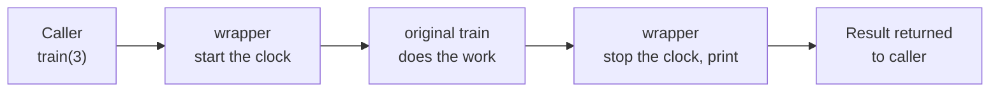

These are two of Python's more advanced features, and both appear throughout AI code. **Decorators** wrap a function to add behaviour: `@app.get("/predict")` in FastAPI and `@torch.no_grad()` in PyTorch are decorators. **Generators** produce values one at a time: they are how you stream tokens from an LLM and feed datasets too large for memory.

## Functions that take and return functions

Decorators rest on one idea from the functions lesson: a function is a value. It can be passed in, and it can be returned.

```python
def make_multiplier(factor):
    def multiply(n):
        return n * factor       # remembers factor from the enclosing call
    return multiply

double = make_multiplier(2)
triple = make_multiplier(3)
print(double(5), triple(5))
```

```output
10 15
```

`multiply` keeps access to `factor` even after `make_multiplier` has finished. A function that remembers variables from where it was created is called a **closure**.

## Decorators

A **decorator** is a function that takes a function and returns a new one, usually a wrapper that does something before or after calling the original.

```python
import time

def timer(func):
    def wrapper(*args, **kwargs):
        start = time.perf_counter()
        result = func(*args, **kwargs)
        elapsed = time.perf_counter() - start
        print(f"{func.__name__} took {elapsed:.3f}s")
        return result
    return wrapper

@timer
def train(epochs):
    time.sleep(0.2 * epochs)
    return "done"

print(train(3))
```

```output
train took 0.601s
done
```

The `@timer` line is shorthand for `train = timer(train)`. From then on, the name `train` refers to `wrapper`.



`*args` and `**kwargs` let the wrapper accept any arguments and pass them straight through, so one decorator works on any function.

### Preserve the original's identity

Wrapping replaces the function's name and docstring with the wrapper's. `functools.wraps` copies them back. Always include it.

```python
from functools import wraps

def timer(func):
    @wraps(func)
    def wrapper(*args, **kwargs):
        ...
    return wrapper
```

### Decorators with arguments

To configure a decorator, add one more layer: a function that returns the decorator.

```python
import time
from functools import wraps

def retry(attempts=3, delay=1.0):
    def decorator(func):
        @wraps(func)
        def wrapper(*args, **kwargs):
            for attempt in range(1, attempts + 1):
                try:
                    return func(*args, **kwargs)
                except ConnectionError:
                    if attempt == attempts:
                        raise
                    time.sleep(delay * attempt)
        return wrapper
    return decorator

@retry(attempts=5, delay=0.5)
def call_api(prompt):
    ...
```

This is the retry pattern from the exceptions lesson, now reusable on any function with one line.

### Decorators you will use

| Decorator | Purpose |
| --- | --- |
| `@property` | Access a method like an attribute |
| `@staticmethod`, `@classmethod` | Methods that do not need an instance |
| `@dataclass` | Generate `__init__`, `__repr__` and `__eq__` |
| `@functools.lru_cache` | Cache results of expensive calls |
| `@app.get("/path")` | Register a FastAPI route |
| `@torch.no_grad()` | Disable gradient tracking during inference |
| `@pytest.fixture` | Define reusable test setup |

Caching is a good example of how much a single line can do:

```python
from functools import lru_cache

@lru_cache(maxsize=None)
def fib(n):
    return n if n < 2 else fib(n - 1) + fib(n - 2)

print(fib(80))
```

```output
23416728348467685
```

Without the cache this call would take longer than your lifetime, because the same values are recomputed billions of times. With it, each value is computed once. The same idea, remembering answers to repeated questions, is used to cut the cost of LLM calls.

## Generators

A normal function computes everything, returns it, and is finished. A **generator** function uses `yield` to hand back one value and then **pause**, resuming where it left off when the next value is requested.

```python
def countdown(n):
    while n > 0:
        yield n
        n -= 1

for number in countdown(3):
    print(number)
```

```output
3
2
1
```

Calling `countdown(3)` runs none of the body. It returns a generator object. Each request for a value runs the code up to the next `yield`:

```python
gen = countdown(2)
print(next(gen))
print(next(gen))
print(next(gen))
```

```output
2
1
StopIteration
```

When the function ends, `StopIteration` is raised. A `for` loop handles that for you.

```trace
{
  "title": "a generator pausing and resuming",
  "code": [
    "def countdown(n):",
    "    while n > 0:",
    "        yield n",
    "        n -= 1",
    "",
    "gen = countdown(2)",
    "print(next(gen))",
    "print(next(gen))"
  ],
  "steps": [
    { "line": 6, "vars": { "gen": "<generator>" }, "note": "Calling countdown(2) creates a generator. None of its body has run yet." },
    { "line": 7, "vars": { "gen": "<generator>" }, "note": "next(gen) starts the body running." },
    { "line": 3, "vars": { "gen": "<generator>", "n (in gen)": "2" }, "note": "yield hands back 2 and pauses the function right here." },
    { "line": 7, "vars": { "gen": "<paused at line 3>", "n (in gen)": "2" }, "out": ["2"], "note": "The yielded value is printed. The generator still remembers n." },
    { "line": 8, "vars": { "gen": "<paused at line 3>", "n (in gen)": "2" }, "out": ["2"], "note": "next(gen) resumes the body from where it paused." },
    { "line": 4, "vars": { "gen": "<generator>", "n (in gen)": "1" }, "out": ["2"], "note": "Execution continues after the yield: n becomes 1." },
    { "line": 3, "vars": { "gen": "<generator>", "n (in gen)": "1" }, "out": ["2"], "note": "The loop comes round again and yields 1." },
    { "line": 8, "vars": { "gen": "<paused at line 3>", "n (in gen)": "1" }, "out": ["2", "1"], "note": "1 is printed. A third next() would end the loop and raise StopIteration." }
  ]
}
```

### Why generators matter: memory

A list holds every item at once. A generator holds only its current state.

```python
import sys

as_list = [n * n for n in range(1_000_000)]
as_generator = (n * n for n in range(1_000_000))

print(sys.getsizeof(as_list))
print(sys.getsizeof(as_generator))
```

```output
8448728
200
```

Eight megabytes against two hundred bytes. For a dataset of a hundred million rows, that is the difference between working and crashing.

### Processing data in batches

Models are trained on batches of examples, not on the whole dataset at once. A generator is the natural way to produce them:

```python
def batches(items, size):
    for start in range(0, len(items), size):
        yield items[start:start + size]

data = list(range(10))
for batch in batches(data, 4):
    print(batch)
```

```output
[0, 1, 2, 3]
[4, 5, 6, 7]
[8, 9]
```

PyTorch's `DataLoader` does this for you, with shuffling and parallel loading added.

### Pipelines

Generators chain together. Each stage pulls one item at a time from the stage before, so a file of any size flows through with constant memory.

```python
def read_lines(path):
    with open(path, encoding="utf-8") as f:
        for line in f:
            yield line

def non_empty(lines):
    for line in lines:
        if line.strip():
            yield line

def lowercase(lines):
    for line in lines:
        yield line.strip().lower()

pipeline = lowercase(non_empty(read_lines("reviews.txt")))
for line in pipeline:
    ...
```

Nothing is read until the final loop asks for the first item. This is called **lazy evaluation**.

### Streaming

When a chatbot's reply appears word by word, the client is consuming a generator:

```python
import time

def stream_reply(text):
    for word in text.split():
        time.sleep(0.05)        # stands in for the model generating a token
        yield word + " "

for chunk in stream_reply("Generators make streaming simple"):
    print(chunk, end="", flush=True)
```

```output
Generators make streaming simple 
```

> [!WARNING]
> A generator can be consumed only once. After a loop has run through it, it is empty, and a second loop produces nothing. If you need the values again, call the generator function again or store them with `list(gen)`.

## Exercises

**1.** Write a decorator `log_calls` that prints the function's name and arguments before each call, and the return value after.

<details>
<summary>Show solution</summary>

```python
from functools import wraps

def log_calls(func):
    @wraps(func)
    def wrapper(*args, **kwargs):
        print(f"calling {func.__name__} with {args} {kwargs}")
        result = func(*args, **kwargs)
        print(f"{func.__name__} returned {result!r}")
        return result
    return wrapper

@log_calls
def add(a, b):
    return a + b

add(2, 3)
```

</details>

**2.** Write a generator `fibonacci()` that yields the Fibonacci numbers forever, then print the first ten.

<details>
<summary>Show solution</summary>

```python
from itertools import islice

def fibonacci():
    a, b = 0, 1
    while True:
        yield a
        a, b = b, a + b

print(list(islice(fibonacci(), 10)))
# [0, 1, 1, 2, 3, 5, 8, 13, 21, 34]
```

An infinite generator is fine because values are produced only on demand. `islice` takes the first ten.

</details>

**3.** Write a generator `sliding_windows(tokens, size, overlap)` that yields overlapping chunks of a token list. This is the basis of text chunking in RAG.

<details>
<summary>Show solution</summary>

```python
def sliding_windows(tokens, size, overlap):
    step = size - overlap
    for start in range(0, len(tokens), step):
        yield tokens[start:start + size]
        if start + size >= len(tokens):
            break

words = "a b c d e f g h".split()
for window in sliding_windows(words, size=4, overlap=2):
    print(window)
# ['a', 'b', 'c', 'd']
# ['c', 'd', 'e', 'f']
# ['e', 'f', 'g', 'h']
```

</details>

```quiz
[
  {
    "q": "What is `@timer` above a function definition equivalent to?",
    "options": [
      "`timer = func(timer)`",
      "`func = timer(func)`",
      "`timer(func)` with the result discarded",
      "`func.timer = True`"
    ],
    "answer": 1,
    "why": "The decorator is called with the function, and the function's name is rebound to whatever the decorator returns."
  },
  {
    "q": "What does calling a generator function, such as `countdown(3)`, do?",
    "options": [
      "Runs the whole body and returns a list",
      "Returns a generator object without running the body yet",
      "Runs the body up to the first `yield`",
      "Raises `StopIteration`"
    ],
    "answer": 1,
    "why": "The body only starts executing when the first value is requested, by `next()` or a `for` loop."
  },
  {
    "q": "Why is a generator a good choice for reading a very large dataset?",
    "options": [
      "It reads the file in parallel",
      "It keeps only the current item in memory instead of the whole dataset",
      "It compresses the data",
      "It sorts the data as it reads"
    ],
    "answer": 1,
    "why": "Generators are lazy: each item is produced on demand, so memory use stays constant regardless of dataset size."
  }
]
```
