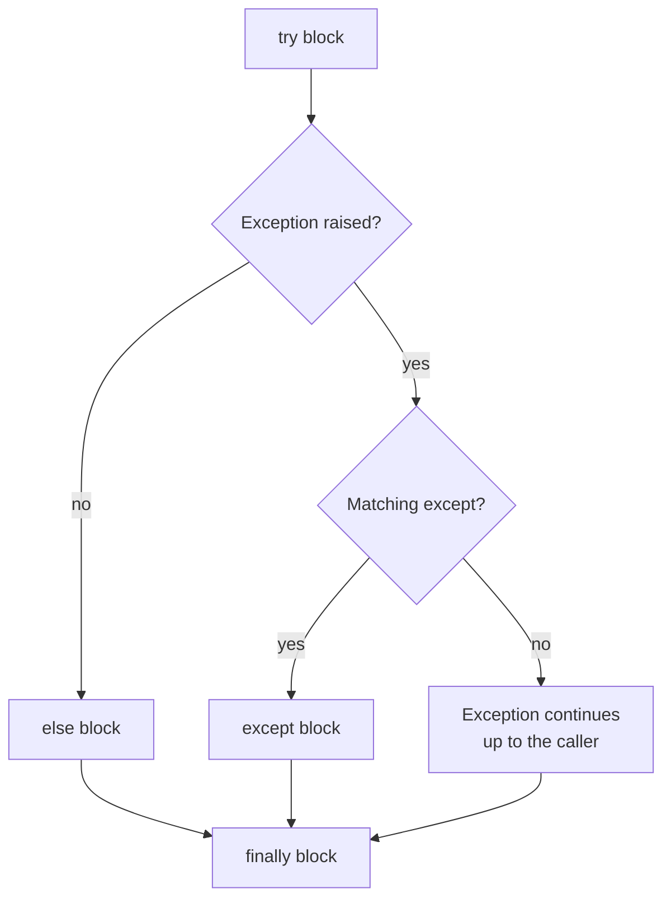

Things go wrong in real programs. Files are missing, networks drop, users type letters where numbers belong, and APIs return rate-limit errors. An **exception** is Python's way of signalling that something went wrong. Handling exceptions well is the difference between a script that crashes at 3 a.m. and a system that recovers.

## What an exception is

When Python cannot carry out an operation, it **raises** an exception. If nothing handles it, the program stops and prints a **traceback**.

```python
numbers = [1, 2, 3]
print(numbers[5])
```

```output
Traceback (most recent call last):
  File "demo.py", line 2, in <module>
    print(numbers[5])
          ~~~~~~~^^^
IndexError: list index out of range
```

Read a traceback from the bottom: the last line gives the exception type and message, and the lines above show where it happened.

### Common built-in exceptions

| Exception | Raised when |
| --- | --- |
| `ValueError` | The type is right but the value is not: `int("abc")` |
| `TypeError` | The type is wrong: `"a" + 1` |
| `KeyError` | A dictionary key does not exist |
| `IndexError` | A list index is out of range |
| `FileNotFoundError` | A file or folder does not exist |
| `ZeroDivisionError` | Dividing by zero |
| `AttributeError` | An object has no such attribute or method |
| `ImportError` | A module cannot be imported |

## try and except

Wrap risky code in `try`. If an exception occurs, Python jumps to the matching `except` block instead of crashing.

```python
text = "abc"

try:
    number = int(text)
    print("Parsed:", number)
except ValueError:
    print(f"'{text}' is not a number")

print("Program continues.")
```

```output
'abc' is not a number
Program continues.
```

The moment `int(text)` fails, the rest of the `try` block is skipped.

### Catching several exceptions

```python
def safe_divide(a, b):
    try:
        return a / b
    except ZeroDivisionError:
        print("Cannot divide by zero")
    except TypeError as error:
        print("Bad input:", error)
    return None

safe_divide(1, 0)
safe_divide("1", 2)
```

```output
Cannot divide by zero
Bad input: unsupported operand type(s) for /: 'str' and 'int'
```

`as error` gives you the exception object, so you can read or log its message. To handle several types the same way, group them: `except (ValueError, TypeError):`.

## else and finally

The full statement has four parts:

```python
try:
    f = open("data.txt", encoding="utf-8")
except FileNotFoundError:
    print("File missing")
else:
    print("Read", len(f.read()), "characters")
    f.close()
finally:
    print("Done")
```



| Block | Runs when |
| --- | --- |
| `try` | Always, until an exception occurs |
| `except` | A matching exception was raised |
| `else` | No exception was raised |
| `finally` | Always, whatever happened: use it for cleanup |

## Raising exceptions

Your own code should raise exceptions when it is given something it cannot work with. Failing loudly and early is better than quietly producing wrong results.

```python
def set_learning_rate(lr):
    if not 0 < lr < 1:
        raise ValueError(f"learning rate must be between 0 and 1, got {lr}")
    return lr

set_learning_rate(5)
```

```output
ValueError: learning rate must be between 0 and 1, got 5
```

A clear message that includes the offending value saves a great deal of debugging time.

## Custom exceptions

Define your own exception types by inheriting from `Exception`. This lets callers handle your errors specifically.

```python
class ModelNotLoadedError(Exception):
    """Raised when a prediction is requested before the model is loaded."""

def predict(model, text):
    if model is None:
        raise ModelNotLoadedError("call load_model() before predict()")
    return model(text)

try:
    predict(None, "hello")
except ModelNotLoadedError as error:
    print("Setup problem:", error)
```

```output
Setup problem: call load_model() before predict()
```

## Handling exceptions well

### Be specific

```python
# bad: hides every possible problem, including typos in your own code
try:
    result = process(data)
except:
    pass

# good: handles the one failure you expect
try:
    result = process(data)
except FileNotFoundError:
    result = default_result
```

> [!WARNING]
> A bare `except:` followed by `pass` silently swallows every error. The program carries on with bad data and you find out much later, far from the cause. Catch only the exceptions you know how to handle.

### Ask forgiveness, not permission

Python style favours attempting an operation and handling the failure, rather than checking every precondition first.

```python
# checking first
if "temperature" in config:
    temperature = config["temperature"]
else:
    temperature = 0.7

# trying first
try:
    temperature = config["temperature"]
except KeyError:
    temperature = 0.7
```

Both are valid. The second form avoids a subtle gap when the state can change between the check and the use, as with files.

### Retrying

Network calls fail for temporary reasons. Retrying with a growing delay is a pattern you will use with every LLM API:

```python
import time

def call_with_retry(func, attempts=3):
    for attempt in range(1, attempts + 1):
        try:
            return func()
        except ConnectionError as error:
            if attempt == attempts:
                raise                       # out of attempts: re-raise
            wait = 2 ** attempt
            print(f"Attempt {attempt} failed ({error}); retrying in {wait}s")
            time.sleep(wait)
```

A bare `raise` inside an `except` block re-raises the exception that was just caught. Doubling the wait each time is called **exponential backoff**.

## Exercises

**1.** Write `read_int(prompt)` that keeps asking until the user enters a valid integer, then returns it.

<details>
<summary>Show solution</summary>

```python
def read_int(prompt):
    while True:
        try:
            return int(input(prompt))
        except ValueError:
            print("Please enter a whole number.")
```

</details>

**2.** Write `average(values)` that raises a `ValueError` with a helpful message when the list is empty.

<details>
<summary>Show solution</summary>

```python
def average(values):
    if not values:
        raise ValueError("cannot average an empty list")
    return sum(values) / len(values)
```

Without the check the function would raise `ZeroDivisionError`, which describes the symptom rather than the cause.

</details>

**3.** Write `count_lines(path)` that returns the number of lines in a file, or `0` if the file does not exist.

<details>
<summary>Show solution</summary>

```python
def count_lines(path):
    try:
        with open(path, encoding="utf-8") as f:
            return sum(1 for _ in f)
    except FileNotFoundError:
        return 0
```

</details>

```quiz
[
  {
    "q": "Which exception does `int(\"3.7\")` raise?",
    "options": ["`TypeError`", "`ValueError`", "`SyntaxError`", "None, it returns `3`"],
    "answer": 1,
    "why": "The argument is a string, which is an acceptable type, but its value is not a valid integer literal."
  },
  {
    "q": "When does a `finally` block run?",
    "options": [
      "Only when an exception was raised",
      "Only when no exception was raised",
      "Always, whether or not an exception was raised",
      "Only if there is no `except` block"
    ],
    "answer": 2,
    "why": "`finally` always runs, which makes it the right place for cleanup such as closing connections."
  },
  {
    "q": "Why is `except: pass` considered bad practice?",
    "options": [
      "It is slower than a specific `except`",
      "It is a syntax error in Python 3",
      "It hides every error, including bugs you did not anticipate",
      "It only catches `ValueError`"
    ],
    "answer": 2,
    "why": "Swallowing all exceptions lets the program continue in a broken state and removes the evidence you need to debug it."
  }
]
```
