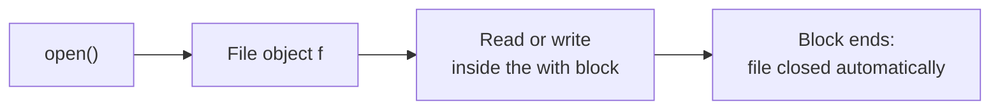

Variables disappear when a program ends. Files are how data survives: datasets, configuration, logs, saved models and results all live on disk. This lesson covers reading and writing text files safely and working with file paths.

## Opening a file

```python
with open("notes.txt", "w", encoding="utf-8") as f:
    f.write("First line\n")
    f.write("Second line\n")
```

`open` returns a **file object**. The `with` statement guarantees the file is closed when the block ends, even if an error occurs inside it.



> [!KEY]
> Always open files with `with`. A file that is never closed can lose the data still waiting to be written, and on some systems it stays locked.

### File modes

| Mode | Meaning | If the file exists | If it does not |
| --- | --- | --- | --- |
| `"r"` | Read (the default) | Opens it | `FileNotFoundError` |
| `"w"` | Write | **Erases it first** | Creates it |
| `"a"` | Append | Adds to the end | Creates it |
| `"x"` | Exclusive create | `FileExistsError` | Creates it |
| `"rb"`, `"wb"` | Binary read, write | For images, model weights and other non-text data | |

> [!WARNING]
> Mode `"w"` wipes the file the moment it is opened, before you write anything. To add to an existing file, use `"a"`.

## Reading

```python
with open("notes.txt", encoding="utf-8") as f:
    content = f.read()

print(content)
```

```output
First line
Second line
```

There are three ways to read, suited to different sizes of file:

| Method | Returns | Use when |
| --- | --- | --- |
| `f.read()` | The whole file as one string | The file is small |
| `f.readlines()` | A list of lines | You need all lines in a list |
| `for line in f:` | One line at a time | The file is large |

Looping over the file object is the memory-safe choice, because only one line is held at a time:

```python
with open("notes.txt", encoding="utf-8") as f:
    for number, line in enumerate(f, start=1):
        print(number, line.strip())
```

```output
1 First line
2 Second line
```

Each line ends with its newline character `\n`. Calling `.strip()` removes it.

## Writing

`write` does not add a newline for you, and it only accepts strings.

```python
results = [("bert", 0.91), ("gpt2", 0.88)]

with open("results.txt", "w", encoding="utf-8") as f:
    for name, score in results:
        f.write(f"{name}\t{score}\n")

with open("results.txt", "a", encoding="utf-8") as f:
    f.write("t5\t0.9\n")
```

A training log is usually written this way: opened in append mode, one line added per epoch.

## Encodings

Files store bytes. An **encoding** is the rule that maps bytes to characters. UTF-8 is the modern standard and handles every language.

> [!TIP]
> Always pass `encoding="utf-8"`. If you leave it out, Python uses the operating system's default, which differs between Windows, macOS and Linux. The same script can then work on your machine and fail on someone else's with a `UnicodeDecodeError`.

## Paths with pathlib

Building paths by joining strings breaks across operating systems, because Windows uses `\` and everything else uses `/`. The `pathlib` module handles this for you.

```python
from pathlib import Path

data_dir = Path("data")
file_path = data_dir / "raw" / "reviews.txt"

print(file_path)
print(file_path.name, file_path.stem, file_path.suffix)
print(file_path.parent)
print(file_path.exists())
```

```output
data/raw/reviews.txt
reviews.txt reviews .txt
data/raw
False
```

The `/` operator joins path parts. A `Path` object also has shortcuts for the most common operations:

```python
out = Path("output")
out.mkdir(parents=True, exist_ok=True)      # create the folder if needed

(out / "summary.txt").write_text("42 samples\n", encoding="utf-8")
print((out / "summary.txt").read_text(encoding="utf-8"))

for path in out.glob("*.txt"):              # find files by pattern
    print(path.name, path.stat().st_size, "bytes")
```

```output
42 samples

summary.txt 11 bytes
```

### Relative and absolute paths

A **relative path** such as `data/reviews.txt` is resolved from the **current working directory**, the folder your terminal was in when you ran the script. It is not the folder the script lives in. An **absolute path** starts from the root of the file system and means the same thing everywhere.

To find files next to your script regardless of where it is run from:

```python
here = Path(__file__).parent
config_path = here / "config.txt"
```

## Handling missing files

```python
from pathlib import Path

path = Path("missing.txt")

if path.exists():
    text = path.read_text(encoding="utf-8")
else:
    print(f"{path} not found, using defaults")
    text = ""
```

```output
missing.txt not found, using defaults
```

The next lesson shows the other approach: attempt the operation and catch the error.

## A complete example

Count the lines, words and most frequent word in a text file:

```python
from pathlib import Path

def analyse(path):
    """Return line count, word count and the most common word in a file."""
    counts = {}
    lines = 0
    with open(path, encoding="utf-8") as f:
        for line in f:
            lines += 1
            for word in line.lower().split():
                counts[word] = counts.get(word, 0) + 1
    top = max(counts, key=counts.get) if counts else None
    return lines, sum(counts.values()), top

Path("sample.txt").write_text("the cat sat\nthe dog ran\n", encoding="utf-8")
print(analyse("sample.txt"))
```

```output
(2, 6, 'the')
```

## Exercises

**1.** Write a program that asks for three items and saves them to `shopping.txt`, one per line. Then read the file back and print the items numbered from 1.

<details>
<summary>Show solution</summary>

```python
with open("shopping.txt", "w", encoding="utf-8") as f:
    for _ in range(3):
        f.write(input("Item: ") + "\n")

with open("shopping.txt", encoding="utf-8") as f:
    for i, line in enumerate(f, start=1):
        print(f"{i}. {line.strip()}")
```

</details>

**2.** Write `copy_without_blank_lines(src, dst)` that copies a text file, skipping lines that are empty or only whitespace.

<details>
<summary>Show solution</summary>

```python
def copy_without_blank_lines(src, dst):
    with open(src, encoding="utf-8") as fin, open(dst, "w", encoding="utf-8") as fout:
        for line in fin:
            if line.strip():
                fout.write(line)
```

One `with` statement can manage several files.

</details>

**3.** Using `pathlib`, print the name and size of every `.py` file in the current folder, largest first.

<details>
<summary>Show solution</summary>

```python
from pathlib import Path

files = sorted(Path(".").glob("*.py"), key=lambda p: p.stat().st_size, reverse=True)
for p in files:
    print(f"{p.name:<30} {p.stat().st_size:>8,} bytes")
```

</details>

```quiz
[
  {
    "q": "What happens when you open an existing file with mode `\"w\"`?",
    "options": [
      "New text is added to the end",
      "Its contents are erased immediately",
      "`FileExistsError` is raised",
      "It opens read-only"
    ],
    "answer": 1,
    "why": "Write mode truncates the file as soon as it is opened. Use `\"a\"` to append."
  },
  {
    "q": "What is the main benefit of `with open(...) as f:`?",
    "options": [
      "It reads the file faster",
      "It closes the file automatically, even if an error occurs",
      "It converts the file to UTF-8",
      "It creates a backup"
    ],
    "answer": 1,
    "why": "The `with` statement guarantees cleanup when the block exits, however it exits."
  },
  {
    "q": "Which approach is best for processing a 20 GB log file?",
    "options": ["`f.read()`", "`f.readlines()`", "`for line in f:`", "`f.read().split()`"],
    "answer": 2,
    "why": "Iterating over the file object loads one line at a time. The other options load the entire file into memory."
  }
]
```
