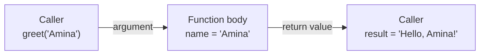

A **function** is a named, reusable block of code. You have been calling functions since the first lesson: `print`, `len`, `input`. Writing your own is how you stop repeating yourself and start building programs out of small, testable pieces.

## Defining and calling a function

```python
def greet(name):
    message = "Hello, " + name + "!"
    return message

result = greet("Amina")
print(result)
```

```output
Hello, Amina!
```

- `def` starts the definition, followed by the function's name and its **parameters** in parentheses.
- The indented block is the **body**. It does not run when the function is defined, only when it is **called**.
- `return` sends a value back to the caller and ends the function.



The value you pass in is an **argument**; the name that receives it is a **parameter**.

## return versus print

This distinction trips up almost every beginner. `print` shows text on screen. `return` hands a value back to the code that called the function so it can be used.

```python
def add_print(a, b):
    print(a + b)

def add_return(a, b):
    return a + b

x = add_print(2, 3)
y = add_return(2, 3)
print(x, y)
```

```output
5
None 5
```

`add_print` displayed `5` but returned nothing, so `x` is `None`. A function without a `return` statement always returns `None`.

> [!KEY]
> Functions should usually **return** their result and leave printing to the caller. A function that returns can be reused in calculations, tests and other functions. One that only prints cannot.

A function can return several values at once, packed into a tuple:

```python
def min_max(values):
    return min(values), max(values)

low, high = min_max([4, 9, 2])
print(low, high)
```

```output
2 9
```

## Parameters and arguments

### Positional and keyword arguments

```python
def describe(model, params, task):
    return f"{model}: {params}B parameters, used for {task}"

print(describe("llama", 8, "chat"))                       # positional
print(describe(task="chat", model="llama", params=8))     # keyword
```

```output
llama: 8B parameters, used for chat
llama: 8B parameters, used for chat
```

Keyword arguments can come in any order and make calls self-documenting.

### Default values

```python
def train(epochs=10, learning_rate=0.001):
    return f"Training for {epochs} epochs at lr={learning_rate}"

print(train())
print(train(epochs=3))
```

```output
Training for 10 epochs at lr=0.001
Training for 3 epochs at lr=0.001
```

Parameters with defaults must come after those without.

> [!WARNING]
> Never use a mutable value such as a list as a default: `def add(item, items=[])`. The default is created **once**, when the function is defined, and shared by every call. Use `items=None` and create the list inside the function.

```python
def add(item, items=None):
    if items is None:
        items = []
    items.append(item)
    return items
```

### Variable numbers of arguments

`*args` collects extra positional arguments into a tuple. `**kwargs` collects extra keyword arguments into a dictionary.

```python
def average(*numbers):
    return sum(numbers) / len(numbers)

def configure(**options):
    for key, value in options.items():
        print(key, "=", value)

print(average(4, 8, 6))
configure(batch_size=32, shuffle=True)
```

```output
6.0
batch_size = 32
shuffle = True
```

## Scope

Variables created inside a function are **local**: they exist only while the function runs and cannot be seen from outside.

```python
def compute():
    result = 42      # local variable
    return result

compute()
print(result)
```

```output
NameError: name 'result' is not defined
```

A function can read variables from the surrounding code, but relying on that makes functions harder to understand and test. Pass what the function needs as arguments and return what it produces.

Step through a call to watch a local scope appear and disappear:

```trace
{
  "title": "a function call",
  "code": [
    "def square(n):",
    "    result = n * n",
    "    return result",
    "",
    "x = 4",
    "y = square(x)",
    "print(y)"
  ],
  "steps": [
    { "line": 1, "vars": {}, "note": "Python stores the function under the name square. The body does not run yet." },
    { "line": 5, "vars": { "x": "4" }, "note": "x is created in the global scope." },
    { "line": 6, "vars": { "x": "4" }, "note": "square(x) is called with the argument 4. Execution jumps into the function." },
    { "line": 2, "vars": { "x": "4", "n (local)": "4", "result (local)": "16" }, "note": "Inside the function, n and result are local variables." },
    { "line": 3, "vars": { "x": "4", "n (local)": "4", "result (local)": "16" }, "note": "return sends 16 back to the caller. The local variables are discarded." },
    { "line": 6, "vars": { "x": "4", "y": "16" }, "note": "The returned value is assigned to y." },
    { "line": 7, "vars": { "x": "4", "y": "16" }, "out": ["16"], "note": "Only x and y exist out here." }
  ]
}
```

## Docstrings

A string on the first line of a function body is its **docstring**. Editors and the `help()` function display it.

```python
def normalize(value, minimum, maximum):
    """Scale value to the range 0-1 given its minimum and maximum."""
    return (value - minimum) / (maximum - minimum)

print(normalize(75, 50, 100))
```

```output
0.5
```

That formula, $x' = \frac{x - \min}{\max - \min}$, is **min-max normalization**. You will use it when preparing data for machine learning.

## Lambda functions

A **lambda** is a small, unnamed function written in one expression:

```python
square = lambda n: n * n
print(square(5))
```

```output
25
```

It is equivalent to a `def` whose body is a single `return`. Lambdas are useful when a function is needed briefly as an argument to another function:

```python
models = [("bert", 110), ("gpt2", 1500), ("t5", 220)]

by_size = sorted(models, key=lambda m: m[1])
print(by_size)

sizes = list(map(lambda m: m[1], models))
large = list(filter(lambda m: m[1] > 200, models))
print(sizes)
print(large)
```

```output
[('bert', 110), ('t5', 220), ('gpt2', 1500)]
[110, 1500, 220]
[('gpt2', 1500), ('t5', 220)]
```

`sorted` with a `key` function is by far the most common place you will meet a lambda.

> [!TIP]
> If a lambda needs a name or more than one simple expression, write a normal `def`. Lambdas are for throwaway one-liners.

## Functions are values

In Python a function is an object like any other. You can store it in a variable, put it in a list, or pass it to another function.

```python
def apply_twice(func, value):
    return func(func(value))

def double(n):
    return n * 2

print(apply_twice(double, 5))
```

```output
20
```

Note that `double` is passed without parentheses. `double` is the function itself; `double(5)` is the result of calling it. This idea underpins decorators, callbacks and much of how AI frameworks are designed.

## Exercises

**1.** Write `celsius_to_fahrenheit(c)` that returns the temperature in Fahrenheit: $F = C \times \frac{9}{5} + 32$.

<details>
<summary>Show solution</summary>

```python
def celsius_to_fahrenheit(c):
    return c * 9 / 5 + 32

print(celsius_to_fahrenheit(100))   # 212.0
```

</details>

**2.** Write `accuracy(correct, total)` that returns the percentage correct, rounded to one decimal place, and `0.0` when `total` is zero.

<details>
<summary>Show solution</summary>

```python
def accuracy(correct, total):
    """Return the percentage of correct predictions."""
    if total == 0:
        return 0.0
    return round(correct / total * 100, 1)

print(accuracy(47, 60))   # 78.3
```

</details>

**3.** Sort `words = ["transformer", "RNN", "attention", "GPU"]` by length, shortest first, using a lambda.

<details>
<summary>Show solution</summary>

```python
words = ["transformer", "RNN", "attention", "GPU"]
print(sorted(words, key=lambda w: len(w)))
# ['RNN', 'GPU', 'attention', 'transformer']
```

`key=len` works too, since `len` is already a function.

</details>

```quiz
[
  {
    "q": "What does a function return if it has no `return` statement?",
    "options": ["`0`", "An empty string", "`None`", "It raises an error"],
    "answer": 2,
    "why": "Every Python function returns something. Without an explicit `return`, that value is `None`."
  },
  {
    "q": "Given `def f(a, b=2): return a * b`, what is `f(3)`?",
    "options": ["`3`", "`6`", "`5`", "A `TypeError`"],
    "answer": 1,
    "why": "`b` falls back to its default of 2, so the result is 3 * 2."
  },
  {
    "q": "What is `(lambda x, y: x + y)(2, 5)`?",
    "options": ["`7`", "`(2, 5)`", "`25`", "A `SyntaxError`"],
    "answer": 0,
    "why": "The lambda is defined and immediately called with 2 and 5, returning their sum."
  }
]
```
