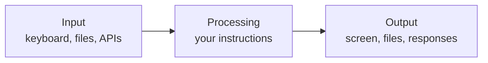
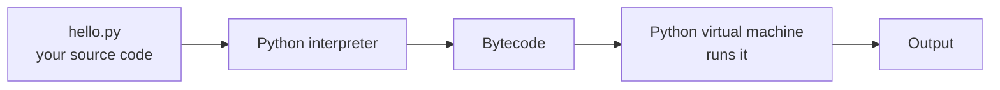

Every AI system you will ever build, from a spam filter to a multi-agent assistant, is a program. Before models, data or maths, you need to be able to tell a computer exactly what to do. This lesson explains what programming is, why Python is the language of AI, and gets your first program running.

## What a program is

A **program** is a sequence of instructions a computer follows, in order, with no judgement of its own. The computer does precisely what you wrote, which is not always what you meant. Most of the skill in programming is closing that gap.

Nearly every program has the same shape: it takes some **input**, **processes** it, and produces **output**.



A chatbot fits this shape: the input is your message, the processing is a language model predicting a reply, and the output is the text you read. So does a calculator, a search engine and a self-driving car.

## How Python runs your code

Computers only understand machine code: long sequences of numbers. Programming languages exist so humans can write instructions in something readable, and a tool translates it.

Python uses an **interpreter**: a program that reads your code line by line and carries it out immediately.



You never see the middle steps. The practical consequences are what matter:

- **You can run code instantly.** No separate build step, which makes experimenting fast.
- **Errors appear when a line runs**, not before. A mistake on line 50 is only discovered when execution reaches line 50.

## Why Python for AI

| Reason | What it means for you |
| --- | --- |
| Readable syntax | Code looks close to plain English, so you focus on ideas rather than punctuation |
| The ecosystem | NumPy, Pandas, scikit-learn, PyTorch and Hugging Face are all Python-first |
| Interactive workflow | You can test one line at a time, which suits data exploration |
| Industry standard | Research papers, tutorials and job descriptions in AI assume Python |

Python is slower than languages like C++ or Rust. In AI this rarely matters, because the heavy computation happens inside libraries written in those fast languages. Python is the steering wheel, not the engine.

## Your first program

Install Python 3.12 or newer from [python.org](https://www.python.org/downloads/), then check it works in a terminal:

```bash
python3 --version
```

```output
Python 3.12.4
```

Create a file called `hello.py` containing one line:

```python
print("Hello, world!")
```

Run it:

```bash
python3 hello.py
```

```output
Hello, world!
```

`print` is a **function**: a named instruction that does a job. The text in quotes is a **string**, and it is what you hand to `print` to display. You will meet both properly in the next lessons.

### The interactive shell

Type `python3` with no file name and you get the **REPL** (read, evaluate, print, loop). It runs each line as you press Enter, which makes it ideal for quick experiments.

```python
>>> 2 + 3
5
>>> print("Python as a calculator")
Python as a calculator
>>> exit()
```

> [!TIP]
> Use the REPL to answer "what does this do?" questions. Trying something takes five seconds and teaches you more than guessing.

## A program with input, processing and output

```python
# greet.py
name = input("What is your name? ")      # input
greeting = "Hello, " + name + "!"        # processing
print(greeting)                           # output
```

```output
What is your name? Amina
Hello, Amina!
```

Three ideas appear here that the rest of this module builds on:

1. **Statements run top to bottom**, one at a time.
2. **Variables** such as `name` store values so later lines can use them.
3. **Comments** start with `#`. Python ignores them; they are notes for humans.

## Reading error messages

You will see errors constantly. That is normal at every level of experience. Run this:

```python
print("Hello"
```

```output
  File "hello.py", line 1
    print("Hello"
         ^
SyntaxError: '(' was never closed
```

Read an error from the bottom up. The last line names the kind of error and what went wrong. The lines above show where. Here the closing bracket is missing.

| Error | Usual cause |
| --- | --- |
| `SyntaxError` | The code breaks Python's grammar: a missing bracket, quote or colon |
| `NameError` | You used a name Python has not seen, often a typo |
| `IndentationError` | Spaces at the start of a line are inconsistent |
| `TypeError` | You combined values that do not work together, such as text plus a number |

> [!WARNING]
> Python uses **indentation** (spaces at the start of a line) to group code. Other languages treat it as decoration; in Python it changes what the program means. Use four spaces per level, never a mix of tabs and spaces.

## Exercises

**1.** Write a program that prints your name on one line and your city on the next.

<details>
<summary>Show solution</summary>

```python
print("Amina Khan")
print("Lahore")
```

</details>

**2.** Write a program that asks for the user's favourite food and replies `I like <food> too!`.

<details>
<summary>Show solution</summary>

```python
food = input("What is your favourite food? ")
print("I like " + food + " too!")
```

</details>

**3.** This program has two errors. Find them by running it and reading the messages.

```python
mesage = "Learning Python"
print(message
```

<details>
<summary>Show solution</summary>

The bracket is never closed (`SyntaxError`), and the variable is spelled `mesage` when created but `message` when used (`NameError`). Python reports the syntax error first because it checks grammar before running anything.

```python
message = "Learning Python"
print(message)
```

</details>

```quiz
[
  {
    "q": "What does the Python interpreter do?",
    "options": [
      "Reads your code and executes it, statement by statement",
      "Checks your code for spelling mistakes only",
      "Converts Python into a Word document",
      "Uploads your code to the internet"
    ],
    "answer": 0,
    "why": "The interpreter translates and runs your source code directly, which is why Python needs no separate build step."
  },
  {
    "q": "Why is Python fast enough for AI even though it is a slow language?",
    "options": [
      "AI models are small",
      "The heavy computation runs inside libraries written in fast languages like C++",
      "Python skips lines it does not need",
      "It is not; AI engineers avoid Python"
    ],
    "answer": 1,
    "why": "Libraries such as NumPy and PyTorch do the number crunching in compiled code. Python coordinates the work."
  },
  {
    "q": "You see `NameError: name 'totl' is not defined`. What is the most likely cause?",
    "options": [
      "A missing bracket",
      "Inconsistent indentation",
      "A typo in a variable name",
      "Python is not installed"
    ],
    "answer": 2,
    "why": "A `NameError` means Python met a name it has never seen. A misspelled variable is the usual culprit."
  }
]
```
