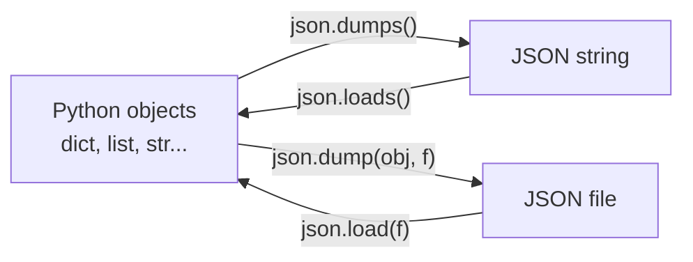

Data has to travel between programs and be stored between runs. Two plain-text formats do most of that work. **JSON** carries structured, nested data: every API response, configuration file and LLM tool call. **CSV** carries tables: most datasets you download start life as one. This lesson covers reading and writing both with Python's standard library.

## JSON

**JSON** (JavaScript Object Notation) represents data using a small set of types that map almost directly onto Python's.

```json
{
  "model": "gpt-4o-mini",
  "temperature": 0.7,
  "stream": false,
  "stop": null,
  "messages": [
    {"role": "user", "content": "Hello"}
  ]
}
```

| JSON | Python |
| --- | --- |
| object `{ }` | `dict` |
| array `[ ]` | `list` |
| string `"text"` | `str` |
| number `42`, `3.14` | `int`, `float` |
| `true`, `false` | `True`, `False` |
| `null` | `None` |

JSON is stricter than Python. Strings and keys must use **double** quotes, there are no trailing commas, and comments are not allowed.

### Converting between JSON and Python

The `json` module has four functions. The ones ending in `s` work with **s**trings; the others work with files.



```python
import json

config = {"model": "gpt-4o-mini", "temperature": 0.7, "stop": None, "tags": ["chat", "fast"]}

text = json.dumps(config)
print(text)
print(type(text))

restored = json.loads(text)
print(restored["tags"][0], restored["stop"])
```

```output
{"model": "gpt-4o-mini", "temperature": 0.7, "stop": null, "tags": ["chat", "fast"]}
<class 'str'>
chat None
```

Turning objects into text is called **serialization**; the reverse is **deserialization** or parsing.

### Reading and writing files

```python
import json

with open("config.json", "w", encoding="utf-8") as f:
    json.dump(config, f, indent=2)

with open("config.json", encoding="utf-8") as f:
    loaded = json.load(f)

print(loaded == config)
```

```output
True
```

`indent=2` writes the file with line breaks and indentation so people can read it. Two other options are worth knowing: `ensure_ascii=False` keeps non-English characters readable instead of escaping them, and `sort_keys=True` gives a stable key order.

### Navigating nested data

API responses are often deeply nested. Work inwards one level at a time, checking whether each level is a dictionary or a list.

```python
response = {
    "choices": [
        {"message": {"role": "assistant", "content": "Hi there!"}, "finish_reason": "stop"}
    ],
    "usage": {"total_tokens": 12},
}

print(response["choices"][0]["message"]["content"])
print(response.get("usage", {}).get("total_tokens", 0))
```

```output
Hi there!
12
```

Chained `.get()` calls with defaults protect against missing keys.

> [!TIP]
> When exploring an unfamiliar response, print it with `print(json.dumps(data, indent=2))`. The indentation makes the structure obvious.

### Handling invalid JSON

Parsing fails with `json.JSONDecodeError` when the text is not valid JSON. This matters with LLMs, which sometimes return almost-JSON.

```python
import json

raw = "{'answer': 42}"       # single quotes: not valid JSON

try:
    data = json.loads(raw)
except json.JSONDecodeError as error:
    print("Invalid JSON:", error)
    data = None
```

```output
Invalid JSON: Expecting property name enclosed in double quotes: line 1 column 2 (char 1)
```

### What JSON cannot store

Only the types in the table above are supported. Dates, sets and your own objects raise `TypeError: Object of type ... is not JSON serializable`. Convert them first:

```python
from datetime import date

record = {"created": date(2025, 3, 14), "tags": {"a", "b"}}

safe = {"created": record["created"].isoformat(), "tags": sorted(record["tags"])}
print(json.dumps(safe))
```

```output
{"created": "2025-03-14", "tags": ["a", "b"]}
```

Two further details: tuples become lists, and dictionary keys always become strings, so `{1: "a"}` comes back as `{"1": "a"}`.

### JSON Lines

Large datasets are often stored as **JSON Lines** (`.jsonl`): one complete JSON object per line. The file can be read and written one record at a time, and it is the standard format for LLM fine-tuning data.

```python
examples = [
    {"prompt": "Capital of France?", "completion": "Paris"},
    {"prompt": "Capital of Japan?", "completion": "Tokyo"},
]

with open("train.jsonl", "w", encoding="utf-8") as f:
    for example in examples:
        f.write(json.dumps(example) + "\n")

with open("train.jsonl", encoding="utf-8") as f:
    loaded = [json.loads(line) for line in f]

print(len(loaded), loaded[1]["completion"])
```

```output
2 Tokyo
```

## CSV

**CSV** (comma-separated values) stores a table as text: one row per line, with values separated by commas. The first line is usually a header naming the columns.

```csv
name,age,city
Amina,27,Lahore
Omar,31,"Karachi, Sindh"
```

The second data row shows why you should not split lines on commas yourself: a value containing a comma is wrapped in quotes. The `csv` module handles this and the other edge cases correctly.

### Reading

`csv.DictReader` gives you each row as a dictionary keyed by the header.

```python
import csv

with open("people.csv", newline="", encoding="utf-8") as f:
    for row in csv.DictReader(f):
        print(row["name"], row["age"], row["city"])
```

```output
Amina 27 Lahore
Omar 31 Karachi, Sindh
```

> [!WARNING]
> Every value read from a CSV file is a **string**. `row["age"]` is `"27"`, not `27`. Convert before doing arithmetic: `int(row["age"])`.

```python
with open("people.csv", newline="", encoding="utf-8") as f:
    ages = [int(row["age"]) for row in csv.DictReader(f)]

print(sum(ages) / len(ages))
```

```output
29.0
```

### Writing

```python
import csv

results = [
    {"model": "bert", "accuracy": 0.91, "seconds": 42},
    {"model": "gpt2", "accuracy": 0.88, "seconds": 67},
]

with open("results.csv", "w", newline="", encoding="utf-8") as f:
    writer = csv.DictWriter(f, fieldnames=["model", "accuracy", "seconds"])
    writer.writeheader()
    writer.writerows(results)
```

Passing `newline=""` when opening the file is required by the `csv` module. Without it, Windows writes a blank line between every row.

For files without a header, `csv.reader` and `csv.writer` work with plain lists instead of dictionaries. Other separators are supported through `delimiter`, for example `delimiter="\t"` for tab-separated files.

## Choosing a format

| | JSON | CSV |
| --- | --- | --- |
| Shape of data | Nested, hierarchical | Flat table |
| Types preserved | Numbers, booleans, null, strings | Everything is a string |
| Readable in a spreadsheet | No | Yes |
| File size | Larger: keys repeat for every record | Compact |
| Typical use | APIs, configuration, LLM messages | Datasets, exports, reports |

Converting between them is common. A list of flat dictionaries maps directly to CSV rows:

```python
import csv
import json

with open("results.csv", newline="", encoding="utf-8") as f:
    rows = list(csv.DictReader(f))

for row in rows:
    row["accuracy"] = float(row["accuracy"])
    row["seconds"] = int(row["seconds"])

with open("results.json", "w", encoding="utf-8") as f:
    json.dump(rows, f, indent=2)
```

## Looking ahead

The `csv` module is right for small files and simple scripts. For real data analysis you will use **Pandas**, which reads a CSV in one line, infers the column types and gives you fast tools for filtering and aggregation:

```python
import pandas as pd

df = pd.read_csv("results.csv")
print(df["accuracy"].mean())
```

That is the subject of Phase 3. The understanding you have built here, of what is inside these files and what can go wrong, carries straight over.

## Exercises

**1.** Write `save_settings(settings, path)` and `load_settings(path)` using JSON. Loading should return an empty dictionary if the file is missing or contains invalid JSON.

<details>
<summary>Show solution</summary>

```python
import json

def save_settings(settings, path):
    with open(path, "w", encoding="utf-8") as f:
        json.dump(settings, f, indent=2)

def load_settings(path):
    try:
        with open(path, encoding="utf-8") as f:
            return json.load(f)
    except (FileNotFoundError, json.JSONDecodeError):
        return {}

save_settings({"theme": "dark", "font_size": 14}, "settings.json")
print(load_settings("settings.json"))
print(load_settings("missing.json"))
```

</details>

**2.** Given a CSV file `sales.csv` with columns `product`, `quantity` and `price`, print the total revenue for each product.

<details>
<summary>Show solution</summary>

```python
import csv

revenue = {}
with open("sales.csv", newline="", encoding="utf-8") as f:
    for row in csv.DictReader(f):
        amount = int(row["quantity"]) * float(row["price"])
        revenue[row["product"]] = revenue.get(row["product"], 0) + amount

for product, total in sorted(revenue.items(), key=lambda item: item[1], reverse=True):
    print(f"{product:<15} {total:>10,.2f}")
```

</details>

**3.** An LLM was asked for JSON and returned the text below, wrapped in a Markdown code fence. Write `extract_json(text)` that returns the parsed data, or `None` if it cannot be parsed.

```text
Here is the result:
'''json
{"sentiment": "positive", "confidence": 0.93}
'''
```

(Imagine the three quote marks are backticks.)

<details>
<summary>Show solution</summary>

```python
import json

def extract_json(text):
    start = text.find("{")
    end = text.rfind("}")
    if start == -1 or end == -1:
        return None
    try:
        return json.loads(text[start:end + 1])
    except json.JSONDecodeError:
        return None
```

Taking the text between the first `{` and the last `}` ignores any surrounding commentary or fences. Cleaning up model output like this is a routine part of working with LLMs.

</details>

```quiz
[
  {
    "q": "Which function converts a Python dictionary into a JSON string?",
    "options": ["`json.load()`", "`json.loads()`", "`json.dump()`", "`json.dumps()`"],
    "answer": 3,
    "why": "`dumps` means dump to a string. `dump` writes to a file, and the `load` functions go the other way."
  },
  {
    "q": "Which of these is valid JSON?",
    "options": [
      "`{'name': 'Ali'}`",
      "`{\"name\": \"Ali\",}`",
      "`{\"name\": \"Ali\", \"active\": true}`",
      "`{\"name\": \"Ali\", \"active\": True}`"
    ],
    "answer": 2,
    "why": "JSON requires double quotes, forbids trailing commas, and spells booleans in lowercase."
  },
  {
    "q": "You read a CSV with `csv.DictReader`. What is the type of `row[\"price\"]` for a cell containing 19.99?",
    "options": ["`float`", "`int`", "`str`", "`Decimal`"],
    "answer": 2,
    "why": "CSV has no type information, so every value is read as a string and must be converted explicitly."
  },
  {
    "q": "What is the JSON Lines format?",
    "options": [
      "JSON with comments allowed",
      "One JSON object per line, so records can be processed one at a time",
      "A JSON file with exactly one line",
      "A compressed binary form of JSON"
    ],
    "answer": 1,
    "why": "Each line is an independent JSON document, which suits streaming and very large datasets such as fine-tuning data."
  }
]
```
