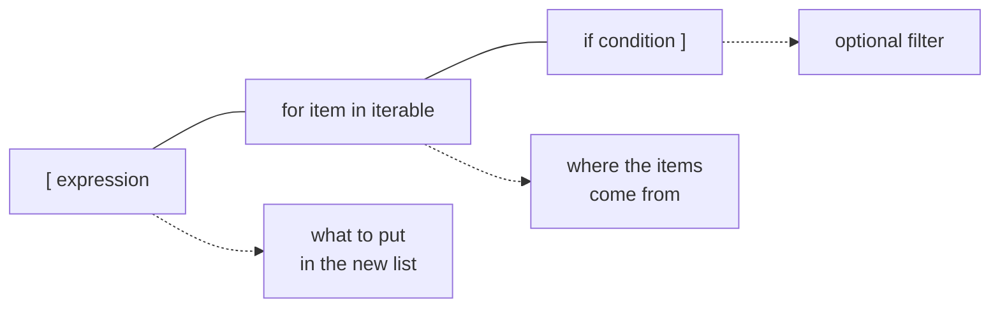

Building a new list from an existing collection is one of the most frequent things you will do: clean every string, square every number, keep only the rows that pass a test. A **list comprehension** does this in a single readable expression, and it is one of the features that makes Python code look like Python.

## From loop to comprehension

Here is the loop version of "square every number":

```python
numbers = [1, 2, 3, 4]

squares = []
for n in numbers:
    squares.append(n ** 2)

print(squares)
```

```output
[1, 4, 9, 16]
```

And the comprehension:

```python
squares = [n ** 2 for n in numbers]
```

The three parts are rearranged, nothing more:



Read it aloud as "n squared, for each n in numbers".

## Filtering

Add an `if` at the end to keep only some items.

```python
scores = [0.42, 0.91, 0.67, 0.88, 0.35]

passing = [s for s in scores if s >= 0.6]
print(passing)
```

```output
[0.91, 0.67, 0.88]
```

You can transform and filter in the same expression:

```python
words = ["  Data ", "", "  AI", " ", "models  "]

cleaned = [w.strip().lower() for w in words if w.strip()]
print(cleaned)
```

```output
['data', 'ai', 'models']
```

## Conditional values

To choose between two values for each item, put a conditional expression at the **front**:

```python
probabilities = [0.2, 0.8, 0.55]

labels = ["spam" if p >= 0.5 else "ham" for p in probabilities]
print(labels)
```

```output
['ham', 'spam', 'spam']
```

> [!KEY]
> Position decides the meaning. An `if` at the **end** filters: items that fail are dropped. An `if ... else` at the **start** transforms: every item is kept, with a value chosen by the condition.

## Dictionary and set comprehensions

The same idea works with curly braces.

```python
words = ["apple", "fig", "banana"]

lengths = {w: len(w) for w in words}
initials = {w[0] for w in words}

print(lengths)
print(initials)
```

```output
{'apple': 5, 'fig': 3, 'banana': 6}
{'a', 'f', 'b'}
```

A dictionary comprehension is the standard way to build the word-to-ID mapping every NLP model needs:

```python
vocab = ["<pad>", "the", "cat", "sat"]

word_to_id = {word: i for i, word in enumerate(vocab)}
id_to_word = {i: word for word, i in word_to_id.items()}

print(word_to_id)
print([word_to_id[w] for w in "the cat sat".split()])
```

```output
{'<pad>': 0, 'the': 1, 'cat': 2, 'sat': 3}
[1, 2, 3]
```

That last line turned a sentence into numbers, which is what encoding text for a model means.

## Nested comprehensions

Two `for` clauses read in the same order as nested loops.

```python
matrix = [[1, 2, 3], [4, 5, 6]]

flat = [value for row in matrix for value in row]
print(flat)

pairs = [(x, y) for x in [1, 2] for y in ["a", "b"]]
print(pairs)
```

```output
[1, 2, 3, 4, 5, 6]
[(1, 'a'), (1, 'b'), (2, 'a'), (2, 'b')]
```

A comprehension can also sit inside another to build a nested result, here the transpose of a matrix:

```python
transposed = [[row[i] for row in matrix] for i in range(3)]
print(transposed)
```

```output
[[1, 4], [2, 5], [3, 6]]
```

## Generator expressions

Swap the square brackets for parentheses and you get a **generator expression**. It produces items one at a time instead of building the whole list in memory.

```python
total = sum(n ** 2 for n in range(1_000_000))
print(total)
```

```output
333332833333500000
```

No million-element list is ever created. Use this form when you only need to pass the values to a function such as `sum`, `max`, `any` or `all`:

```python
scores = [0.9, 0.7, 0.95]
print(all(s > 0.5 for s in scores), any(s > 0.99 for s in scores))
```

```output
True False
```

Generators get a full treatment in the [decorators and generators](/learn/python-programming/decorators-and-generators) lesson.

## When not to use one

Comprehensions are for building collections. They become a liability when overused.

| Situation | Use |
| --- | --- |
| Transform or filter into a new list | Comprehension |
| Logic needs several statements or `try`/`except` | A normal loop |
| You only want side effects such as printing | A normal loop |
| It no longer fits on one or two lines | A normal loop, or a helper function |

```python
# hard to read: too much in one expression
result = [x * y for x in range(10) if x % 2 == 0 for y in range(x) if y % 3 == 0 and x + y > 5]
```

> [!TIP]
> If you have to read a comprehension twice to understand it, rewrite it as a loop. Clarity beats brevity.

## Exercises

**1.** From `temps_c = [18, 25, 31, 12]`, build the list in Fahrenheit.

<details>
<summary>Show solution</summary>

```python
temps_c = [18, 25, 31, 12]
temps_f = [c * 9 / 5 + 32 for c in temps_c]
print(temps_f)   # [64.4, 77.0, 87.8, 53.6]
```

</details>

**2.** From `files = ["a.csv", "notes.txt", "b.csv", "img.png"]`, get the names of the CSV files without their extension.

<details>
<summary>Show solution</summary>

```python
files = ["a.csv", "notes.txt", "b.csv", "img.png"]
names = [f.removesuffix(".csv") for f in files if f.endswith(".csv")]
print(names)   # ['a', 'b']
```

</details>

**3.** Given `scores = {"ali": 82, "sara": 95, "omar": 58}`, build a dictionary containing only those who scored 60 or more, with their score as a fraction of 100.

<details>
<summary>Show solution</summary>

```python
scores = {"ali": 82, "sara": 95, "omar": 58}
passed = {name: s / 100 for name, s in scores.items() if s >= 60}
print(passed)   # {'ali': 0.82, 'sara': 0.95}
```

</details>

```quiz
[
  {
    "q": "What is `[x * 2 for x in range(4) if x % 2 == 1]`?",
    "options": ["`[0, 2, 4, 6]`", "`[2, 6]`", "`[1, 3]`", "`[2, 4, 6]`"],
    "answer": 1,
    "why": "The filter keeps the odd values 1 and 3, and each is doubled."
  },
  {
    "q": "Which comprehension keeps every item but replaces negatives with 0?",
    "options": [
      "`[x for x in data if x >= 0]`",
      "`[x if x >= 0 else 0 for x in data]`",
      "`[x for x in data else 0]`",
      "`[0 for x in data if x < 0]`"
    ],
    "answer": 1,
    "why": "An `if ... else` before the `for` chooses a value for every item. An `if` after the `for` would drop items instead."
  },
  {
    "q": "Why use `sum(x * x for x in data)` rather than `sum([x * x for x in data])`?",
    "options": [
      "It gives a more accurate result",
      "It avoids building a temporary list in memory",
      "The second form is a syntax error",
      "It sorts the data first"
    ],
    "answer": 1,
    "why": "The generator expression yields values one at a time, so no intermediate list is created."
  }
]
```
