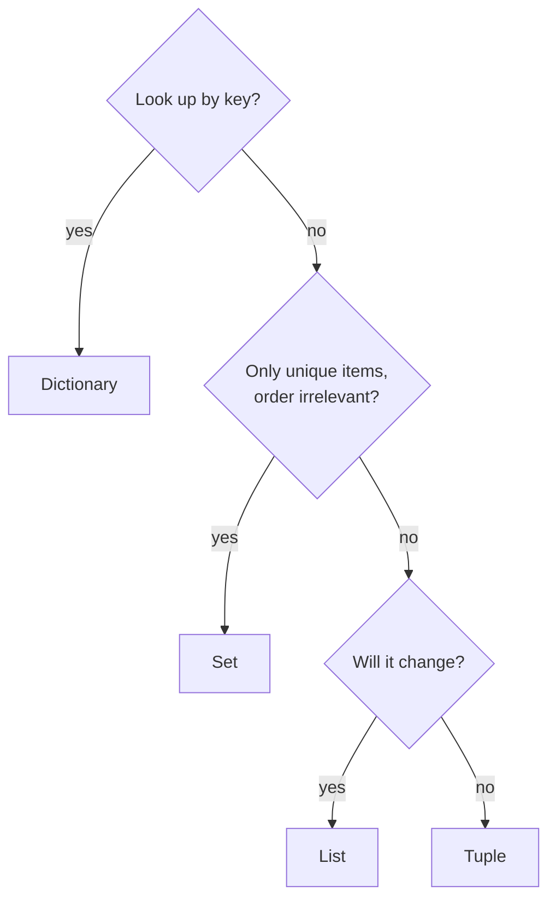

Single values only get you so far. Real programs handle collections: a dataset of rows, a vocabulary of words, a model's configuration. Python has four built-in collection types, and choosing the right one makes code both simpler and faster.

## The four collections at a glance

| Type | Syntax | Ordered | Mutable | Duplicates | Best for |
| --- | --- | --- | --- | --- | --- |
| List | `[1, 2, 3]` | Yes | Yes | Allowed | A sequence that changes |
| Tuple | `(1, 2, 3)` | Yes | No | Allowed | A fixed group of values |
| Set | `{1, 2, 3}` | No | Yes | Removed | Uniqueness and fast membership tests |
| Dictionary | `{"a": 1}` | Yes (insertion order) | Yes | Keys unique | Looking values up by key |

**Mutable** means the object can be changed after it is created.

## Lists

A list is an ordered, changeable sequence. It is the collection you will use most.

```python
scores = [0.71, 0.85, 0.92]

print(scores[0])     # first item: indexing starts at 0
print(scores[-1])    # last item
print(len(scores))
```

```output
0.71
0.92
3
```

### Slicing

A slice `list[start:stop:step]` extracts part of a list. As with `range`, the stop index is excluded.

```python
data = [10, 20, 30, 40, 50]

print(data[1:4])
print(data[:2])
print(data[2:])
print(data[::2])
print(data[::-1])
```

```output
[20, 30, 40]
[10, 20]
[30, 40, 50]
[10, 30, 50]
[50, 40, 30, 20, 10]
```

Slicing is how you split data into training and test portions: `train = data[:800]` and `test = data[800:]`.

### Changing a list

```python
tokens = ["the", "cat"]

tokens.append("sat")          # add to the end
tokens.insert(0, "then")      # add at a position
tokens.extend(["on", "it"])   # add several
tokens[1] = "a"               # replace
last = tokens.pop()           # remove and return the last item
tokens.remove("then")         # remove by value

print(tokens, last)
```

```output
['a', 'cat', 'sat', 'on'] it
```

Other tools you will reach for: `sorted(items)` returns a new sorted list, `items.sort()` sorts in place, and `sum`, `min`, `max` and `in` all work on lists.

### Lists and shared references

Recall that assignment only attaches a label. With a mutable object, that has consequences:

```python
a = [1, 2, 3]
b = a            # same list, second label
b.append(4)
print(a)

c = a.copy()     # a separate list
c.append(5)
print(a)
```

```output
[1, 2, 3, 4]
[1, 2, 3, 4]
```

> [!WARNING]
> `b = a` does not copy a list. Both names refer to one object, so changing it through either name affects both. Use `a.copy()` or `a[:]` when you need an independent copy.

## Tuples

A tuple is a list that cannot be changed. Use it for values that belong together and should stay fixed.

```python
image_size = (224, 224)
point = (3.5, -1.2, 0.0)

width, height = image_size    # unpacking
print(width, height)
```

```output
224 224
```

**Unpacking** assigns each element to its own variable. It is what makes `for name, score in zip(names, scores)` work, and it gives you a one-line swap:

```python
a, b = 1, 2
a, b = b, a
print(a, b)
```

```output
2 1
```

Trying to change a tuple raises `TypeError: 'tuple' object does not support item assignment`. That is the point: a tuple is a promise that the data will not change, which also lets it be used as a dictionary key.

## Sets

A set holds unique items in no particular order.

```python
words = ["the", "cat", "the", "mat", "cat"]
vocabulary = set(words)

print(vocabulary)
print(len(vocabulary))
print("cat" in vocabulary)
```

```output
{'the', 'cat', 'mat'}
3
True
```

Building a vocabulary of unique words is the first step of many NLP pipelines.

Sets support the operations from mathematics:

```python
train_ids = {1, 2, 3, 4}
test_ids = {4, 5, 6}

print(train_ids | test_ids)   # union
print(train_ids & test_ids)   # intersection
print(train_ids - test_ids)   # difference
```

```output
{1, 2, 3, 4, 5, 6}
{4}
{1, 2, 3}
```

A non-empty intersection between training and test IDs means your data has leaked, a real bug this one-liner catches.

> [!TIP]
> Checking `x in my_set` takes the same time whether the set has ten items or ten million. Checking `x in my_list` scans the list item by item. For repeated membership tests, convert to a set first.

## Dictionaries

A dictionary maps **keys** to **values**. It is how Python represents structured records, and JSON data becomes dictionaries when loaded.

```python
config = {
    "model": "gpt-4o-mini",
    "temperature": 0.7,
    "max_tokens": 500,
}

print(config["model"])
config["temperature"] = 0.2      # update
config["stream"] = True          # add a new key
del config["max_tokens"]         # remove
print(config)
```

```output
gpt-4o-mini
{'model': 'gpt-4o-mini', 'temperature': 0.2, 'stream': True}
```

Asking for a missing key with square brackets raises `KeyError`. Use `get` to supply a fallback instead:

```python
print(config.get("top_p"))
print(config.get("top_p", 1.0))
```

```output
None
1.0
```

### Looping over a dictionary

```python
word_counts = {"ai": 3, "data": 5}

for word in word_counts:                  # keys
    print(word)

for word, count in word_counts.items():   # key and value pairs
    print(word, count)
```

```output
ai
data
ai 3
data 5
```

### Counting with a dictionary

```python
text = "the cat and the hat and the bat"
counts = {}

for word in text.split():
    counts[word] = counts.get(word, 0) + 1

print(counts)
```

```output
{'the': 3, 'cat': 1, 'and': 2, 'hat': 1, 'bat': 1}
```

This counting pattern is the basis of bag-of-words models, which you will meet in the NLP phase.

### Nesting

Collections can contain collections. A list of dictionaries is the most common shape for records:

```python
messages = [
    {"role": "system", "content": "You are helpful."},
    {"role": "user", "content": "Hi!"},
]

print(messages[1]["content"])
```

```output
Hi!
```

That structure is exactly how you send a conversation to an LLM API.

## Choosing the right collection



## Exercises

**1.** Given `temps = [22, 31, 19, 27, 35]`, print the highest, the lowest, the average, and the list sorted from high to low.

<details>
<summary>Show solution</summary>

```python
temps = [22, 31, 19, 27, 35]
print(max(temps), min(temps), sum(temps) / len(temps))
print(sorted(temps, reverse=True))
```

</details>

**2.** Remove the duplicates from `[3, 1, 3, 2, 1]` while keeping the original order.

<details>
<summary>Show solution</summary>

```python
items = [3, 1, 3, 2, 1]
seen = set()
unique = []

for item in items:
    if item not in seen:
        seen.add(item)
        unique.append(item)

print(unique)   # [3, 1, 2]
```

`list(set(items))` removes duplicates but loses the order.

</details>

**3.** Count how many times each character appears in `"mississippi"` and print the most frequent one.

<details>
<summary>Show solution</summary>

```python
counts = {}
for ch in "mississippi":
    counts[ch] = counts.get(ch, 0) + 1

most_common = max(counts, key=counts.get)
print(counts, most_common)
```

`i` and `s` both appear four times; `max` returns the first it meets, `i`.

</details>

```quiz
[
  {
    "q": "Given `x = [10, 20, 30, 40]`, what is `x[1:3]`?",
    "options": ["`[10, 20, 30]`", "`[20, 30]`", "`[20, 30, 40]`", "`[10, 20]`"],
    "answer": 1,
    "why": "Slicing starts at index 1 and stops before index 3."
  },
  {
    "q": "After `a = [1, 2]`, `b = a`, `b.append(3)`, what is `a`?",
    "options": ["`[1, 2]`", "`[1, 2, 3]`", "`[3]`", "An error is raised"],
    "answer": 1,
    "why": "`b = a` makes both names refer to the same list, so the append is visible through `a`."
  },
  {
    "q": "Which collection should you use to test quickly whether a word is in a large vocabulary?",
    "options": ["List", "Tuple", "Set", "String"],
    "answer": 2,
    "why": "Set membership tests take constant time, however large the set is."
  },
  {
    "q": "What does `{\"a\": 1}.get(\"b\", 0)` return?",
    "options": ["`None`", "`0`", "`1`", "It raises `KeyError`"],
    "answer": 1,
    "why": "`get` returns the supplied default when the key is missing, instead of raising an error."
  }
]
```
