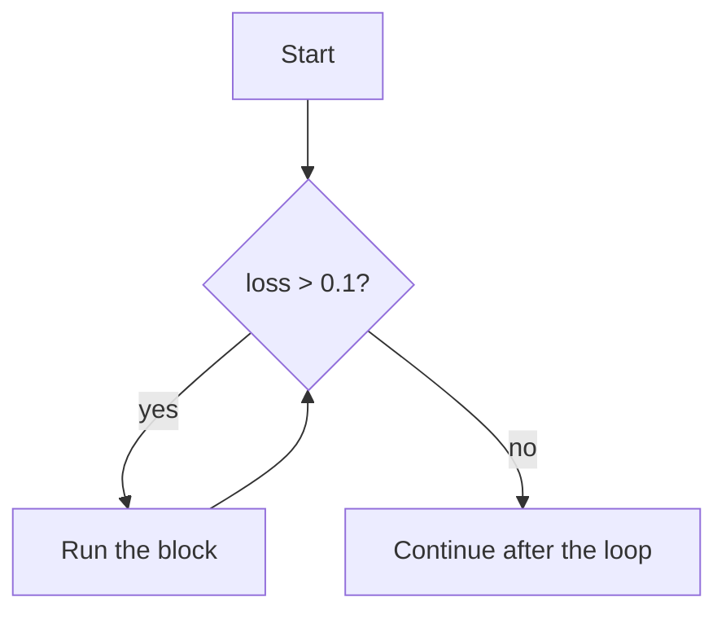

Computers are good at doing the same thing many times without getting bored or making mistakes. A **loop** repeats a block of code. Training a neural network is a loop. Processing every row in a dataset is a loop. Python has two kinds: `for` and `while`.

## The for loop

A `for` loop runs its block once for each item in a sequence.

```python
models = ["bert", "gpt", "t5"]

for model in models:
    print("Loading", model)

print("All loaded.")
```

```output
Loading bert
Loading gpt
Loading t5
All loaded.
```

On each pass (called an **iteration**), the variable `model` is assigned the next item. When the items run out, the loop ends and execution continues below it.

You can loop over anything **iterable**: lists, strings, dictionaries, files and more.

```python
for letter in "AI":
    print(letter)
```

```output
A
I
```

## range

To repeat something a fixed number of times, use `range`. It produces a sequence of integers.

| Call | Produces |
| --- | --- |
| `range(5)` | 0, 1, 2, 3, 4 |
| `range(2, 6)` | 2, 3, 4, 5 |
| `range(0, 10, 3)` | 0, 3, 6, 9 |
| `range(5, 0, -1)` | 5, 4, 3, 2, 1 |

The start is included and the stop is **excluded**. `range(5)` gives five numbers, starting from zero.

```python
total = 0
for i in range(1, 4):
    total += i
print(total)
```

```output
6
```

Step through that loop to see exactly how the variables change:

```trace
{
  "title": "summing with a for loop",
  "code": [
    "total = 0",
    "for i in range(1, 4):",
    "    total += i",
    "print(total)"
  ],
  "steps": [
    { "line": 1, "vars": { "total": "0" }, "note": "total starts at 0." },
    { "line": 2, "vars": { "total": "0", "i": "1" }, "note": "First iteration: i takes the first value from range(1, 4)." },
    { "line": 3, "vars": { "total": "1", "i": "1" }, "note": "total becomes 0 + 1." },
    { "line": 2, "vars": { "total": "1", "i": "2" }, "note": "Back to the top: i takes the next value." },
    { "line": 3, "vars": { "total": "3", "i": "2" }, "note": "total becomes 1 + 2." },
    { "line": 2, "vars": { "total": "3", "i": "3" }, "note": "Last value. The stop value 4 is excluded." },
    { "line": 3, "vars": { "total": "6", "i": "3" }, "note": "total becomes 3 + 3." },
    { "line": 4, "vars": { "total": "6", "i": "3" }, "out": ["6"], "note": "range is exhausted, so the loop ends and the next line runs." }
  ]
}
```

## enumerate and zip

When you need the position as well as the item, use `enumerate` instead of managing a counter yourself:

```python
layers = ["input", "hidden", "output"]

for index, layer in enumerate(layers):
    print(index, layer)
```

```output
0 input
1 hidden
2 output
```

To walk through two sequences together, use `zip`:

```python
names = ["Ali", "Sara"]
scores = [88, 95]

for name, score in zip(names, scores):
    print(name, "scored", score)
```

```output
Ali scored 88
Sara scored 95
```

> [!TIP]
> If you find yourself writing `for i in range(len(items)):` and then `items[i]`, you almost always want `for item in items:` or `enumerate(items)` instead.

## The while loop

A `while` loop repeats **as long as a condition stays true**. Use it when you do not know in advance how many iterations you need.

```python
loss = 1.0
epoch = 0

while loss > 0.1:
    loss = loss / 2
    epoch += 1
    print("epoch", epoch, "loss", loss)
```

```output
epoch 1 loss 0.5
epoch 2 loss 0.25
epoch 3 loss 0.125
epoch 4 loss 0.0625
```



The condition is checked before every iteration. If it is false at the start, the block never runs.

> [!WARNING]
> Something inside a `while` loop must eventually make the condition false. If nothing does, you have an **infinite loop** and the program hangs. Press `Ctrl+C` in the terminal to stop it.

### Choosing between them

| Use `for` when | Use `while` when |
| --- | --- |
| You are going through a collection | You are waiting for a condition to change |
| You know the number of repetitions | The number of repetitions is unknown |
| Example: process every file | Example: retry until the request succeeds |

## break, continue and else

`break` exits the loop immediately. `continue` skips the rest of the current iteration and moves to the next.

```python
for n in [3, 8, -1, 5]:
    if n < 0:
        print("Negative found, stopping")
        break
    if n % 2 == 0:
        continue
    print("odd:", n)
```

```output
odd: 3
Negative found, stopping
```

A loop can have an `else` block. It runs only if the loop finished **without** hitting `break`, which suits search loops:

```python
for word in ["cat", "dog"]:
    if word == "bird":
        print("Found it")
        break
else:
    print("Not found")
```

```output
Not found
```

## Nested loops

A loop inside a loop runs the inner loop completely for each iteration of the outer one.

```python
for row in range(2):
    for col in range(3):
        print(row, col, end="  ")
    print()
```

```output
0 0  0 1  0 2  
1 0  1 1  1 2  
```

If the outer loop runs $n$ times and the inner loop $m$ times, the innermost line runs $n \times m$ times. Nested loops over large data get slow quickly, which is one reason NumPy exists.

## Common loop patterns

```python
numbers = [4, 9, 2, 7]

# accumulate
total = 0
for n in numbers:
    total += n

# count matches
big = 0
for n in numbers:
    if n > 5:
        big += 1

# find the maximum
largest = numbers[0]
for n in numbers:
    if n > largest:
        largest = n

print(total, big, largest)
```

```output
22 2 9
```

Python has built-ins for these (`sum`, `max`), but the patterns themselves appear in every program you will write.

## Exercises

**1.** Print the multiplication table for 7, from `7 x 1 = 7` to `7 x 10 = 70`.

<details>
<summary>Show solution</summary>

```python
for i in range(1, 11):
    print("7 x", i, "=", 7 * i)
```

</details>

**2.** Use a `while` loop to find how many times you can halve 1,000,000 before it drops below 1.

<details>
<summary>Show solution</summary>

```python
value = 1_000_000
count = 0

while value >= 1:
    value /= 2
    count += 1

print(count)   # 20
```

</details>

**3.** Print FizzBuzz for 1 to 20, using the single-number version from the previous lesson.

<details>
<summary>Show solution</summary>

```python
for n in range(1, 21):
    if n % 15 == 0:
        print("FizzBuzz")
    elif n % 3 == 0:
        print("Fizz")
    elif n % 5 == 0:
        print("Buzz")
    else:
        print(n)
```

</details>

**4.** Given `prices = [120, 80, 310, 45]`, print the index and value of the first price above 300, or `none` if there is no such price.

<details>
<summary>Show solution</summary>

```python
prices = [120, 80, 310, 45]

for i, price in enumerate(prices):
    if price > 300:
        print(i, price)
        break
else:
    print("none")
```

</details>

```quiz
[
  {
    "q": "How many times does the body of `for i in range(2, 10, 2):` run?",
    "options": ["3", "4", "5", "8"],
    "answer": 1,
    "why": "The values are 2, 4, 6 and 8. The stop value 10 is excluded."
  },
  {
    "q": "What does `continue` do?",
    "options": [
      "Exits the loop completely",
      "Skips to the next iteration of the loop",
      "Restarts the loop from the first item",
      "Pauses the program"
    ],
    "answer": 1,
    "why": "`continue` abandons the rest of the current iteration only. `break` is the one that exits the loop."
  },
  {
    "q": "When does the `else` block of a loop run?",
    "options": [
      "When the loop body raises an error",
      "Every iteration, after the body",
      "When the loop ends without hitting `break`",
      "Only when the loop runs zero times"
    ],
    "answer": 2,
    "why": "The loop's `else` runs after normal completion. A `break` skips it, which makes it useful for 'not found' handling."
  }
]
```
