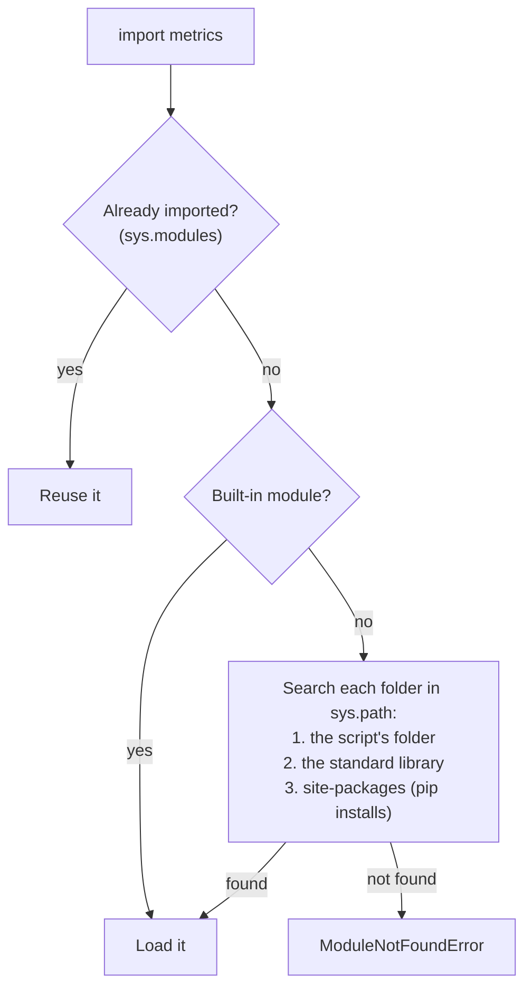

No real project lives in a single file. Python lets you split code across files and folders, and reuse code written by others, through **modules** and **packages**. Understanding how imports work also explains some of the most confusing errors beginners meet.

## Modules

A **module** is simply a `.py` file. Any names it defines (functions, classes, variables) can be imported into another file.

```python
# metrics.py
def accuracy(correct, total):
    return correct / total

def error_rate(correct, total):
    return 1 - accuracy(correct, total)

DEFAULT_THRESHOLD = 0.5
```

```python
# main.py
import metrics

print(metrics.accuracy(45, 50))
print(metrics.DEFAULT_THRESHOLD)
```

```output
0.9
0.5
```

### Ways to import

| Statement | You then write | Notes |
| --- | --- | --- |
| `import metrics` | `metrics.accuracy(...)` | Clear where each name comes from |
| `from metrics import accuracy` | `accuracy(...)` | Shorter; good for a few names |
| `import numpy as np` | `np.array(...)` | An alias; standard for some libraries |
| `from metrics import *` | `accuracy(...)` | Avoid: you cannot tell where names came from |

Certain aliases are universal conventions in data and AI work. Use them so your code reads like everyone else's:

```python
import numpy as np
import pandas as pd
import matplotlib.pyplot as plt
import torch.nn as nn
```

## The standard library

Python ships with hundreds of modules, known as the **standard library**. No installation is needed.

| Module | Used for |
| --- | --- |
| `math` | Mathematical functions and constants |
| `random` | Random numbers, shuffling, sampling |
| `datetime` | Dates and times |
| `pathlib`, `os` | Files, paths and the operating system |
| `json`, `csv` | Reading and writing data formats |
| `re` | Regular expressions |
| `collections` | Specialised containers such as `Counter` |
| `itertools` | Tools for working with iterators |
| `time` | Timing and delays |

```python
import math
import random
from collections import Counter
from datetime import date

print(math.sqrt(16), round(math.pi, 4))

random.seed(42)                       # fixed seed: same results every run
print(random.randint(1, 10), random.choice(["a", "b", "c"]))

print(Counter("mississippi").most_common(2))
print(date(2025, 3, 14).strftime("%d %B %Y"))
```

```output
4.0 3.1416
2 a
[('i', 4), ('s', 4)]
14 March 2025
```

> [!TIP]
> Setting a random **seed** makes "random" results repeatable. In machine learning you set seeds so that an experiment can be reproduced exactly.

## How Python finds a module

When you write `import metrics`, Python searches a list of locations in order and uses the first match.



Two consequences are worth remembering.

**A module's code runs once.** The first import executes the file from top to bottom. Later imports reuse the result.

**Your own files can hide real libraries.** The script's folder is searched first.

> [!WARNING]
> Never name a file after a library you use. If you create `random.py` or `numpy.py`, then `import random` loads **your** file, and you get baffling errors such as `AttributeError: module 'random' has no attribute 'randint'`.

## The main guard

Because importing a module runs it, any code at the top level executes on import, including test calls and prints you only wanted when running the file directly. The fix is this idiom:

```python
# metrics.py
def accuracy(correct, total):
    return correct / total

if __name__ == "__main__":
    # runs only with `python metrics.py`, not on import
    print("Self-test:", accuracy(9, 10))
```

Python sets the variable `__name__` to `"__main__"` in the file being run directly, and to the module's name (`"metrics"`) when it is imported.

## Packages

A **package** is a folder of modules. It lets you organise a larger codebase into a hierarchy.

```text
my_project/
├── main.py
└── chatbot/
    ├── __init__.py
    ├── prompts.py
    ├── client.py
    └── utils/
        ├── __init__.py
        └── text.py
```

The `__init__.py` file marks a folder as a package. It can be empty. Import from a package using dots:

```python
# main.py
from chatbot.prompts import build_prompt
from chatbot.utils.text import clean
import chatbot.client as client
```

### Absolute and relative imports

Inside a package, a module can import its neighbours in two ways:

```python
# chatbot/client.py
from chatbot.prompts import build_prompt     # absolute: full path from the project root
from .prompts import build_prompt            # relative: "." is the current package
from .utils.text import clean
```

Absolute imports are easier to read and move around. Relative imports are common inside libraries.

### A convenient public interface

Code in `__init__.py` runs when the package is imported. It is often used to lift the most useful names to the top level:

```python
# chatbot/__init__.py
from .client import ChatClient
from .prompts import build_prompt
```

Users can then write `from chatbot import ChatClient` without knowing the internal file layout.

## Third-party packages

Beyond the standard library, the **Python Package Index** (PyPI) hosts hundreds of thousands of packages, including every AI library in this curriculum. They are installed with `pip`:

```bash
pip install requests
```

```python
import requests
```

Installing packages properly, in an isolated environment, is the subject of the next two lessons.

## Common import errors

| Error | Usual cause |
| --- | --- |
| `ModuleNotFoundError: No module named 'x'` | Not installed, installed into a different environment, or a typo |
| `ImportError: cannot import name 'y' from 'x'` | The name does not exist in that module, or there is a circular import |
| `AttributeError: module 'x' has no attribute 'y'` | One of your own files is shadowing the real module |
| `ImportError: attempted relative import with no known parent package` | A file that uses relative imports was run directly as a script |

A **circular import** happens when module A imports B while B imports A. The usual fix is to move the shared code into a third module that both import.

## Exercises

**1.** Create `geometry.py` with functions `circle_area(r)` and `rectangle_area(w, h)`, plus a self-test under a main guard. Import and use it from `main.py`.

<details>
<summary>Show solution</summary>

```python
# geometry.py
import math

def circle_area(r):
    return math.pi * r ** 2

def rectangle_area(w, h):
    return w * h

if __name__ == "__main__":
    print(circle_area(1), rectangle_area(2, 3))
```

```python
# main.py
from geometry import circle_area, rectangle_area

print(round(circle_area(2), 2), rectangle_area(4, 5))
```

</details>

**2.** Using only the standard library, write a function that simulates rolling two dice 10,000 times and returns the most common total.

<details>
<summary>Show solution</summary>

```python
import random
from collections import Counter

def most_common_total(rolls=10_000):
    totals = Counter(random.randint(1, 6) + random.randint(1, 6) for _ in range(rolls))
    return totals.most_common(1)[0][0]

print(most_common_total())   # almost always 7
```

</details>

**3.** A colleague's script contains `import json` but fails with `AttributeError: module 'json' has no attribute 'loads'`. What is the most likely cause, and how would you confirm it?

<details>
<summary>Show solution</summary>

There is probably a file called `json.py` in their project folder, which is being imported instead of the standard library module. Confirm it by printing the module's location:

```python
import json
print(json.__file__)
```

If the path points into the project rather than the Python installation, rename the offending file.

</details>

```quiz
[
  {
    "q": "After `import numpy as np`, how do you call NumPy's `array` function?",
    "options": ["`numpy.array(...)`", "`np.array(...)`", "`array(...)`", "`import.array(...)`"],
    "answer": 1,
    "why": "The alias `np` is the name bound in your file. The name `numpy` is not defined."
  },
  {
    "q": "What is the purpose of `if __name__ == \"__main__\":`?",
    "options": [
      "It makes the file run faster",
      "It runs the block only when the file is executed directly, not when imported",
      "It marks the file as a package",
      "It is required in every Python file"
    ],
    "answer": 1,
    "why": "`__name__` equals `\"__main__\"` only in the file being run directly, so the guarded code is skipped on import."
  },
  {
    "q": "You create a file named `random.py` in your project and then write `import random` in another file there. What happens?",
    "options": [
      "Python raises a `SyntaxError`",
      "The standard library `random` is always used",
      "Your `random.py` is imported instead of the standard library module",
      "Both are merged"
    ],
    "answer": 2,
    "why": "The script's own folder comes first on the search path, so a local file shadows the library of the same name."
  }
]
```
