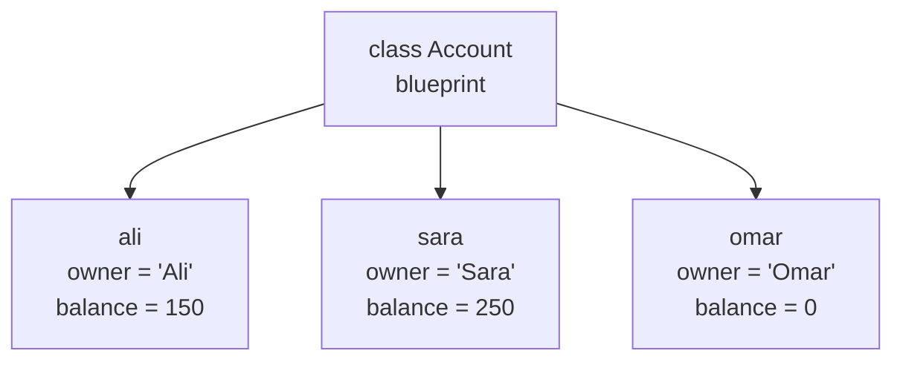

As programs grow, loose variables and functions become hard to manage. **Object-oriented programming** (OOP) organises code by bundling data together with the functions that operate on it. Every major AI library is built this way: a PyTorch model is an object, a Pandas DataFrame is an object, and so is an LLM client. This lesson introduces the way of thinking; the next covers the mechanics in depth.

## The problem OOP solves

Suppose you track bank accounts with plain variables and functions:

```python
ali_balance = 100
sara_balance = 250

def deposit(balance, amount):
    return balance + amount

ali_balance = deposit(ali_balance, 50)
```

The data and the functions are separate. Nothing stops you from passing the wrong balance, setting a balance to a negative number, or forgetting to store the result. With a hundred accounts, each with an owner and a history, it falls apart.

OOP groups each account's data and behaviour into one unit:

```python
class Account:
    def __init__(self, owner, balance=0):
        self.owner = owner
        self.balance = balance

    def deposit(self, amount):
        self.balance += amount

ali = Account("Ali", 100)
ali.deposit(50)
print(ali.owner, ali.balance)
```

```output
Ali 150
```

## Classes and objects

A **class** is a blueprint. An **object** (or **instance**) is a concrete thing built from that blueprint. One class can produce any number of objects, each with its own data.



| Term | Meaning | In the example |
| --- | --- | --- |
| Class | The blueprint | `Account` |
| Object / instance | One thing built from the class | `ali` |
| Attribute | Data stored on an object | `ali.balance` |
| Method | A function that belongs to a class | `ali.deposit(50)` |

You have been using objects all along. `"hello".upper()` calls the `upper` method on a string object. `[1, 2].append(3)` calls a method on a list object. In Python, **everything is an object**.

## Anatomy of a class

```python
class Counter:
    """Counts how many times something happens."""

    def __init__(self, start=0):
        self.count = start          # attribute

    def increment(self):            # method
        self.count += 1

    def reset(self):
        self.count = 0


clicks = Counter()
clicks.increment()
clicks.increment()
print(clicks.count)

errors = Counter(start=10)
print(errors.count, clicks.count)
```

```output
2
10 2
```

### The constructor

`__init__` runs automatically each time an object is created. Its job is to set up the object's starting attributes. `Counter(start=10)` creates a new object and then calls `__init__` with `start=10`.

### self

`self` is the object the method is being called on. When you write `clicks.increment()`, Python translates it to `Counter.increment(clicks)`, so inside the method `self` is `clicks`.

That is how one method definition serves every object: `self.count` means "the count belonging to this particular object".

> [!WARNING]
> Every method needs `self` as its first parameter, and attributes must be accessed as `self.name`. Forgetting `self` in the parameter list produces `TypeError: increment() takes 0 positional arguments but 1 was given`.

## The four pillars

OOP is usually described through four ideas.

| Pillar | In one sentence |
| --- | --- |
| **Encapsulation** | Keep data and the code that manages it together, and control how the data is changed |
| **Abstraction** | Expose a simple interface and hide the complicated details |
| **Inheritance** | Build a new class on top of an existing one, reusing its code |
| **Polymorphism** | Let different kinds of object respond to the same method call in their own way |

### Encapsulation

An object protects its own data by offering methods instead of letting outside code change attributes freely.

```python
class Account:
    def __init__(self, owner, balance=0):
        self.owner = owner
        self._balance = balance

    def withdraw(self, amount):
        if amount > self._balance:
            raise ValueError("insufficient funds")
        self._balance -= amount

    def get_balance(self):
        return self._balance
```

The rule "a balance cannot go negative" lives in one place and cannot be bypassed by accident. The leading underscore in `_balance` is a convention meaning "internal: do not touch from outside".

### Abstraction

You use a model without knowing how it works inside:

```python
model = SentimentModel()
label = model.predict("I loved this film")
```

Behind `predict` there may be tokenization, a neural network with millions of parameters and post-processing. The caller needs none of that. A good class offers a small set of clear methods and hides the rest.

### Inheritance and polymorphism

These two are the subject of the next lesson. In brief: a `SavingsAccount` can inherit everything from `Account` and add interest, and code that works with any `Account` will work with it too.

## OOP in the AI libraries you will use

Recognising this pattern now will make the libraries feel familiar later.

```python
# scikit-learn: a model is an object with fit and predict methods
model = LogisticRegression(max_iter=200)
model.fit(X_train, y_train)
predictions = model.predict(X_test)

# PyTorch: you define a network by writing a class
class Classifier(nn.Module):
    def __init__(self):
        super().__init__()
        self.layer = nn.Linear(784, 10)

    def forward(self, x):
        return self.layer(x)
```

In both, configuration goes into the constructor, learned state is stored in attributes, and behaviour is exposed as methods.

## When to write a class

| Write a class when | A function or dictionary is enough when |
| --- | --- |
| Several functions share the same data | You have a single transformation: input in, output out |
| You need many things with the same structure | The data is a one-off record with no behaviour |
| State must persist between calls | Nothing needs to be remembered between calls |

> [!TIP]
> Do not reach for classes by default. A handful of well-named functions is often clearer. Introduce a class when you notice the same group of values being passed to function after function.

## Exercises

**1.** Write a `Rectangle` class with `width` and `height` attributes and methods `area()` and `perimeter()`.

<details>
<summary>Show solution</summary>

```python
class Rectangle:
    def __init__(self, width, height):
        self.width = width
        self.height = height

    def area(self):
        return self.width * self.height

    def perimeter(self):
        return 2 * (self.width + self.height)

r = Rectangle(4, 3)
print(r.area(), r.perimeter())   # 12 14
```

</details>

**2.** Write a `Stopwatch` class whose `lap(seconds)` method records a lap time, with methods `total()` and `fastest()`.

<details>
<summary>Show solution</summary>

```python
class Stopwatch:
    def __init__(self):
        self.laps = []

    def lap(self, seconds):
        self.laps.append(seconds)

    def total(self):
        return sum(self.laps)

    def fastest(self):
        return min(self.laps) if self.laps else None

s = Stopwatch()
s.lap(61.2)
s.lap(58.9)
print(s.total(), s.fastest())
```

</details>

**3.** Write a `Vocabulary` class with `add(word)`, which assigns each new word the next integer ID, and `encode(sentence)`, which returns the list of IDs for a sentence.

<details>
<summary>Show solution</summary>

```python
class Vocabulary:
    def __init__(self):
        self.word_to_id = {}

    def add(self, word):
        if word not in self.word_to_id:
            self.word_to_id[word] = len(self.word_to_id)

    def encode(self, sentence):
        return [self.word_to_id[w] for w in sentence.split()]

vocab = Vocabulary()
for w in "the cat sat on the mat".split():
    vocab.add(w)
print(vocab.encode("the mat sat"))   # [0, 4, 2]
```

</details>

```quiz
[
  {
    "q": "What is the relationship between a class and an object?",
    "options": [
      "They are two words for the same thing",
      "A class is a blueprint; an object is an instance built from it",
      "An object is a blueprint; a class is an instance built from it",
      "A class is a function that returns a dictionary"
    ],
    "answer": 1,
    "why": "The class defines the structure and behaviour once. Each object is a separate instance with its own data."
  },
  {
    "q": "What does `self` refer to inside a method?",
    "options": ["The class itself", "The module the class is in", "The specific object the method was called on", "The parent class"],
    "answer": 2,
    "why": "`obj.method()` passes `obj` as the first argument, which the method receives as `self`."
  },
  {
    "q": "Hiding a model's internal steps behind a single `predict()` method is an example of which idea?",
    "options": ["Inheritance", "Abstraction", "Polymorphism", "Recursion"],
    "answer": 1,
    "why": "Abstraction means exposing a simple interface while concealing the implementation details."
  }
]
```
