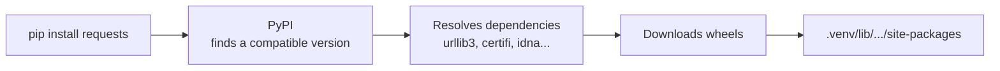

Almost nothing in AI is built from scratch. A typical project stands on dozens of libraries: NumPy for arrays, PyTorch for models, FastAPI for serving. **pip** is the tool that downloads and installs them. Managing those dependencies carefully is what makes a project reproducible on another machine, or on the same machine six months later.

## How pip works

`pip` fetches packages from the **Python Package Index** (PyPI), a public repository at [pypi.org](https://pypi.org), and installs them into the active environment's `site-packages` folder.



Packages rarely stand alone. `requests` needs four other packages, and pip installs those too. These are called **transitive dependencies**.

> [!WARNING]
> Activate your virtual environment before running `pip install`. Otherwise packages go into the system Python, which is the situation the previous lesson taught you to avoid.

## Everyday commands

| Command | What it does |
| --- | --- |
| `pip install requests` | Install the latest version |
| `pip install requests==2.32.3` | Install an exact version |
| `pip install "requests>=2.31,<3"` | Install within a range |
| `pip install --upgrade requests` | Upgrade to the newest version |
| `pip uninstall requests` | Remove a package |
| `pip list` | List installed packages |
| `pip show requests` | Show details: version, location, dependencies |
| `pip freeze` | List installed packages in requirements format |
| `pip install -r requirements.txt` | Install everything listed in a file |

```bash
pip show requests
```

```output
Name: requests
Version: 2.32.3
Summary: Python HTTP for Humans.
Location: /home/amina/projects/chatbot/.venv/lib/python3.12/site-packages
Requires: certifi, charset-normalizer, idna, urllib3
```

The `Location` line is a quick way to confirm which environment a package lives in.

## Version numbers

Most packages follow **semantic versioning**: three numbers, `MAJOR.MINOR.PATCH`.

| Part | Changes when | Example |
| --- | --- | --- |
| Major | Breaking changes: your code may stop working | `1.26.4` to `2.0.0` |
| Minor | New features, backwards compatible | `2.1.0` to `2.2.0` |
| Patch | Bug fixes only | `2.2.0` to `2.2.1` |

### Version specifiers

| Specifier | Meaning |
| --- | --- |
| `==2.2.1` | Exactly this version |
| `>=2.0` | This version or newer |
| `>=2.0,<3` | At least 2.0, but below the next major version |
| `~=2.2.0` | Compatible release: `>=2.2.0, <2.3.0` |

## requirements.txt

A requirements file lists a project's dependencies, one per line.

```text
# requirements.txt
numpy==2.1.3
pandas==2.2.3
scikit-learn==1.5.2
requests>=2.31,<3
```

There are two ways to produce one, with different trade-offs:

| Approach | How | Result |
| --- | --- | --- |
| Hand-written | List only the packages you import directly | Short and readable; transitive versions can drift |
| Frozen | `pip freeze > requirements.txt` | Every package pinned exactly; fully reproducible but long |

> [!KEY]
> **Pin your versions.** An unpinned `pandas` means "whatever is newest on the day someone installs". A model that trained correctly last month can produce different numbers, or crash, after a silent upgrade. In machine learning, reproducibility depends on exact versions.

### Separating development tools

Tools needed only while developing (test runners, formatters, notebooks) are commonly kept in a second file:

```text
# requirements-dev.txt
-r requirements.txt
pytest==8.3.3
ruff==0.7.4
jupyter==1.1.1
```

The `-r` line includes the main file, so `pip install -r requirements-dev.txt` installs both sets.

## pyproject.toml

Modern Python projects describe themselves in a single `pyproject.toml` file, which is replacing the older `setup.py` and, increasingly, `requirements.txt`.

```toml
[project]
name = "sentiment-app"
version = "0.1.0"
requires-python = ">=3.11"
dependencies = [
    "pandas>=2.2,<3",
    "scikit-learn>=1.5",
]

[project.optional-dependencies]
dev = ["pytest>=8", "ruff"]
```

With that file in place, you can install your own project in **editable** mode. Changes to your source code take effect immediately, without reinstalling:

```bash
pip install -e .
pip install -e ".[dev]"
```

Tools such as `uv` and `poetry` read the same file and also write a **lock file** recording the exact version of every transitive dependency.

## Installing AI libraries

Deep learning packages have some special considerations.

**They are large.** PyTorch with GPU support is several gigabytes. Be patient, and avoid reinstalling unnecessarily.

**GPU builds need the right variant.** PyTorch publishes separate builds for CPU-only machines and for each CUDA version. The [PyTorch website](https://pytorch.org/get-started/locally/) generates the correct command for your system, for example:

```bash
pip install torch --index-url https://download.pytorch.org/whl/cu124
```

**The import name can differ from the package name.**

| You install | You import |
| --- | --- |
| `scikit-learn` | `sklearn` |
| `opencv-python` | `cv2` |
| `pillow` | `PIL` |
| `python-dotenv` | `dotenv` |
| `beautifulsoup4` | `bs4` |

## Security and good habits

Anyone can publish to PyPI, so treat installing a package like running a stranger's code, because that is what it is.

- **Check the name carefully.** Attackers publish packages whose names are one typo away from popular ones, a practice called typosquatting.
- **Prefer well-known packages.** Look at the project's page: download counts, recent releases, a linked source repository.
- **Never use `sudo pip install`.** It modifies the system Python with administrator rights. Use a virtual environment.
- **Keep dependencies few.** Each one is code you must trust and keep updated.

## Troubleshooting

| Problem | What to try |
| --- | --- |
| `ERROR: No matching distribution found` | The package name is misspelled, or no build exists for your Python version or platform |
| `ERROR: ResolutionImpossible` | Two packages need incompatible versions of a third. Loosen a pin, or upgrade the older package |
| Installed, but import fails | Wrong environment. Use `python -m pip install ...` |
| `pip` itself is outdated | `python -m pip install --upgrade pip` |
| A build fails while compiling | No prebuilt wheel exists for your platform. Try a newer package version or a supported Python version |

## Exercises

**1.** In a fresh virtual environment, install `rich`, check its version and dependencies, then use it to print coloured text.

<details>
<summary>Show solution</summary>

```bash
python3 -m venv .venv
source .venv/bin/activate
pip install rich
pip show rich
```

```python
from rich import print

print("[bold green]Success![/bold green] rich is installed.")
```

</details>

**2.** Write a `requirements.txt` that pins `numpy` exactly to 2.1.3, allows any `requests` version from 2.31 up to but not including 3, and accepts any patch release of `pandas` 2.2.

<details>
<summary>Show solution</summary>

```text
numpy==2.1.3
requests>=2.31,<3
pandas~=2.2.0
```

</details>

**3.** A library moves from version 3.4.1 to 4.0.0. What does the version change tell you, and what should you do before upgrading a project that depends on it?

<details>
<summary>Show solution</summary>

A change in the major number signals breaking changes: code written for version 3 may fail on version 4. Before upgrading, read the release notes or migration guide, upgrade in a separate branch or environment, and run your tests. If the project is pinned to 3.4.1, nothing changes until you decide to upgrade, which is exactly why pinning matters.

</details>

```quiz
[
  {
    "q": "What does `pip freeze > requirements.txt` do?",
    "options": [
      "Prevents any further packages from being installed",
      "Saves every installed package with its exact version to a file",
      "Uninstalls all packages",
      "Upgrades every package to its latest version"
    ],
    "answer": 1,
    "why": "`pip freeze` prints installed packages as `name==version`, and `>` redirects that output into the file."
  },
  {
    "q": "In the version number `2.4.1`, which part increases when a release breaks backwards compatibility?",
    "options": ["`2` (major)", "`4` (minor)", "`1` (patch)", "None of them"],
    "answer": 0,
    "why": "Under semantic versioning, a major version bump signals breaking changes."
  },
  {
    "q": "Why should you pin dependency versions in a machine learning project?",
    "options": [
      "Pinned packages download faster",
      "PyPI requires it",
      "So results stay reproducible instead of changing when a library silently updates",
      "It reduces the size of the virtual environment"
    ],
    "answer": 2,
    "why": "Unpinned dependencies resolve to whatever is newest at install time, which can change behaviour or break code without warning."
  }
]
```
