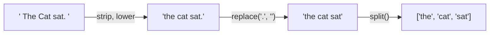

Text is the raw material of modern AI. Prompts are strings. Model outputs are strings. Before any language model sees your data, you clean, split and format it using the tools in this lesson.

## Strings are immutable sequences

A string behaves like a tuple of characters. You can index and slice it, but you cannot change it in place.

```python
word = "transformer"

print(word[0], word[-1])
print(word[:5])
print(len(word))
```

```output
t r
trans
11
```

```python
word[0] = "T"
```

```output
TypeError: 'str' object does not support item assignment
```

Every string method therefore **returns a new string** and leaves the original untouched. Forgetting to use the result is a common bug:

```python
name = "  amina  "
name.strip()            # result thrown away
print(repr(name))
name = name.strip()     # result kept
print(repr(name))
```

```output
'  amina  '
'amina'
```

## Formatting with f-strings

An **f-string** is a string prefixed with `f`. Anything inside `{}` is evaluated and inserted.

```python
model = "bert-base"
accuracy = 0.91837
epoch = 3

print(f"Epoch {epoch}: {model} reached {accuracy:.2%} accuracy")
print(f"{accuracy:.3f} | {1234567:,} | {epoch:03d} | {'left':<8}|")
```

```output
Epoch 3: bert-base reached 91.84% accuracy
0.918 | 1,234,567 | 003 | left    |
```

The part after the colon is a **format specifier**:

| Specifier | Meaning | Example output |
| --- | --- | --- |
| `.2f` | Two decimal places | `0.92` |
| `.1%` | Percentage with one decimal | `91.8%` |
| `,` | Thousands separator | `1,234,567` |
| `03d` | Pad an integer with zeros to width 3 | `003` |
| `>10` / `<10` | Right or left align in 10 characters | |

> [!TIP]
> `f"{value=}"` prints both the expression and its value, such as `value=42`. It is a quick debugging aid.

## Essential string methods

### Cleaning and case

```python
raw = "  Hello, World!  "

print(raw.strip())
print(raw.lower())
print(raw.upper())
print(raw.strip().replace("World", "Python"))
```

```output
Hello, World!
  hello, world!  
  HELLO, WORLD!  
Hello, Python!
```

Lowercasing and stripping whitespace are the first steps of nearly every text-cleaning pipeline.

### Searching

```python
text = "Attention is all you need"

print("all" in text)
print(text.startswith("Attention"))
print(text.endswith("?"))
print(text.find("is"))
print(text.count("e"))
```

```output
True
True
False
10
3
```

`find` returns the index of the first match, or `-1` if there is none.

### Splitting and joining

`split` breaks a string into a list. `join` does the reverse.

```python
sentence = "the quick brown fox"
words = sentence.split()
print(words)

row = "ali,27,lahore"
print(row.split(","))

print("-".join(words))
print(" ".join(reversed(words)))
```

```output
['the', 'quick', 'brown', 'fox']
['ali', '27', 'lahore']
the-quick-brown-fox
fox brown quick the
```

Splitting text into words is the simplest form of **tokenization**, the step that turns text into units a model can process.



> [!WARNING]
> Build long strings with `join`, not by adding in a loop. Each `+=` on a string creates a whole new string, which gets slow for thousands of pieces. Collect the pieces in a list and call `"".join(pieces)` once.

### Checking content

```python
print("42".isdigit(), "abc".isalpha(), "abc123".isalnum(), "  ".isspace())
```

```output
True True True True
```

## Escape characters and raw strings

A backslash introduces a special character:

| Sequence | Meaning |
| --- | --- |
| `\n` | New line |
| `\t` | Tab |
| `\\` | A literal backslash |
| `\"` | A double quote inside a double-quoted string |

```python
print("Line one\nLine two\tindented")
print(r"C:\new\table")    # raw string: backslashes are left alone
```

```output
Line one
Line two	indented
C:\new\table
```

Raw strings, prefixed with `r`, are used for Windows paths and regular expressions.

## Multi-line strings and prompt templates

Triple-quoted strings keep their line breaks. Combined with f-strings they make readable prompt templates:

```python
context = "Paris is the capital of France."
question = "What is the capital of France?"

prompt = f"""Answer using only the context below.

Context: {context}

Question: {question}
Answer:"""

print(prompt)
```

```output
Answer using only the context below.

Context: Paris is the capital of France.

Question: What is the capital of France?
Answer:
```

This is a miniature version of the prompt used in retrieval-augmented generation, which you will build in Phase 8.

## A first look at regular expressions

When `find` and `replace` are not enough, the `re` module matches **patterns** rather than fixed text.

```python
import re

text = "Contact: ali@example.com or sara@test.org by 2025-03-14."

emails = re.findall(r"[\w.]+@[\w.]+\.\w+", text)
date = re.search(r"\d{4}-\d{2}-\d{2}", text)
cleaned = re.sub(r"\s+", " ", "too    many   spaces")

print(emails)
print(date.group())
print(cleaned)
```

```output
['ali@example.com', 'sara@test.org']
2025-03-14
too many spaces
```

| Pattern | Matches |
| --- | --- |
| `\d` | A digit |
| `\w` | A letter, digit or underscore |
| `\s` | Whitespace |
| `+` | One or more of the previous item |
| `{4}` | Exactly four of the previous item |
| `[abc]` | Any one of the listed characters |

You do not need to master regular expressions now. Know that they exist and reach for them when text has a pattern.

## Exercises

**1.** Write `clean(text)` that strips surrounding whitespace, lowercases the text, and removes commas and full stops.

<details>
<summary>Show solution</summary>

```python
def clean(text):
    return text.strip().lower().replace(",", "").replace(".", "")

print(clean("  Hello, World.  "))   # hello world
```

</details>

**2.** Write `is_palindrome(text)` that ignores case and spaces. `"Never odd or even"` should return `True`.

<details>
<summary>Show solution</summary>

```python
def is_palindrome(text):
    letters = text.lower().replace(" ", "")
    return letters == letters[::-1]

print(is_palindrome("Never odd or even"))   # True
```

</details>

**3.** Given `name = "resnet50"`, `params = 25557032` and `top1 = 0.7613`, print exactly: `resnet50     25,557,032 params   76.1%`, with the name left-aligned in 12 characters.

<details>
<summary>Show solution</summary>

```python
name, params, top1 = "resnet50", 25557032, 0.7613
print(f"{name:<12} {params:,} params   {top1:.1%}")
```

</details>

```quiz
[
  {
    "q": "What is `\"a,b,,c\".split(\",\")`?",
    "options": ["`['a', 'b', 'c']`", "`['a', 'b', '', 'c']`", "`['a,b,,c']`", "`('a', 'b', 'c')`"],
    "answer": 1,
    "why": "Splitting on an explicit separator keeps empty strings between consecutive separators."
  },
  {
    "q": "After `s = \"Hello\"` and `s.upper()`, what is `s`?",
    "options": ["`\"HELLO\"`", "`\"Hello\"`", "`\"hello\"`", "`None`"],
    "answer": 1,
    "why": "Strings are immutable. `upper()` returns a new string, and here the result is discarded."
  },
  {
    "q": "What does `f\"{3.14159:.2f}\"` produce?",
    "options": ["`\"3.14\"`", "`\"3.1\"`", "`\"3.14159\"`", "`\"03.14\"`"],
    "answer": 0,
    "why": "`.2f` formats the number as a float with two decimal places."
  }
]
```
