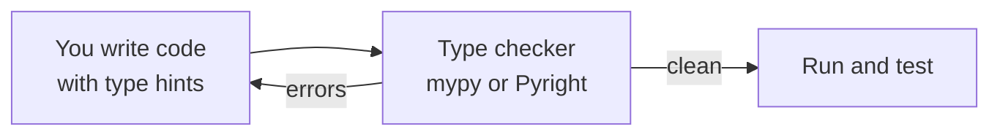

Python does not make you declare types, which is convenient for a ten-line script and risky in a ten-thousand-line codebase. **Type hints** let you state what types your code expects. Python itself ignores them at runtime, but editors and type checkers use them to catch bugs before the code ever runs. Modern AI tooling, including FastAPI and Pydantic, is built on them.

## Why annotate

Look at this function signature:

```python
def search(query, k, threshold):
    ...
```

Is `k` a number or a string? Is `threshold` between 0 and 1, or a percentage? What comes back? You have to read the body, or guess. Compare:

```python
def search(query: str, k: int = 5, threshold: float = 0.5) -> list[str]:
    ...
```

Now the signature documents itself, your editor can autocomplete on the result, and a type checker can flag `search(42, "five")` as a mistake.

> [!KEY]
> Type hints are **not enforced** when the program runs. `search(42, "five")` still executes, and fails later in some confusing place. Hints are information for tools and for people. A separate program, a type checker, is what verifies them.

## Basic syntax

Annotate a parameter with `name: type` and a return value with `-> type`.

```python
def greet(name: str, excited: bool = False) -> str:
    suffix = "!" if excited else "."
    return f"Hello, {name}{suffix}"

def log(message: str) -> None:      # returns nothing
    print(message)

learning_rate: float = 0.001        # variables can be annotated too
```

Variable annotations are usually unnecessary, because the checker infers the type from the value. Annotate function signatures first: that is where hints pay off most.

## Collections

Put the element type in square brackets.

```python
scores: list[float] = [0.91, 0.88]
point: tuple[int, int] = (3, 4)
vocab: dict[str, int] = {"the": 0, "cat": 1}
seen: set[str] = {"a", "b"}

def average(values: list[float]) -> float:
    return sum(values) / len(values)

def count_words(text: str) -> dict[str, int]:
    counts: dict[str, int] = {}
    for word in text.split():
        counts[word] = counts.get(word, 0) + 1
    return counts
```

| Annotation | Meaning |
| --- | --- |
| `list[str]` | A list of strings |
| `dict[str, float]` | A dictionary with string keys and float values |
| `tuple[int, str]` | A tuple of exactly an int then a string |
| `tuple[int, ...]` | A tuple of any number of ints |
| `list[dict[str, str]]` | A list of dictionaries, such as chat messages |

## Optional values and unions

A value that may be one of several types is a **union**, written with a vertical bar.

```python
def parse_number(text: str) -> int | float:
    return float(text) if "." in text else int(text)
```

The most common union is "this type or `None`":

```python
def find_user(user_id: int) -> str | None:
    users = {1: "amina", 2: "omar"}
    return users.get(user_id)

name = find_user(3)
print(name.upper())      # a type checker flags this line
```

```output
AttributeError: 'NoneType' object has no attribute 'upper'
```

A checker warns that `name` might be `None` before you ever run the program. Handling the `None` case satisfies it:

```python
name = find_user(3)
if name is not None:
    print(name.upper())
```

This single feature eliminates one of the most common classes of bug.

> [!NOTE]
> In older code you will see `Optional[str]` and `Union[int, float]` from the `typing` module. They mean the same as `str | None` and `int | float`. The bar syntax needs Python 3.10 or newer.

## More useful types

```python
from typing import Any, Callable, Literal

def apply(func: Callable[[float], float], value: float) -> float:
    return func(value)

def load(path: str, mode: Literal["train", "test"]) -> list[Any]:
    ...
```

| Type | Meaning |
| --- | --- |
| `Any` | Anything at all: switches checking off for that value |
| `Callable[[int, str], bool]` | A function taking an int and a str and returning a bool |
| `Literal["train", "test"]` | Only these exact values are allowed |
| `Iterable[str]` | Anything you can loop over that yields strings |

> [!WARNING]
> `Any` is an escape hatch. Each use is a hole in your type checking, so reach for it sparingly and prefer a precise type.

## Describing structured data

Dictionaries with known keys are everywhere in AI code. Two tools describe their shape.

A `TypedDict` describes a dictionary:

```python
from typing import TypedDict

class Message(TypedDict):
    role: str
    content: str

def last_user_message(messages: list[Message]) -> str | None:
    for message in reversed(messages):
        if message["role"] == "user":
            return message["content"]
    return None
```

A `dataclass` describes an object, with types on every field:

```python
from dataclasses import dataclass

@dataclass
class Document:
    text: str
    source: str
    score: float = 0.0

doc = Document("Paris is in France.", "geo.txt")
print(doc.score)
```

```output
0.0
```

Later in the curriculum you will use **Pydantic**, which looks similar but also **validates** the data at runtime. It is how FastAPI checks requests and how you get reliable structured output from an LLM.

## Type checking

A type checker reads your code without running it and reports mismatches.

```python
# example.py
def total_tokens(prompt: int, completion: int) -> int:
    return prompt + completion

total_tokens("120", 80)
```

```bash
pip install mypy
mypy example.py
```

```output
example.py:5: error: Argument 1 to "total_tokens" has incompatible type "str"; expected "int"  [arg-type]
Found 1 error in 1 file (checked 1 source file)
```



VS Code's Python extension includes the Pyright checker and underlines problems as you type. Turn it on by setting **Type Checking Mode** to `basic` in the settings.

## How much to annotate

| Situation | Recommendation |
| --- | --- |
| Function parameters and return types | Always |
| Public classes and their attributes | Always |
| Local variables | Only when the checker cannot infer the type, such as an empty list |
| Throwaway scripts and notebooks | Optional |

Hints are documentation that cannot go stale, because a checker verifies them. Start with function signatures and add more where it helps.

## Exercises

**1.** Add type hints to this function.

```python
def top_k(scores, k=3):
    return sorted(scores, reverse=True)[:k]
```

<details>
<summary>Show solution</summary>

```python
def top_k(scores: list[float], k: int = 3) -> list[float]:
    return sorted(scores, reverse=True)[:k]
```

</details>

**2.** Write a typed function `safe_divide` that returns the quotient of two floats, or `None` when the divisor is zero. Then call it and use the result in a way that would satisfy a type checker.

<details>
<summary>Show solution</summary>

```python
def safe_divide(a: float, b: float) -> float | None:
    if b == 0:
        return None
    return a / b

result = safe_divide(10, 0)
if result is None:
    print("undefined")
else:
    print(round(result, 2))
```

</details>

**3.** Define a dataclass `Prediction` with a `label` string, a `confidence` float and an optional `explanation` that defaults to `None`. Write `most_confident(predictions)` returning the prediction with the highest confidence.

<details>
<summary>Show solution</summary>

```python
from dataclasses import dataclass

@dataclass
class Prediction:
    label: str
    confidence: float
    explanation: str | None = None

def most_confident(predictions: list[Prediction]) -> Prediction:
    return max(predictions, key=lambda p: p.confidence)

best = most_confident([Prediction("spam", 0.7), Prediction("ham", 0.9)])
print(best.label)   # ham
```

</details>

```quiz
[
  {
    "q": "What happens at runtime if you call `def f(x: int) -> int` with a string?",
    "options": [
      "Python raises a `TypeError` immediately",
      "Python converts the string to an int",
      "Nothing special: hints are not enforced, so the call proceeds",
      "The program refuses to start"
    ],
    "answer": 2,
    "why": "Type hints are ignored by the interpreter. A type checker such as mypy is what detects the mismatch."
  },
  {
    "q": "Which annotation describes a dictionary mapping words to counts?",
    "options": ["`dict[int, str]`", "`dict[str, int]`", "`list[str, int]`", "`dict(str: int)`"],
    "answer": 1,
    "why": "The first type parameter is the key type and the second is the value type."
  },
  {
    "q": "What does the return type `str | None` tell the caller?",
    "options": [
      "The function returns an empty string on failure",
      "The function may return a string or `None`, so the result should be checked",
      "The function returns nothing",
      "The function returns a tuple of a string and `None`"
    ],
    "answer": 1,
    "why": "A union with `None` signals a possibly missing value. A type checker will require you to handle the `None` case."
  }
]
```
