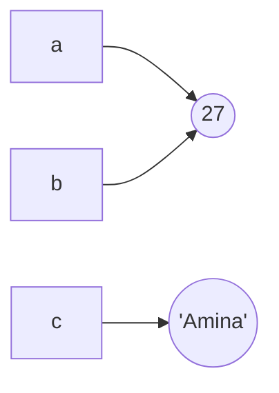

Programs work by storing values and changing them. A **variable** is a name attached to a value, and every value has a **type** that decides what you can do with it. Get these two ideas right and most of Python's behaviour stops being surprising.

## Variables are names, not boxes

You create a variable by assigning to it with `=`:

```python
age = 27
name = "Amina"
height = 1.68
```

There is no declaration step and no type to write down. Python creates the value, then attaches the name to it.

The common mental picture is a box holding a value. A more accurate one is a **label tied to an object**. The difference matters when two names point at the same thing:



```python
a = 27
b = a        # b is a second label on the same object
a = 30       # a now points to a new object; b is untouched
print(a, b)
```

```output
30 27
```

Assignment never copies a value. It only moves a label. You will see why this matters when you reach lists.

### Naming rules

- Letters, digits and underscores only. A name cannot start with a digit.
- Names are case-sensitive: `score` and `Score` are different variables.
- You cannot use keywords such as `for`, `class` or `if`.
- By convention, Python uses `snake_case`: `learning_rate`, not `learningRate`.

> [!TIP]
> Choose names that say what the value means. `learning_rate = 0.001` explains itself. `x = 0.001` forces every reader, including you next month, to work it out.

## The core data types

| Type | Name | Example | Used for |
| --- | --- | --- | --- |
| Integer | `int` | `42`, `-7` | Counting, indexing |
| Floating point | `float` | `3.14`, `1e-3` | Measurements, model weights |
| String | `str` | `"hello"` | Text |
| Boolean | `bool` | `True`, `False` | Yes or no decisions |
| None | `NoneType` | `None` | "No value here" |

Ask Python for a value's type with `type()`:

```python
print(type(42))
print(type(3.14))
print(type("hello"))
print(type(True))
print(type(None))
```

```output
<class 'int'>
<class 'float'>
<class 'str'>
<class 'bool'>
<class 'NoneType'>
```

### Integers and floats

Python integers have no size limit. Floats are stored in 64 bits, which means they are approximations:

```python
print(2 ** 100)
print(0.1 + 0.2)
```

```output
1267650600228229401496703205376
0.30000000000000004
```

That second result is not a Python bug. Binary cannot represent 0.1 exactly, just as decimal cannot write one third exactly. Every language using standard floats behaves this way.

> [!WARNING]
> Never compare floats with `==`. Use `math.isclose(a, b)` instead. This matters constantly in machine learning, where every weight and loss value is a float.

### Strings

Text goes in single or double quotes; the two are equivalent. Triple quotes span several lines.

```python
model = "gpt"
prompt = """You are a helpful assistant.
Answer briefly."""
print(len(prompt))
```

```output
44
```

### Booleans and None

`True` and `False` are the results of comparisons and drive every decision your program makes. `None` represents the absence of a value, for example a search that found nothing.

```python
is_trained = False
best_score = None
print(5 > 3, is_trained, best_score)
```

```output
True False None
```

## Dynamic typing

A variable in Python has no fixed type. The value has the type, and the name can be re-pointed at anything:

```python
x = 10
print(type(x))
x = "ten"
print(type(x))
```

```output
<class 'int'>
<class 'str'>
```

This is called **dynamic typing**. It makes Python quick to write, and it means type mistakes only show up when the line runs. The [type hints](/learn/python-programming/type-hints) lesson shows how to get that safety back.

## Converting between types

Python will not guess how to mix types. You convert explicitly, which is called **casting**:

```python
age_text = "27"
age = int(age_text)
print(age + 1)
print(float("3.5"), str(99) + "%", int(3.99))
```

```output
28
3.5 99% 3
```

Note that `int(3.99)` gives `3`: it cuts off the decimals rather than rounding. Use `round()` when you want rounding.

`input()` always returns a string, which causes a classic first bug:

```python
count = input("How many? ")   # user types 5
print(count * 2)
```

```output
55
```

The string `"5"` was repeated twice. Converting fixes it: `count = int(input("How many? "))`.

### Truthiness

Any value can be used where a boolean is expected. These count as false: `0`, `0.0`, `""`, `None`, and empty collections. Everything else counts as true.

```python
print(bool(0), bool(""), bool(None))
print(bool(42), bool("no"), bool(-1))
```

```output
False False False
True True True
```

## Exercises

**1.** Create variables for a model's name, its number of parameters in billions, and whether it is open source. Print each with its type.

<details>
<summary>Show solution</summary>

```python
model_name = "llama-3"
params_billions = 8.0
open_source = True

print(model_name, type(model_name))
print(params_billions, type(params_billions))
print(open_source, type(open_source))
```

</details>

**2.** Ask the user for two numbers and print their sum. Remember what `input()` returns.

<details>
<summary>Show solution</summary>

```python
a = float(input("First number: "))
b = float(input("Second number: "))
print("Sum:", a + b)
```

</details>

**3.** Predict the output before running it, then check.

```python
x = 5
y = x
x = x + 1
print(x, y)
```

<details>
<summary>Show solution</summary>

`6 5`. The line `x = x + 1` creates a new object `6` and moves the label `x` to it. `y` still points at `5`.

</details>

```quiz
[
  {
    "q": "What does `type(3.0)` return?",
    "options": ["`<class 'int'>`", "`<class 'float'>`", "`<class 'str'>`", "`<class 'number'>`"],
    "answer": 1,
    "why": "A decimal point makes the literal a float, even when the fractional part is zero."
  },
  {
    "q": "What does `\"3\" + \"4\"` evaluate to?",
    "options": ["`7`", "`\"7\"`", "`\"34\"`", "A `TypeError`"],
    "answer": 2,
    "why": "Both values are strings, so `+` joins them. Convert with `int()` first if you want arithmetic."
  },
  {
    "q": "Which of these values is truthy?",
    "options": ["`0`", "`\"\"`", "`None`", "`\"False\"`"],
    "answer": 3,
    "why": "Any non-empty string is truthy, including the text `\"False\"`. Only the empty string is falsy."
  }
]
```
