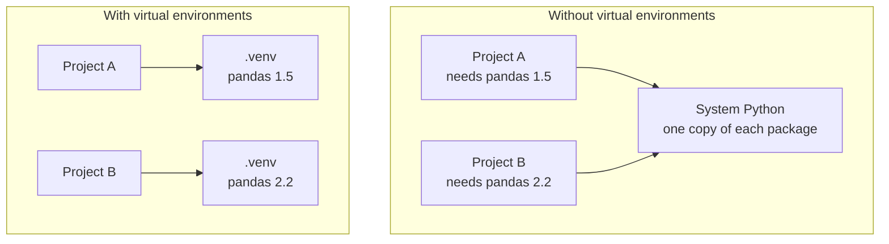

Sooner or later, two of your projects will need different versions of the same library. One uses an older PyTorch that a tutorial depends on; another needs the newest release. If everything is installed into one shared Python, one of them breaks. A **virtual environment** gives each project its own private set of packages.

## The problem

By default, `pip install` puts packages into a single location shared by every project on your machine. Only one version of each package can exist there.



There are other costs too. Installing into the system Python can break tools your operating system relies on, and you have no record of which packages a particular project needs, so nobody else can reproduce your setup.

## What a virtual environment is

A virtual environment is a folder containing:

- a link to a Python interpreter,
- its own `site-packages` directory where `pip` installs packages,
- small scripts to activate it.

It is not a virtual machine and not a copy of Python. It is lightweight, takes seconds to create, and is safe to delete and rebuild.

## Creating and using one

Python includes the `venv` module. From your project folder:

```bash
python3 -m venv .venv
```

This creates a folder called `.venv`. The name is a convention that editors recognise automatically.

### Activate it

| System | Command |
| --- | --- |
| macOS and Linux | `source .venv/bin/activate` |
| Windows (PowerShell) | `.venv\Scripts\Activate.ps1` |
| Windows (Command Prompt) | `.venv\Scripts\activate.bat` |

Once active, your prompt shows the environment's name, and `python` and `pip` refer to the ones inside it:

```bash
source .venv/bin/activate
which python
```

```output
/home/amina/projects/chatbot/.venv/bin/python
```

Activation only changes the current terminal session. It works by putting the environment's folder at the front of your `PATH`, so its `python` is found first.

### Install, work, deactivate

```bash
pip install requests
python main.py
deactivate
```

`deactivate` returns the terminal to the system Python. Open a new terminal and you will need to activate again.

> [!WARNING]
> The most common cause of `ModuleNotFoundError` for a package you are sure you installed is that it went into a different environment from the one running your code. Check with `which python` (or `where python` on Windows) and `pip --version`, which prints the location pip is installing to.

## The standard project workflow

```bash
mkdir sentiment-app
cd sentiment-app
python3 -m venv .venv
source .venv/bin/activate
pip install pandas scikit-learn
pip freeze > requirements.txt
```

`pip freeze` lists every installed package with its exact version. Saving that to `requirements.txt` records what the project needs. Anyone can then rebuild the same environment:

```bash
python3 -m venv .venv
source .venv/bin/activate
pip install -r requirements.txt
```

### Keep the environment out of Git

The `.venv` folder is large, specific to your machine and fully reproducible from `requirements.txt`. Never commit it. Add it to `.gitignore`:

```text
.venv/
__pycache__/
```

> [!KEY]
> Commit `requirements.txt`. Ignore `.venv/`. The requirements file is the recipe; the environment is the meal, and can be cooked again at any time.

## Using the environment in your editor

VS Code detects a `.venv` folder in your project. Open the command palette, choose **Python: Select Interpreter** and pick the one inside `.venv`. The editor then uses it for running, debugging and autocompletion, and activates it in new integrated terminals.

In Jupyter, the notebook's **kernel** decides which environment runs your code. Install `ipykernel` in the environment and select that kernel so the notebook sees the same packages.

## Other tools you will meet

`venv` is built in and always available, but the ecosystem has alternatives.

| Tool | What it adds | Typical use |
| --- | --- | --- |
| `venv` + `pip` | Nothing extra: the standard baseline | Learning, simple projects |
| `uv` | Very fast installs; manages Python versions, environments and lock files in one tool | Modern projects |
| `conda` | Installs non-Python dependencies too, such as CUDA libraries | Data science, GPU setups |
| `poetry` | Dependency resolution, lock files and packaging | Libraries and applications |

With `uv`, the workflow above becomes:

```bash
uv venv
uv pip install pandas scikit-learn
```

The concepts are identical whichever tool you use: one isolated environment per project, and a file that records its dependencies. Learn `venv` first; switching later is easy.

## Troubleshooting

| Symptom | Likely cause and fix |
| --- | --- |
| `ModuleNotFoundError` after installing | The environment is not active, or the editor is using a different interpreter |
| `pip` installs to the system Python | You forgot to activate. Run `python -m pip install ...` to be certain which Python is used |
| PowerShell refuses to run the activate script | Run `Set-ExecutionPolicy -Scope CurrentUser RemoteSigned` once |
| The environment is in a strange state | Delete `.venv` and recreate it from `requirements.txt` |
| The project folder was moved or renamed | Environments contain absolute paths. Recreate it |

> [!TIP]
> `python -m pip install package` is more reliable than plain `pip install package`. It guarantees the package goes into the same Python that `python` runs.

## Exercises

**1.** Create a project folder with a virtual environment, activate it, and confirm that `python` now points inside `.venv`.

<details>
<summary>Show solution</summary>

```bash
mkdir venv-practice
cd venv-practice
python3 -m venv .venv
source .venv/bin/activate      # Windows: .venv\Scripts\Activate.ps1
which python                   # Windows: where python
```

The path printed should end in `.venv/bin/python`.

</details>

**2.** In that environment, install `requests`, write a `requirements.txt`, then delete `.venv` and rebuild it from the file.

<details>
<summary>Show solution</summary>

```bash
pip install requests
pip freeze > requirements.txt
deactivate
rm -rf .venv

python3 -m venv .venv
source .venv/bin/activate
pip install -r requirements.txt
pip list
```

`pip freeze` lists `requests` plus the packages it depends on, such as `urllib3` and `certifi`.

</details>

**3.** Explain why committing the `.venv` folder to Git is a bad idea, in two or three points.

<details>
<summary>Show solution</summary>

- It is large: often hundreds of megabytes, and gigabytes with deep learning libraries.
- It is machine-specific: it contains absolute paths and compiled files for one operating system, so it will not work elsewhere.
- It is redundant: `requirements.txt` already lets anyone recreate it exactly.

</details>

```quiz
[
  {
    "q": "What problem do virtual environments solve?",
    "options": [
      "They make Python code run faster",
      "They let each project have its own isolated set of package versions",
      "They protect your code from viruses",
      "They compile Python into machine code"
    ],
    "answer": 1,
    "why": "Isolation means two projects can depend on different versions of the same library without conflict."
  },
  {
    "q": "Which file should be committed to Git so others can recreate your environment?",
    "options": ["The whole `.venv` folder", "`requirements.txt`", "`__pycache__`", "`activate.bat`"],
    "answer": 1,
    "why": "The requirements file lists the dependencies. The environment itself is rebuilt from it."
  },
  {
    "q": "You ran `pip install pandas`, but `import pandas` fails in your script. What is the most likely cause?",
    "options": [
      "pandas does not support your Python version",
      "The package was installed into a different environment from the one running the script",
      "You need to restart the computer",
      "pandas must be imported as `pd`"
    ],
    "answer": 1,
    "why": "A mismatch between where pip installed and which interpreter is running is the usual culprit. Check `which python` and `pip --version`."
  }
]
```
