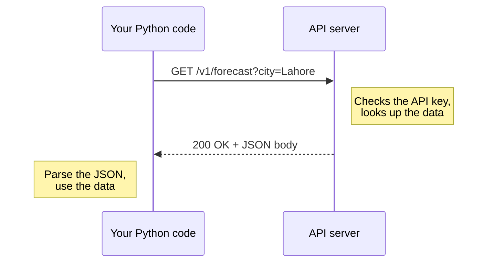

An **API** (application programming interface) is how one program asks another to do something. When your code gets a weather forecast, sends a prompt to an LLM, or stores a vector in a database, it is calling an API over the internet. For an AI engineer, calling APIs reliably is a daily skill.

## How a web API works

Web APIs use **HTTP**, the same protocol your browser uses. Your program, the **client**, sends a **request** to a **server**, which sends back a **response**.



### The parts of a request

| Part | Purpose | Example |
| --- | --- | --- |
| Method | What kind of action | `GET`, `POST` |
| URL | Which resource | `https://api.example.com/v1/users/42` |
| Query parameters | Options, added to the URL | `?city=Lahore&units=metric` |
| Headers | Metadata about the request | `Authorization: Bearer sk-...` |
| Body | Data sent to the server, usually JSON | `{"prompt": "Hello"}` |

### HTTP methods

| Method | Meaning | Has a body |
| --- | --- | --- |
| `GET` | Read data | No |
| `POST` | Create something, or run an action such as generating text | Yes |
| `PUT` / `PATCH` | Replace or update | Yes |
| `DELETE` | Remove | Rarely |

### Status codes

Every response carries a three-digit code. The first digit tells you the category.

| Code | Meaning | What to do |
| --- | --- | --- |
| `200` OK, `201` Created | Success | Use the response |
| `400` Bad Request | Your request is malformed | Fix the request |
| `401` Unauthorized | Missing or invalid API key | Check your credentials |
| `403` Forbidden | Valid key, but not allowed | Check permissions |
| `404` Not Found | The URL does not exist | Check the endpoint |
| `429` Too Many Requests | You hit the rate limit | Wait, then retry |
| `500`, `502`, `503` | The server failed | Retry after a delay |

> [!KEY]
> Codes starting with `4` mean **you** made a mistake, and repeating the same request will fail again. Codes starting with `5`, and `429`, are temporary, so retrying makes sense.

## Making requests in Python

The `requests` library is the standard choice. Install it with `pip install requests`.

```python
import requests

response = requests.get(
    "https://api.open-meteo.com/v1/forecast",
    params={"latitude": 31.55, "longitude": 74.34, "current": "temperature_2m"},
    timeout=10,
)

print(response.status_code)
data = response.json()
print(data["current"]["temperature_2m"], data["current_units"]["temperature_2m"])
```

```output
200
28.4 °C
```

`params` builds the query string for you. `response.json()` parses the JSON body into Python dictionaries and lists. Open-Meteo is a free weather API that needs no key, which makes it good for practice.

### Sending data with POST

```python
payload = {"title": "Learning APIs", "body": "POST sends data.", "userId": 1}

response = requests.post(
    "https://jsonplaceholder.typicode.com/posts",
    json=payload,
    timeout=10,
)

print(response.status_code)
print(response.json())
```

```output
201
{'title': 'Learning APIs', 'body': 'POST sends data.', 'userId': 1, 'id': 101}
```

The `json=` argument converts the dictionary to JSON and sets the `Content-Type` header for you.

## Authentication and API keys

Most APIs need to know who is calling, for billing and security. The usual method is an **API key** sent in a header.

```python
headers = {"Authorization": f"Bearer {api_key}"}
response = requests.get(url, headers=headers, timeout=10)
```

### Keep keys out of your code

An API key is a password that can spend your money. If it is pushed to a public repository, automated scanners will find and abuse it within minutes.

> [!WARNING]
> Never write an API key directly in your source code, and never commit one to Git. Store keys in environment variables.

The standard approach is a `.env` file that stays on your machine:

```text
# .env
OPENAI_API_KEY=sk-your-key-here
```

```text
# .gitignore
.env
```

```python
import os
from dotenv import load_dotenv     # pip install python-dotenv

load_dotenv()                      # reads .env into environment variables
api_key = os.environ["OPENAI_API_KEY"]
```

Using `os.environ["NAME"]` raises a `KeyError` immediately if the variable is missing, which is better than discovering it deep inside a failed request.

## Handling failures

Networks are unreliable. Production code must expect timeouts, rate limits and server errors.

```python
import requests

def get_json(url, params=None):
    try:
        response = requests.get(url, params=params, timeout=10)
        response.raise_for_status()          # raises on 4xx and 5xx codes
        return response.json()
    except requests.exceptions.Timeout:
        print("The request timed out")
    except requests.exceptions.HTTPError as error:
        print("HTTP error:", error.response.status_code)
    except requests.exceptions.RequestException as error:
        print("Network problem:", error)
    return None
```

> [!WARNING]
> Always pass `timeout`. Without it, `requests` waits forever if the server never answers, and your program hangs with no error.

### Retrying with backoff

For temporary failures, wait and try again, increasing the delay each time.

```python
import time
import requests

RETRYABLE = {429, 500, 502, 503, 504}

def get_with_retry(url, params=None, attempts=4):
    for attempt in range(attempts):
        response = requests.get(url, params=params, timeout=10)
        if response.status_code not in RETRYABLE:
            response.raise_for_status()
            return response.json()
        wait = 2 ** attempt                  # 1, 2, 4, 8 seconds
        print(f"Got {response.status_code}; retrying in {wait}s")
        time.sleep(wait)
    raise RuntimeError(f"Gave up after {attempts} attempts")
```

LLM providers enforce rate limits strictly, so this pattern, or a library that implements it, is in every serious AI application.

## Pagination

APIs rarely return thousands of records at once. They split results into **pages**, and you request each in turn.

```python
def fetch_all(url):
    items, page = [], 1
    while True:
        batch = get_json(url, params={"_page": page, "_limit": 50})
        if not batch:
            break
        items.extend(batch)
        page += 1
    return items

posts = fetch_all("https://jsonplaceholder.typicode.com/posts")
print(len(posts))
```

```output
100
```

Every API paginates slightly differently: page numbers, offsets, or a cursor token pointing to the next page. The documentation tells you which.

## Calling an LLM API

An LLM API is an ordinary HTTP API. Stripped of any helper library, a chat request is one POST:

```python
import os
import requests

response = requests.post(
    "https://api.openai.com/v1/chat/completions",
    headers={"Authorization": f"Bearer {os.environ['OPENAI_API_KEY']}"},
    json={
        "model": "gpt-4o-mini",
        "messages": [
            {"role": "system", "content": "You answer in one sentence."},
            {"role": "user", "content": "What is an API?"},
        ],
    },
    timeout=30,
)

response.raise_for_status()
data = response.json()
print(data["choices"][0]["message"]["content"])
print(data["usage"])
```

```output
An API is a set of rules that lets one piece of software request data or actions from another.
{'prompt_tokens': 24, 'completion_tokens': 21, 'total_tokens': 45}
```

Everything from this lesson is there: a POST, a bearer token from an environment variable, a JSON body, a timeout, an error check, and a nested JSON response. The `usage` field reports the tokens consumed, which is what you are billed for.

In practice you will use the provider's official Python package, which wraps these calls and adds retries and streaming. Knowing what happens underneath is what lets you debug it.

## Reading API documentation

Good documentation answers the same questions every time. Look for:

1. **Base URL and endpoints**: which URLs exist.
2. **Authentication**: how to send your key.
3. **Parameters**: which are required, their types and allowed values.
4. **Response format**: the shape of the JSON you get back.
5. **Rate limits**: how many requests you may make per minute.
6. **Errors**: what each error code means for this API.

## Exercises

**1.** Using the Open-Meteo API, write `current_temperature(lat, lon)` that returns the current temperature, or `None` if the request fails.

<details>
<summary>Show solution</summary>

```python
import requests

def current_temperature(lat, lon):
    try:
        response = requests.get(
            "https://api.open-meteo.com/v1/forecast",
            params={"latitude": lat, "longitude": lon, "current": "temperature_2m"},
            timeout=10,
        )
        response.raise_for_status()
        return response.json()["current"]["temperature_2m"]
    except requests.exceptions.RequestException:
        return None

print(current_temperature(24.86, 67.0))   # Karachi
```

</details>

**2.** Fetch `https://jsonplaceholder.typicode.com/users` and print each user's name and email, sorted by name.

<details>
<summary>Show solution</summary>

```python
import requests

response = requests.get("https://jsonplaceholder.typicode.com/users", timeout=10)
response.raise_for_status()

for user in sorted(response.json(), key=lambda u: u["name"]):
    print(f"{user['name']:<28} {user['email']}")
```

</details>

**3.** For each status code, say whether you should retry: `401`, `429`, `404`, `503`.

<details>
<summary>Show solution</summary>

- `401`: no. The credentials are wrong, and retrying will not change that.
- `429`: yes, after waiting. You are being rate-limited.
- `404`: no. The resource does not exist.
- `503`: yes, after waiting. The server is temporarily unavailable.

</details>

```quiz
[
  {
    "q": "Which HTTP method is used to send a prompt to an LLM API?",
    "options": ["`GET`", "`POST`", "`DELETE`", "`HEAD`"],
    "answer": 1,
    "why": "The prompt is data sent in the request body, and `POST` is the method that carries a body to trigger an action."
  },
  {
    "q": "An API responds with status `429`. What does it mean?",
    "options": [
      "The URL does not exist",
      "Your API key is invalid",
      "You are sending requests too quickly",
      "The request succeeded"
    ],
    "answer": 2,
    "why": "`429 Too Many Requests` signals a rate limit. Wait and retry, ideally with exponential backoff."
  },
  {
    "q": "Where should an API key be stored?",
    "options": [
      "In a variable at the top of the script",
      "In a comment, so it is not executed",
      "In an environment variable, loaded from a `.env` file that Git ignores",
      "In the README, so teammates can find it"
    ],
    "answer": 2,
    "why": "Keys in source code end up in version control and get leaked. Environment variables keep secrets out of the codebase."
  },
  {
    "q": "Why should every `requests` call include a `timeout`?",
    "options": [
      "It makes the request faster",
      "Without it, the program can hang forever if the server never responds",
      "It is required for HTTPS",
      "It enables retries automatically"
    ],
    "answer": 1,
    "why": "`requests` has no default timeout. An unresponsive server would block the program indefinitely."
  }
]
```
