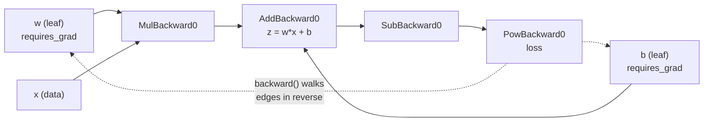

In [backpropagation](/learn/neural-network-fundamentals/backpropagation) you derived the gradient of the loss with respect to every weight by hand, applying the [chain rule](/learn/calculus/chain-rule) layer by layer and writing a NumPy line for each step. It works, and it teaches you what a gradient is, but it does not scale: every change to the architecture means re-deriving the backward pass, and a single sign error silently ruins training. **Autograd** is PyTorch's automatic differentiation engine. As you compute the forward pass, it records each operation; when you call `.backward()`, it walks that record in reverse and applies the chain rule for you. This lesson explains how that works and the handful of rules that follow from it.

## requires_grad and the computation graph

A tensor created with `requires_grad=True` tells PyTorch: "I will want the gradient of something with respect to this". Every operation that involves such a tensor produces a result that remembers how it was made, through its `grad_fn` attribute.

```python
import torch

torch.manual_seed(0)

w = torch.tensor(2.0, requires_grad=True)
b = torch.tensor(0.5, requires_grad=True)
x = torch.tensor(3.0)                 # data: no gradient needed

z = w * x + b
loss = (z - 10.0) ** 2

print(z, z.grad_fn.name())
print(loss, loss.grad_fn.name())
print(w.is_leaf, z.is_leaf)
```

```output
tensor(6.5000, grad_fn=<AddBackward0>) AddBackward0
tensor(12.2500, grad_fn=<PowBackward0>) PowBackward0
True False
```

The chain of `grad_fn` objects is the **computation graph**. PyTorch builds it on the fly, every time the forward code runs, which is why you can use ordinary Python `if` statements and loops inside a model: the graph is simply whatever actually executed. Tensors you created yourself (`w`, `b`, `x`) are **leaves**; tensors produced by operations are interior nodes.



## backward() fills in .grad

Calling `.backward()` on a scalar computes the gradient of that scalar with respect to every leaf that requires gradients, and stores the result in each leaf's `.grad` attribute.

```python
loss.backward()
print(w.grad, b.grad)
print(x.grad)
```

```output
tensor(-21.) tensor(-7.)
None
```

Check it against the hand derivation. With $z = wx + b$ and $L = (z - 10)^2$:

$$
\frac{\partial L}{\partial w} = 2(z - 10)\,x = 2(6.5 - 10)(3) = -21, \qquad
\frac{\partial L}{\partial b} = 2(z - 10) = -7
$$

Autograd produced exactly the numbers you would have written by hand. `x.grad` is `None` because you never asked for it.

Two practical constraints on `backward()`:

- It needs a **scalar** to start from. Your loss is a mean over the batch, so this is normally automatic. Calling it on a vector raises *grad can be implicitly created only for scalar outputs*.
- By default the graph is **freed** after the backward pass to save memory. Calling `backward()` twice through the same graph raises an error unless the first call passed `retain_graph=True`. In a normal training loop the forward pass rebuilds the graph each step, so this never comes up.

## Gradients accumulate

This is the rule that surprises everyone once. `backward()` does not overwrite `.grad`; it **adds** to it.

```python
w = torch.tensor(2.0, requires_grad=True)
for _ in range(3):
    loss = (w * 3.0 - 10.0) ** 2
    loss.backward()
    print(w.grad)
```

```output
tensor(-24.)
tensor(-48.)
tensor(-72.)
```

The true gradient is `-24` every time, but `.grad` reports the running total. In a training loop you must therefore clear gradients before each new backward pass. With raw tensors you call `w.grad.zero_()`; with a model you call `optimizer.zero_grad()`, which you will meet in [training loops](/learn/pytorch/training-loops).

Accumulation is a deliberate design, not an accident. It lets you simulate a larger batch than fits in memory: run `backward()` on several small batches without zeroing, so their gradients add up, then take a single optimiser step. This is **gradient accumulation**, and it appears in nearly every large-model training script.

> [!KEY]
> One training step is always the same four beats: zero the gradients, forward pass, `loss.backward()`, update the weights. Forget the first and your gradients grow without bound; the loss jumps around or diverges, and nothing raises an error.

## Gradient descent with autograd

Here is the whole idea in a few lines: one weight, one data point, three steps of gradient descent. Step through it and compare each gradient with $2(wx - y)x$.

```trace
{
  "title": "gradient descent driven by autograd",
  "code": [
    "w = torch.tensor(2.0, requires_grad=True)",
    "x, y = 3.0, 12.0",
    "for step in range(3):",
    "    loss = (w * x - y) ** 2",
    "    loss.backward()",
    "    with torch.no_grad():",
    "        w -= 0.05 * w.grad",
    "    w.grad.zero_()",
    "    print(step, round(loss.item(), 4), round(w.item(), 4))"
  ],
  "steps": [
    { "line": 2, "vars": { "w": "2.0", "x": "3.0", "y": "12.0" }, "note": "The target is w = 4, since 4 * 3 = 12. We start at w = 2." },
    { "line": 4, "vars": { "w": "2.0", "step": "0", "loss": "36.0" }, "note": "Forward pass: 2 * 3 - 12 = -6, squared is 36. Autograd records Mul, Sub and Pow as it goes." },
    { "line": 5, "vars": { "w": "2.0", "step": "0", "loss": "36.0", "w.grad": "-36.0" }, "note": "backward() applies the chain rule: 2 * (-6) * 3 = -36. Negative gradient: increasing w lowers the loss." },
    { "line": 7, "vars": { "w": "3.8", "step": "0", "loss": "36.0", "w.grad": "-36.0" }, "note": "Update inside no_grad so the update itself is not recorded: 2.0 - 0.05 * (-36) = 3.8." },
    { "line": 8, "vars": { "w": "3.8", "step": "0", "loss": "36.0", "w.grad": "0.0" }, "note": "Clear the gradient, otherwise the next backward() would add to -36." },
    { "line": 9, "vars": { "w": "3.8", "step": "0", "loss": "36.0", "w.grad": "0.0" }, "out": ["0 36.0 3.8"], "note": "One full step done." },
    { "line": 5, "vars": { "w": "3.8", "step": "1", "loss": "0.36", "w.grad": "-3.6" }, "note": "A fresh graph is built. Error is 3.8 * 3 - 12 = -0.6, so the gradient is 2 * (-0.6) * 3 = -3.6." },
    { "line": 9, "vars": { "w": "3.98", "step": "1", "loss": "0.36", "w.grad": "0.0" }, "out": ["0 36.0 3.8", "1 0.36 3.98"], "note": "w moves by 0.05 * 3.6 = 0.18. Smaller gradient, smaller step." },
    { "line": 9, "vars": { "w": "3.998", "step": "2", "loss": "0.0036", "w.grad": "0.0" }, "out": ["0 36.0 3.8", "1 0.36 3.98", "2 0.0036 3.998"], "note": "The loss falls by a factor of 100 each step and w closes in on 4." }
  ]
}
```

This is the same algorithm as your NumPy [gradient descent](/learn/calculus/gradient-descent), with the derivative line deleted.

## torch.no_grad() and detach()

Recording the graph costs memory and time. There are two situations where you do not want it:

1. **Updating weights.** The update `w -= lr * w.grad` must not become part of the graph, and PyTorch refuses an in-place change to a leaf that requires grad unless recording is off.
2. **Evaluation and inference.** When you only want predictions, there is nothing to differentiate.

`torch.no_grad()` is a context manager that switches recording off for everything inside it:

```python
w = torch.tensor(2.0, requires_grad=True)

with torch.no_grad():
    y = w * 3
print(y.requires_grad)

try:
    w -= 0.1          # in-place update outside no_grad
except RuntimeError as e:
    print("RuntimeError:", e)
```

```output
False
RuntimeError: a leaf Variable that requires grad is being used in an in-place operation.
```

`.detach()` does the same for a single tensor: it returns a tensor that shares the data but is cut off from the graph. Use it when you want to keep a value, for logging or plotting, without keeping the whole graph alive in memory.

| Tool | Scope | Typical use |
| --- | --- | --- |
| `with torch.no_grad():` | Everything in the block | Validation loops, inference, manual weight updates |
| `with torch.inference_mode():` | Everything in the block | Pure inference; slightly faster, results can never re-enter autograd |
| `t.detach()` | One tensor | Logging, storing predictions, `t.detach().cpu().numpy()` |
| `requires_grad_(False)` | One parameter, permanently | Freezing layers in [transfer learning](/learn/pytorch/transfer-learning) |

> [!WARNING]
> Accumulating `total_loss += loss` across a whole epoch keeps every batch's graph alive, and memory grows until the process dies. Accumulate `loss.item()` instead, which is a plain Python float.

## Gradients through a real layer

Autograd works the same for matrices. Here is a single linear layer with a mean squared error loss, with the autograd gradient checked against the formula you derived in Module 17, $\nabla_W L = \frac{2}{n}(\hat{y} - y)^\top X$ for $\hat{y} = XW^\top$, where $n$ is the number of elements in $\hat{y}$:

```python
X = torch.randn(8, 3)
y = torch.randn(8, 1)
W = torch.randn(1, 3, requires_grad=True)

y_hat = X @ W.T
loss = ((y_hat - y) ** 2).mean()
loss.backward()

manual = 2 / y.numel() * (y_hat - y).T @ X
print(W.grad)
print(manual.detach())
print(torch.allclose(W.grad, manual))
```

```output
tensor([[ 0.8303, -2.0192, -0.5809]])
tensor([[ 0.8303, -2.0192, -0.5809]])
True
```

From here on you will not write a backward pass again. You will still need the understanding you built by hand, because it is what lets you diagnose vanishing gradients, exploding losses and dead units when autograd is doing the arithmetic.

## In-place operations can break backward

Some operations save their inputs for the backward pass. For example, the derivative of $\sigma(x)$ is computed from the sigmoid's output. If you overwrite a saved tensor in place, PyTorch detects it through a version counter and refuses to compute a wrong gradient:

```python
a = torch.tensor([1.0, 2.0], requires_grad=True)
s = torch.sigmoid(a)
s.mul_(2)              # overwrites the saved output
try:
    s.sum().backward()
except RuntimeError as e:
    print("RuntimeError:", str(e).split(". Hint")[0])
```

```output
RuntimeError: one of the variables needed for gradient computation has been modified by an inplace operation: [torch.FloatTensor [2]], which is output 0 of Sigmoid, is at version 1; expected version 0 instead
```

The message tells you exactly what happened: the sigmoid's output was at version 0 when it was saved and at version 1 by the time backward needed it. The fix is to use the out-of-place version, `s = s * 2`. If you cannot find the offending line, `torch.autograd.set_detect_anomaly(True)` makes the error point at the forward operation involved, at the cost of much slower execution.

## Exercises

**1.** For $f(x) = x^3 + 2x$ at $x = 2$, compute $f'(2)$ by hand, then confirm it with autograd.

<details>
<summary>Show solution</summary>

$f'(x) = 3x^2 + 2$, so $f'(2) = 14$.

```python
x = torch.tensor(2.0, requires_grad=True)
f = x ** 3 + 2 * x
f.backward()
print(x.grad)
```

```output
tensor(14.)
```

</details>

**2.** Use gradient accumulation to compute the gradient of the mean loss over 4 examples by processing them in two halves. Show that it matches the gradient from one full batch.

<details>
<summary>Show solution</summary>

Each half's loss is divided by the number of halves, so the accumulated sum equals the full-batch mean.

```python
torch.manual_seed(1)
X, y = torch.randn(4, 2), torch.randn(4)
w = torch.zeros(2, requires_grad=True)

((X @ w - y) ** 2).mean().backward()
full = w.grad.clone()
w.grad.zero_()

for Xh, yh in [(X[:2], y[:2]), (X[2:], y[2:])]:
    (((Xh @ w - yh) ** 2).mean() / 2).backward()

print(torch.allclose(full, w.grad))
```

```output
True
```

</details>

**3.** Why does `with torch.no_grad():` around a validation loop matter, given that you never call `backward()` there?

<details>
<summary>Show solution</summary>

Without it, every forward pass still builds a graph and keeps intermediate activations in memory in case you call `backward()`. That wastes memory and time, and on large models can exhaust the GPU. `no_grad` tells PyTorch not to record anything.

</details>

```quiz
[
  {
    "q": "You call `loss.backward()` twice on two different batches without zeroing. What does `w.grad` contain?",
    "options": [
      "The gradient from the second batch only",
      "The sum of both batches' gradients",
      "The average of both batches' gradients",
      "`None`"
    ],
    "answer": 1,
    "why": "PyTorch accumulates gradients into `.grad`. Zero them between steps unless you want accumulation."
  },
  {
    "q": "Why must a manual weight update be wrapped in `torch.no_grad()`?",
    "options": [
      "Otherwise the update is recorded in the graph, and in-place updates on leaf tensors that require grad raise an error",
      "It makes the update run on the GPU",
      "It zeroes the gradient automatically",
      "It is only needed for float16 tensors"
    ],
    "answer": 0,
    "why": "The update is not part of the model's computation and must not be differentiated."
  },
  {
    "q": "What is `x.grad` after `loss.backward()` if `x` was created with `torch.randn(3)`?",
    "options": ["A tensor of zeros", "The gradient of loss with respect to x", "`None`", "An error is raised"],
    "answer": 2,
    "why": "`x` does not require gradients, so autograd does not compute or store one."
  },
  {
    "q": "Which line leaks memory across an epoch?",
    "options": [
      "`total += loss.item()`",
      "`total += loss`",
      "`total += loss.detach().item()`",
      "`losses.append(loss.item())`"
    ],
    "answer": 1,
    "why": "Adding the loss tensor itself keeps each batch's computation graph reachable."
  }
]
```
